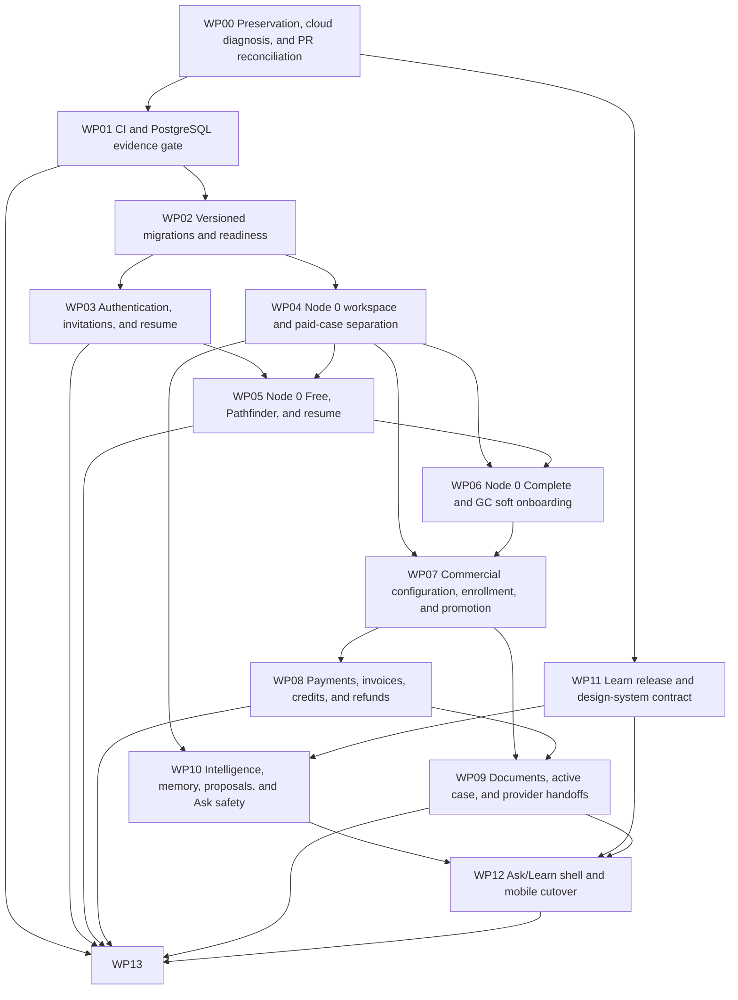

# Natalyx repair programme planning package

> Planning only. No application, infrastructure, schema, deployment or cloud mutation is authorized by these files. Alan should review/sign off the consolidated plan before proposed assignments become expected work.

## Executive summary

This clean planning worktree on `plan/mvp-product-flow-reshape` contains 14 standalone work-package plans, a 50-PR manifest, extraction ledger, Project operating model, consolidated Markdown and a PDF rendered from that Markdown. The organisation Project [MVP Product Flow Reshape](https://github.com/orgs/NatalyxPlatform/projects/3) is the operational control plane.

## Current verified verdict

The dev app endpoint returned ALB 503 at the inspection snapshot, and local AWS SSO was expired, so A0 is not passed and the exact running ECS revision still needs capture. Main lacks a Python/PostgreSQL evidence job. Updated PR #122 is stronger and worth selective reuse; PR #124 remains architecturally unsafe unchanged because Node 0 Free creates a canonical case and an unaddressed link can lead to case membership.

## Architecture principles

- Separate entry, workspace, entitlement, commitment, payment, case, claim/invitation and document state machines.
- Only `byos.workspace_promotion_authorized.v1` authorizes paid-case promotion.
- PostgreSQL production authority, versioned migrations, append-only commercial/authorship/audit history.
- IP provisional information remains attributed; GC/private/provider truth has explicit authorship, visibility, verification and revision.
- Synthetic A0-A2, PII-only B1, formal human PHI B2.

## Dependency graph



## Critical path and first work

Critical path:

`P00-01` → `P01-01` → `P02-01` → `P02-02` → `P02-03` → `P07-01` → `P08-01` → `P07-02` → `P08-02` → `P07-03` → `P07-04` → `P09-04` → `P08-03` → `P08-04` → `P13-04` → `P13-07`

Required dependency joins:

- P07-03 additionally waits for P04-02 (workspace/provenance); P07-04 additionally waits for P03-03 (paid-case invitation).
- P09-04 additionally waits for P09-03 and P11-03; P13-04 additionally waits for P06-03, P09-05, P10-04, P12-02 and A1 runner P13-03.
- P13-07 additionally waits for P13-05 RLS/non-owner runtime and P13-06 backup/audit/control evidence before B2.

First three implementation PRs:

1. `P01-01` — Establish current-test and PostgreSQL CI evidence
2. `P02-01` — Decide migration architecture and compatibility contract
3. `P13-01` — Expose known-revision health, readiness, and dependency diagnostics

CI/A0/migration design can progress after plan sign-off while Alan completes the explicit #122/#124 reconciliation checkpoint. Replacement auth, Node 0 and participant case work waits for that checkpoint.

## Programme gates

| Gate | Owner / verifier | Prerequisites | Evidence |
| --- | --- | --- | --- |
| A0 | Alan / Luke | P01-01, P02-02, P13-01, P13-02 | AWS account/region and stack/service snapshots; ALB status and target health; image SHA/task definition; readiness JSON/log correlation; CI/PostgreSQL artifacts; rollback rehearsal |
| A1 | Alan / Luke | P02-04, P03-01, P03-02, P03-04, P04-01, P04-02, P04-03, P05-01, P05-02, P05-03, P11-03, P13-03 | A1 synthetic run artifact; separate IP/GC subject IDs (synthetic only); authorization matrix results; mobile screenshots/accessibility output; audit event trace; database invariant queries |
| A2 | Alan / Luke | P03-03, P06-01, P06-02, P06-03, P07-01, P07-02, P07-03, P07-04, P08-01, P08-02, P08-03, P08-04, P09-01, P09-02, P09-03, P09-04, P09-05, P10-01, P10-02, P10-03, P10-04, P11-01, P11-02, P11-04, P12-01, P12-02, P13-04 | A2 synthetic run artifact; processor simulator event ledger; promotion idempotency query; invoice/refund explanations; S3/KMS/IAM/quarantine assertions; provider snapshot checksum; Ask/proposal safety evals |
| B1 | Luke / External/TBD | A2, P12-03, P13-07 | Signed B1 checklist; data inventory/classification; access review; incident tabletop; backup/restore result; vendor register; current A2 bundle |
| B2 | Luke / External security/privacy/compliance reviewers | B1, P13-05, P13-06, P13-07 | Signed go/no-go; risk/security/privacy assessments; BAA/vendor evidence; access/log/incident/backup controls; penetration/security testing; training/operations evidence; current technical gate bundles |

## GitHub Project operating model

Use [MVP Product Flow Reshape](https://github.com/orgs/NatalyxPlatform/projects/3) as the authoritative tracker. Draft items cannot be true GitHub sub-issues. Work-package parents are identifiable draft epics; child PR/decision/gate items link by Work package and Dependencies fields and exact IDs. Convert only when real implementation begins. Readiness is independent from Status. A Todo item may be blocked, awaiting reconciliation, plan-ready or ready to implement. Alan is a proposed implementer pending his review/sign-off; Project fields describe the recommendation, not an imposed assignment.

## Ownership and review

| Work package | DRI | Implementer | Reviewer | Approver | Note |
| --- | --- | --- | --- | --- | --- |
| WP00 | Luke | Luke (proposed) | Alan | Luke | Programme baseline; Alan sign-off precedes mandatory assignments. |
| WP01 | Alan | Alan (proposed) | Luke | Luke | Technical evidence foundation. |
| WP02 | Alan | Alan (proposed) | Luke + higher-capability | Luke | Alan proposes framework; Luke approves compatibility/risk. |
| WP03 | Alan | Alan (proposed) | Luke + security | Luke | Luke decides admission/access policy. |
| WP04 | Alan | Alan (proposed) | Luke + privacy | Luke | Joint domain/provenance design. |
| WP05 | Alan | Alan (proposed) | Luke | Luke | Luke owns Free boundary and sensitive question/score policy. |
| WP06 | Alan | Alan (proposed) | Luke + privacy | Luke | Luke owns cross-role projection and Complete contract. |
| WP07 | Luke | Alan (proposed) | Luke + finance/legal | Luke | Luke decides commercial semantics; Alan implements event/state contract. |
| WP08 | Luke | Alan (proposed) | payment/security/finance | Luke | Mandatory external review before real money. |
| WP09 | Alan | Alan (proposed) | Luke + security/privacy/provider | Luke | Luke approves retention and provider purpose. |
| WP10 | Alan | Alan (proposed) | Luke + AI safety/privacy | Luke | Luke approves truth/scope policy. |
| WP11 | Alan | Alan (proposed) | Luke + accessibility/content | Luke | Separate repo releases; aesthetic purity is not universal gate. |
| WP12 | Alan | Alan (proposed) | Luke + accessibility | Luke | Luke owns product acceptance; participant surfaces only. |
| WP13 | Joint | Alan (proposed) | Luke + external security/privacy/compliance | Luke | Alan verifies technical gates; Luke accepts; B1/B2 need independent review. |

## Document index

| Document | Purpose |
| --- | --- |
| README.md | Programme entrypoint, index, operating/maintenance/render instructions |
| existing-pr-extraction-ledger.md | PR/worktree preservation, extraction and closure/delete conditions |
| project-structure.md | GitHub Project fields, items and conventions |
| pr-manifest.md | Canonical proposed PR inventory and execution order |
| consolidated-plan.md | Full programme source for the PDF |
| consolidated-plan.pdf | Rendered review copy generated only from consolidated-plan.md |
| 00-preservation-cloud-diagnosis-and-pr-reconciliation.md | Standalone execution plan for WP00 — Preservation, cloud diagnosis, and PR reconciliation |
| 01-ci-and-postgres-evidence-gate.md | Standalone execution plan for WP01 — CI and PostgreSQL evidence gate |
| 02-versioned-migrations-and-readiness.md | Standalone execution plan for WP02 — Versioned migrations and readiness |
| 03-auth-invitations-and-resume.md | Standalone execution plan for WP03 — Authentication, invitations, and resume |
| 04-node0-workspace-case-separation.md | Standalone execution plan for WP04 — Node 0 workspace and paid-case separation |
| 05-node0-free-pathfinder-and-resume.md | Standalone execution plan for WP05 — Node 0 Free, Pathfinder, and resume |
| 06-node0-complete-and-soft-onboarding.md | Standalone execution plan for WP06 — Node 0 Complete and GC soft onboarding |
| 07-commercial-configuration-enrollment-and-promotion.md | Standalone execution plan for WP07 — Commercial configuration, enrollment, and promotion |
| 08-payments-invoices-credits-and-refunds.md | Standalone execution plan for WP08 — Payments, invoices, credits, and refunds |
| 09-documents-active-case-and-provider-handoffs.md | Standalone execution plan for WP09 — Documents, active case, and provider handoffs |
| 10-intelligence-memory-proposals-and-ask-safety.md | Standalone execution plan for WP10 — Intelligence, memory, proposals, and Ask safety |
| 11-learn-release-and-design-system-contract.md | Standalone execution plan for WP11 — Learn release and design-system contract |
| 12-ask-learn-shell-and-mobile-cutover.md | Standalone execution plan for WP12 — Ask/Learn shell and mobile cutover |
| 13-deployment-cloud-gates-and-phi-readiness.md | Standalone execution plan for WP13 — Deployment, cloud gates, and PHI readiness |
| programme_data.py | Canonical structured source used to keep IDs/contracts consistent |
| scripts/render_programme.py | Mechanical Markdown renderer |
| scripts/render_pdf.py | Markdown-to-PDF renderer |
| scripts/validate_programme.py | Cross-file/dependency/gate validator |
| scripts/sync_project.py | Idempotent GitHub Project inspector/synchronizer |

## Reproducible generation, validation and PDF render

Regenerate Markdown:

```bash
/Users/lukerhodes/.cache/codex-runtimes/codex-primary-runtime/dependencies/python/bin/python3 scripts/render_programme.py
```

Validate identifiers/dependencies/gates/cross-file coverage:

```bash
/Users/lukerhodes/.cache/codex-runtimes/codex-primary-runtime/dependencies/python/bin/python3 scripts/validate_programme.py
```

Render the PDF **from consolidated-plan.md**:

```bash
/Users/lukerhodes/.cache/codex-runtimes/codex-primary-runtime/dependencies/python/bin/python3 scripts/render_pdf.py consolidated-plan.md consolidated-plan.pdf
```

Inspect PDF metadata/text/pages:

```bash
pdfinfo consolidated-plan.pdf
pdftotext consolidated-plan.pdf /tmp/consolidated-plan.txt
pdftoppm -f 1 -singlefile -png -r 110 consolidated-plan.pdf /tmp/natalyx-plan-first
```

Synchronize the GitHub Project (dry-run, then apply):

```bash
/Users/lukerhodes/.cache/codex-runtimes/codex-primary-runtime/dependencies/python/bin/python3 scripts/sync_project.py
/Users/lukerhodes/.cache/codex-runtimes/codex-primary-runtime/dependencies/python/bin/python3 scripts/sync_project.py --apply
```

## Maintenance instructions

1. Edit programme_data.py, not a single rendered plan, when an ID/title/dependency/owner/gate/decision/disposition changes.
2. Record new Alan findings in the extraction/checkpoint data with exact head and evidence anchor.
3. Regenerate Markdown and run validate_programme.py; resolve every circular/missing/mismatch result.
4. Re-render the PDF, inspect representative first/table/diagram/code/last pages and verify text/headings/page count.
5. Run git diff --check, then run the idempotent Project sync and verify expected counts/fields.
6. Never make a proposed item Ready to implement until plan approval, decisions, dependencies and checkpoint requirements are satisfied.
