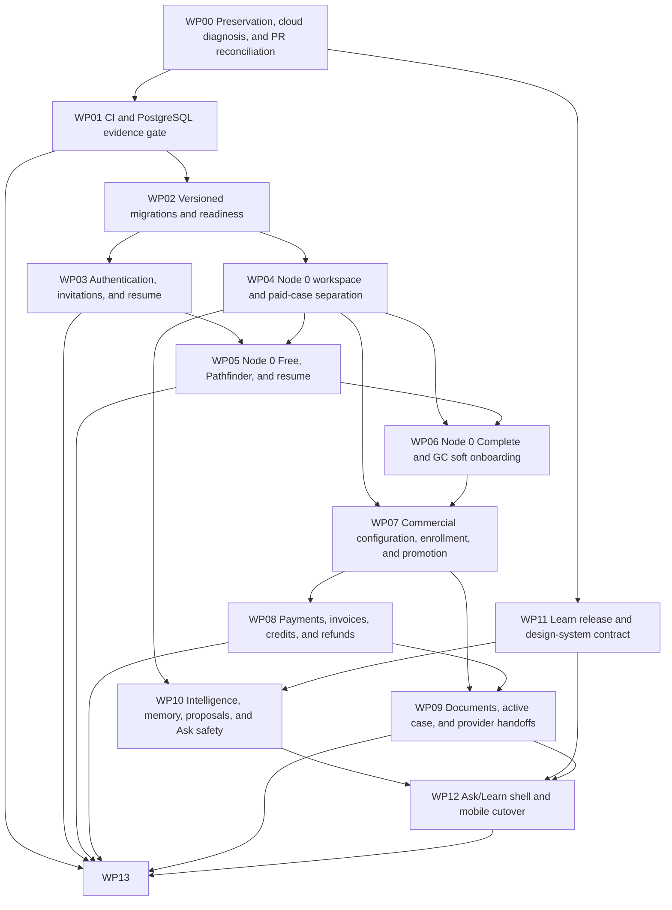

# Natalyx repair programme planning package

> Planning only. No application, infrastructure, schema, deployment or cloud mutation is authorized by these files. The corrected work-package split remains proposed pending Alan's review; local preparation never authorizes commit, PR creation or merge.

## Executive summary

This clean planning worktree on `plan/mvp-product-flow-reshape` contains 14 standalone work-package plans, a 52-PR manifest, frozen recommendation matrix, extraction ledger, desired Project catalogue, consolidated Markdown and a PDF rendered from that Markdown. Drive is the canonical review surface; the benched Project is not live authority until separately reactivated and synced.

## Current verified verdict

The dev app endpoint returned ALB 503 at the original inspection snapshot, so A0 remains unaccepted. Corrected #122 is the named behavior/test baseline; #124 is extraction evidence only; Wave 2@5b63e3a passed 535 local tests but contains independently reproduced restart-loss and stale-review defects and remains adapt/test evidence only. Required-check enforcement is bounded by D-CI-01.

## Architecture principles

- Separate entry, workspace, entitlement, commitment, payment, case, claim/invitation and document state machines.
- Separate identity, participation and access; lens/view never authorizes.
- Only `byos.workspace_promotion_authorized.v1` authorizes paid-case promotion.
- PostgreSQL production authority, versioned migrations, append-only commercial/authorship/audit history.
- IP provisional information remains attributed; GC/private/provider truth has explicit authorship, visibility, verification and revision.
- Metadata coordination is not a document-content state; forced RLS/non-owner runtime precedes PII-only B1; formal human PHI approval remains B2.

## Dependency graph



## Critical path and first work

Critical path:

`P00-01` → `P01-01` → `P02-01` → `P02-02` → `P02-03` → `P03-05` → `P04-01` → `P04-02` → `P07-01` → `P08-01` → `P07-02` → `P08-02` → `P07-03` → `P03-03` → `P07-04` → `P09-01` → `P09-04` → `P09-02` → `P09-03` → `P09-06` → `P09-05` → `P13-04` → `P13-05` → `P13-06` → `P13-07`

Required dependency joins:

- P03-02 and P04-01 wait for P03-05 identity/participation/access; P07-03 additionally waits for P04-02; P07-04 additionally waits for P03-03.
- P09-04 metadata/readiness is independent of content storage; P09-06 joins P09-03 content to P09-04 surfaces; P09-05 then builds provider snapshots from actual clean versions.
- P13-04 waits for the complete synthetic A2 surface; P13-05/06/07 then supply RLS, operational controls and human evidence required before B1, while B2 remains a later PHI approval.

First three implementation PRs:

1. `P01-01` — Establish current-test and PostgreSQL CI evidence
2. `P02-01` — Decide migration architecture and compatibility contract
3. `P13-01` — Expose known-revision health, readiness, and dependency diagnostics

The #122/#124/Wave 2 reconciliation checkpoint is complete. Local preparation and merge readiness are now separate; reciprocal review, D-CI-01, ordinary dependencies/decisions and gate contracts continue to govern commit, PR creation and merge.

## Founder decision resolution

All 24 decision IDs are classified. Founder-final outcomes are distinct from Alan's technical controls and from external activation evidence; no final policy is represented as an active control until its evidence passes.

| ID | Status | Classification | Remaining owner | Affected / latest | Programme effect |
| --- | --- | --- | --- | --- | --- |
| D-MIG-01 | Founder constraints final; Alan immediate; operationally pending | Luke sets constraints; Alan decides immediately | Alan - immediate | P02-01, P02-02, P02-03; Before P02-02 | P02-01 decision work may proceed; P02-02, P02-03 and Gate A0 remain blocked until Alan's mechanism and evidence are accepted. |
| D-AUTH-01 | Resolved by reconciliation | Reconciliation settled | Alan - implementation | P03-02, P03-03; Resolved 2026-07-12 | No longer blocks P03-02 or P03-03. |
| D-AUTH-02 | Founder constraints final; Alan later | Alan decides later within founder constraints | Alan - later at P03-04 | P03-04; Before P03-04 | P03-04 and Gate A1 remain blocked until the technical mechanism and evidence exist. |
| D-AUTH-03 | Resolved by reconciliation | Reconciliation settled | Alan - implementation | P03-02, P03-03, P03-05, P04-01, P04-02, P09-04, P13-05; Resolved 2026-07-12 | No longer blocks the reconciled access/workspace PR sequence. |
| D-CI-01 | Founder final; operationally pending | Luke decides commercial outcome; Alan configures immediately | Alan - immediate | P01-01; Founder decision resolved 2026-07-13; control required before P01-01 merge or any later app implementation PR | P01-01 merge, Gate A0 and dependent implementation PRs remain blocked until the live control is active and verified. |
| D-DATA-01 | Founder decision final; implementation evidence pending | Luke decides product/privacy outcome | Alan - implementation | P04-02, P06-02, P06-03, P07-03, P07-04, P09-05, P10-01, P10-02; Before P04-02 | Founder ambiguity is removed across WP04, WP06, WP07, WP09 and WP10; A1 still requires the technical denial evidence. |
| D-DATA-02 | Founder default final; external validation before B1 | Luke decides default; external specialist validates | Alan - implementation; privacy/legal - validation | P04-02, P04-03, P06-02; Before P04-02 | Synthetic implementation may proceed; real-user B1 activation remains externally dependent. |
| D-DATA-03 | Resolved by reconciliation | Reconciliation settled | Alan - implementation | P05-02, P06-03; Resolved 2026-07-12 | No longer blocks Node 0 implementation planning. |
| D-COM-01 | Founder decision final for beta; tax externally dependent | Luke decides commercial outcome | Alan - implementation | P06-01, P07-01, P08-01; Before activation of a Complete configuration | P06-01, P07-01 and P08-01 may proceed synthetically; live activation remains gated. |
| D-COM-02 | Founder decision final for v1; live activation gated | Luke decides commercial outcome | Alan - implementation | P07-01, P08-01, P08-03; Before P07-01 activation data | Synthetic commercial configuration and ledgers may proceed; real charging remains gated. |
| D-COM-03 | Externally dependent; founder policy inputs settled | External specialist / later evidence required | External legal/privacy/finance; Luke final business approval | P07-01, P07-02, P08-03; Before P07-02 user acceptance | Synthetic A2 preparation may proceed; live P07-02/P08 charging and B1 customer acceptance remain blocked. |
| D-COM-04 | Founder decision final; implementation evidence pending | Luke decides commercial/product outcome | Alan - implementation | P07-02, P07-03, P07-04, P08-03, P09-04; Before P07-02 | P07-02 through P09-04 may proceed under the settled semantics. |
| D-PAY-01 | Founder constraints final; Alan later | Luke sets constraints; Alan decides later | Alan - later before P08-02 | P08-02, P08-03, P08-04; Before P08-02 adapter | P08-01 ledger work may proceed; P08-02 and A2 payment completion wait for Alan's processor decision and evidence. |
| D-COM-05 | Founder decision final for beta | Luke decides beta scope | None during beta | P07-02, P08-02; Before financed option is exposed | Financing no longer blocks P08-02; the feature is deliberately out of scope. |
| D-COM-06 | Founder policy final; legal/accounting externally dependent | Luke decides policy; specialists translate | Alan - implementation; legal/accounting - wording | P08-03; Before automated pregnancy-stage refund logic | Synthetic P08-03 implementation may proceed; live policy activation remains gated. |
| D-COM-07 | Founder policy final; legal/accounting externally dependent | Luke decides policy; specialists translate | Alan - implementation; legal/accounting - wording | P08-03; Before real billing | Synthetic P08-03 implementation may proceed; live refund/cancellation terms remain gated. |
| D-COM-08 | Founder decision final; implementation evidence pending | Luke decides customer treatment | Alan - implementation | P08-04; Before P08-04 | P08-04 may proceed under the settled policy. |
| D-DOC-01 | Founder default final; Alan later; external validation before B1/B2 | Luke sets policy; Alan decides implementation later | Alan - later before P09-03; privacy/legal - validation | P09-01, P09-03, P09-06; Before P09-03 | P09-01 ADR work may proceed; P09-03/P09-06 and real-content activation wait for Alan's delivery choice and evidence. |
| D-DOC-02 | Founder constraints final; Alan later | Luke sets constraints; Alan decides later | Alan - later before P09-02 | P09-01, P09-02, P09-03, P09-06; Before P09-02 | P09-01 contract work may proceed; P09-02/P09-03/P09-06 wait for Alan's technical selection and evidence. |
| D-PROV-01 | Founder decision final; Alan later | Luke decides product/privacy outcome; Alan implements later | Alan - later before P09-05 | P09-05; Before P09-05 | Synthetic provider-snapshot design may proceed; P09-05 completion and real handoff require Alan's evidence and later external review. |
| D-AI-01 | Founder scope/cost final; Alan later; PHI externally gated | Luke sets scope and cost; Alan decides implementation later | Alan - later before P10-01 | P10-01, P10-02, P10-03, P12-01; Before P10-01 | P10/P12 synthetic planning may proceed; implementation completion waits for Alan's technical decision and PHI remains blocked through B2. |
| D-OPS-01 | Founder constraints final; Alan immediate; operationally pending | Luke sets constraints; Alan decides immediately | Alan - immediate | P13-02; Before Gate A0 recovery action | P13-02 and Gate A0 remain blocked until the runbook and synthetic exercise pass; A1 must exercise the control. |
| D-PHI-01 | Founder beta scope final; externally gated | Luke decides beta scope; external evidence required | Alan - B1/B2 evidence; external reviewers - approval | P09-01, P09-02, P09-05, P09-06, P13-05, P13-06, P13-07; Before B1 for PII scope; before B2 for PHI | B1 remains blocked until the limited PII control bundle is accepted; real documents/provider packets and all PHI remain blocked until B2. |
| D-PHI-02 | Founder governance final; external reviewers pending | Luke decides governance; external evidence required | Alan - evidence; external reviewers - attestations; Luke - go/no-go | P13-06, P13-07; Before B1 | B1 and B2 remain blocked until the corresponding evidence is current and the required humans sign off. |

### Immediate Alan decisions

These block current foundation work or Gate A0; founder constraints are final but the controls are not active until the evidence passes.

| ID | Alan owns | Affected / latest | Evidence | Founder approval rule |
| --- | --- | --- | --- | --- |
| D-CI-01 | Activate GitHub Team when enforcement is required; Configure required unittest and PostgreSQL checks; Restrict routine bypass; Supply ruleset readback and negative-bypass evidence | P01-01; Founder decision resolved 2026-07-13; control required before P01-01 merge or any later app implementation PR | GitHub Team activation/readback; Mandatory unittest and PostgreSQL checks; Restricted routine bypass; Negative-bypass evidence | Luke accepts the enforcement evidence; the approved purchase itself needs no further founder decision. |
| D-MIG-01 | Choose the migration framework; Choose sequencing/locking and expand-contract mechanics; Choose the detailed rollback, restore or forward-repair mechanism | P02-01, P02-02, P02-03; Before P02-02 | Migration ADR; Fresh/current/upgrade compatibility matrix; Tested recovery or rollback evidence; Destructive-change approval path | Luke approves only destructive or irreversible actions that could affect real-user data; ordinary technical choices stay with Alan. |
| D-OPS-01 | Choose exact compatibility, rollback/forward-repair and automation mechanisms; Name the evidence owner and write the runbook | P13-02; Before Gate A0 recovery action | Documented recovery procedure; Successful synthetic recovery exercise; Known-compatible image/schema evidence | Luke accepts A0 evidence and explicitly approves risky real-user/destructive recovery. |

### Later Alan decisions

These are resolved only at the named WP/checkpoint; Alan should not be forced to choose their mechanisms prematurely.

| ID | Alan owns | Affected / latest | Evidence | Founder approval rule |
| --- | --- | --- | --- | --- |
| D-AUTH-02 | Choose the proof format, signer/verifier, key lifecycle and claim lifecycle | P03-04; Before P03-04 | Expiry, replay, wrong-email, wrong-purpose, mismatch and revocation tests; Separate internal allowlist evidence | Luke approval is not required unless Alan proposes broader access or materially weaker identity assurance. |
| D-PAY-01 | Choose the processor/vendor, tokenization, webhook, settlement, return/refund and reconciliation mechanisms | P08-02, P08-03, P08-04; Before P08-02 adapter | Provider security and cost comparison; Synthetic settlement, return, refund, duplicate and reconciliation tests | Luke approval is required only if the proposed processor exceeds the cost/privacy constraints or changes the payment experience. |
| D-DOC-01 | Choose proxy versus presigned delivery by class; Implement hold, deletion, tombstone, retry and authorization behavior | P09-01, P09-03, P09-06; Before P09-03 | Fresh-authorization and five-minute-link tests; Retention/hold/deletion exercise; Privacy/legal approval before real content | Luke accepts live policy after privacy/legal review. |
| D-DOC-02 | Choose the AWS-native scanner, queue, retry, timeout, recovery and cost-control mechanisms | P09-01, P09-02, P09-03, P09-06; Before P09-02 | Type/sniffing/spoof tests; Quarantine, error, timeout and retry tests; Cost estimate and alerts | Luke approval is required if the solution exceeds the cost or safety constraints. |
| D-PROV-01 | Choose recipient verification, snapshot checksum, expiry, revocation and audit mechanisms | P09-05; Before P09-05 | Wrong-recipient, expiry, revoke-before-access, reissue and checksum tests | Luke approves broader recipient or ambient-access scope. |
| D-AI-01 | Choose Bedrock model, prompts, retrieval, schemas, fallback, human-review rails and cost controls | P10-01, P10-02, P10-03, P12-01; Before P10-01 | Scope/authority negative tests; Fallback and malformed-response tests; Safety and cost evidence | Luke approves broader AI authority, higher cost or any PHI use; B2 external approval is mandatory for PHI. |
| D-PHI-01 | Implement inventory, cohort controls, RLS, cross-tenant denials, de-identification and prohibited-data tests | P09-01, P09-02, P09-05, P09-06, P13-05, P13-06, P13-07; Before B1 for PII scope; before B2 for PHI | Five-pair cohort configuration; RLS/cross-tenant/de-identification/prohibited-data tests; External privacy/legal approval | Luke accepts B1 only after required evidence and external privacy/legal advice; B2 requires qualified external approval. |
| D-PHI-02 | Maintain evidence recency, change-triggered reruns and exception records | P13-06, P13-07; Before B1 | B1/B2 evidence index with dates; Named reviewers; Exception register; Signed go/no-go | Luke is final product go/no-go within the specified external-review model. |

### External dependencies

| ID | Dependency | Activation boundary |
| --- | --- | --- |
| D-DATA-02 | Privacy/legal validation before B1 | Synthetic implementation may proceed; real-user B1 activation remains externally dependent. |
| D-COM-01 | Tax treatment and customer-facing wording before live activation | P06-01, P07-01 and P08-01 may proceed synthetically; live activation remains gated. |
| D-COM-02 | Approved terms and tax treatment before live activation | Synthetic commercial configuration and ledgers may proceed; real charging remains gated. |
| D-COM-03 | Legal, privacy, tax and finance review before real-user acceptance or charging | Synthetic A2 preparation may proceed; live P07-02/P08 charging and B1 customer acceptance remain blocked. |
| D-PAY-01 | Payment/security/finance review before real money | P08-01 ledger work may proceed; P08-02 and A2 payment completion wait for Alan's processor decision and evidence. |
| D-COM-06 | Legal and accounting review before live use | Synthetic P08-03 implementation may proceed; live policy activation remains gated. |
| D-COM-07 | Legal and accounting review before live use | Synthetic P08-03 implementation may proceed; live refund/cancellation terms remain gated. |
| D-DOC-01 | Privacy/legal validation before B1/B2 real-content use | P09-01 ADR work may proceed; P09-03/P09-06 and real-content activation wait for Alan's delivery choice and evidence. |
| D-PROV-01 | Privacy/provider review before real handoff | Synthetic provider-snapshot design may proceed; P09-05 completion and real handoff require Alan's evidence and later external review. |
| D-AI-01 | B2 external security/privacy/compliance approval before PHI | P10/P12 synthetic planning may proceed; implementation completion waits for Alan's technical decision and PHI remains blocked through B2. |
| D-PHI-01 | External privacy/legal approval before B1; Qualified external security/privacy/compliance/legal approval before B2 | B1 remains blocked until the limited PII control bundle is accepted; real documents/provider packets and all PHI remain blocked until B2. |
| D-PHI-02 | Named privacy/legal advisers for B1; Named qualified security/privacy/compliance/legal reviewers for B2 | B1 and B2 remain blocked until the corresponding evidence is current and the required humans sign off. |

### Active decision blockers

Only the following decision IDs may still appear in PR blocking fields: D-AI-01, D-AUTH-02, D-CI-01, D-DOC-01, D-DOC-02, D-MIG-01, D-OPS-01, D-PAY-01, D-PROV-01. Founder-final policy rows without a remaining technical mechanism are not PR blockers.

## Programme gates

| Gate | Owner / verifier | Prerequisites | Evidence |
| --- | --- | --- | --- |
| A0 | Alan / Luke | P01-01, P02-02, P13-01, P13-02 | GitHub Team/ruleset readback and negative-bypass result; Migration ADR and consequential-migration recovery evidence; AWS account/region and stack/service snapshots; ALB status and target health; image SHA/task definition; readiness JSON/log correlation; CI/PostgreSQL artifacts; fail-closed synthetic recovery exercise |
| A1 | Alan / Luke | P02-04, P03-01, P03-02, P03-04, P03-05, P04-01, P04-02, P04-03, P05-01, P05-02, P05-03, P11-03, P13-03 | A1 synthetic run artifact; separate IP/GC subject IDs (synthetic only); authorization matrix results; mobile screenshots/accessibility output; audit event trace; database invariant queries |
| A2 | Alan / Luke | P03-03, P06-01, P06-02, P06-03, P07-01, P07-02, P07-03, P07-04, P08-01, P08-02, P08-03, P08-04, P09-01, P09-02, P09-03, P09-04, P09-05, P09-06, P10-01, P10-02, P10-03, P10-04, P11-01, P11-02, P11-04, P12-01, P12-02, P13-04 | A2 synthetic run artifact; processor simulator event ledger; promotion idempotency query; invoice/refund explanations; S3/KMS/IAM/quarantine assertions; provider snapshot checksum; Ask/proposal safety evals |
| B1 | Luke / External/TBD | A2, P12-03, P13-05, P13-06, P13-07 | Signed B1 checklist and five-pair cohort roster; data inventory/classification and prohibited-data tests; runtime/migrator grants and RLS policy matrix; cross-org/pool-reset results; de-identification evidence; access review; incident tabletop; backup/restore result; vendor register; external privacy/legal advice; current A2 bundle no older than 60 days |
| B2 | Luke / External security/privacy/compliance reviewers | B1 | Signed go/no-go; risk/security/privacy assessments; BAA/vendor evidence; access/log/incident/backup controls; penetration/security testing; training/operations evidence; current technical gate bundles |

## GitHub Project operating model

The desired catalogue for [MVP Product Flow Reshape](https://github.com/orgs/NatalyxPlatform/projects/3) is maintained locally, but the Project remains benched and its last verified live state is 106 items. Draft items cannot be true GitHub sub-issues. Work-package parents are identifiable draft epics; child PR/decision/gate items link by Work package and Dependencies fields and exact IDs. Convert only when real implementation begins. Local preparation status is distinct from merge readiness. A PR may permit isolated uncommitted preparation while remaining blocked from commit, PR creation or merge. PR ownership inherits the proposed work-package split pending Alan's review; named technical-decision ownership does not transfer implementation ownership across work packages.

## Ownership and review

| Work package | DRI | Primary implementer | Reciprocal reviewer | Founder approver | Note |
| --- | --- | --- | --- | --- | --- |
| WP00 | Luke | Luke (proposed) | Alan | Luke | Ready for Alan review and joint acceptance; no new implementation is authorized by this review package. |
| WP01 | Alan | Alan (proposed) | Luke | Luke | Technical evidence foundation. |
| WP02 | Alan | Alan (proposed) | Luke | Luke | Alan chooses the migration framework/mechanism; Luke approves compatibility and risk. |
| WP03 | Alan | Alan (proposed) | Luke | Luke | Alan implements identity/admission controls; Luke reviews founder access constraints. |
| WP04 | Alan | Alan (proposed) | Luke | Luke | Alan implements the domain/provenance contracts; Luke reviews product/privacy boundaries. |
| WP05 | Luke | Luke (proposed) | Alan | Luke | Luke owns Free implementation; Alan reviews technical architecture, security and failure behavior. |
| WP06 | Alan | Alan (proposed) | Luke | Luke | Alan implements Complete/GC onboarding; Luke reviews cross-role projection and product boundaries. |
| WP07 | Luke | Luke (proposed) | Alan | Luke | Luke implements settled commercial semantics; Alan reviews technical mechanisms and idempotency. |
| WP08 | Luke | Luke (proposed) | Alan | Luke | Luke implements payment-domain contracts after D-PAY-01; external review remains mandatory before real money. |
| WP09 | Alan | Alan (proposed) | Luke | Luke | Alan implements document/provider controls; Luke reviews retention, purpose and PHI boundaries. |
| WP10 | Alan | Alan (proposed) | Luke | Luke | Alan implements intelligence contracts after D-AI-01; Luke reviews truth and privacy policy. |
| WP11 | Luke | Luke (proposed) | Alan | Luke | Luke implements the separate Learn, intelligence-catalog, participant-DS and app-adoption PRs; Alan reviews technical contracts. |
| WP12 | Luke | Luke (proposed) | Alan | Luke | Luke implements participant shell/cutover; Alan reviews integration, authorization and failure behavior. |
| WP13 | Alan | Alan (proposed) | Luke | Luke | Alan owns technical gate evidence; Luke accepts gates and external reviewers retain their required attestations. |

## Document index

| Document | Purpose |
| --- | --- |
| README.md | Programme entrypoint, index, operating/maintenance/render instructions |
| existing-pr-extraction-ledger.md | PR/worktree preservation, extraction and closure/delete conditions |
| project-structure.md | GitHub Project fields, items and conventions |
| pr-manifest.md | Canonical proposed PR inventory and execution order |
| consolidated-plan.md | Full programme source for the PDF |
| consolidated-plan.pdf | Rendered review copy generated only from consolidated-plan.md |
| 00-preservation-cloud-diagnosis-and-pr-reconciliation.md | Standalone execution plan for WP00 — Preservation, cloud diagnosis, and PR reconciliation |
| 01-ci-and-postgres-evidence-gate.md | Standalone execution plan for WP01 — CI and PostgreSQL evidence gate |
| 02-versioned-migrations-and-readiness.md | Standalone execution plan for WP02 — Versioned migrations and readiness |
| 03-auth-invitations-and-resume.md | Standalone execution plan for WP03 — Authentication, invitations, and resume |
| 04-node0-workspace-case-separation.md | Standalone execution plan for WP04 — Node 0 workspace and paid-case separation |
| 05-node0-free-pathfinder-and-resume.md | Standalone execution plan for WP05 — Node 0 Free, Pathfinder, and resume |
| 06-node0-complete-and-soft-onboarding.md | Standalone execution plan for WP06 — Node 0 Complete and GC soft onboarding |
| 07-commercial-configuration-enrollment-and-promotion.md | Standalone execution plan for WP07 — Commercial configuration, enrollment, and promotion |
| 08-payments-invoices-credits-and-refunds.md | Standalone execution plan for WP08 — Payments, invoices, credits, and refunds |
| 09-documents-active-case-and-provider-handoffs.md | Standalone execution plan for WP09 — Documents, active case, and provider handoffs |
| 10-intelligence-memory-proposals-and-ask-safety.md | Standalone execution plan for WP10 — Intelligence, memory, proposals, and Ask safety |
| 11-learn-release-and-design-system-contract.md | Standalone execution plan for WP11 — Learn release and design-system contract |
| 12-ask-learn-shell-and-mobile-cutover.md | Standalone execution plan for WP12 — Ask/Learn shell and mobile cutover |
| 13-deployment-cloud-gates-and-phi-readiness.md | Standalone execution plan for WP13 — Deployment, cloud gates, and PHI readiness |
| programme_data.py | Canonical structured source used to keep IDs/contracts consistent |
| scripts/render_programme.py | Mechanical Markdown renderer |
| scripts/render_pdf.py | Markdown-to-PDF renderer |
| scripts/validate_programme.py | Cross-file/dependency/gate validator |
| scripts/sync_project.py | Idempotent GitHub Project inspector/synchronizer |

## Reproducible generation, validation and PDF render

Regenerate Markdown:

```bash
/Users/lukerhodes/.cache/codex-runtimes/codex-primary-runtime/dependencies/python/bin/python3 scripts/render_programme.py
```

Validate identifiers/dependencies/gates/cross-file coverage:

```bash
/Users/lukerhodes/.cache/codex-runtimes/codex-primary-runtime/dependencies/python/bin/python3 scripts/validate_programme.py
```

Render the PDF **from consolidated-plan.md**:

```bash
/Users/lukerhodes/.cache/codex-runtimes/codex-primary-runtime/dependencies/python/bin/python3 scripts/render_pdf.py consolidated-plan.md consolidated-plan.pdf
```

Inspect PDF metadata/text/pages:

```bash
pdfinfo consolidated-plan.pdf
pdftotext consolidated-plan.pdf /tmp/consolidated-plan.txt
pdftoppm -f 1 -singlefile -png -r 110 consolidated-plan.pdf /tmp/natalyx-plan-first
```

Validate the desired GitHub Project catalogue locally; apply only after separate reactivation/authorization:

```bash
/Users/lukerhodes/.cache/codex-runtimes/codex-primary-runtime/dependencies/python/bin/python3 scripts/sync_project.py
/Users/lukerhodes/.cache/codex-runtimes/codex-primary-runtime/dependencies/python/bin/python3 scripts/sync_project.py --apply
```

## Maintenance instructions

1. Edit programme_data.py, not a single rendered plan, when an ID/title/dependency/owner/gate/decision/disposition changes.
2. Record new review or branch evidence in the extraction/matrix data with exact head and evidence anchor.
3. Regenerate Markdown and run validate_programme.py; resolve every circular/missing/mismatch result.
4. Re-render the PDF, inspect representative first/table/diagram/code/last pages and verify text/headings/page count.
5. Run git diff --check and validate the desired Project catalogue. Remote sync is separately authorized and blocked while the Project remains benched.
6. Never make a proposed item Ready to implement until plan approval, decisions, dependencies and gate requirements are satisfied.
