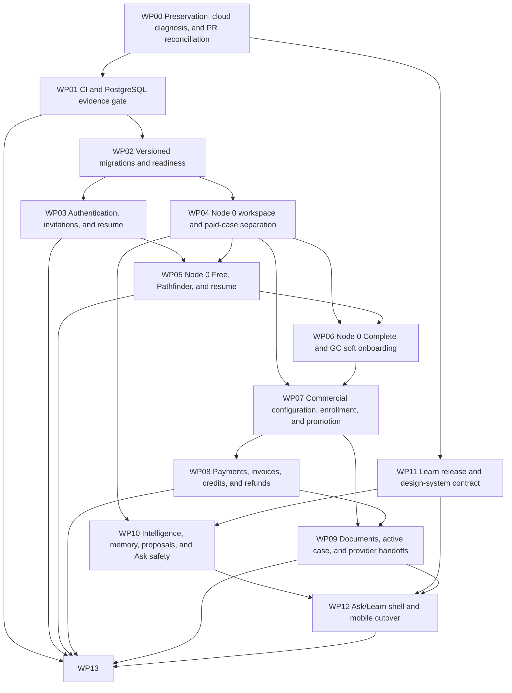

# Natalyx MVP Product Flow Reshape — consolidated programme plan

> Planning-only. Do not implement, deploy, migrate, change cloud resources, alter existing PRs or clean protected worktrees from this document. Alan should review/sign off this consolidated plan before proposed assignments become expected work.

Inspection snapshot: **2026-07-10 20:12 America/New_York**. Planning branch: `plan/mvp-product-flow-reshape`. GitHub Project: [MVP Product Flow Reshape](https://github.com/orgs/NatalyxPlatform/projects/3). Proposed PRs: **50**.

## Table of contents

- [Executive summary](#executive-summary)
- [Current verified verdict](#current-verified-verdict)
- [Architecture principles](#architecture-principles)
- [Dependency graph](#dependency-graph)
- [Global PR table and execution order](#global-pr-table-and-execution-order)
- [Parallel lanes and critical path](#parallel-lanes-and-critical-path)
- [State transition contract](#state-transition-contract)
- [Programme gates](#programme-gates)
- [GitHub Project operating model](#github-project-operating-model)
- [Ownership, delegation and review](#ownership-delegation-and-review)
- [Existing-PR extraction and Alan checkpoint](#existing-pr-extraction-and-alan-checkpoint)
- [Data authorship and provenance](#data-authorship-and-provenance)
- [Migration architecture](#migration-architecture)
- [Promotion, commercial and payment contract](#promotion-commercial-and-payment-contract)
- [Invitation safety](#invitation-safety)
- [Documents and S3](#documents-and-s3)
- [Design-system release rubric](#design-system-release-rubric)
- [Decision register](#decision-register)
- [Risk register](#risk-register)
- [Release strategy and real-user/PHI boundaries](#release-strategy-and-real-userphi-boundaries)
- [Document index and maintenance](#document-index-and-maintenance)
- [Detailed work packages](#detailed-work-packages)

## Executive summary

The programme is a controlled rebuild around **free Node 0 workspace → explicit entitlement/commitment/payment → typed promotion authorization → enrollment-pending paid case**, not a patch stack on the current case-shaped Node 0 branch. The live dev endpoint is currently 503, so A0 recovery and current CI/PostgreSQL evidence come first. PR #122's update materially improves invitation and case-surface safety and should be salvaged; PR #124 remains valuable but structurally unsafe unchanged. Alan's unfinished review is an explicit blocking checkpoint, not an assumed approval.

The canonical package proposes 50 focused PRs across app, infra, intelligence, Learn, participant design system and organisation planning. It keeps free education/safety capability, payment and truth state separate; uses one processor-neutral promotion authorization; preserves authorship/provenance; and gates real PII/PHI behind independent evidence rather than deploy success.

## Current verified verdict

| Area | Verdict | Evidence / consequence |
| --- | --- | --- |
| Live cloud | Not usable now | dev.app.natalyx.health returned ALB 503 at the inspection snapshot; A0 is open. |
| AWS detail | Partially unverified | Local natalyx-dev SSO expired; service counts/task revision must be captured during A0. |
| CI/Postgres | Insufficient on main | Container build + contract smoke exist; no main Python/PostgreSQL evidence job. |
| PR #122 | Materially improved, not final architecture | Latest e853821 fixes return_to/TTL/CAS/lens/CI and should be selectively retained. |
| PR #124 | Do not merge unchanged | Free Node 0 creates a canonical case; unaddressed link can lead to case membership; no commercial promotion/provenance contract. |
| Payments/documents/PHI | Not implemented/ready | No money ledger; documents metadata-only; app-layer authorization and synthetic-first PHI gate remain. |

## Architecture principles

- natalyx-app owns routing, validation, permissions, participant/workspace/case/commercial truth and PHI policy.
- Workspace, entitlement, commitment, payment, case, invitation/claim, document and journey-stage state machines remain separate.
- PostgreSQL is production authority; established migrations are preferred pending ADR; runtime identities lose DDL authority.
- Only `byos.workspace_promotion_authorized.v1` authorizes workspace-to-case promotion; redirects and raw webhooks never do.
- Commercial/money events are append-only; balances/statuses are projections.
- IP observations/provisional assertions remain attributed; GC/provider confirmation appends revisions and never silently erases/elevates source.
- Provider/intelligence/Learn projections are purpose-, role-, consent-, provenance- and version-bound.
- Security/accessibility/responsive interaction can block release; aesthetic/token purity alone generally cannot.
- Synthetic only through A2, approved PII scope at B1, PHI only after formal B2.

## Dependency graph



The graph is package-level; the PR table below is the executable dependency authority.

## Global PR table and execution order

| ID | Title | Repository | Work package | DRI | Implementer | Reviewer | Final approver | Dependencies | Gate | Size | Readiness | Blocking decision | Replacement/source PR | Project item |
| --- | --- | --- | --- | --- | --- | --- | --- | --- | --- | --- | --- | --- | --- | --- |
| P00-01 | Approve programme baseline and extraction ledger | .github | WP00 / Preservation, cloud diagnosis, and PR reconciliation | Luke | Luke | Alan | Luke | P00-01 plan sign-off | Pre-A0 | Medium | Needs plan approval | None | All listed draft PRs and protected worktrees | [P00-01](https://github.com/orgs/NatalyxPlatform/projects/3?query=P00-01) |
| P01-01 | Establish current-test and PostgreSQL CI evidence | app | WP01 / CI and PostgreSQL evidence gate | Alan | Alan | Luke | Luke | P00-01 | A0 | Medium | Dependencies unmet | None | PR #122 unittest workflow and backend-neutral fixes after reconciliation | [P01-01](https://github.com/orgs/NatalyxPlatform/projects/3?query=P01-01) |
| P11-01 | Publish validated Learn artifact and provenance contract | learn | WP11 / Learn release and design-system contract | Alan | Alan | Luke | Luke | P00-01 | A2 | Large | Dependencies unmet | None | Protected feature/learn-resource-rendering-contract, feature/node0-beta-learn-resources | [P11-01](https://github.com/orgs/NatalyxPlatform/projects/3?query=P11-01) |
| P11-03 | Release participant design-system accessibility and interaction contract | design-system | WP11 / Learn release and design-system contract | Alan | Alan | Luke | Luke | P00-01 | A1 | Medium | Dependencies unmet | None | Design-system PRs #7 and #8, dirty local brand assets | [P11-03](https://github.com/orgs/NatalyxPlatform/projects/3?query=P11-03) |
| P02-01 | Decide migration architecture and compatibility contract | app | WP02 / Versioned migrations and readiness | Alan | Alan | Luke | Luke | P01-01 | A0 | Small | Blocked by decision | D-MIG-01 | app/storage/schema.py, app/storage/connection.py | [P02-01](https://github.com/orgs/NatalyxPlatform/projects/3?query=P02-01) |
| P03-01 | Harden auth return-to and participant resume | app | WP03 / Authentication, invitations, and resume | Alan | Alan | Luke | Luke | P01-01 | A1 | Medium | Dependencies unmet | None | PR #122 return_to fixes | [P03-01](https://github.com/orgs/NatalyxPlatform/projects/3?query=P03-01) |
| P13-01 | Expose known-revision health, readiness, and dependency diagnostics | app | WP13 / Deployment, cloud gates, and PHI readiness | Alan | Alan | Luke | Luke | P01-01 | A0 | Large | Dependencies unmet | None | Current /healthz, direct 503 evidence | [P13-01](https://github.com/orgs/NatalyxPlatform/projects/3?query=P13-01) |
| P11-02 | Serve approved Learn catalog versions from intelligence | intelligence | WP11 / Learn release and design-system contract | Alan | Alan | Luke | Luke | P11-01 | A2 | Large | Dependencies unmet | None | Intelligence issue #14, protected dirty learn_resources.py | [P11-02](https://github.com/orgs/NatalyxPlatform/projects/3?query=P11-02) |
| P02-02 | Introduce versioned migration runner and readiness checks | app | WP02 / Versioned migrations and readiness | Alan | Alan | Luke | Luke | P02-01 | A0 | Large | Dependencies unmet | D-MIG-01 | Current init_db startup path | [P02-02](https://github.com/orgs/NatalyxPlatform/projects/3?query=P02-02) |
| P09-01 | Define document lifecycle, authorization, and retention contract | app | WP09 / Documents, active case, and provider handoffs | Alan | Alan | Luke | Luke | P00-01, P02-01 | A2 | Medium | Blocked by decision | D-DOC-01, D-DOC-02, D-PHI-01 | Current metadata-only documents.py, provider branch | [P09-01](https://github.com/orgs/NatalyxPlatform/projects/3?query=P09-01) |
| P13-02 | Harden guarded deployment, rollback, and evidence capture | infra | WP13 / Deployment, cloud gates, and PHI readiness | Alan | Alan | Luke | Luke | P01-01, P13-01 | A0 | Large | Dependencies unmet | D-OPS-01 | Existing guarded app/infra workflows | [P13-02](https://github.com/orgs/NatalyxPlatform/projects/3?query=P13-02) |
| P11-04 | Adopt approved Learn and source-card recipes in app | app | WP11 / Learn release and design-system contract | Alan | Alan | Luke | Luke | P11-02, P11-03 | A2 | Large | Dependencies unmet | None | PR #122 Learn slot, PR #124 dependency note | [P11-04](https://github.com/orgs/NatalyxPlatform/projects/3?query=P11-04) |
| P02-03 | Baseline canonical schema and prove expand-contract repair | app | WP02 / Versioned migrations and readiness | Alan | Alan | Luke | Luke | P02-02 | A1 | Large | Dependencies unmet | None | app/storage/schema.py current definitions, PR #122 forward-migration tests after reconciliation | [P02-03](https://github.com/orgs/NatalyxPlatform/projects/3?query=P02-03) |
| P02-04 | Move intelligence persistence to a revisioned migration namespace | intelligence | WP02 / Versioned migrations and readiness | Alan | Alan | Luke | Luke | P02-01, P02-02 | A1 | Large | Dependencies unmet | D-MIG-01 | src/natalyx_intelligence/shared/persistence.py runtime _ensure_schema | [P02-04](https://github.com/orgs/NatalyxPlatform/projects/3?query=P02-04) |
| P09-02 | Provision private encrypted document and quarantine storage | infra | WP09 / Documents, active case, and provider handoffs | Alan | Alan | Luke | Luke | P09-01, P13-02 | A2 | Large | Dependencies unmet | D-DOC-02, D-PHI-01 | Existing infra platform stack patterns | [P09-02](https://github.com/orgs/NatalyxPlatform/projects/3?query=P09-02) |
| P04-01 | Separate Node 0 workspace storage from paid cases | app | WP04 / Node 0 workspace and paid-case separation | Alan | Alan | Luke | Luke | P02-03 | A1 | Exceptional | Dependencies unmet | CHECK-ALAN-122-124 | PR #124 _ensure_node0_case as behavior to replace, candidate worktrees | [P04-01](https://github.com/orgs/NatalyxPlatform/projects/3?query=P04-01) |
| P07-01 | Add versioned commercial configuration and terms acceptance | app | WP07 / Commercial configuration, enrollment, and promotion | Alan | Alan | Luke | Luke | P02-03 | A2 | Large | Dependencies unmet | D-COM-01, D-COM-02, D-COM-03 | Payment/business-model DOCX | [P07-01](https://github.com/orgs/NatalyxPlatform/projects/3?query=P07-01) |
| P09-03 | Implement resilient document upload, scan, and download | app | WP09 / Documents, active case, and provider handoffs | Alan | Alan | Luke | Luke | P09-02, P02-03 | A2 | Exceptional | Dependencies unmet | D-DOC-01, D-DOC-02 | Current metadata scaffold | [P09-03](https://github.com/orgs/NatalyxPlatform/projects/3?query=P09-03) |
| P03-02 | Add low-risk workspace claim lifecycle | app | WP03 / Authentication, invitations, and resume | Alan | Alan | Luke | Luke | P03-01, P04-01 | A1 | Large | Dependencies unmet | D-AUTH-01, CHECK-ALAN-122-124 | PRs #123/#124, dirty onboarding-link worktree | [P03-02](https://github.com/orgs/NatalyxPlatform/projects/3?query=P03-02) |
| P03-03 | Bind paid-case invitations to identity and consent | app | WP03 / Authentication, invitations, and resume | Alan | Alan | Luke | Luke | P03-01, P04-01 | A2 | Large | Dependencies unmet | D-AUTH-01, CHECK-ALAN-122-124 | PR #122 CAS/TTL/self-invite fixes, current invitations.py | [P03-03](https://github.com/orgs/NatalyxPlatform/projects/3?query=P03-03) |
| P04-02 | Add attributable workspace revision and projection contracts | app | WP04 / Node 0 workspace and paid-case separation | Alan | Alan | Luke | Luke | P04-01 | A1 | Large | Dependencies unmet | D-DATA-01, D-DATA-02, CHECK-ALAN-122-124 | Current facts/memory models, GC authorship audit | [P04-02](https://github.com/orgs/NatalyxPlatform/projects/3?query=P04-02) |
| P05-01 | Replace Pathfinder routing with deterministic entry decisions | app | WP05 / Node 0 Free, Pathfinder, and resume | Alan | Alan | Luke | Luke | P03-01, P04-01 | A1 | Medium | Dependencies unmet | None | Current pathfinder_destinations.py, PR #119 product-alignment doc | [P05-01](https://github.com/orgs/NatalyxPlatform/projects/3?query=P05-01) |
| P08-01 | Add append-only commercial and money ledgers | app | WP08 / Payments, invoices, credits, and refunds | Alan | Alan | Luke | Luke | P02-03, P07-01 | A2 | Exceptional | Dependencies unmet | D-COM-01, D-COM-02, D-COM-03 | Payment/business-model DOCX | [P08-01](https://github.com/orgs/NatalyxPlatform/projects/3?query=P08-01) |
| P03-04 | Replace shared signup admission with claim-aware Cognito admission | infra | WP03 / Authentication, invitations, and resume | Alan | Alan | Luke | Luke | P03-02, P03-03 | A1 | Large | Blocked by decision | D-AUTH-02 | infra platform-stack.ts current allowlist + shared invite code | [P03-04](https://github.com/orgs/NatalyxPlatform/projects/3?query=P03-04) |
| P04-03 | Adapt legacy Node 0 case-shaped data without semantic promotion | app | WP04 / Node 0 workspace and paid-case separation | Alan | Alan | Luke | Luke | P04-02 | A1 | Large | Dependencies unmet | None | PRs #117/#121/#123/#124 and dirty candidate worktrees | [P04-03](https://github.com/orgs/NatalyxPlatform/projects/3?query=P04-03) |
| P10-01 | Version the scoped intelligence context envelope | intelligence | WP10 / Intelligence, memory, proposals, and Ask safety | Alan | Alan | Luke | Luke | P01-01, P04-02 | A2 | Large | Dependencies unmet | D-DATA-01, D-AI-01 | Current case_context advisory stub | [P10-01](https://github.com/orgs/NatalyxPlatform/projects/3?query=P10-01) |
| P05-02 | Rebuild Node 0 Free candidate and outreach domain | app | WP05 / Node 0 Free, Pathfinder, and resume | Alan | Alan | Luke | Luke | P04-02, P05-01 | A1 | Exceptional | Dependencies unmet | CHECK-ALAN-122-124 | PR #117 direct algorithm/test salvage, PR #124, quiz rewrite worktree | [P05-02](https://github.com/orgs/NatalyxPlatform/projects/3?query=P05-02) |
| P06-01 | Add Node 0 Complete entitlement and versioned feature gates | app | WP06 / Node 0 Complete and GC soft onboarding | Alan | Alan | Luke | Luke | P04-01, P07-01, P08-01 | A2 | Large | Dependencies unmet | D-COM-01 | Business-model Node 0 feature table | [P06-01](https://github.com/orgs/NatalyxPlatform/projects/3?query=P06-01) |
| P07-02 | Implement commitment and enrollment-pending lifecycle | app | WP07 / Commercial configuration, enrollment, and promotion | Alan | Alan | Luke | Luke | P07-01, P08-01 | A2 | Large | Dependencies unmet | D-COM-04 | Business-model conversion trigger | [P07-02](https://github.com/orgs/NatalyxPlatform/projects/3?query=P07-02) |
| P10-02 | Enforce private/shared memory and evidence-bound proposal approval | app | WP10 / Intelligence, memory, proposals, and Ask safety | Alan | Alan | Luke | Luke | P04-02, P10-01 | A2 | Exceptional | Dependencies unmet | D-DATA-01, D-AI-01 | Current facts/memory/proposals scaffolds, GC authorship audit | [P10-02](https://github.com/orgs/NatalyxPlatform/projects/3?query=P10-02) |
| P10-03 | Harden Ask and Learn grounding and degraded-mode behavior | intelligence | WP10 / Intelligence, memory, proposals, and Ask safety | Alan | Alan | Luke | Luke | P10-01, P11-02 | A2 | Large | Dependencies unmet | D-AI-01 | Current ask_natalyx.py and PR #124 Ask integration | [P10-03](https://github.com/orgs/NatalyxPlatform/projects/3?query=P10-03) |
| P05-03 | Ship resumable Node 0 Free participant surface | app | WP05 / Node 0 Free, Pathfinder, and resume | Alan | Alan | Luke | Luke | P03-01, P05-02, P11-03 | A1 | Large | Dependencies unmet | CHECK-ALAN-122-124 | PRs #121/#124 selective UI port, DS PR #8 | [P05-03](https://github.com/orgs/NatalyxPlatform/projects/3?query=P05-03) |
| P06-02 | Add GC soft onboarding and attributable confirmation | app | WP06 / Node 0 Complete and GC soft onboarding | Alan | Alan | Luke | Luke | P03-02, P04-02, P06-01 | A2 | Exceptional | Dependencies unmet | D-DATA-01, D-DATA-02, CHECK-ALAN-122-124 | PRs #123/#124 UX only, GC authorship audit | [P06-02](https://github.com/orgs/NatalyxPlatform/projects/3?query=P06-02) |
| P08-02 | Add processor-neutral payment command and webhook inbox | app | WP08 / Payments, invoices, credits, and refunds | Alan | Alan | Luke | Luke | P08-01, P07-02 | A2 | Exceptional | Blocked by decision | D-PAY-01, D-COM-05 | Business-model processor-neutral requirement | [P08-02](https://github.com/orgs/NatalyxPlatform/projects/3?query=P08-02) |
| P10-04 | Add intelligence safety evaluations and cross-service observability | intelligence | WP10 / Intelligence, memory, proposals, and Ask safety | Alan | Alan | Luke | Luke | P10-02, P10-03 | A2 | Large | Dependencies unmet | None | Current intelligence auth/telemetry tests | [P10-04](https://github.com/orgs/NatalyxPlatform/projects/3?query=P10-04) |
| P13-03 | Automate synthetic A1 core participant journey verification | app | WP13 / Deployment, cloud gates, and PHI readiness | Alan | Alan | Luke | Luke | P03-02, P04-03, P05-03, P11-03, P13-02 | A1 | Large | Dependencies unmet | None | Existing synthetic sandbox/scenario utilities | [P13-03](https://github.com/orgs/NatalyxPlatform/projects/3?query=P13-03) |
| P06-03 | Add readiness report and role-scoped progress surfaces | app | WP06 / Node 0 Complete and GC soft onboarding | Alan | Alan | Luke | Luke | P06-02, P10-02, P11-04 | A2 | Large | Dependencies unmet | D-DATA-01 | PR #124 score/report concepts | [P06-03](https://github.com/orgs/NatalyxPlatform/projects/3?query=P06-03) |
| P07-03 | Emit processor-neutral workspace promotion authorization | app | WP07 / Commercial configuration, enrollment, and promotion | Alan | Alan | Luke | Luke | P04-02, P07-02, P08-02 | A2 | Large | Dependencies unmet | D-COM-04, D-DATA-01 | Business-model promotion invariants | [P07-03](https://github.com/orgs/NatalyxPlatform/projects/3?query=P07-03) |
| P07-04 | Promote workspace exactly once from authorization event | app | WP07 / Commercial configuration, enrollment, and promotion | Alan | Alan | Luke | Luke | P03-03, P04-02, P07-03 | A2 | Exceptional | Dependencies unmet | D-COM-04, D-DATA-01, CHECK-ALAN-122-124 | byos.workspace_promotion_authorized.v1 contract, PR #124 source linkage concepts | [P07-04](https://github.com/orgs/NatalyxPlatform/projects/3?query=P07-04) |
| P09-04 | Complete active-case participant document and progress surfaces | app | WP09 / Documents, active case, and provider handoffs | Alan | Alan | Luke | Luke | P03-03, P07-04, P09-03, P11-03 | A2 | Exceptional | Dependencies unmet | D-COM-04, CHECK-ALAN-122-124 | PR #122 selective/direct reuse after checkpoint, PR #124 case UI | [P09-04](https://github.com/orgs/NatalyxPlatform/projects/3?query=P09-04) |
| P08-03 | Implement milestone invoicing, credits, and deterministic refunds | app | WP08 / Payments, invoices, credits, and refunds | Alan | Alan | Luke | Luke | P08-02, P07-04, P09-04 | A2 | Exceptional | Dependencies unmet | D-COM-04, D-COM-06, D-COM-07 | Payment/business-model milestone/refund tables | [P08-03](https://github.com/orgs/NatalyxPlatform/projects/3?query=P08-03) |
| P09-05 | Implement consent-scoped provider handoff snapshots and operations | app | WP09 / Documents, active case, and provider handoffs | Alan | Alan | Luke | Luke | P04-02, P09-03, P09-04, P10-02 | A2 | Exceptional | Dependencies unmet | D-PROV-01, D-PHI-01 | Protected provider-exchange worktree: selective port only after provenance fix | [P09-05](https://github.com/orgs/NatalyxPlatform/projects/3?query=P09-05) |
| P12-01 | Unify Ask and Learn shell with explicit context scopes | app | WP12 / Ask/Learn shell and mobile cutover | Alan | Alan | Luke | Luke | P10-03, P11-04, P09-04 | A2 | Large | Dependencies unmet | D-AI-01 | Current Ask widget/Learn workspace, PR #124 | [P12-01](https://github.com/orgs/NatalyxPlatform/projects/3?query=P12-01) |
| P08-04 | Add payment reconciliation and safe service-pause operations | app | WP08 / Payments, invoices, credits, and refunds | Alan | Alan | Luke | Luke | P08-03 | A2 | Large | Dependencies unmet | D-COM-08 | Business-model failure handling | [P08-04](https://github.com/orgs/NatalyxPlatform/projects/3?query=P08-04) |
| P13-05 | Enforce case RLS and a non-owner PostgreSQL runtime | app | WP13 / Deployment, cloud gates, and PHI readiness | Alan | Alan | Luke | Luke | P02-03, P03-03, P04-03, P09-05, P10-02 | B2 | Exceptional | Dependencies unmet | D-PHI-01 | case-shell.md current app-layer-only/RLS gap | [P13-05](https://github.com/orgs/NatalyxPlatform/projects/3?query=P13-05) |
| P12-02 | Complete mobile participant interaction and accessibility cutover | app | WP12 / Ask/Learn shell and mobile cutover | Alan | Alan | Luke | Luke | P05-03, P06-03, P09-04, P12-01 | A2 | Exceptional | Dependencies unmet | None | PR #122 mobile journey, PR #124 Node 0, DS PR #8 | [P12-02](https://github.com/orgs/NatalyxPlatform/projects/3?query=P12-02) |
| P13-06 | Harden B1/B2 backups, audit, alarms, and cohort controls | infra | WP13 / Deployment, cloud gates, and PHI readiness | Alan | Alan | Luke | Luke | P09-02, P13-02, P13-05 | B2 | Exceptional | Dependencies unmet | D-PHI-01, D-PHI-02 | Existing audit/backup/platform stack constructs | [P13-06](https://github.com/orgs/NatalyxPlatform/projects/3?query=P13-06) |
| P13-04 | Automate synthetic A2 commercial and document journey verification | app | WP13 / Deployment, cloud gates, and PHI readiness | Alan | Alan | Luke | Luke | P06-03, P07-04, P08-04, P09-05, P10-04, P12-02, P13-03 | A2 | Exceptional | Dependencies unmet | None | Payment document smoke paths, A1 harness | [P13-04](https://github.com/orgs/NatalyxPlatform/projects/3?query=P13-04) |
| P12-03 | Retire legacy participant routes behind verified redirects | app | WP12 / Ask/Learn shell and mobile cutover | Alan | Alan | Luke | Luke | P12-02, P13-04 | B1 | Large | Dependencies unmet | None | Current route inventory, PRs #112/#119 planning maps | [P12-03](https://github.com/orgs/NatalyxPlatform/projects/3?query=P12-03) |
| P13-07 | Publish B1 and B2 privacy, PHI, and operational go-no-go runbooks | .github | WP13 / Deployment, cloud gates, and PHI readiness | Luke | Joint | External/TBD | Luke | P13-04, P13-05, P13-06 | B2 | Large | Blocked by decision | D-PHI-01, D-PHI-02 | Natalyx compliance/company records by reference, all gate evidence | [P13-07](https://github.com/orgs/NatalyxPlatform/projects/3?query=P13-07) |

Topological execution order:

| Order | ID | Title | Repository | Dependencies | Gate |
| --- | --- | --- | --- | --- | --- |
| 1 | P00-01 | Approve programme baseline and extraction ledger | .github | P00-01 | Pre-A0 |
| 2 | P01-01 | Establish current-test and PostgreSQL CI evidence | app | P00-01 | A0 |
| 3 | P11-01 | Publish validated Learn artifact and provenance contract | learn | P00-01 | A2 |
| 4 | P11-03 | Release participant design-system accessibility and interaction contract | design-system | P00-01 | A1 |
| 5 | P02-01 | Decide migration architecture and compatibility contract | app | P01-01 | A0 |
| 6 | P03-01 | Harden auth return-to and participant resume | app | P01-01 | A1 |
| 7 | P13-01 | Expose known-revision health, readiness, and dependency diagnostics | app | P01-01 | A0 |
| 8 | P11-02 | Serve approved Learn catalog versions from intelligence | intelligence | P11-01 | A2 |
| 9 | P02-02 | Introduce versioned migration runner and readiness checks | app | P02-01 | A0 |
| 10 | P09-01 | Define document lifecycle, authorization, and retention contract | app | P00-01, P02-01 | A2 |
| 11 | P13-02 | Harden guarded deployment, rollback, and evidence capture | infra | P01-01, P13-01 | A0 |
| 12 | P11-04 | Adopt approved Learn and source-card recipes in app | app | P11-02, P11-03 | A2 |
| 13 | P02-03 | Baseline canonical schema and prove expand-contract repair | app | P02-02 | A1 |
| 14 | P02-04 | Move intelligence persistence to a revisioned migration namespace | intelligence | P02-01, P02-02 | A1 |
| 15 | P09-02 | Provision private encrypted document and quarantine storage | infra | P09-01, P13-02 | A2 |
| 16 | P04-01 | Separate Node 0 workspace storage from paid cases | app | P02-03 | A1 |
| 17 | P07-01 | Add versioned commercial configuration and terms acceptance | app | P02-03 | A2 |
| 18 | P09-03 | Implement resilient document upload, scan, and download | app | P09-02, P02-03 | A2 |
| 19 | P03-02 | Add low-risk workspace claim lifecycle | app | P03-01, P04-01 | A1 |
| 20 | P03-03 | Bind paid-case invitations to identity and consent | app | P03-01, P04-01 | A2 |
| 21 | P04-02 | Add attributable workspace revision and projection contracts | app | P04-01 | A1 |
| 22 | P05-01 | Replace Pathfinder routing with deterministic entry decisions | app | P03-01, P04-01 | A1 |
| 23 | P08-01 | Add append-only commercial and money ledgers | app | P02-03, P07-01 | A2 |
| 24 | P03-04 | Replace shared signup admission with claim-aware Cognito admission | infra | P03-02, P03-03 | A1 |
| 25 | P04-03 | Adapt legacy Node 0 case-shaped data without semantic promotion | app | P04-02 | A1 |
| 26 | P10-01 | Version the scoped intelligence context envelope | intelligence | P01-01, P04-02 | A2 |
| 27 | P05-02 | Rebuild Node 0 Free candidate and outreach domain | app | P04-02, P05-01 | A1 |
| 28 | P06-01 | Add Node 0 Complete entitlement and versioned feature gates | app | P04-01, P07-01, P08-01 | A2 |
| 29 | P07-02 | Implement commitment and enrollment-pending lifecycle | app | P07-01, P08-01 | A2 |
| 30 | P10-02 | Enforce private/shared memory and evidence-bound proposal approval | app | P04-02, P10-01 | A2 |
| 31 | P10-03 | Harden Ask and Learn grounding and degraded-mode behavior | intelligence | P10-01, P11-02 | A2 |
| 32 | P05-03 | Ship resumable Node 0 Free participant surface | app | P03-01, P05-02, P11-03 | A1 |
| 33 | P06-02 | Add GC soft onboarding and attributable confirmation | app | P03-02, P04-02, P06-01 | A2 |
| 34 | P08-02 | Add processor-neutral payment command and webhook inbox | app | P08-01, P07-02 | A2 |
| 35 | P10-04 | Add intelligence safety evaluations and cross-service observability | intelligence | P10-02, P10-03 | A2 |
| 36 | P13-03 | Automate synthetic A1 core participant journey verification | app | P03-02, P04-03, P05-03, P11-03, P13-02 | A1 |
| 37 | P06-03 | Add readiness report and role-scoped progress surfaces | app | P06-02, P10-02, P11-04 | A2 |
| 38 | P07-03 | Emit processor-neutral workspace promotion authorization | app | P04-02, P07-02, P08-02 | A2 |
| 39 | P07-04 | Promote workspace exactly once from authorization event | app | P03-03, P04-02, P07-03 | A2 |
| 40 | P09-04 | Complete active-case participant document and progress surfaces | app | P03-03, P07-04, P09-03, P11-03 | A2 |
| 41 | P08-03 | Implement milestone invoicing, credits, and deterministic refunds | app | P08-02, P07-04, P09-04 | A2 |
| 42 | P09-05 | Implement consent-scoped provider handoff snapshots and operations | app | P04-02, P09-03, P09-04, P10-02 | A2 |
| 43 | P12-01 | Unify Ask and Learn shell with explicit context scopes | app | P10-03, P11-04, P09-04 | A2 |
| 44 | P08-04 | Add payment reconciliation and safe service-pause operations | app | P08-03 | A2 |
| 45 | P13-05 | Enforce case RLS and a non-owner PostgreSQL runtime | app | P02-03, P03-03, P04-03, P09-05, P10-02 | B2 |
| 46 | P12-02 | Complete mobile participant interaction and accessibility cutover | app | P05-03, P06-03, P09-04, P12-01 | A2 |
| 47 | P13-06 | Harden B1/B2 backups, audit, alarms, and cohort controls | infra | P09-02, P13-02, P13-05 | B2 |
| 48 | P13-04 | Automate synthetic A2 commercial and document journey verification | app | P06-03, P07-04, P08-04, P09-05, P10-04, P12-02, P13-03 | A2 |
| 49 | P12-03 | Retire legacy participant routes behind verified redirects | app | P12-02, P13-04 | B1 |
| 50 | P13-07 | Publish B1 and B2 privacy, PHI, and operational go-no-go runbooks | .github | P13-04, P13-05, P13-06 | B2 |

## Parallel lanes and critical path

Critical path:

`P00-01` → `P01-01` → `P02-01` → `P02-02` → `P02-03` → `P07-01` → `P08-01` → `P07-02` → `P08-02` → `P07-03` → `P07-04` → `P09-04` → `P08-03` → `P08-04` → `P13-04` → `P13-07`

Required dependency joins:

- P07-03 additionally waits for P04-02 (workspace/provenance); P07-04 additionally waits for P03-03 (paid-case invitation).
- P09-04 additionally waits for P09-03 and P11-03; P13-04 additionally waits for P06-03, P09-05, P10-04, P12-02 and A1 runner P13-03.
- P13-07 additionally waits for P13-05 RLS/non-owner runtime and P13-06 backup/audit/control evidence before B2.

First three implementation PRs:

1. `P01-01` — Establish current-test and PostgreSQL CI evidence
2. `P02-01` — Decide migration architecture and compatibility contract
3. `P13-01` — Expose known-revision health, readiness, and dependency diagnostics

| Lane | Lead | Items | Coordination |
| --- | --- | --- | --- |
| Foundation and live recovery | Alan | P01-01, P02-01, P02-02, P02-03, P02-04, P13-01, P13-02 | Luke approves ADR and A0; no replacement participant surface required. |
| Alan reconciliation | Alan | CHECK-ALAN-122-124, CLEAN-01 | Runs beside CI/A0; blocks replacement auth/Node0/case surfaces, not evidence work. |
| Identity and workspace | Alan | P03-01, P03-02, P03-03, P03-04, P04-01, P04-02, P04-03 | Luke decides role/privacy/authorship contract; begins after checkpoint. |
| Participant Free and Complete | Alan | P05-01, P05-02, P05-03, P06-01, P06-02, P06-03 | Depends workspace/provenance; Luke accepts complete-the-match and projections. |
| Commercial and payment | Alan | P07-01, P07-02, P07-03, P07-04, P08-01, P08-02, P08-03, P08-04 | Domain/config work can proceed beside participant UI once Luke/finance/legal decisions are explicit. |
| Documents and provider exchange | Alan | P09-01, P09-02, P09-03, P09-04, P09-05 | Infra storage can follow ADR while UI waits on case/provenance and checkpoint. |
| Intelligence, Learn and DS | Alan | P10-01, P10-02, P10-03, P10-04, P11-01, P11-02, P11-03, P11-04, P12-01 | Learn and DS repositories can progress without blocking A0; app adoption waits on pinned releases. |
| Cutover and formal gates | Joint | P12-02, P12-03, P13-03, P13-04, P13-05, P13-06, P13-07 | Alan verifies technical evidence; Luke and external reviewers accept B1/B2. |

Early sequencing:

1. P00-01
2. P01-01 + P02-01 + P13-01 + CHECK-ALAN-122-124
3. P02-02 + P13-02 + P11-01 + P11-03
4. P02-03 + P02-04 + P03-01 + P04-01

## State transition contract

Common envelope:

```text
event_id
entity_type
entity_id
event_type
from_state
to_state
expected_revision
result_revision
actor_type
actor_subject_or_service
authority_scope
evidence_refs[]
idempotency_key
correlation_id
causation_id
policy_version
schema_version
commercial_config_version (nullable)
reason_code
occurred_at
recorded_at
safe_metadata
```

- Reusing an idempotency key with the same canonical payload returns the original result; a different payload returns 409 idempotency_conflict.
- A wrong from_state or expected revision returns 409 stale_transition; no generic setter silently coerces state.
- The state write, append-only audit event and outbox entry commit in one transaction.
- Retry resumes from committed event/projection; recovery uses an explicit compensating or forward-repair event.
- Audit safe_metadata excludes raw PHI, PII beyond essential identifiers, invitation tokens, processor payloads and document contents.

### Participant entry and routing (`entry_session`)

Owner: **natalyx-app**. States: `unstarted`, `education`, `identity_required`, `authenticated`, `routed`, `handed_off`, `expired`.

| From | To | Actor | Evidence | Idempotency key | Invalid transitions | Audit event | Retry | Recovery |
| --- | --- | --- | --- | --- | --- | --- | --- | --- |
| unstarted | education | visitor | GET/explicit entry choice | entry:{session}:start | No participant/case write | entry_started | Return current session | Create fresh anonymous session |
| education | identity_required | visitor/policy | route requires saved workspace | entry:{session}:identity | Cannot grant workspace/case | identity_required | Preserve safe return intent | Restart at public choice |
| identity_required | authenticated | Cognito/auth provider | verified subject/session | auth:{subject}:{nonce} | Invalid/expired token | identity_bound | Replay returns authenticated session | Rechallenge; no partial membership |
| education\|authenticated | routed | participant + deterministic policy | validated route answers + policy version | route:{session}:{answer_hash} | Unknown/unsafe route goes review/education | entry_routed | Same input returns same decision | Allow corrected answers/new decision revision |
| routed | handed_off | participant | accepted destination and authorized target | handoff:{session}:{route_version} | Target not authorized/available | entry_handed_off | Resume same safe destination | Return to route result with explanation |
| any nonterminal | expired | system | TTL elapsed/revoked session | entry:{session}:expire | No transition from handed_off needed | entry_expired | Idempotent | New session; no case/access change |

### Node 0 workspace (`node0_workspace`)

Owner: **natalyx-app**. States: `draft`, `active`, `match_ready`, `promotion_pending`, `promoted`, `archived`.

| From | To | Actor | Evidence | Idempotency key | Invalid transitions | Audit event | Retry | Recovery |
| --- | --- | --- | --- | --- | --- | --- | --- | --- |
| none | draft | authenticated IP | first explicit Node 0 start | workspace:{owner}:create | Existing active workspace returns existing | workspace_created | Unique owner/idempotency key | Forward repair orphan membership |
| draft | active | IP | minimum workspace consent/profile | workspace:{id}:activate:{revision} | Missing consent/owner | workspace_activated | Return current active revision | Correct inputs and retry |
| active | match_ready | IP + selected GC evidence policy | selected candidate + required provisional/GC-authored fields | workspace:{id}:ready:{revision} | Critical unknown/decline/revoked claim | workspace_match_ready | No duplicate event | Reopen active with reason revision |
| match_ready | promotion_pending | promotion event consumer | valid byos.workspace_promotion_authorized.v1 | promotion:{commitment}:v1 | No authorization; already promoted; stale config | workspace_promotion_requested | Replay resumes/finds same promotion | Forward-repair incomplete transaction |
| promotion_pending | promoted | promotion service | paid case + manifest committed | promotion:{commitment}:v1 | Projection invariant/privacy failure | workspace_promoted | Return same case ID | Repair from immutable manifest; never duplicate |
| draft\|active\|match_ready | archived | IP/operator per policy | explicit archive + retention policy | workspace:{id}:archive:{request} | Promotion pending/promoted | workspace_archived | Idempotent | Restore only through new audited revision if policy permits |

### Entitlement (`workspace_entitlement`)

Owner: **natalyx-app commercial domain**. States: `free`, `complete_pending`, `complete_active`, `suspended`, `revoked`.

| From | To | Actor | Evidence | Idempotency key | Invalid transitions | Audit event | Retry | Recovery |
| --- | --- | --- | --- | --- | --- | --- | --- | --- |
| none | free | system | active Node 0 workspace | entitlement:{workspace}:free | No workspace | entitlement_granted | Return current | Repair projection from event |
| free | complete_pending | IP/commercial service | accepted Complete offer/config | entitlement:{workspace}:{commitment} | Unknown price/config/terms | complete_requested | Return pending | Cancel/expire commitment |
| complete_pending | complete_active | payment domain | settled Complete ledger entry | entitlement:{payment}:activate | Amount/currency/config mismatch | complete_activated | Replay no-op | Reconcile and retry from inbox |
| complete_active | suspended | authorized commercial policy | refund/reversal or approved pause reason | entitlement:{id}:suspend:{event} | Cannot remove free/safety capability | entitlement_suspended | No-op if same event | Reinstate or revoke through new event |
| complete_active\|suspended | revoked | authorized operator/policy | fraud/refund/terms revocation evidence | entitlement:{id}:revoke:{event} | No silent case cancellation | entitlement_revoked | Idempotent | Manual reviewed regrant creates new entitlement event |

### Commercial commitment (`journey_commitment`)

Owner: **natalyx-app commercial domain**. States: `draft`, `accepted`, `funding_pending`, `funded`, `cancelled`, `expired`.

| From | To | Actor | Evidence | Idempotency key | Invalid transitions | Audit event | Retry | Recovery |
| --- | --- | --- | --- | --- | --- | --- | --- | --- |
| none | draft | IP | active workspace + displayed config/terms | commitment:{workspace}:{config} | No active config/workspace | commitment_drafted | Return existing draft | Create new draft after expiry/version change |
| draft | accepted | IP | terms/privacy consent + payment path | commitment:{id}:accept:{terms_hash} | Stale/missing acceptance | commitment_accepted | Return accepted | New acceptance revision if version changes |
| accepted | funding_pending | commercial service | enrollment invoice/payment intent created | commitment:{id}:funding | No invoice or invalid amount | funding_requested | Resume same invoice | Cancel/reissue under audited adjustment |
| funding_pending | funded | payment domain | net settled enrollment funding meets versioned requirement | enrollment-funding:{id}:v1 | Redirect/pending/failed/reversed evidence | commercial.enrollment_funding_confirmed.v1 | Exactly-once event/outbox replay | Reconcile inbox/ledger; no browser repair |
| draft\|accepted\|funding_pending | cancelled | IP/authorized operator | explicit cancellation and refund policy | commitment:{id}:cancel:{request} | Already funded/promoted uses case cancellation rail | commitment_cancelled | Idempotent | New commitment required |
| draft\|accepted | expired | system | offer/terms TTL or config deactivation | commitment:{id}:expire | No expiry after funding | commitment_expired | Idempotent | Draft new version |

### Payment (`payment_obligation + append-only entries`)

Owner: **natalyx-app payment domain**. States: `created`, `processing`, `settled`, `failed`, `partially_refunded`, `refunded`, `reversed`.

| From | To | Actor | Evidence | Idempotency key | Invalid transitions | Audit event | Retry | Recovery |
| --- | --- | --- | --- | --- | --- | --- | --- | --- |
| none | created | billing policy | valid invoice/obligation | payment:{invoice}:create | Duplicate or invalid invoice | payment_created | Return current intent | Void/reissue through adjustment |
| created\|failed | processing | processor adapter | signed provider acknowledgement | processor:{provider_event} | Amount/currency/customer mismatch | payment_processing | Inbox replay no-op | Retry same intent or audited replacement |
| processing\|created | settled | payment domain | verified settlement event | processor:{provider_event} | Browser redirect or unverified event | payment_settled | Exactly-once append | Reconcile provider and append repair event |
| created\|processing | failed | payment domain | verified failure/timeout policy | processor:{provider_event} | Cannot overwrite settled | payment_failed | Replay no-op | Retry/new attempt linked to obligation |
| settled\|partially_refunded | partially_refunded\|refunded | authorized refund service | approved refund calculation + processor confirmation | refund:{refund_request} | Exceeds settled less prior refunds | refund_settled | Replay no-op | Reconcile/adjust; never mutate original |
| settled | reversed | payment domain | verified chargeback/reversal | processor:{provider_event} | Unsupported/manual assertion | payment_reversed | Replay no-op | Open discrepancy and apply policy; case is not deleted |

### Paid case lifecycle (`case`)

Owner: **natalyx-app**. States: `enrollment_pending`, `active`, `paused`, `closed`, `cancelled`.

| From | To | Actor | Evidence | Idempotency key | Invalid transitions | Audit event | Retry | Recovery |
| --- | --- | --- | --- | --- | --- | --- | --- | --- |
| none | enrollment_pending | promotion service | byos.workspace_promotion_authorized.v1 + projection manifest | promotion:{commitment}:v1 | No authorization/duplicate workspace | paid_case_created | Return same case | Forward-repair same promotion |
| enrollment_pending | active | authorized coordinator/domain service | approved onboarding/compatibility/intake/education evidence | case:{id}:activate:{evidence_hash} | Missing/revoked evidence or GC consent | case_activated | No duplicate activation/invoice | Return pending with unmet checklist |
| active | paused | authorized commercial/operations policy | audited non-critical pause reason | case:{id}:pause:{event} | Safety-critical access cannot be paused | case_paused | Idempotent | Resume after evidence; preserve entitled docs |
| paused | active | authorized operator/domain service | pause reason resolved | case:{id}:resume:{event} | Unresolved safety/authorization block | case_resumed | Idempotent | Escalate manual review |
| active\|paused | closed | authorized coordinator | birth/close or completed termination handoff evidence | case:{id}:close:{evidence_hash} | Open critical obligations | case_closed | No-op if same evidence | Reopen only by exceptional audited event |
| enrollment_pending\|active\|paused | cancelled | authorized operator under policy | withdrawal/non-clearance/cancellation + financial disposition | case:{id}:cancel:{request} | Cannot erase records/refund ledger | case_cancelled | Idempotent | Replacement is a new case/workspace policy event |

### Low-risk workspace identity claim (`workspace_claim`)

Owner: **natalyx-app**. States: `issued`, `pending_identity`, `identity_bound`, `consented`, `claimed`, `mismatch_pending`, `revoked`, `expired`.

| From | To | Actor | Evidence | Idempotency key | Invalid transitions | Audit event | Retry | Recovery |
| --- | --- | --- | --- | --- | --- | --- | --- | --- |
| none | issued | workspace IP | selected candidate + allowed claim scope | claim:{workspace}:{candidate}:{generation} | Existing live claim superseded | workspace_claim_issued | Return current token only at issuance | Issue new generation; old revoked |
| issued | pending_identity | link holder | valid token landing | claim:{id}:land | Expired/revoked token | claim_opened | Safe repeat | Authenticate or exit; no data grant |
| pending_identity | identity_bound\|mismatch_pending | auth provider | verified subject/email and binding policy | claim:{id}:bind:{subject} | Already claimed/different subject | claim_identity_bound\|claim_mismatch | CAS no-op or mismatch state | Issuer review/new claim |
| identity_bound | consented | GC claimant | workspace consent version | claim:{id}:consent:{version} | Stale/missing consent | claim_consented | Idempotent | Display current consent |
| consented | claimed | claim service | authorized low-risk workspace membership transaction | claim:{id}:complete | Case membership requested or conflicting claimant | workspace_claimed | Return same membership | Transaction rollback/forward repair |
| issued\|pending_identity\|identity_bound\|consented\|mismatch_pending | revoked\|expired | issuer/system | revocation or TTL | claim:{id}:terminal:{event} | No terminal overwrite | claim_revoked\|claim_expired | Idempotent | Fresh claim only |

### Paid-case membership invitation (`case_invitation`)

Owner: **natalyx-app**. States: `issued`, `pending_identity`, `identity_bound`, `mismatch_pending`, `issuer_confirmed`, `consented`, `redeemed`, `declined`, `revoked`, `expired`, `superseded`.

| From | To | Actor | Evidence | Idempotency key | Invalid transitions | Audit event | Retry | Recovery |
| --- | --- | --- | --- | --- | --- | --- | --- | --- |
| none | issued | authorized IP case member | enrollment_pending/active case + recipient binding | case-invite:{case}:{role}:{generation} | Self/member/active-GC/unauthorized | case_invite_issued | Return current; supersede prior live GC invite | Issue corrected invite |
| issued | pending_identity | recipient | valid addressed token landing | case-invite:{id}:land | Expired/revoked | case_invite_opened | Safe repeat | Authenticate with return_to |
| pending_identity | identity_bound\|mismatch_pending | auth provider | verified subject/email | case-invite:{id}:bind:{subject} | Terminal/duplicate/different subject | case_invite_bound\|mismatch | CAS protects terminal | Issuer confirmation or corrected invite |
| mismatch_pending | issuer_confirmed | authorized issuer | explicit reviewed mismatch confirmation | case-invite:{id}:confirm:{issuer} | Issuer unauthorized/recipient changed | case_invite_mismatch_confirmed | CAS no-op | Revoke and reissue |
| identity_bound\|issuer_confirmed | consented | invitee | paid-case role/privacy consent version | case-invite:{id}:consent:{version} | Stale/missing consent | case_invite_consented | Idempotent | Present current consent |
| consented | redeemed | invitation service | single transaction creates person/party/membership | case-invite:{id}:redeem | Existing member/active GC/expired/revoked | case_invite_redeemed | Return same membership | Rollback entire transaction; forward repair from invite |
| issued\|pending_identity\|identity_bound\|mismatch_pending\|issuer_confirmed\|consented | declined\|revoked\|expired\|superseded | invitee/issuer/system | explicit decline/revoke/TTL/new generation | case-invite:{id}:terminal:{event} | No terminal overwrite | case_invite_terminal | Idempotent CAS | Fresh invitation only |

### Document lifecycle (`document + document_version + upload`)

Owner: **natalyx-app; storage in natalyx-infra**. States: `upload_requested`, `uploading`, `quarantined`, `scanning`, `available`, `review`, `approved`, `replaced`, `deleted`, `failed`.

| From | To | Actor | Evidence | Idempotency key | Invalid transitions | Audit event | Retry | Recovery |
| --- | --- | --- | --- | --- | --- | --- | --- | --- |
| none | upload_requested | authorized case member | document purpose/type/size intent | upload:{case}:{client_request} | Unauthorized/type/size/retention block | upload_requested | Return same intent | Expire/orphan intent |
| upload_requested | uploading | client/storage service | authorized upload starts | upload:{id}:start | Expired intent/wrong key | upload_started | Multipart resume | Abort and mark failed/orphan cleanup |
| uploading | quarantined | finalize service | object exists + size/checksum/content sniff | upload:{id}:finalize:{checksum} | Mismatch/missing object | upload_quarantined | Repeat verify | Delete bad object; request new upload |
| quarantined | scanning | scan worker | durable queued task | scan:{version}:{engine_version} | Already available/deleted | scan_started | Leased retry | Lease expiry requeues after ECS replacement |
| scanning | available\|failed | scan service | signed clean/malicious/error result | scan:{version}:{result_id} | Unknown result/engine | scan_completed\|scan_failed | Inbox replay no-op | Remain quarantined on timeout/error; security review |
| available | review\|approved | authorized participant/reviewer | purpose-specific review/evidence | document:{version}:review:{event} | Wrong role/stale version | document_reviewed | Idempotent | New review revision |
| available\|review\|approved | replaced | authorized owner | new clean version linked | document:{id}:replace:{new_version} | New version not available | document_replaced | Return current version | Keep prior per retention; roll current pointer forward |
| available\|review\|approved\|replaced\|failed | deleted | authorized policy job/operator | retention/delete request and no hold | document:{version}:delete:{request} | Legal hold/provider obligation | document_deleted | Tombstone idempotent | Object-delete retry/orphan alarm; metadata/audit retained |

## Programme gates

### Gate A0 — Infrastructure recovery and known-revision health

| Field | Contract |
| --- | --- |
| Prerequisite PRs/gates | P01-01, P02-02, P13-01, P13-02 |
| Prerequisite decisions | D-MIG-01, D-OPS-01 |
| Responsible owner | Alan |
| Verifier | Luke |

Acceptance matrix:

- [ ] CloudFormation/ECS/ALB state is captured from refreshed dev credentials and is stable.
- [ ] The running app and intelligence image SHAs/task definitions are known and map to reviewed commits.
- [ ] Liveness and readiness are both healthy; PostgreSQL, migrations and required private intelligence dependencies pass their bounded checks.
- [ ] A synthetic unauthenticated health request and authenticated minimal route succeed without PII/PHI.
- [ ] Rollback or forward-repair path is rehearsed and the prior compatible revision is identified.

Required evidence:

- AWS account/region and stack/service snapshots
- ALB status and target health
- image SHA/task definition
- readiness JSON/log correlation
- CI/PostgreSQL artifacts
- rollback rehearsal

**Failure and rollback response.** Do not proceed to participant validation. Freeze live updates, retain evidence, restore the known compatible image/schema or forward-repair under the approved runbook, and keep the Project gate blocked.

### Gate A1 — Synthetic core participant journey

| Field | Contract |
| --- | --- |
| Prerequisite PRs/gates | P02-04, P03-01, P03-02, P03-04, P04-01, P04-02, P04-03, P05-01, P05-02, P05-03, P11-03, P13-03 |
| Prerequisite decisions | D-AUTH-01, D-AUTH-02, D-DATA-01, D-DATA-02, D-DATA-03 |
| Responsible owner | Alan |
| Verifier | Luke |

Acceptance matrix:

- [ ] A new synthetic IP signs up, is deterministically routed, enters Node 0 Free and no paid case is created.
- [ ] Candidate/outreach data remains IP-attributed and provisional; no score or answer becomes GC/provider truth.
- [ ] A synthetic GC begins a low-risk claim, binds identity/consent and sees only the allowed workspace projection.
- [ ] Cross-role negative tests prove class-2 IP assertions and class-4 GC-private answers do not leak.
- [ ] Both roles log out/in/resume and complete the mobile journey at tested widths.
- [ ] Known revision, audit events, correlation IDs and sanitized evidence are attached to the gate item.

Required evidence:

- A1 synthetic run artifact
- separate IP/GC subject IDs (synthetic only)
- authorization matrix results
- mobile screenshots/accessibility output
- audit event trace
- database invariant queries

**Failure and rollback response.** Stop before Complete, commercial or paid-case validation. Revert/disable the failing participant feature flag or deploy the known A0 revision; preserve synthetic data only for defect diagnosis, then purge under the runbook.

### Gate A2 — Synthetic commercial, promotion, billing and document journey

| Field | Contract |
| --- | --- |
| Prerequisite PRs/gates | P03-03, P06-01, P06-02, P06-03, P07-01, P07-02, P07-03, P07-04, P08-01, P08-02, P08-03, P08-04, P09-01, P09-02, P09-03, P09-04, P09-05, P10-01, P10-02, P10-03, P10-04, P11-01, P11-02, P11-04, P12-01, P12-02, P13-04 |
| Prerequisite decisions | D-COM-01, D-COM-02, D-COM-03, D-COM-04, D-PAY-01, D-COM-05, D-COM-06, D-COM-07, D-COM-08, D-DOC-01, D-DOC-02, D-PROV-01, D-AI-01 |
| Responsible owner | Alan |
| Verifier | Luke |

Acceptance matrix:

- [ ] Synthetic Complete entitlement does not itself create a case and records its commercial configuration version/credit.
- [ ] Only byos.workspace_promotion_authorized.v1 authorizes exactly one enrollment_pending case; callbacks/redirects/replays create none/duplicates.
- [ ] Recipient-bound paid-case invitation and consent grant correct membership; activation waits for approved evidence.
- [ ] Enrollment/activation/milestone/credit/refund ledgers reconcile, including duplicate and out-of-order provider events.
- [ ] Synthetic files follow upload/quarantine/scan/available/download/replacement/revocation/recovery and never become public.
- [ ] Provider packet contains only purpose-allowed consented sources; intelligence scopes and proposals do not upgrade truth.

Required evidence:

- A2 synthetic run artifact
- processor simulator event ledger
- promotion idempotency query
- invoice/refund explanations
- S3/KMS/IAM/quarantine assertions
- provider snapshot checksum
- Ask/proposal safety evals

**Failure and rollback response.** Disable commercial/document/provider features, retain free/safety content, prevent live money or real documents, reconcile synthetic ledger inconsistencies, and restore the A1-known revision or forward-repair as approved.

### Gate B1 — Real-user and PII beta readiness

| Field | Contract |
| --- | --- |
| Prerequisite PRs/gates | A2, P12-03, P13-07 |
| Prerequisite decisions | D-PHI-01, D-PHI-02 |
| Responsible owner | Luke |
| Verifier | External/TBD |

Acceptance matrix:

- [ ] A written B1 data-classification boundary permits named PII and expressly prohibits PHI/clinical documents.
- [ ] Named beta users, support/on-call, access review, incident response, backup/restore, retention/deletion and complaint routes are ready.
- [ ] Security/privacy review has no unresolved critical finding; vendors handling PII are approved.
- [ ] A2 evidence is current for the exact candidate revision and rollback/feature-disable controls are operational.
- [ ] Consent/privacy/terms copy is approved and data-subject correction/deletion workflows are testable.

Required evidence:

- Signed B1 checklist
- data inventory/classification
- access review
- incident tabletop
- backup/restore result
- vendor register
- current A2 bundle

**Failure and rollback response.** No real-user invitation. Continue synthetic-only, close control gaps, invalidate stale evidence and re-run the exact affected reviews/tests before a new go/no-go.

### Gate B2 — PHI readiness and formal go/no-go

| Field | Contract |
| --- | --- |
| Prerequisite PRs/gates | B1, P13-05, P13-06, P13-07 |
| Prerequisite decisions | D-PHI-01, D-PHI-02 |
| Responsible owner | Luke |
| Verifier | External security/privacy/compliance reviewers |

Acceptance matrix:

- [ ] Formal PHI data flows, risk assessment, policies, BAAs/vendor controls, least privilege, audit/log retention, encryption/key management, incident/breach response and backup/restore are approved.
- [ ] Application, infrastructure, document, provider and intelligence threat models have current evidence and no unresolved critical/high risk without accepted exception.
- [ ] Operational staff training, access provisioning/deprovisioning, monitoring, support and emergency stop are complete.
- [ ] The exact release passed A2 and B1 revalidation; a signed human go/no-go records scope, date, evidence versions and approvers.
- [ ] The gate states explicitly that testing/deployment alone did not establish HIPAA/PHI readiness.

Required evidence:

- Signed go/no-go
- risk/security/privacy assessments
- BAA/vendor evidence
- access/log/incident/backup controls
- penetration/security testing
- training/operations evidence
- current technical gate bundles

**Failure and rollback response.** PHI remains prohibited. Keep B1 PII scope only if still independently valid; disable any PHI-capable upload/context path, remediate, and repeat formal review.

## GitHub Project operating model

Project: [MVP Product Flow Reshape](https://github.com/orgs/NatalyxPlatform/projects/3).

## Pre-change inspection

Direct GraphQL inspection found Project 3 open with only GitHub's default Title, Assignees, Status, Labels, Linked PRs, Milestone, Repository, Reviewers, Parent issue, Sub-issues progress, Created, Updated and Closed fields, and **zero items**. The programme sync therefore does not duplicate prior programme items.

## Operating model

| Convention | Rule |
| --- | --- |
| Project | MVP Product Flow Reshape |
| Number | 3 |
| Status | Reuse GitHub's Todo / In Progress / Done field for execution state. |
| Hierarchy | Draft items cannot be true GitHub sub-issues. Work-package parents are identifiable draft epics; child PR/decision/gate items link by Work package and Dependencies fields and exact IDs. Convert only when real implementation begins. |
| Readiness | Readiness is independent from Status. A Todo item may be blocked, awaiting reconciliation, plan-ready or ready to implement. |
| Assignment | Alan is a proposed implementer pending his review/sign-off; Project fields describe the recommendation, not an imposed assignment. |
| Reviewer Field | GitHub reserves the literal custom-field name Reviewer, so Programme reviewer holds the requested planning reviewer role without duplicating the built-in Reviewers metadata. |
| Source Of Truth | programme_data.py is the package generator source; rendered Markdown is review material; the Project is operational control plane after sync. Changes must update data, regenerate, validate and re-sync together. |

## Fields

| Field | Type | Options / use |
| --- | --- | --- |
| Item type | single | Work package, Proposed PR, Existing PR, Existing issue, Decision, Review checkpoint, Programme gate, Cleanup task |
| Work package | single | Programme, WP00, WP01, WP02, WP03, WP04, WP05, WP06, WP07, WP08, WP09, WP10, WP11, WP12, WP13 |
| Target repository | single | .github, natalyx-app, natalyx-infra, natalyx-intelligence, natalyx-learn-resources, natalyx-design-system, Multiple / external |
| Proposed PR ID | text | Free text |
| DRI | single | Luke, Alan, Joint, External / TBD, N/A |
| Implementer | single | Luke, Alan, Joint, External / TBD, N/A |
| Programme reviewer | single | Luke, Alan, Joint, External / TBD, N/A |
| Final approver | single | Luke, Alan, Joint, External / TBD, N/A |
| Dependencies | text | Free text |
| Programme gate | single | Pre-A0, A0, A1, A2, B1, B2, Post-B2, N/A |
| Size | single | Small, Medium, Large, Exceptional, N/A |
| Blocking decision | text | Free text |
| Source / salvage PR | text | Free text |
| Plan document path | text | Free text |
| Readiness | single | Needs plan approval, Awaiting reconciliation, Blocked by decision, Dependencies unmet, Ready to implement, In implementation, Verification, Complete, Retained for salvage |
| Disposition | single | Programme baseline, Proposed, Retain pending review, Direct reuse, Selective port, Rewrite, Supersede after extraction, Defer, Gate criterion, Decision needed, Checkpoint, Cleanup only |

GitHub's existing **Status** field is reused; no duplicate status field is created. Custom fields are the minimum set needed to hold the fields explicitly required by the programme brief for draft items as well as real PRs/issues.

## Item catalogue

| Item type | Expected count | Naming convention |
| --- | --- | --- |
| Work packages | 14 | [WPxx] title |
| Proposed PRs | 50 | [Pxx-yy] title |
| Existing PRs | 9 | Actual linked PR |
| Existing issues | 2 | Actual linked issue |
| Decisions | 22 | [DECISION D-*] title |
| Review checkpoints | 1 | [CHECKPOINT] title |
| Programme gates | 5 | [GATE Ax] title |
| Cleanup tasks | 3 | [CLEANUP C-*] title |

## Live post-sync validation

| Check | Verified result |
| --- | --- |
| Validated At | 2026-07-10 21:59 America/New_York |
| Project Id | PVT_kwDOEAWZDM4BYbai |
| Items | 106 |
| Draft Items | 95 |
| Linked Items | 11 |
| Total Fields | 29 |
| Custom Fields | 16 |
| Statuses | All 106 items are Todo |
| Required Values | Complete on every item; Proposed PR ID complete on all 50 proposed PR items |
| Type Counts | 14 WP; 50 proposed PR; 9 existing PR; 2 existing issue; 22 decision; 1 checkpoint; 5 gate; 3 cleanup |
| Result | Passed: exact counts, unique stable IDs/URLs, no missing fields or links |

The synchronizer read these values back from Project 3 after the final update; it did not infer them from the local catalogue. All items remain planning-only and no proposed PR is marked `Ready to implement`.

## Dependency and hierarchy representation

Draft items cannot be true GitHub sub-issues. Work-package parents are identifiable draft epics; child PR/decision/gate items link by Work package and Dependencies fields and exact IDs. Convert only when real implementation begins.

Each proposed PR carries a Work package value and exact Dependencies text. Work-package draft bodies list child PR IDs, decisions, gates and plan path. Decision/gate/checkpoint bodies list what they block. This provides deterministic hierarchy without creating empty issues/PRs.

## Status, readiness and disposition

| Dimension | Meaning |
| --- | --- |
| Status | Todo / In Progress / Done: execution state only. |
| Readiness | Whether plan/decision/dependency/reconciliation conditions permit implementation. |
| Disposition | How existing/proposed/decision/gate/cleanup material should be treated. |
| Ownership | DRI/implementer/reviewer/approver recommendation; Alan remains proposed until sign-off. |

## Project sync and maintenance

Dry-run/read current state:

```bash
/Users/lukerhodes/.cache/codex-runtimes/codex-primary-runtime/dependencies/python/bin/python3 scripts/sync_project.py
```

Apply idempotent updates:

```bash
/Users/lukerhodes/.cache/codex-runtimes/codex-primary-runtime/dependencies/python/bin/python3 scripts/sync_project.py --apply
```

After any canonical change, regenerate Markdown, validate, re-render the PDF, then re-run the idempotent Project sync. Do not hand-edit IDs/titles/dependencies in only one surface.

## Final Project validation checklist

- [ ] One identifiable item for every WP00-WP13.
- [ ] One proposed-PR draft item for all 50 PR IDs.
- [ ] Actual linked PRs #112/#117/#119/#121/#122/#123/#124 and DS #7/#8.
- [ ] Actual linked Learn #3 and Intelligence #14 dependency issues.
- [ ] Alan reconciliation checkpoint present and blocking named replacement work.
- [ ] Every blocking decision and A0/A1/A2/B1/B2 gate present.
- [ ] Ownership, dependencies, readiness, plan path, source/salvage and disposition populated.
- [ ] No duplicate titles/IDs and Project/document parity validator passes.


## Ownership, delegation and review

| Work package | DRI | Implementer | Reviewer | Approver | Split |
| --- | --- | --- | --- | --- | --- |
| WP00 | Luke | Luke (proposed) | Alan | Luke | Programme baseline; Alan sign-off precedes mandatory assignments. |
| WP01 | Alan | Alan (proposed) | Luke | Luke | Technical evidence foundation. |
| WP02 | Alan | Alan (proposed) | Luke + higher-capability | Luke | Alan proposes framework; Luke approves compatibility/risk. |
| WP03 | Alan | Alan (proposed) | Luke + security | Luke | Luke decides admission/access policy. |
| WP04 | Alan | Alan (proposed) | Luke + privacy | Luke | Joint domain/provenance design. |
| WP05 | Alan | Alan (proposed) | Luke | Luke | Luke owns Free boundary and sensitive question/score policy. |
| WP06 | Alan | Alan (proposed) | Luke + privacy | Luke | Luke owns cross-role projection and Complete contract. |
| WP07 | Luke | Alan (proposed) | Luke + finance/legal | Luke | Luke decides commercial semantics; Alan implements event/state contract. |
| WP08 | Luke | Alan (proposed) | payment/security/finance | Luke | Mandatory external review before real money. |
| WP09 | Alan | Alan (proposed) | Luke + security/privacy/provider | Luke | Luke approves retention and provider purpose. |
| WP10 | Alan | Alan (proposed) | Luke + AI safety/privacy | Luke | Luke approves truth/scope policy. |
| WP11 | Alan | Alan (proposed) | Luke + accessibility/content | Luke | Separate repo releases; aesthetic purity is not universal gate. |
| WP12 | Alan | Alan (proposed) | Luke + accessibility | Luke | Luke owns product acceptance; participant surfaces only. |
| WP13 | Joint | Alan (proposed) | Luke + external security/privacy/compliance | Luke | Alan verifies technical gates; Luke accepts; B1/B2 need independent review. |

| Checkpoint | When | Owner | Evidence |
| --- | --- | --- | --- |
| Architecture review | Before any package PR plan is marked ready | Luke | Approved entities/contracts/decision items |
| PR-plan approval | Before implementation branch | Luke + proposed implementer | Scope, non-goals, dependencies, tests, rollout/repair |
| Alan PR reconciliation | Before replacement auth/Node0/case surfaces | Alan; Luke accepts | CHECK-ALAN-122-124 complete |
| Pre-merge review | Every PR | Named reviewer/approver | CI, objective acceptance, risk review |
| Cloud verification | Gate-related PRs | Alan | Known revision and redacted live/synthetic artifacts |
| Gate acceptance | A0/A1/A2/B1/B2 | Luke | Gate matrix; external sign-off where required |

Delegation rule: Luke decides product/lifecycle/commercial/privacy/PHI/provider boundaries and accepts gates; Alan proposes implementation and owns technical delivery/validation after sign-off. Joint planning is mandatory for migration, invitation admission, authorship/projection, promotion, activation, document plane and B1/B2. External review is mandatory for payment/refund, auth security, document/PHI, provider sharing and AI truth boundaries.

## Existing-PR extraction and Alan checkpoint

> Read-only reconciliation record. No PR, branch or worktree may be closed, retargeted, rebased, cleaned or deleted from this ledger alone.

Inspection snapshot: **2026-07-10 20:12 America/New_York**.

## Preservation and extraction sequence

1. Preserve dirty worktrees and identify active branches/PRs.
2. Reinspect latest heads.
3. Complete this extraction ledger.
4. Reconcile Alan's findings.
5. Approve replacement architecture/PR boundaries.
6. Create/ready Project draft items.
7. Open replacement drafts only when implementation starts.
8. Extract/port/rewrite value.
9. Close superseded PRs only after accounting.
10. Delete branches/worktrees only after closure and team confirmation.

## Summary

| PR | Latest head | Useful capability | Destination | Status | Disposition |
| --- | --- | --- | --- | --- | --- |
| app#112 | 9605d88e31bd7ea5ccb0ddc524c5f2412efb242e | Source-first 81-node/12-cluster surface map, participant-renderer boundaries, wave plan and cross-repo seams. | P00-01, P09-04, P11-03, P11-04, P12-03 | Catalogued; content remains to be reconciled into replacement PR acceptance tests. | Selective port, then supersede after extraction |
| app#117 | 5ac09f0cdd9299667fd70e845e606b1892f98ece | Deterministic candidate questionnaire, scoring/status calculation, conversation-guide resource, routes and extensive Node 0 tests. | P04-01, P04-02, P05-02, P05-03 | Unextracted; algorithm/test review required after Alan checkpoint and Luke field/score decision. | Selective port and rewrite |
| app#119 | a8cd2f4285358077490f02089ac8f9e6f1e8bed3 | Concise product-leverage framing and boundaries for the MVP flow. | P00-01, P04-01, P05-01, P06-01, P10-01, P12-03 | Catalogued; reconcile terminology into approved programme. | Retain as source or merge separately after plan decision |
| app#121 | 529d377e23376268b44c95ba9974aa0cd133275f | Primary Node 0 participant model/UI, PDF/guide presentation and focused surface tests. | P05-03, P11-03, P12-02 | Unextracted; #124 may contain later copies but equivalence must be proved by file/commit comparison. | Selective UI/test port, then supersede |
| app#122 | e85382150853cf4774948c55b91e330e7e69617e | Case projection/lens surfaces, safe return_to, invitation TTL/CAS/self-member/one-GC constraints, transactional membership, fail-closed Learn, SQL-limited timeline, responsive/a11y tests and Python CI workflow. | P01-01, P02-03, P03-01, P03-03, P04-02, P09-04, P10-02, P11-03, P12-02 | Reinspected at latest head. It is exactly e853821 (no newer delta); retention strengthened, but final extraction waits for Alan checkpoint. | Retain pending Alan reconciliation; selective port or rebase only after architecture approval |
| app#123 | 34078f810b634aa6ddce5954763c03cb46b574d8 | GC onboarding form/copy, hosted auth return, invite handoff and role-specific surface work. | P03-01, P03-02, P06-02, P06-03 | Unextracted; likely partially copied into #124 but not proven complete. | Selective UX/test port and rewrite |
| app#124 | 84a5a847fea71213b6257549e5a620f654836cb1 | Current consolidation of Node 0 questionnaire/guide/surfaces, GC onboarding, participant case shell, invitations, DS assets and large focused test suites. | P04-01, P04-02, P04-03, P05-02, P05-03, P06-02, P06-03, P09-04, P10-02, P11-04, P12-02 | Unextracted; Alan review explicitly incomplete and unresolved. | Retain unchanged as evidence; selective port/rewrite after checkpoint |
| ds#7 | cedfcc489b1f60842aed3a9701348c85964cfd96 | Documents an escaping/attrs hardening follow-up relevant to participant recipe security. | P11-03 | Direct-reuse candidate; not yet merged. | Retain for direct review/merge or fold into P11-03 |
| ds#8 | 4656426e493e243785f8490589bf44fc0e05b8d6 | Consumer parity and bounded app-owned layout guidance for Node 0/case/mobile adoption. | P11-03, P12-02 | Direct-reuse candidate; local dirty asset delta separately protected. | Prefer direct review/merge if still correct |

## Detailed PR records

### app#112 — BYOS journey surface migration: surface map + workplan (spec handoff)

| Field | Finding |
| --- | --- |
| URL | https://github.com/NatalyxPlatform/natalyx-app/pull/112 |
| Latest inspected head | 9605d88e31bd7ea5ccb0ddc524c5f2412efb242e |
| Inspection time | 2026-07-11T00:59:11Z (2026-07-10 20:59:11 America/New_York) |
| Useful capability | Source-first 81-node/12-cluster surface map, participant-renderer boundaries, wave plan and cross-repo seams. |
| Reusable commits/files | docs/plans/byos-journey-surface-map.md; docs/plans/byos-journey-surface-workplan.md; single documentation commit 9605d88. |
| Tests worth preserving | Docs-only; preserve its stated acceptance/test map, not CI results as product evidence. |
| Obsolete/unsafe assumptions | Predates the explicit free-workspace/paid-case/commercial/provenance split and cannot be the implementation sequence by itself. |
| Replacement destination | P00-01, P09-04, P11-03, P11-04, P12-03 |
| Extraction status | Catalogued; content remains to be reconciled into replacement PR acceptance tests. |
| Outstanding reviewer input | No GitHub review recorded. |
| Recommended disposition | Selective port, then supersede after extraction |
| Exact close condition | Every unique architecture/product decision is either adopted in the programme or rejected with rationale; Alan confirms no needed review input remains; replacement plan is approved. |
| Exact branch/worktree delete condition | PR is closed, commit is reachable from retained history or archived reference, no attached dirty worktree/unique commit remains, and Luke/Alan explicitly confirm cleanup. |

### app#117 — Node 0 beta: Outreach Readiness Quiz and deterministic Conversation Guide

| Field | Finding |
| --- | --- |
| URL | https://github.com/NatalyxPlatform/natalyx-app/pull/117 |
| Latest inspected head | 5ac09f0cdd9299667fd70e845e606b1892f98ece |
| Inspection time | 2026-07-11T00:59:11Z (2026-07-10 20:59:11 America/New_York) |
| Useful capability | Deterministic candidate questionnaire, scoring/status calculation, conversation-guide resource, routes and extensive Node 0 tests. |
| Reusable commits/files | app/node0.py; app/node0_conversation_guide.py; resource JSON; focused tests; only the non-ranking/safety-safe algorithms that pass D-DATA-03. |
| Tests worth preserving | tests/python/test_node0.py contains useful deterministic and authorization cases. |
| Obsolete/unsafe assumptions | Large mixed UI/style/schema PR; case-shaped persistence, 0-100 ranking and unverified third-party answers conflict with workspace/provenance contract. |
| Replacement destination | P04-01, P04-02, P05-02, P05-03 |
| Extraction status | Unextracted; algorithm/test review required after Alan checkpoint and Luke field/score decision. |
| Outstanding reviewer input | No GitHub review recorded. |
| Recommended disposition | Selective port and rewrite |
| Exact close condition | Approved questionnaire/guide behavior and every valuable test are mapped to P05-02/P05-03 or deliberately rejected; replacement PRs contain provenance and Free-tier contract. |
| Exact branch/worktree delete condition | Close conditions met, stacked PRs #121/#123 are reconciled, branch has no unique retained worktree content, and team confirms deletion. |

### app#119 — Docs: align MVP app flows to process leverage points

| Field | Finding |
| --- | --- |
| URL | https://github.com/NatalyxPlatform/natalyx-app/pull/119 |
| Latest inspected head | a8cd2f4285358077490f02089ac8f9e6f1e8bed3 |
| Inspection time | 2026-07-11T00:59:11Z (2026-07-10 20:59:11 America/New_York) |
| Useful capability | Concise product-leverage framing and boundaries for the MVP flow. |
| Reusable commits/files | docs/plans/mvp-process-leverage-alignment.md and its two documentation commits. |
| Tests worth preserving | Docs-only; no executable behavior. |
| Obsolete/unsafe assumptions | Does not define implementation state machines, funding, provenance or gate evidence; title similarity must not make it the programme authority. |
| Replacement destination | P00-01, P04-01, P05-01, P06-01, P10-01, P12-03 |
| Extraction status | Catalogued; reconcile terminology into approved programme. |
| Outstanding reviewer input | No GitHub review recorded. |
| Recommended disposition | Retain as source or merge separately after plan decision |
| Exact close condition | Luke decides whether the source document remains useful independently; if superseded, every unique principle is cited/adopted or rejected in the approved programme. |
| Exact branch/worktree delete condition | Only after close/merge, source commit remains reachable, no worktree depends on branch and team confirms. |

### app#121 — Node 0 beta: primary participant surface

| Field | Finding |
| --- | --- |
| URL | https://github.com/NatalyxPlatform/natalyx-app/pull/121 |
| Latest inspected head | 529d377e23376268b44c95ba9974aa0cd133275f |
| Inspection time | 2026-07-11T00:59:11Z (2026-07-10 20:59:11 America/New_York) |
| Useful capability | Primary Node 0 participant model/UI, PDF/guide presentation and focused surface tests. |
| Reusable commits/files | app/node0_surface.py; node0_pdf.py; route/template/asset/test slices after comparison with #124. |
| Tests worth preserving | Node 0 surface/rendering tests worth porting to P05-03. |
| Obsolete/unsafe assumptions | Stacked on #117 rather than main, inherits case-shaped candidate model, and includes broad Wave 0/DS content already landed through #115; only tip 529d377 is genuinely unique. It predates the authorship/workspace split. |
| Replacement destination | P05-03, P11-03, P12-02 |
| Extraction status | Unextracted; #124 may contain later copies but equivalence must be proved by file/commit comparison. |
| Outstanding reviewer input | No GitHub review recorded. |
| Recommended disposition | Selective UI/test port, then supersede |
| Exact close condition | All unique surface/PDF/test value is proven present in an approved replacement or explicitly rejected; stacked dependency is no longer needed. |
| Exact branch/worktree delete condition | After #117/#123/#124 reconciliation, PR closure, no dirty worktree/unique commits, and team confirmation. |

### app#122 — Wave 1 participant case shell surfaces

| Field | Finding |
| --- | --- |
| URL | https://github.com/NatalyxPlatform/natalyx-app/pull/122 |
| Latest inspected head | e85382150853cf4774948c55b91e330e7e69617e |
| Inspection time | 2026-07-11T00:59:11Z (2026-07-10 20:59:11 America/New_York) |
| Useful capability | Case projection/lens surfaces, safe return_to, invitation TTL/CAS/self-member/one-GC constraints, transactional membership, fail-closed Learn, SQL-limited timeline, responsive/a11y tests and Python CI workflow. |
| Reusable commits/files | Invitation commits/files and tests; case_journey/case_home presenter and paired-lens/mobile tests; .github/workflows/python-tests.yml; DS vendoring/escaping contract where still applicable. |
| Tests worth preserving | Reported 499-test suite; green unittest/build/contract checks observed at e853821. Preserve concurrency, logged-out invite, paired IP/GC, Learn timeout and render tests. |
| Obsolete/unsafe assumptions | No Node 0 workspace target, payment/promotion or separate claim model; facts/proposals lack strong authorship/approval authority; generic invitation status setter remains; case lifecycle is not the whole programme state model. |
| Replacement destination | P01-01, P02-03, P03-01, P03-03, P04-02, P09-04, P10-02, P11-03, P12-02 |
| Extraction status | Reinspected at latest head. It is exactly e853821 (no newer delta); retention strengthened, but final extraction waits for Alan checkpoint. |
| Outstanding reviewer input | Alan's 2026-07-10 review-round comment records fixes from earlier 8df63dd to e853821. No formal GitHub review object; current planning must not imply all architecture is approved. |
| Recommended disposition | Retain pending Alan reconciliation; selective port or rebase only after architecture approval |
| Exact close condition | CHECK-ALAN-122-124 is complete; every fix/finding/test has a destination; replacement contracts cover workspace/case/provenance; the relevant replacements have merged or the team explicitly elects to merge a narrowed #122. |
| Exact branch/worktree delete condition | Only after final disposition/closure, all commits/tests are reachable or intentionally discarded, no worktree depends on branch, and Alan/Luke confirm cleanup. |

### app#123 — Node 0 beta: GC onboarding and hosted handoff

| Field | Finding |
| --- | --- |
| URL | https://github.com/NatalyxPlatform/natalyx-app/pull/123 |
| Latest inspected head | 34078f810b634aa6ddce5954763c03cb46b574d8 |
| Inspection time | 2026-07-11T00:59:11Z (2026-07-10 20:59:11 America/New_York) |
| Useful capability | GC onboarding form/copy, hosted auth return, invite handoff and role-specific surface work. |
| Reusable commits/files | Onboarding templates/routes/tests after field-level privacy and claim separation review. |
| Tests worth preserving | Preserve hosted-return, invalid/decline and GC lens interaction cases after comparison with #124/dirty onboarding branch. |
| Obsolete/unsafe assumptions | Stacked on #121, predates PR #122 hardening, and conflates soft onboarding with case-shaped data/membership; GC answers do not revise IP assertions. It also mixes participant work with a large internal/operator redesign and vendored internal DS, which must stay out of this participant programme. |
| Replacement destination | P03-01, P03-02, P06-02, P06-03 |
| Extraction status | Unextracted; likely partially copied into #124 but not proven complete. |
| Outstanding reviewer input | No GitHub review recorded. |
| Recommended disposition | Selective UX/test port and rewrite |
| Exact close condition | Hosted return and onboarding value is mapped to claim-aware, attributable GC replacement PRs and no unique behavior remains. |
| Exact branch/worktree delete condition | After stacked PR/worktree reconciliation, closure, retained commits/tests are reachable, and team confirms. |

### app#124 — Consolidate BYOS Node 0 handoff

| Field | Finding |
| --- | --- |
| URL | https://github.com/NatalyxPlatform/natalyx-app/pull/124 |
| Latest inspected head | 84a5a847fea71213b6257549e5a620f654836cb1 |
| Inspection time | 2026-07-11T00:59:11Z (2026-07-10 20:59:11 America/New_York) |
| Useful capability | Current consolidation of Node 0 questionnaire/guide/surfaces, GC onboarding, participant case shell, invitations, DS assets and large focused test suites. |
| Reusable commits/files | Deterministic guide/resource/tests, selected Node 0/GC/case presentation, source-aware Learn dependency notes, subject to file-level extraction. |
| Tests worth preserving | test_node0.py and test_case_home.py contain broad behavior/render coverage; green build/contract-smoke observed, but no main Python/PostgreSQL proof. |
| Obsolete/unsafe assumptions | Node 0 Free creates a synthetic canonical case; unaddressed link can lead to case membership; IP third-party assertions drive score/invite; notes become shared memory; no commercial event, payment ledger or promotion. It contains older #122 equivalents but not the later hardening commits through e853821; its checks omit the unittest workflow. |
| Replacement destination | P04-01, P04-02, P04-03, P05-02, P05-03, P06-02, P06-03, P09-04, P10-02, P11-04, P12-02 |
| Extraction status | Unextracted; Alan review explicitly incomplete and unresolved. |
| Outstanding reviewer input | Alan's review is explicitly incomplete and unresolved (halfway through per team update). No completion is assumed; CHECK-ALAN-122-124 blocks final disposition and replacement work. |
| Recommended disposition | Retain unchanged as evidence; selective port/rewrite after checkpoint |
| Exact close condition | Alan completes and reconciles findings; every valuable commit/file/test has a destination; replacement architecture is approved; extracted replacements cover value; Luke and Alan confirm supersession. |
| Exact branch/worktree delete condition | Only after closure, replacement merges/extraction verification, no protected worktree depends on branch and explicit team cleanup confirmation. |

### ds#7 — Document Jinja attrs hardening follow-up

| Field | Finding |
| --- | --- |
| URL | https://github.com/NatalyxPlatform/natalyx-design-system/pull/7 |
| Latest inspected head | cedfcc489b1f60842aed3a9701348c85964cfd96 |
| Inspection time | 2026-07-11T00:59:11Z (2026-07-10 20:59:11 America/New_York) |
| Useful capability | Documents an escaping/attrs hardening follow-up relevant to participant recipe security. |
| Reusable commits/files | Documentation commit/contract as direct source for P11-03. |
| Tests worth preserving | Preserve attrs/escaping contract tests in the eventual DS release. |
| Obsolete/unsafe assumptions | Draft guidance alone does not prove consumer safety and should not block cloud recovery for aesthetic reasons. |
| Replacement destination | P11-03 |
| Extraction status | Direct-reuse candidate; not yet merged. |
| Outstanding reviewer input | No recorded review in this inspection. |
| Recommended disposition | Retain for direct review/merge or fold into P11-03 |
| Exact close condition | Merged as-is after review or content/tests are present in an approved DS replacement. |
| Exact branch/worktree delete condition | After merge/closure, no unique dirty asset changes on the branch and team confirmation. |

### ds#8 — Add consumer visual parity guidance

| Field | Finding |
| --- | --- |
| URL | https://github.com/NatalyxPlatform/natalyx-design-system/pull/8 |
| Latest inspected head | 4656426e493e243785f8490589bf44fc0e05b8d6 |
| Inspection time | 2026-07-11T00:59:11Z (2026-07-10 20:59:11 America/New_York) |
| Useful capability | Consumer parity and bounded app-owned layout guidance for Node 0/case/mobile adoption. |
| Reusable commits/files | Guidance and validation expectations for P11-03/P12-02. |
| Tests worth preserving | Use concrete responsive/a11y/security requirements; do not turn every token mismatch into a blocker. |
| Obsolete/unsafe assumptions | Local worktree contains extra dirty brand assets not represented by remote PR; do not overwrite or assume included. |
| Replacement destination | P11-03, P12-02 |
| Extraction status | Direct-reuse candidate; local dirty asset delta separately protected. |
| Outstanding reviewer input | Open, not draft; no recorded formal review in this inspection. |
| Recommended disposition | Prefer direct review/merge if still correct |
| Exact close condition | Merged or equivalent guidance/tests are released and app pins that release. |
| Exact branch/worktree delete condition | After closure/merge and explicit confirmation that local dirty assets are committed elsewhere or intentionally discarded. |

## Latest PR #122 reinspection

Latest inspected head: `e85382150853cf4774948c55b91e330e7e69617e` at 2026-07-11T00:59:11Z (2026-07-10 20:59:11 America/New_York). The earlier reviewed workflow run/comment baseline was `8df63dd`; Alan's current head is `e853821`.

Fixed or materially improved since the earlier snapshot:

- Logged-out invite delivery/resume and validated internal return_to across login/signup/confirm/resend.
- Paired IP/GC lens semantics and render-time action labels.
- CAS redemption/expiry/mismatch transitions, self-invite refusal and one-live-GC constraints.
- 14-day expiry ceiling, portable integrity handling and duplicate-live-invite forward migration.
- Blocking Python CI workflow, fail-closed Learn approval, bounded Learn timeout, SQL-limited timeline and safer cookie/dead-button behavior.

Remaining conflicts/gaps:

- No distinct Node 0 workspace or workspace claim target; it cannot be stacked unchanged with #124.
- No commercial commitment/funding/promotion or separate entitlement/payment/document lifecycle.
- Generic fact/proposal/invitation rails still need explicit author/authority/evidence transition commands.
- The case projection is useful case-stage presentation, not a universal programme state machine.

Decomposition impact: retain more of #122's CI, invitation and case-surface tests/implementation, but do not collapse WP03/WP04/WP07/WP09. Workspace/case separation and Alan reconciliation remain blocking.

## Alan reconciliation checkpoint

| Field | Contract |
| --- | --- |
| Name | Alan review reconciliation: PRs #122 and #124 |
| Status | Unresolved input |
| Blocks | P03-01, P03-02, P03-03, P03-04, P04-01, P04-02, P04-03, P05-01, P05-02, P05-03, P06-01, P06-02, P06-03, P09-04 |
| May amend | WP01, WP03, WP04, WP05, WP06, WP09, WP10, WP11, WP12, WP13 |
| Avoid wasted review | Do not ask Alan to polish code already known to be architecturally obsolete. Complete the safety/defect review at the contract/test level, identify reusable commits/tests, and stop once findings are captured. Obsolete code can be superseded while its findings become replacement acceptance tests. |

Finding recording:

- Record each finding with PR/head SHA, file/line or diff anchor, severity, reproducible behavior, architecture/product implication, proposed acceptance test and destination PR ID.
- Mark whether the finding concerns reusable behavior, obsolete architecture, security/privacy, accessibility, migration, concurrency, test coverage or product semantics.
- Update this extraction ledger first; then update the canonical programme data, regenerate all plans/manifest and re-sync the Project so no source diverges.

Resolution rule:

- Evidence beats plan text: a verified defect or missing contract amends the package.
- Alan proposes technical alternatives and records a concise dissent where needed; Luke resolves product, lifecycle, privacy, commercial and cross-repository architecture decisions.
- Security/privacy/payment/PHI disagreements that exceed internal authority go to the named external reviewer; implementation remains blocked.

Complete only when:

- [ ] Alan confirms his #122 changes and unfinished #124 findings are fully captured.
- [ ] Every finding has a disposition and destination or explicit no-action rationale.
- [ ] Luke and Alan accept the workspace/case, invitation, authorship and PR-boundary contract, or an explicit unresolved decision remains blocked.
- [ ] No replacement implementation item is marked Ready to implement until both the checkpoint and its own dependencies/decisions are clear.

## Protected local worktrees

| Repository | Path | Branch/head | Protected content | Destination | Safety rule |
| --- | --- | --- | --- | --- | --- |
| app | `/Users/lukerhodes/Natalyx/natalyx-app` | feature/provider-exchange-layer-v0 / 84a5a84 | substantial uncommitted provider handoff/ops/document work | P09-01/P09-03/P09-05 after provenance/security review | Do not stage, reset, stash, switch, commit, clean or overwrite. |
| app | `/Users/lukerhodes/.codex/worktrees/1b3f/natalyx-app` | feature/node0-surrogate-onboarding-link / 529d377 | substantial uncommitted onboarding/invitation work | P03-02/P03-03/P06-02 | Preserve until file/test extraction is signed off. |
| app | `/Users/lukerhodes/.codex/worktrees/39b2/natalyx-app` | detached candidate rewrite / 9605d88 | substantial uncommitted Node 0 quiz rewrite | P04-02/P05-02 | Preserve; compare with predecessor and #117/#124 before any discard. |
| app | `/Users/lukerhodes/.codex/worktrees/6233/natalyx-app` | detached predecessor candidate model / dc6a2f0 | substantial uncommitted predecessor model | P04-02/P05-02 if unique | Preserve until rewrite diff/extraction ledger is complete. |
| learn | `/Users/lukerhodes/Natalyx/natalyx-learn-resources` | feature/learn-resource-rendering-contract / 9c9a9c2 | substantial uncommitted builder/schema/templates/resource work | P11-01 | Do not update/switch/clean; create a future isolated extraction worktree. |
| learn | `/Users/lukerhodes/.codex/worktrees/9dfc/natalyx-learn-resources` | feature/node0-beta-learn-resources / e1fb2d6 | uncommitted Node 0 Learn implementation | P11-01 after provenance/no-fake-content review | Preserve until compared with rendering-contract branch. |
| intelligence | `/Users/lukerhodes/Natalyx/natalyx-intelligence` | main (behind origin/main) / 9d824e8 | dirty Learn registry/corpus plus uv.lock | P11-02/P10-03 as appropriate | Do not pull/reset/stash; extract in isolated worktree later. |
| design-system | `/Users/lukerhodes/Natalyx/Natalyx Design System` | feature/ds-consumer-parity-guidance / 4656426 | dirty brand assets beyond PR #8 | P11-03 after asset review | Remote PR and local asset delta are separate evidence; do not overwrite. |
| internal-design-system | `/Users/lukerhodes/Natalyx/Natalyx Internal View Design System` | main / current local | substantial uncommitted operator shell/design-system work | Not part of participant DS; review only if P09-05 operator UI needs approved internal recipes | Preserve repo boundary and dirty worktree. |

## Cleanup tasks

| ID | Task | Dependencies | Owner |
| --- | --- | --- | --- |
| CLEAN-01 | Verify extraction completeness before any PR closure | CHECK-ALAN-122-124 | Joint |
| CLEAN-02 | Close superseded PRs only after replacement evidence is reachable | CLEAN-01 | Luke |
| CLEAN-03 | Delete remote branches/worktrees only after closure and team confirmation | CLEAN-02 | Alan |


## Data authorship and provenance

Class definitions:

| Class | Meaning |
| --- | --- |
| 1 | IP-owned observation or relationship context |
| 2 | Provisional IP-supplied candidate information |
| 3 | GC-authored or GC-confirmed information |
| 4 | GC-only private information |
| 5 | Provider- or reviewer-confirmed information |

| Element | Class | Subject | Current author | Storage | Provenance | Visibility | Verification | Correction/replacement | GC sees it? | IP sees GC answer? | Downstream influence | Promotion behavior | Recommended contract |
| --- | --- | --- | --- | --- | --- | --- | --- | --- | --- | --- | --- | --- | --- |
| Pathfinder known-carrier/route answers | 1 | IP journey | IP | participants.intake_data and pathfinder_context | participant settings; inconsistent per-field source | IP/app routing; legacy reviewer surfaces | Not applicable as GC truth | IP appends/amends route-answer revision | No by default | N/A | Entry routing only | Route/source reference only | Never create a GC fact, entitlement, membership or case. |
| IP preferences about a GC/journey (location, communication, involvement, reduction/twins, relationship) | 1 | IP preferences | IP | legacy participant intake_data | participant-supplied, no field history | IP; some selected axes in frozen matching UI | IP preference, not eligibility | IP revision | Only an approved purpose-limited projection | Only separate GC preference projection | Routing/compatibility discussion | As IP preference with author | Race-based preference is separately blocked for Luke/external review. |
| Candidate nickname/name and pronouns | 2 | Prospective GC | IP/co-IP | node0_candidates columns | row creator only; no field history | IP/co-IP only | Unverified | IP revision; GC identity later supersedes reference | No current path | GC-authored identity after explicit share | Candidate list/guide | Link selected candidate reference only | Paid identity comes from authenticated GC/person record. |
| Relationship to prospective GC | 1 | IP-GC relationship | IP | node0_candidates.responses_json q1_2 | Implicit IP | IP private | Observation | IP revision; GC may provide separate relationship answer | No by default | Approved relationship projection | Outreach route | Optional IP-attributed context | Conflicting answers coexist; neither silently overwrites. |
| Pregnancy history, family-complete, citizenship and age | 2 | Prospective GC | IP | responses_json q2_1-q2_4 | Implicit IP; copied to guide packet | IP private | Unverified third-party assertion | GC class-3/4 revision; reviewer class-5 later | Only if Luke approves labelled confirmation prompt | Only purpose-limited status | Current score/status/invite gate | Exclude raw values by default | Cannot gate account/claim/onboarding/eligibility from IP answer. |
| Gestational-health or systemic-health assertions | 2 | Prospective GC health | IP | responses_json q3_1-q3_2 and guide packet | Implicit IP | IP private | Unverified/sensitive | GC private self-report; provider evidence class 5 | Prefer remove before consent; otherwise labelled prompt | Only reviewed coordination outcome | Current critical/status/guide | Do not promote raw assertion | Remove or make optional/provisional; never provider material. |
| Substance, schedule, support and stability assertions | 2 | Prospective GC circumstances | IP | responses_json q4_1/q4_3/q4_4/q5_5 | Implicit IP | IP private | Unverified | GC self-report revision | No by default | Only explicit progress/status projection | Current score/things-to-uncover | Exclude raw; optional private question list | May inform low-pressure questions only. |
| Candidate state and derived proximity | 2 | Prospective GC location | IP/system derivative | responses_json q4_2 plus IP profile state | IP and derived-from missing | IP private | Unverified | GC class-3 state revision | Optional labelled confirmation | GC-shared state as separate revision | Score/route | GC-authored state only when permitted | Derived value inherits weakest source status. |
| Worldview, communication, power, tested relationship and privacy observations | 1 | Relationship | IP | responses_json q5_1-q5_6 | Implicit IP | IP private | Personal observation | IP revision; GC separate answer | No automatic visibility | Only GC-approved projection | Private outreach guide | Exclude unless expressly shared | Suitable for private reflection, not eligibility. |
| GC spouse/household assertion | 2 | GC/third party | IP | responses_json q5_7 | Implicit IP | IP private | Unverified | GC private revision | No default | Purpose-limited status only | Conversation prompt | Exclude | No provider/case truth. |
| Observed openness/signals | 1 | IP-GC interaction | IP | responses_json q5_8 | Implicit IP | IP private | Observation | IP revision | No default | N/A | Low-pressure outreach route | Exclude or retain IP-private | Never imply GC consent/willingness. |
| Archetype, score, status, score suppression, things-to-uncover and guide route | 2 derived | Prospective GC | System from IP input | node0_candidates derived columns/JSON | No derived_from/source version | IP private | Unverified derivative | Recompute from revision; retain old derivation | No by default | N/A | Ordering, readiness, guide and invite gating | Do not promote as truth | Recommendation is remove ranking; use non-ranking questions-to-clarify. |
| Guide evidence/scaffold/snapshot/PDF | 2 derived | Outreach about GC | System for IP | candidate guide JSON/PDF | Raw IP responses copied | IP private | Unverified | New immutable version on source change | No automatic visibility | N/A | Conversation preparation/Ask | Exclude by default | Workspace-private; never provider/canonical truth. |
| Candidate ordering/outreach state/decline | 1/2 | IP workflow and GC response | IP, GC or system | candidate row plus timeline | Single enum obscures actor/reason | IP; GC only own flow | Workflow evidence | Append actor/reason transition | Own invitation status | Purpose-limited response status | Outreach workflow | Selected relationship history only | Decline is not eligibility; retain append-only actor. |
| Invited email and IP message | 2/1 | Prospective GC contact / IP message | IP | invitations | Created-by subject | Issuer/internal; token landing | Email unverified until identity bind | Revoke/reissue; mismatch confirmation | Own invitation/message | Claim status, not private answers | Identity claim | Membership audit reference only | Original recipient assertion remains in audit; do not silently rewrite. |
| Redeemed subject/email and GC decline | 3 | GC/account | Authenticated GC | invitation claim/redemption | Verified account event | Issuer sees bounded status; operator audit | Identity-bound, not professional truth | New claim/identity-review event | Own status | Bounded status/email per policy | Workspace/case membership | Purpose/membership event only | No clinical/eligibility meaning. |
| GC name, preferred name and state | 3 | GC | Authenticated GC | people plus gc_onboarding:first_run_profile | Broad user-supplied | Currently shared fact | Self-attested | GC revision/history UI | Yes | Approved identity/state projection | Profile/routing/onboarding | Preserve GC author and self-attested status | Revises, never erases, IP assertion. |
| GC relationship/familiarity/readiness | 3 | GC/relationship | GC | shared first_run_profile | User-supplied | Shared latent; no clear current UI | Self-attested familiarity, not eligibility | GC revision | Yes | Only approved progress/relationship projection | Onboarding/readiness presentation | Preserve source/meaning | Do not label as medical/overall readiness. |
| GC email, phone, best time and contact preference | 4 | GC | GC/account | private contact_preferences; preference duplicated shared | User/account supplied | GC owner/internal purpose | Self-attested; email account-bound | GC revision | Yes | Minimal operational projection only | Contact coordination | Private; project only explicit contact channel | Remove shared duplication and audit every projection. |
| GC case-profile consent | 3 | GC | GC | case_profile_consent/shared fact in PR #124 | User-supplied | Status may be shared; evidence private/audit | Authenticated acceptance | Revoke/new consent version | Yes | Purpose/status only | Projection/membership authorization | Carry consent ID/version/status, not form content | Consent is purpose/version specific and revocable. |
| GC direct clinical/social screening answers | 4 then 5 | GC | GC; later reviewer/provider | legacy GC intake_data | No per-field provenance/history | GC-private/reviewer; some legacy summaries | Self-report until evidence review | GC revision; dedicated class-5 evidence revision | Yes | Reviewed coordination status only | Eligibility/readiness/provider review | Private self-report with separate verified revisions | Never collected/answered authoritatively by IP or upgraded by generic proposal. |
| GC preferences and boundaries | 3 or 4 | GC | GC | legacy intake_data / future authored assertions | User-supplied | Per field/purpose | Self-attested | GC revision | Yes | Only explicit compatibility/coordination projection | Relationship discussion/routing | Preserve field-level visibility | No blanket sharing. |
| GC insurance identifiers and answers | 4 then 5 | GC | GC; reviewer/provider confirms | legacy intake_data / future document-fact rail | Currently broad | GC/private reviewer | Self-report then reviewed | GC/provider evidence revision | Yes | Coverage/review status only | Insurance coordination/provider packet | Raw identifiers stay private | Never promise coverage; class 5 evidence linked. |
| IP Conversation Guide notes | 1 | IP relationship intent | IP | currently memory_records.scope=shared | IP but scope unsafe | Future all-case-member risk | Private note | IP revision/delete per retention | No by default | N/A | Ask/guide | Off by default | Change default to IP-private; explicit share creates a new projection. |
| Ask context and AI proposals about GC | 2 until 3/5 evidence | GC/case | AI from mixed sources | known_intake_state, proposals, memory/facts | Insufficiently typed | Depends caller/payload | Proposal only | Reject or evidence-linked revision | Only scope-authorized output | Only scope-authorized output | Guidance, case facts, provider prep | Never upgrades class | Every datum carries subject/author/class/source/allowed use; generic approval cannot create class 5. |
| GC self-authored case facts | 3/4 | GC | GC | facts with user-supplied provenance | Owner/created_by but no author role/supersedes | Private/shared broad | Self-attested | Append superseding revision | Yes | Only shared purpose projection | Case/Ask/readiness | Preserve visibility/verification | Add field-level author, revision and verification. |
| Reviewer/provider conclusions | 5 | GC/case | Authorized reviewer/provider | future evidence rail; current broad fact provenance allows it | Must include evidence/source/authority | Purpose/role scoped | Confirmed | New evidence-linked revision | Per policy | Approved coordination status | Eligibility, routing, provider and milestone evidence | Retain class/evidence | Only dedicated role-gated evidence rail can create class 5. |
| Provider packet facts/documents | 3/5 plus consent | GC/provider purpose | GC/operator/provider sources | dirty handoff packet/snapshot work | Current selector too broad | Named recipient/purpose only | Per included item | New snapshot/revision/revocation | Preview/consent | No raw packet unless policy permits | Provider handoff | Immutable purpose-bound snapshot | Class 1/2 excluded; class 4 explicit GC selection; exact source/evidence required. |

Global contract:

- Every assertion/revision records subject_ref, semantic_key, author_subject/person/role, authorship_class, provenance, verification_status, visibility, purpose, source_ref, derived_from, supersedes_id, promotion_event_id, policy version and immutable timestamps.
- Class 1 defaults IP-private; class 2 defaults IP-private/internal and visibly says reported by the intended parent, not confirmed by the GC.
- Class 3 is GC-authored and shared only per field/purpose; class 4 is GC-only private; class 5 requires an evidence-linked role-gated reviewer/provider rail.
- GC confirmation appends a class-3 revision referencing the class-2 assertion. Relationship answers can coexist; disagreement is not an overwrite.
- Unselected candidates, raw health assertions, ranking scores and private IP notes do not promote. Derived values inherit the weakest source status.
- Copying, promotion, generic proposal approval, IP assertion or AI inference can never create Natalyx-reviewed, provider-confirmed, medically cleared, legally cleared or insurance-verified truth.

### Concise answer for Alan

The intended parent answers today because Node 0 was built as a private pre-contact reflection tool: relationship context and observed signals can tailor a low-pressure conversation guide before the prospective GC has an account. That limited use is reasonable. What is not reasonable is treating those answers as if the GC made or confirmed them, especially health, age, citizenship, family status, insurance, consent, preferences or eligibility. Those must be GC-authored, with reviewer/provider confirmation where required. When the GC joins, her answer appends an attributable revision; the earlier IP statement remains labelled as IP-reported/unconfirmed, GC-private data stays private, and only an explicit purpose-limited projection reaches the IP. The current score/invite gating and missing reconciliation should be replaced.

## Migration architecture

Options:

1. Alembic with reviewed operations/raw SQL
2. Custom ordered Python migrations with a demonstrated reason not to use an established framework
3. A standalone established runner such as Flyway/dbmate if its runtime/deployment burden fits

**Provisional recommendation:** Favor Alembic unless the ADR proves it cannot safely serve the current raw-SQL/SQLite compatibility architecture.

- PostgreSQL is production authority; SQLite is a supported local/test projection only if the ADR retains it.
- Fingerprint existing databases before baseline stamping; never blindly stamp unknown schema.
- App and intelligence use separate revision namespaces and PostgreSQL advisory-lock keys.
- Migration identities hold DDL; app/intelligence runtime identities do not after adoption.
- Run migrations in a deploy-controlled one-off task before app rollout, not opportunistically from web startup.
- Use expand in release N, bounded/backpressure-aware backfill, dual-compatible N+1, then contract only when N cannot run.
- CI covers fresh, current, one-revision-behind, N-1 app on expanded schema, concurrent runner, checksum drift and interrupted backfill.
- Irreversible changes require backup evidence, explicit approval and forward-repair plan. Schema rollback is not automatic.

## Promotion, commercial and payment contract

Sole authorization: `byos.workspace_promotion_authorized.v1`. Producer: natalyx-app commitment/commercial domain after deterministic validation. Consumer: natalyx-app promotion service.

Payload:

```text
event_id
idempotency_key
workspace_id
commitment_id
owner_person_id
owner_subject
commercial_config_version
terms_acceptance_ids[]
payment_plan_id
funding_evidence.kind
funding_evidence.commercial_event_id
funding_evidence.settled_amount_minor
funding_evidence.currency
credit_allocation_ids[]
initial_case_state=enrollment_pending
occurred_at
correlation_id
causation_id
schema_version
```

Conditions:

- Workspace is active/match-ready, unarchived and not already promoted.
- Commitment references the same workspace, has current terms/privacy acceptances and is in funding_pending/funded per the approved state contract.
- Payment path and activated commercial configuration are pinned.
- Required enrollment funding has a verified settled ledger entry or separately approved financing/manual-funding evidence; a processor webhook is first normalized and cannot itself authorize promotion.
- Credit allocation is non-negative, reproducible and cannot exceed the applicable obligation.
- No cancellation, compliance hold, reversal that invalidates funding, or existing promotion is present.

Constraints:

- one promotion per workspace
- one case per promotion event
- one result per idempotency key
- one primary owner membership per created case

No browser success/return route and no raw processor callback can emit or substitute for this event.

Append-only ledgers:

- `commercial_events`
- `processor_events`
- `invoice_events`
- `payment_ledger_entries`
- `credit_ledger_entries`
- `refund_ledger_entries`
- `adjustment_ledger_entries`
- `performance_obligation_events`
- `promotion_events`

Rules:

- Every record carries currency in integer minor units, commercial configuration version, source/idempotency/correlation identifiers and immutable timestamps.
- Mutable balances/statuses are projections only; reversals, chargebacks, credits, refunds and adjustments append entries.
- Processor events are signature-verified, stored once and normalized before domain use.
- Node 0 Complete credit cannot create a negative JMF obligation and stays distinct from cash/refund entries.
- Pass-through clinic/legal/psych/background/escrow/insurance/GC funds never enter Natalyx revenue ledgers.
- Clinical-linked invoices require durable evidence plus dignity-of-timing delay and can never be the first clinical notification.
- Refundable cash = max(0, settled JMF cash - earned JMF - prior cash refunds - chargebacks/reversals), with policy hooks for unresolved cases.

## Invitation safety

Retain from #122:

- hashed tokens
- purpose-specific TTL with a 14-day ceiling
- CAS terminal transitions
- atomic membership creation
- one-live-GC constraint
- self/existing-member refusal
- safe return_to
- portable integrity/concurrency tests

Required changes:

- Exactly one target: workspace_id or case_id; include purpose, role, access_class, recipient_binding_mode and policy version.
- Email-less possession may only open pending low-risk workspace claim; it cannot reveal sensitive data or grant paid-case membership.
- Paid-case invitation is addressed, authenticated, consented and atomically redeemed; mismatch requires explicit policy/issuer handling and preferably fresh bound token.
- Cognito admission and app membership are separate decisions; account creation never equals workspace/case access.
- Verified identity comes from auth claims, not form-entered email; duplicate claims return the original result.
- Never put raw token/email/PHI in general participant timeline payloads; revoke/expire/supersede fail closed.
- Remove generic unconditional status mutation; expose authorized transition commands only.

## Documents and S3

### Storage

- Private versioned quarantine bucket and clean vault with block-public-access, SSL-only and KMS encryption.
- App can create short-lived unique upload targets in quarantine but cannot read unscanned content; scanner moves/copies only clean versions to vault.
- Object key: env/{org_id}/{case_id}/{document_id}/{version_id}/{generated_object_id}; no names, emails, filenames or clinical labels.
- Authorization is always a Postgres membership/role/visibility/consent decision independent of the key.
- CloudTrail S3 data events and app document_access_event records provide purpose-aware access evidence.

### Upload

- Configurable maximum size; provisional 25 MiB awaits D-DOC-02.
- Initial proposed allowlist PDF/JPEG/PNG; DOCX only after scanner/archive review; no macro-enabled Office formats.
- Unicode-normalize/sanitize display filename; byte-sniff MIME, expected length and required SHA-256 checksum.
- Never reuse a key. Finalize verifies object version, HeadObject size/checksum/type and upload-session ownership.
- S3 event -> durable queue -> scanner -> signed clean/rejected/error result; unavailable/timed-out scan remains quarantined.

### Download

- App authenticates and authorizes exact version/purpose, records access event, then returns a very short-lived clean-vault GET with safe content disposition.
- App proxy is reserved for justified transformation/audit cases, not the default durable path.

### Recovery

- Upload sessions/tasks live in Postgres/queue so ECS replacement does not lose them; leases expire and retry idempotently.
- Replacement creates a new immutable version and supersedes the prior current pointer.
- Deletion is an audited tombstone followed by retention/legal-hold controlled purge; object-delete failures alert and retry.
- Orphan reconciliation handles expired intents and objects without document versions; lifecycle aborts incomplete multipart uploads.
- Provider share uses a purpose-bound snapshot/checksum/expiry, not direct object-key authority.

## Design-system release rubric

| Class | Items |
| --- | --- |
| Release-blocking | XSS/escaping or unsafe raw slots; keyboard/focus/screen-reader failures; unusable responsive layout; misleading or nonfunctional interaction; motion without reduced-motion safety; contrast or error-state defects that block task completion |
| Desirable | token/recipe consistency; visual parity; removal of duplicate spacing/color literals; component naming/adoption |
| Deferred | zero raw hex values; zero inline geometry styles; full legacy strangler cleanup; broad participant redesign; internal/operator DS convergence |

Style purity blocks a release only when tied to a concrete security, accessibility, interaction or material maintainability risk.

## Decision register

| ID | Decision | Owner / proposer | Affected PRs | Latest point | Recommendation / treatment | Project item |
| --- | --- | --- | --- | --- | --- | --- |
| D-MIG-01 | Adopt Alembic or justify a custom ordered runner; decide supported SQLite parity, expand/contract, locking, rollback and forward-repair contract. | Luke / Alan | P02-01, P02-02, P02-03 | Before P02-02 | Prefer an established framework unless the ADR proves current SQL compatibility makes it unsafe or disproportionate. | [D-MIG-01](https://github.com/orgs/NatalyxPlatform/projects/3?query=D-MIG-01) |
| D-AUTH-01 | Which low-risk fields may a link-only claimant see, when is recipient/issuer confirmation required, and what consent/version binds each access elevation? | Luke / Alan | P03-02, P03-03 | Before P03-02 | Link possession creates pending workspace claim only; paid-case access always requires authenticated binding and explicit consent. | [D-AUTH-01](https://github.com/orgs/NatalyxPlatform/projects/3?query=D-AUTH-01) |
| D-AUTH-02 | Choose a short-lived signed/server-verified participant admission proof and key/claim lifecycle while retaining a separate internal allowlist path. | Luke / Alan | P03-04 | Before P03-04 | Bind proof to email, purpose, claim ID and expiry; it admits account creation only and never grants workspace/case membership. | [D-AUTH-02](https://github.com/orgs/NatalyxPlatform/projects/3?query=D-AUTH-02) |
| D-DATA-01 | Which provisional IP assertions may the GC see, which GC answers may the IP see, and which fields survive promotion/provider projection? | Luke / Alan | P04-02, P06-02, P06-03, P07-03, P07-04, P09-05, P10-01, P10-02 | Before P04-02 | Default deny; expose only explicit purpose-limited projections. Class 1/2 and class 4 never automatically cross roles. | [D-DATA-01](https://github.com/orgs/NatalyxPlatform/projects/3?query=D-DATA-01) |
| D-DATA-02 | How long to retain unselected candidate assertions and how are GC corrections, conflicting relationship answers, and private IP notes represented? | Luke / Alan | P04-02, P04-03, P06-02 | Before P04-02 | Append revisions with supersedes/derived-from; never silently erase source; shortest justified retention for unselected candidates. | [D-DATA-02](https://github.com/orgs/NatalyxPlatform/projects/3?query=D-DATA-02) |
| D-DATA-03 | Does any 0-100 candidate ranking or race-based preference survive, and what may provisional third-party answers gate? | Luke / Alan | P05-02, P06-03 | Before P05-02 | Remove candidate ranking and race preference; use source-labelled questions-to-clarify. Unverified IP answers cannot gate claim/onboarding/eligibility. | [D-DATA-03](https://github.com/orgs/NatalyxPlatform/projects/3?query=D-DATA-03) |
| D-COM-01 | Set the flat one-time price and tax treatment; it must remain fully creditable against the later JMF. | Luke / Luke | P06-01, P07-01, P08-01 | Before activation of a Complete configuration | Keep no active production value until explicitly approved; test with synthetic configuration. | [D-COM-01](https://github.com/orgs/NatalyxPlatform/projects/3?query=D-COM-01) |
| D-COM-02 | Ratify $8,900 JMF, $7,830 pay-in-full, $750 deposit and 20/30/20/20/10 post-deposit milestones as configuration v1 with effective date/currency. | Luke / Luke | P07-01, P08-01, P08-03 | Before P07-01 activation data | Use the document anchors but require explicit version activation rather than code literals. | [D-COM-02](https://github.com/orgs/NatalyxPlatform/projects/3?query=D-COM-02) |
| D-COM-03 | Approve the actual paid-service terms, privacy/consent disclosure and refundable-to-earned wording. | Luke / External/TBD | P07-01, P07-02, P08-03 | Before P07-02 user acceptance | External legal/privacy/finance review before any real acceptance. | [D-COM-03](https://github.com/orgs/NatalyxPlatform/projects/3?query=D-COM-03) |
| D-COM-04 | Define evidence for enrollment funding confirmed, promotion authorization, and for onboarding/compatibility complete enough to move case active and earn/issue activation billing. | Luke / Alan | P07-02, P07-03, P07-04, P08-03, P09-04 | Before P07-02 | Funding confirmation is durable ledger evidence; promotion uses the sole typed authorization event; activation requires an explicit evidence checklist, actor and audit event. | [D-COM-04](https://github.com/orgs/NatalyxPlatform/projects/3?query=D-COM-04) |
| D-PAY-01 | Select processor, card/ACH capabilities, webhook/security/settlement semantics and operational ownership. | Luke / Alan | P08-02, P08-03, P08-04 | Before P08-02 adapter | Choose only after domain/ledger contract; retain processor-neutral ports. | [D-PAY-01](https://github.com/orgs/NatalyxPlatform/projects/3?query=D-PAY-01) |
| D-COM-05 | Select financing partner and define when funding is sufficiently authorized/settled; otherwise hide the path. | Luke / External/TBD | P07-02, P08-02 | Before financed option is exposed | Do not block card/ACH MVP; keep optional and disabled. | [D-COM-05](https://github.com/orgs/NatalyxPlatform/projects/3?query=D-COM-05) |
| D-COM-06 | Decide retained revenue versus future-journey credit after heartbeat loss and contractual support window. | Luke / External/TBD | P08-03 | Before automated pregnancy-stage refund logic | Manual/counsel-reviewed hook until policy is approved; never hard-code. | [D-COM-06](https://github.com/orgs/NatalyxPlatform/projects/3?query=D-COM-06) |
| D-COM-07 | Ratify earned/uncharged/refunded treatment, GC withdrawal/replacement and pay-in-full/financed reconciliation. | Luke / External/TBD | P08-03 | Before real billing | Use document schedule as test anchor; require legal/finance approval for live policy. | [D-COM-07](https://github.com/orgs/NatalyxPlatform/projects/3?query=D-COM-07) |
| D-COM-08 | Define reminder cadence, grace period, pauseable services and safety-critical/document access that can never be blocked. | Luke / Alan | P08-04 | Before P08-04 | Default to continued safety and entitled-document access; pause only clearly non-critical future services. | [D-COM-08](https://github.com/orgs/NatalyxPlatform/projects/3?query=D-COM-08) |
| D-DOC-01 | Set retention/legal-hold/deletion and choose presigned versus app-proxied downloads by document class. | Luke / Alan | P09-01, P09-03 | Before P09-03 | Purpose/role authorization independent of key; short-lived downloads; deletion tombstone/audit; legal/privacy review. | [D-DOC-01](https://github.com/orgs/NatalyxPlatform/projects/3?query=D-DOC-01) |
| D-DOC-02 | Choose maximum size/types, scanner/quarantine mechanism, timeout/retry and fail-closed handling. | Luke / Alan | P09-01, P09-02, P09-03 | Before P09-02 | Narrow allowlist, checksum and content sniffing; unavailable scanner remains quarantined. | [D-DOC-02](https://github.com/orgs/NatalyxPlatform/projects/3?query=D-DOC-02) |
| D-PROV-01 | Define permitted recipients/purposes, GC preview/consent, expiry, verification level and exact fact/document allowlists. | Luke / Alan | P09-05 | Before P09-05 | Class 1/2 excluded; class 4 only if GC explicitly selects for recipient/purpose; class 5 evidence linked. | [D-PROV-01](https://github.com/orgs/NatalyxPlatform/projects/3?query=D-PROV-01) |
| D-AI-01 | Approve scopes, allowed sources, model policy, proposal reviewers, class-5 evidence rail and degraded-mode copy. | Luke / Alan | P10-01, P10-02, P10-03, P12-01 | Before P10-01 | Generic case members cannot create reviewed/provider truth; intelligence remains advisory and scope explicit. | [D-AI-01](https://github.com/orgs/NatalyxPlatform/projects/3?query=D-AI-01) |
| D-OPS-01 | Select the revision/schema pair to recover dev, rollback/forward-repair criteria and evidence owner. | Luke / Alan | P13-02 | Before Gate A0 recovery action | Use a tested immutable image and compatible schema; do not deploy from dirty or draft branches. | [D-OPS-01](https://github.com/orgs/NatalyxPlatform/projects/3?query=D-OPS-01) |
| D-PHI-01 | Approve data classification, vendors/BAAs, encryption/logging/access/incident/backup controls and prohibited data at each gate. | Luke / External/TBD | P09-01, P09-02, P09-05, P13-05, P13-06, P13-07 | Before B1 for PII scope; before B2 for PHI | B1 remains PII-only; B2 requires formal external security/privacy/compliance evidence. | [D-PHI-01](https://github.com/orgs/NatalyxPlatform/projects/3?query=D-PHI-01) |
| D-PHI-02 | Name security/privacy/compliance approvers, evidence recency, exception authority and revalidation cadence. | Luke / External/TBD | P13-06, P13-07 | Before B1 | Luke is product go/no-go; independent qualified reviewers own their control attestations. | [D-PHI-02](https://github.com/orgs/NatalyxPlatform/projects/3?query=D-PHI-02) |

## Risk register

| ID | Class | Risk | Owner | Mitigation | Gate |
| --- | --- | --- | --- | --- | --- |
| R-01 | Implementation risk | Runtime DDL or incompatible migration leaves dev unavailable. | Alan | WP01/WP02, advisory lock, one-off migrator, expand/contract, forward repair. | A0 |
| R-02 | Product/privacy risk | IP assertions are presented as GC truth or leak across roles. | Luke | Authorship matrix, D-DATA decisions, WP04/WP06 negative tests. | A1/A2 |
| R-03 | Security risk | Forwarded invitation or shared signup code grants sensitive access. | Alan | Separate claim/invite machines, claim-aware Cognito admission, consent/membership transaction. | A1/A2 |
| R-04 | Financial risk | Duplicate charge/case/invoice/refund or unreproducible balance. | Luke | Append-only ledgers, processor inbox, typed promotion event, idempotency/concurrency tests. | A2 |
| R-05 | Security/compliance risk | Unscanned/public/over-shared documents or provider packet expose sensitive data. | Luke | Quarantine/vault, KMS/IAM, purpose consent, access audit, RLS, formal gates. | A2/B2 |
| R-06 | AI safety risk | Private memory or provisional/AI fact becomes shared/provider truth. | Luke | Scoped envelopes, evidence rail, proposal authority, safety evals. | A2 |
| R-07 | Delivery risk | Useful work is deleted or Alan spends time polishing obsolete architecture. | Joint | Extraction ledger/checkpoint, destination tests, no cleanup before sign-off. | Pre-A0 |
| R-08 | Operational risk | Green CI is mistaken for live or PHI readiness. | Luke | Known-revision cloud gates and formal B1/B2 evidence/approvers. | A0-B2 |
| R-09 | UX/accessibility risk | Mobile or assistive users cannot complete the participant journey. | Alan | Release-blocking DS criteria and end-to-end mobile/keyboard tests. | A1/A2 |
| R-10 | Repository-boundary risk | Participant/internal DS, Learn/intelligence/app truth or app/infra ownership is blurred. | Luke | Pinned contracts, separate PRs/repositories, architecture-after-merge statements. | All |

## Release strategy and real-user/PHI boundaries

- Merge only after the consolidated plan is reviewed by Alan and accepted by Luke; proposed ownership is not a compulsory assignment before that sign-off.
- Use additive schemas, feature flags and dual-compatible reads/writes; contract only after telemetry/evidence proves the prior revision is unavailable.
- Recover and pass A0 first, then validate A1 core participant behavior before adding commercial/document complexity, then A2 before any real user.
- Keep all development synthetic through A2. B1 permits only the explicitly approved PII beta scope. PHI remains blocked until B2's formal human go/no-go.
- Every gate release identifies exact app/intelligence/infra revisions, migration heads, artifact pins and rollback/forward-repair response.
- Existing PRs/branches are closed or deleted only after extraction, replacement reachability, review reconciliation and explicit team confirmation.

A0/A1/A2 remain synthetic. B1 is a named, approved PII-only beta boundary. B2 is a formal PHI go/no-go that requires organizational, contractual, operational and technical evidence; successful tests or deployment alone are insufficient.

## Document index and maintenance

| Document | Purpose |
| --- | --- |
| README.md | Programme entrypoint, index, operating/maintenance/render instructions |
| existing-pr-extraction-ledger.md | PR/worktree preservation, extraction and closure/delete conditions |
| project-structure.md | GitHub Project fields, items and conventions |
| pr-manifest.md | Canonical proposed PR inventory and execution order |
| consolidated-plan.md | Full programme source for the PDF |
| consolidated-plan.pdf | Rendered review copy generated only from consolidated-plan.md |
| 00-preservation-cloud-diagnosis-and-pr-reconciliation.md | Standalone execution plan for WP00 — Preservation, cloud diagnosis, and PR reconciliation |
| 01-ci-and-postgres-evidence-gate.md | Standalone execution plan for WP01 — CI and PostgreSQL evidence gate |
| 02-versioned-migrations-and-readiness.md | Standalone execution plan for WP02 — Versioned migrations and readiness |
| 03-auth-invitations-and-resume.md | Standalone execution plan for WP03 — Authentication, invitations, and resume |
| 04-node0-workspace-case-separation.md | Standalone execution plan for WP04 — Node 0 workspace and paid-case separation |
| 05-node0-free-pathfinder-and-resume.md | Standalone execution plan for WP05 — Node 0 Free, Pathfinder, and resume |
| 06-node0-complete-and-soft-onboarding.md | Standalone execution plan for WP06 — Node 0 Complete and GC soft onboarding |
| 07-commercial-configuration-enrollment-and-promotion.md | Standalone execution plan for WP07 — Commercial configuration, enrollment, and promotion |
| 08-payments-invoices-credits-and-refunds.md | Standalone execution plan for WP08 — Payments, invoices, credits, and refunds |
| 09-documents-active-case-and-provider-handoffs.md | Standalone execution plan for WP09 — Documents, active case, and provider handoffs |
| 10-intelligence-memory-proposals-and-ask-safety.md | Standalone execution plan for WP10 — Intelligence, memory, proposals, and Ask safety |
| 11-learn-release-and-design-system-contract.md | Standalone execution plan for WP11 — Learn release and design-system contract |
| 12-ask-learn-shell-and-mobile-cutover.md | Standalone execution plan for WP12 — Ask/Learn shell and mobile cutover |
| 13-deployment-cloud-gates-and-phi-readiness.md | Standalone execution plan for WP13 — Deployment, cloud gates, and PHI readiness |
| programme_data.py | Canonical structured source used to keep IDs/contracts consistent |
| scripts/render_programme.py | Mechanical Markdown renderer |
| scripts/render_pdf.py | Markdown-to-PDF renderer |
| scripts/validate_programme.py | Cross-file/dependency/gate validator |
| scripts/sync_project.py | Idempotent GitHub Project inspector/synchronizer |

Regenerate all Markdown:

```bash
/Users/lukerhodes/.cache/codex-runtimes/codex-primary-runtime/dependencies/python/bin/python3 scripts/render_programme.py
```

Validate parity/dependencies:

```bash
/Users/lukerhodes/.cache/codex-runtimes/codex-primary-runtime/dependencies/python/bin/python3 scripts/validate_programme.py
```

Render this exact Markdown to PDF:

```bash
/Users/lukerhodes/.cache/codex-runtimes/codex-primary-runtime/dependencies/python/bin/python3 scripts/render_pdf.py consolidated-plan.md consolidated-plan.pdf
```

## Detailed work packages

## Work package 00 — Preservation, cloud diagnosis, and PR reconciliation

> Planning-only execution contract. Proposed implementers and owners remain recommendations until Alan reviews/signs off the consolidated plan and Luke accepts it. Project: [MVP Product Flow Reshape](https://github.com/orgs/NatalyxPlatform/projects/3).

| Plan | Value |
| --- | --- |
| Work package | WP00 |
| Plan file | `00-preservation-cloud-diagnosis-and-pr-reconciliation.md` |
| Proposed PRs | P00-01 |
| Inspection snapshot | 2026-07-10 20:12 America/New_York |

### 1. Purpose and outcome

**Problem.** The live app is returning ALB 503 responses while overlapping draft PRs and protected dirty worktrees contain useful but contradictory implementations.

**Why this package exists.** It creates a reviewable boundary so the programme can progress without mixing product, data, security, infrastructure and rollout concerns in one oversized change.

**Completed outcome.** A signed-off source-of-truth baseline, complete extraction ledger, Alan-review reconciliation, and explicit no-delete/no-close conditions before replacement work begins.

**Explicit non-goals.**

- No code porting
- No PR closure or retargeting
- No branch/worktree cleanup
- No deployment or AWS mutation

### 2. Verified current-state evidence

Classification is explicit: **verified** is observed code/PR/live behavior; **verified limitation** records an evidence gap; **design authority** is an approved planning source; **design decision** is proposed future behavior. None is silently treated as another.

| ID | Class | Repository / ref | File, construct or location | Finding |
| --- | --- | --- | --- | --- |
| E-001 | verified | live dev / 2026-07-10 20:12 America/New_York | https://dev.app.natalyx.health/ and /health | Both requests returned HTTP 503 from awselb/2.0; the deployed participant app is not presently usable. |
| E-002 | verified limitation | AWS dev / 2026-07-10 20:12 America/New_York | aws sts get-caller-identity --profile natalyx-dev | Local AWS SSO was expired, so current ECS desired/running counts and task revision were not independently verified. Gate A0 must refresh access and capture them. |
| E-003 | verified | GitHub / 2026-07-10 20:12 America/New_York | NatalyxPlatform open PR query | App PRs #112, #117, #119, #121, #122, #123 and #124 and design-system PRs #7/#8 are open; all app PRs are drafts. |
| E-004 | verified | .github / main@6072ce9 | GitHub Project 3 GraphQL inspection | MVP Product Flow Reshape existed with only default fields and zero items before this planning update. |

### 3. Architecture and contracts

- Treat every existing branch and worktree as read-only evidence until its valuable files, tests, and reviewer findings have a named destination.
- Use the organisation Project as the programme control plane and this repository-neutral package as the reviewable contract.
- Do not infer live health from GitHub build success; Gate A0 requires a known revision and live evidence.

| Contract area | Package rule |
| --- | --- |
| Ownership boundary | `.github`; repository-specific PRs remain separate. |
| Entities/state | No new runtime entity; evidence/coordination only. |
| Authorization | Authenticated subject/service plus entity membership, role, purpose, consent and expected revision; query parameters, links and UI state are never authority. |
| API/service | No broad public contract; use the focused commands/events in each PR. |
| Storage | No new storage; preserve current state read-only for this package. |
| Audit | Use the common transition envelope and append-only source/event identifiers; redact tokens, raw documents, prompts and sensitive payloads. |
| Failure | Fail closed for authorization, provenance, money, document and PHI boundaries; expose a bounded actionable error and preserve retry/repair evidence. |
| Observability | Correlation, policy/schema/config version, transition and dependency result metrics without PHI/PII payload logging. |
| Compatibility | Additive/dual-compatible changes, explicit version pins, old/new revision window and named forward repair. |
| Privacy/PHI | Synthetic only through A2; approved PII only at B1; PHI remains blocked until formal B2. |

### 4. Explicit PR sequence

| Order | ID | Title | Repository | Dependencies | Gate | Size | Readiness |
| --- | --- | --- | --- | --- | --- | --- | --- |
| 1 | P00-01 | Approve programme baseline and extraction ledger | .github | P00-01 | Pre-A0 | Medium | Needs plan approval |

#### P00-01 — Approve programme baseline and extraction ledger

| Field | Plan |
| --- | --- |
| Repository / base | `.github` (`main`) |
| Project item | [P00-01](https://github.com/orgs/NatalyxPlatform/projects/3?query=P00-01) |
| Gate / size / readiness | Pre-A0 / Medium / Needs plan approval |
| Dependencies | P00-01 plan sign-off only |
| Blocking decisions/checkpoints | None beyond dependencies and plan approval |
| Source / salvage | All listed draft PRs and protected worktrees |

##### Objective

Land the reviewed planning package and extraction baseline only after Alan has reviewed the consolidated document and Luke has accepted the programme contract.

##### Scope

- Record sign-off, unresolved decisions, source SHAs, and reconciliation procedure
- Freeze programme IDs used by the Project

##### Explicit non-goals

- No implementation code
- No assignment becomes mandatory before Alan sign-off

##### Expected files or modules

- `natalyx-repair-program/*.md`
- `natalyx-repair-program/consolidated-plan.pdf`

##### Change map

| Area | Planned change |
| --- | --- |
| Schema/model | None in this PR; any later schema change stays in its named migration PR. |
| API/routes | No public API/route contract change. |
| UI/product surface | No visible participant/operator UI change. |
| Infrastructure/workflow | No cloud/infrastructure resource or workflow change. |
| Migration/backfill | No migration or backfill. |
| Security/privacy | Preserve existing fail-closed boundaries; validate the PR-specific privacy/security cases. |
| Architecture/docs/config | Repository-neutral planning and programme-control documents only. |

##### Tests and validation

Objective tests:

- git diff --check
- document/project parity validator
- PDF visual QA

Local validation:

- `git diff --check`
- `/Users/lukerhodes/.cache/codex-runtimes/codex-primary-runtime/dependencies/python/bin/python3 scripts/validate_programme.py`

Cloud validation: run only through Gate **Pre-A0** on a known revision, using synthetic data until B1 and no PHI until B2. A merge or green deployment is not gate acceptance.

##### Diagnostics and observability

Emit correlation/idempotency/policy/version identifiers, transition/result counters and bounded failure reasons; never log tokens, processor payloads, raw documents, prompts, PHI or unnecessary PII.

##### Rollout

Merge only after document/sign-off checks; it changes no runtime. Re-sync the Project from the same canonical data.

##### Rollback or forward repair

Correct the canonical data and regenerate; do not rewrite implementation history.

##### Dependencies and parallel work

Hard dependencies: approved programme baseline. Parallel opportunities: None inside this package beyond review/test preparation.

##### Objective acceptance criteria

- [ ] Land the reviewed planning package and extraction baseline only after Alan has reviewed the consolidated document and Luke has accepted the programme contract.
- [ ] Every listed objective test passes locally and at the required gate where applicable.
- [ ] Every explicit non-goal remains out of the diff and no protected worktree/branch is modified during extraction.
- [ ] The Project item has matching dependency, readiness, ownership, gate and disposition fields.
- [ ] Rollout/repair evidence is attached before merge; unresolved decisions remain blocked rather than encoded as guesses.

##### Ownership and review

| Role | Recommendation |
| --- | --- |
| DRI | Luke |
| Implementer | Luke (proposed; pending consolidated-plan sign-off) |
| Reviewer | Alan |
| Final approver | Luke |
| Required expertise | programme architecture, technical programme management |
| Higher-capability review | Risk-proportionate; not mandatory by programme default |

### 5. Cross-repository coordination

| Repository | Authority after merge |
| --- | --- |
| `.github` | programme/governance evidence and Project control plane |

Merge order inside this package: `P00-01`.

Handoff rule: producer contract/version must merge and be pinned before its consumer enables the feature. During a partial merge, consumers fail closed or retain the last approved version; they do not fabricate data or silently broaden access.

Compatibility window: keep prior readers/writers and rollback image usable through the named gate; contract/migration PRs document the exact removal point.

### 6. Test and acceptance matrix

| Test dimension | Method | Objective result |
| --- | --- | --- |
| Happy path | SHA and timestamp reproducibility; Project/document identifier parity; No dirty-worktree mutation; HTTP and workflow evidence captured separately | Expected state/event/UI and named evidence are produced once. |
| Authorization failure | Wrong/no subject, role, membership, purpose or consent | 403/404 as appropriate; no write or data leak; audit safe failure. |
| Role differences | Separate IP, GC, operator, provider/service identities | Only the approved lens/projection/actions appear. |
| Retries/duplicates | Repeat same canonical request/event | Original result returned; no duplicate membership/case/invoice/document/event. |
| Concurrency | Two writers/claimants/migrators/workers | One valid transition; loser receives deterministic stale/conflict response. |
| Stale state | Old revision/config/terms/token/artifact | Fail closed or approved compatibility behavior; never silent coercion. |
| Malformed input | Boundary, encoding, size, enum, redirect and identifier corpus | Validation before side effects; safe error. |
| Unavailable dependency | Database, intelligence, processor, S3/scanner or auth unavailable | Explicit degraded/blocked behavior; no hallucinated success. |
| Partial failure | Crash between external effect, DB transaction and outbox | Retry/forward repair converges from durable evidence. |
| Logout/login/resume | Session expires/restarts mid-flow | Return to authorized current state; no query/link authority. |
| Mobile/accessibility | 320/375/768 widths, keyboard, focus, reduced motion | Core task completes with truthful state and no clipped controls. |
| Synthetic cloud | Known dev revision and synthetic identities/data | Gate artifact records SHA, dependency status, audit and cleanup. |
| Audit/observability | Inspect events/metrics/logs | Versions, actor/authority, correlation and reason present; no sensitive payload. |

### 7. Risks and decisions

| Type | ID / risk | Owner | Affected PRs / latest point | Project item / treatment |
| --- | --- | --- | --- | --- |
| Implementation risk | Review findings arrive after decomposition | Alan or named PR DRI | Package PRs; before associated gate | Mitigate through the explicit tests, rollout and forward-repair plan |
| Implementation risk | A protected worktree contains the only copy of useful code | Alan or named PR DRI | Package PRs; before associated gate | Mitigate through the explicit tests, rollout and forward-repair plan |
| Implementation risk | A green PR is mistaken for live readiness | Alan or named PR DRI | Package PRs; before associated gate | Mitigate through the explicit tests, rollout and forward-repair plan |

### 8. Existing-work salvage

| Source | Head | Valuable content | Destination | Recommendation | Extraction status/safety |
| --- | --- | --- | --- | --- | --- |
| app#112 | 9605d88e31bd | Source-first 81-node/12-cluster surface map, participant-renderer boundaries, wave plan and cross-repo seams. | P00-01 | Selective port, then supersede after extraction | Catalogued; content remains to be reconciled into replacement PR acceptance tests. |
| app#119 | a8cd2f428535 | Concise product-leverage framing and boundaries for the MVP flow. | P00-01 | Retain as source or merge separately after plan decision | Catalogued; reconcile terminology into approved programme. |

Package source inventory:

- App PRs #112, #117, #119, #121, #122, #123, #124
- Design-system PRs #7 and #8
- Provider-exchange, Node 0 onboarding/quiz, Learn-rendering, and intelligence dirty worktrees

### 9. Ownership recommendation

Luke owns product/architecture acceptance and the closure decision. Alan owns technical reconciliation recommendations. Both sign the checkpoint before Node 0, invitation/auth, or participant case replacement work starts.

| PR | DRI | Implementer | Reviewer | Final approver | External/high-capability review |
| --- | --- | --- | --- | --- | --- |
| P00-01 | Luke | Luke (proposed) | Alan | Luke | As risk warrants |

Luke decides product/lifecycle/commercial/privacy/PHI/provider policy and accepts gates. Alan proposes implementation design, decomposition, migrations, code, tests, rollout and repair. This is a recommendation pending Alan's review/sign-off, not a compulsory assignment.

### 10. Definition of done

- [ ] Every proposed PR is merged in dependency order or explicitly dispositioned, with its objective acceptance criteria and Project item complete.
- [ ] All package blocking decisions are resolved by the named owner; no commercial/privacy/security value is guessed in code.
- [ ] Local, PostgreSQL, role/authorization, retry/concurrency, failure, mobile and synthetic-cloud evidence required by this package is attached.
- [ ] Cross-repository contracts and artifact/migration versions are pinned; partial-merge behavior is fail-closed or explicitly degraded.
- [ ] Observability is sufficient to identify revision, transition, dependency and safe failure without sensitive payloads.
- [ ] Existing PR/worktree value and reviewer findings are extracted before closure; no cleanup occurs without team confirmation.
- [ ] The associated programme gate is accepted by Luke and any required external reviewer; tests/deploy alone do not establish B1/B2.


## Work package 01 — CI and PostgreSQL evidence gate

> Planning-only execution contract. Proposed implementers and owners remain recommendations until Alan reviews/signs off the consolidated plan and Luke accepts it. Project: [MVP Product Flow Reshape](https://github.com/orgs/NatalyxPlatform/projects/3).

| Plan | Value |
| --- | --- |
| Work package | WP01 |
| Plan file | `01-ci-and-postgres-evidence-gate.md` |
| Proposed PRs | P01-01 |
| Inspection snapshot | 2026-07-10 20:12 America/New_York |

### 1. Purpose and outcome

**Problem.** Main builds containers and runs a deploy-contract smoke, but does not run the Python suite or prove current schema behavior against PostgreSQL.

**Why this package exists.** It creates a reviewable boundary so the programme can progress without mixing product, data, security, infrastructure and rollout concerns in one oversized change.

**Completed outcome.** A first, deliberately CI-only PR that runs the current tests, exercises the existing schema on PostgreSQL, and publishes diagnosable evidence without introducing the future migration framework.

**Explicit non-goals.**

- No migration runner
- No product behavior changes
- No schema redesign
- No deployment

### 2. Verified current-state evidence

Classification is explicit: **verified** is observed code/PR/live behavior; **verified limitation** records an evidence gap; **design authority** is an approved planning source; **design decision** is proposed future behavior. None is silently treated as another.

| ID | Class | Repository / ref | File, construct or location | Finding |
| --- | --- | --- | --- | --- |
| E-005 | verified | app / origin/main@fdf2bb4 | .github/workflows/build.yml:1-42; aws-app-deploy.yml:1-38 | Main builds images and runs a local deploy-contract smoke but has no Python test workflow or PostgreSQL evidence job. |
| E-006 | verified | app / PR #122@e853821 | PR comment Review round 2 addressed and changed workflow/tests | Updated PR #122 reports 499 tests plus return_to, TTL, CAS, self-invite, lens and Learn fail-closed fixes; green checks were observed. These are salvage candidates, not blanket merge approval. |
| E-009 | verified | app / origin/main@fdf2bb4 | app/storage/connection.py:14-57,93-123 | The app supports pooled PostgreSQL and SQLite with a SQL compatibility adapter; PostgreSQL is the cloud backend but the current suite is predominantly local. |

### 3. Architecture and contracts

- PostgreSQL is production authority; SQLite remains a local compatibility target, not production evidence.
- Separate current-schema evidence from tests that require the future migration mechanism.

| Contract area | Package rule |
| --- | --- |
| Ownership boundary | `app`; repository-specific PRs remain separate. |
| Entities/state | No new runtime entity; evidence/coordination only. |
| Authorization | Authenticated subject/service plus entity membership, role, purpose, consent and expected revision; query parameters, links and UI state are never authority. |
| API/service | No broad public contract; use the focused commands/events in each PR. |
| Storage | None; exercise the schema that main owns today. |
| Audit | Use the common transition envelope and append-only source/event identifiers; redact tokens, raw documents, prompts and sensitive payloads. |
| Failure | Fail closed for authorization, provenance, money, document and PHI boundaries; expose a bounded actionable error and preserve retry/repair evidence. |
| Observability | Correlation, policy/schema/config version, transition and dependency result metrics without PHI/PII payload logging. |
| Compatibility | Additive/dual-compatible changes, explicit version pins, old/new revision window and named forward repair. |
| Privacy/PHI | Synthetic only through A2; approved PII only at B1; PHI remains blocked until formal B2. |

### 4. Explicit PR sequence

| Order | ID | Title | Repository | Dependencies | Gate | Size | Readiness |
| --- | --- | --- | --- | --- | --- | --- | --- |
| 1 | P01-01 | Establish current-test and PostgreSQL CI evidence | app | P00-01 | A0 | Medium | Dependencies unmet |

#### P01-01 — Establish current-test and PostgreSQL CI evidence

| Field | Plan |
| --- | --- |
| Repository / base | `app` (`main`) |
| Project item | [P01-01](https://github.com/orgs/NatalyxPlatform/projects/3?query=P01-01) |
| Gate / size / readiness | A0 / Medium / Dependencies unmet |
| Dependencies | P00-01 |
| Blocking decisions/checkpoints | None beyond dependencies and plan approval |
| Source / salvage | PR #122 unittest workflow and backend-neutral fixes after reconciliation |

##### Objective

Run the current suite on pull requests/main and prove the existing schema boots and behaves on an ephemeral PostgreSQL service before any migration redesign.

##### Scope

- Python-version/dependency cache and current test suite
- Ephemeral PostgreSQL current-schema evidence
- Sanitized failure artifacts

##### Explicit non-goals

- No migration-version table
- No new-schema tests
- No application behavior

##### Expected files or modules

- `.github/workflows/python-tests.yml`
- `tests/python/test_postgres_current_schema.py`
- `scripts/ci_postgres_evidence.py`

##### Change map

| Area | Planned change |
| --- | --- |
| Schema/model | None; exercise the schema that main owns today. |
| API/routes | No public API/route contract change. |
| UI/product surface | No visible participant/operator UI change. |
| Infrastructure/workflow | Add blocking unit and PostgreSQL evidence jobs. |
| Migration/backfill | No migration or backfill. |
| Security/privacy | Preserve existing fail-closed boundaries; validate the PR-specific privacy/security cases. |
| Architecture/docs/config | Document the contract, version pins and safe partial-merge behavior. |

##### Tests and validation

Objective tests:

- Current Python suite
- init_db twice on PostgreSQL
- representative create/read/authorization path
- intentional failure log-redaction check

Local validation:

- `python -m unittest discover -s tests/python`
- Run the focused test module(s) named above against SQLite and PostgreSQL where applicable.

Cloud validation: run only through Gate **A0** on a known revision, using synthetic data until B1 and no PHI until B2. A merge or green deployment is not gate acceptance.

##### Diagnostics and observability

Emit correlation/idempotency/policy/version identifiers, transition/result counters and bounded failure reasons; never log tokens, processor payloads, raw documents, prompts, PHI or unnecessary PII.

##### Rollout

Ship expand-only and dark by default; run the one-off migrator, verify readiness/old-revision compatibility, then enable writers/readers in a later compatible step.

##### Rollback or forward repair

Prefer application rollback within the expand/contract window and a new forward-repair migration. An irreversible schema reversal requires its own approval and backup evidence.

##### Dependencies and parallel work

Hard dependencies: P00-01. Parallel opportunities: None inside this package beyond review/test preparation.

##### Objective acceptance criteria

- [ ] Run the current suite on pull requests/main and prove the existing schema boots and behaves on an ephemeral PostgreSQL service before any migration redesign.
- [ ] Every listed objective test passes locally and at the required gate where applicable.
- [ ] Every explicit non-goal remains out of the diff and no protected worktree/branch is modified during extraction.
- [ ] The Project item has matching dependency, readiness, ownership, gate and disposition fields.
- [ ] Rollout/repair evidence is attached before merge; unresolved decisions remain blocked rather than encoded as guesses.

##### Ownership and review

| Role | Recommendation |
| --- | --- |
| DRI | Alan |
| Implementer | Alan (proposed; pending consolidated-plan sign-off) |
| Reviewer | Luke |
| Final approver | Luke |
| Required expertise | Python/FastAPI, PostgreSQL, security-aware product engineering |
| Higher-capability review | Risk-proportionate; not mandatory by programme default |

### 5. Cross-repository coordination

| Repository | Authority after merge |
| --- | --- |
| `app` | routing, validation, authorization, participant/case/workflow truth, PHI policy and commercial domain |

Merge order inside this package: `P01-01`.

Handoff rule: producer contract/version must merge and be pinned before its consumer enables the feature. During a partial merge, consumers fail closed or retain the last approved version; they do not fabricate data or silently broaden access.

Compatibility window: keep prior readers/writers and rollback image usable through the named gate; contract/migration PRs document the exact removal point.

### 6. Test and acceptance matrix

| Test dimension | Method | Objective result |
| --- | --- | --- |
| Happy path | Current unit suite; Fresh PostgreSQL database; Current init_db idempotency; Failure artifact and log clarity | Expected state/event/UI and named evidence are produced once. |
| Authorization failure | Wrong/no subject, role, membership, purpose or consent | 403/404 as appropriate; no write or data leak; audit safe failure. |
| Role differences | Separate IP, GC, operator, provider/service identities | Only the approved lens/projection/actions appear. |
| Retries/duplicates | Repeat same canonical request/event | Original result returned; no duplicate membership/case/invoice/document/event. |
| Concurrency | Two writers/claimants/migrators/workers | One valid transition; loser receives deterministic stale/conflict response. |
| Stale state | Old revision/config/terms/token/artifact | Fail closed or approved compatibility behavior; never silent coercion. |
| Malformed input | Boundary, encoding, size, enum, redirect and identifier corpus | Validation before side effects; safe error. |
| Unavailable dependency | Database, intelligence, processor, S3/scanner or auth unavailable | Explicit degraded/blocked behavior; no hallucinated success. |
| Partial failure | Crash between external effect, DB transaction and outbox | Retry/forward repair converges from durable evidence. |
| Logout/login/resume | Session expires/restarts mid-flow | Return to authorized current state; no query/link authority. |
| Mobile/accessibility | 320/375/768 widths, keyboard, focus, reduced motion | Core task completes with truthful state and no clipped controls. |
| Synthetic cloud | Known dev revision and synthetic identities/data | Gate artifact records SHA, dependency status, audit and cleanup. |
| Audit/observability | Inspect events/metrics/logs | Versions, actor/authority, correlation and reason present; no sensitive payload. |

### 7. Risks and decisions

| Type | ID / risk | Owner | Affected PRs / latest point | Project item / treatment |
| --- | --- | --- | --- | --- |
| Implementation risk | CI exposes existing backend drift | Alan or named PR DRI | Package PRs; before associated gate | Mitigate through the explicit tests, rollout and forward-repair plan |
| Implementation risk | Tests accidentally depend on protected branch code | Alan or named PR DRI | Package PRs; before associated gate | Mitigate through the explicit tests, rollout and forward-repair plan |
| Implementation risk | Secrets or DB credentials leak in logs | Alan or named PR DRI | Package PRs; before associated gate | Mitigate through the explicit tests, rollout and forward-repair plan |

### 8. Existing-work salvage

| Source | Head | Valuable content | Destination | Recommendation | Extraction status/safety |
| --- | --- | --- | --- | --- | --- |
| app#122 | e85382150853 | Case projection/lens surfaces, safe return_to, invitation TTL/CAS/self-member/one-GC constraints, transactional membership, fail-closed Learn, SQL-limited timeline, responsive/a11y tests and Python CI workflow. | P01-01 | Retain pending Alan reconciliation; selective port or rebase only after architecture approval | Reinspected at latest head. It is exactly e853821 (no newer delta); retention strengthened, but final extraction waits for Alan checkpoint. |

Package source inventory:

- PR #122 Python-test workflow and PostgreSQL-compatible test fixes only after reconciliation

### 9. Ownership recommendation

Alan proposes the workflow and test matrix; Luke approves the evidence threshold. This lane can begin after programme sign-off while the Alan PR-reconciliation checkpoint is still open.

| PR | DRI | Implementer | Reviewer | Final approver | External/high-capability review |
| --- | --- | --- | --- | --- | --- |
| P01-01 | Alan | Alan (proposed) | Luke | Luke | As risk warrants |

Luke decides product/lifecycle/commercial/privacy/PHI/provider policy and accepts gates. Alan proposes implementation design, decomposition, migrations, code, tests, rollout and repair. This is a recommendation pending Alan's review/sign-off, not a compulsory assignment.

### 10. Definition of done

- [ ] Every proposed PR is merged in dependency order or explicitly dispositioned, with its objective acceptance criteria and Project item complete.
- [ ] All package blocking decisions are resolved by the named owner; no commercial/privacy/security value is guessed in code.
- [ ] Local, PostgreSQL, role/authorization, retry/concurrency, failure, mobile and synthetic-cloud evidence required by this package is attached.
- [ ] Cross-repository contracts and artifact/migration versions are pinned; partial-merge behavior is fail-closed or explicitly degraded.
- [ ] Observability is sufficient to identify revision, transition, dependency and safe failure without sensitive payloads.
- [ ] Existing PR/worktree value and reviewer findings are extracted before closure; no cleanup occurs without team confirmation.
- [ ] The associated programme gate is accepted by Luke and any required external reviewer; tests/deploy alone do not establish B1/B2.


## Work package 02 — Versioned migrations and readiness

> Planning-only execution contract. Proposed implementers and owners remain recommendations until Alan reviews/signs off the consolidated plan and Luke accepts it. Project: [MVP Product Flow Reshape](https://github.com/orgs/NatalyxPlatform/projects/3).

| Plan | Value |
| --- | --- |
| Work package | WP02 |
| Plan file | `02-versioned-migrations-and-readiness.md` |
| Proposed PRs | P02-01, P02-02, P02-03, P02-04 |
| Inspection snapshot | 2026-07-10 20:12 America/New_York |

### 1. Purpose and outcome

**Problem.** Startup calls a monolithic CREATE/ALTER routine without an ordered migration ledger, advisory lock, expand/contract contract, or reliable partial-failure recovery.

**Why this package exists.** It creates a reviewable boundary so the programme can progress without mixing product, data, security, infrastructure and rollout concerns in one oversized change.

**Completed outcome.** An approved migration ADR, versioned runner, production-safe locking/readiness behavior, baseline migration, and forward-repair procedure proven on PostgreSQL and compatible with supported SQLite development.

**Explicit non-goals.**

- No commercial schema yet
- No Node 0 semantic migration before WP04
- No destructive rollback promise
- No application feature work

### 2. Verified current-state evidence

Classification is explicit: **verified** is observed code/PR/live behavior; **verified limitation** records an evidence gap; **design authority** is an approved planning source; **design decision** is proposed future behavior. None is silently treated as another.

| ID | Class | Repository / ref | File, construct or location | Finding |
| --- | --- | --- | --- | --- |
| E-007 | verified | app / feature/byos-node0-consolidation@84a5a84 | app/storage/schema.py:1-33,353-880 | Schema ownership is a monolithic init_db/ensure_column routine with inline CREATE TABLE/ALTER TABLE and no ordered migration/version/checksum ledger. |
| E-008 | verified | app / origin/main@fdf2bb4 | app/main.py:295-313 | Cloud startup validates auth/storage then calls storage.init_db in-process; readiness is not separated from migration execution. |
| E-009 | verified | app / origin/main@fdf2bb4 | app/storage/connection.py:14-57,93-123 | The app supports pooled PostgreSQL and SQLite with a SQL compatibility adapter; PostgreSQL is the cloud backend but the current suite is predominantly local. |

### 3. Architecture and contracts

- Alan evaluates Alembic versus a custom ordered runner; a custom runner is not the default without ADR evidence.
- Migrations are forward-only by default, transaction-scoped where PostgreSQL permits, advisory-locked, checksum-recorded, and expand/contract compatible with the previous app revision.

| Contract area | Package rule |
| --- | --- |
| Ownership boundary | `app`, `intelligence`; repository-specific PRs remain separate. |
| Entities/state | No new runtime entity; evidence/coordination only. |
| Authorization | Authenticated subject/service plus entity membership, role, purpose, consent and expected revision; query parameters, links and UI state are never authority. |
| API/service | Add internal readiness detail behind safe health surface. |
| Storage | Add migration metadata only. Existing canonical schema becomes a checksummed baseline. Intelligence-owned tables enter a checksummed revision chain. |
| Audit | Use the common transition envelope and append-only source/event identifiers; redact tokens, raw documents, prompts and sensitive payloads. |
| Failure | Fail closed for authorization, provenance, money, document and PHI boundaries; expose a bounded actionable error and preserve retry/repair evidence. |
| Observability | Correlation, policy/schema/config version, transition and dependency result metrics without PHI/PII payload logging. |
| Compatibility | Additive/dual-compatible changes, explicit version pins, old/new revision window and named forward repair. |
| Privacy/PHI | Synthetic only through A2; approved PII only at B1; PHI remains blocked until formal B2. |

#### Migration ADR contract

Options:

1. Alembic with reviewed operations/raw SQL
2. Custom ordered Python migrations with a demonstrated reason not to use an established framework
3. A standalone established runner such as Flyway/dbmate if its runtime/deployment burden fits

**Provisional recommendation.** Favor Alembic unless the ADR proves it cannot safely serve the current raw-SQL/SQLite compatibility architecture.

- PostgreSQL is production authority; SQLite is a supported local/test projection only if the ADR retains it.
- Fingerprint existing databases before baseline stamping; never blindly stamp unknown schema.
- App and intelligence use separate revision namespaces and PostgreSQL advisory-lock keys.
- Migration identities hold DDL; app/intelligence runtime identities do not after adoption.
- Run migrations in a deploy-controlled one-off task before app rollout, not opportunistically from web startup.
- Use expand in release N, bounded/backpressure-aware backfill, dual-compatible N+1, then contract only when N cannot run.
- CI covers fresh, current, one-revision-behind, N-1 app on expanded schema, concurrent runner, checksum drift and interrupted backfill.
- Irreversible changes require backup evidence, explicit approval and forward-repair plan. Schema rollback is not automatic.

### 4. Explicit PR sequence

| Order | ID | Title | Repository | Dependencies | Gate | Size | Readiness |
| --- | --- | --- | --- | --- | --- | --- | --- |
| 1 | P02-01 | Decide migration architecture and compatibility contract | app | P01-01 | A0 | Small | Blocked by decision |
| 2 | P02-02 | Introduce versioned migration runner and readiness checks | app | P02-01 | A0 | Large | Dependencies unmet |
| 3 | P02-03 | Baseline canonical schema and prove expand-contract repair | app | P02-02 | A1 | Large | Dependencies unmet |
| 4 | P02-04 | Move intelligence persistence to a revisioned migration namespace | intelligence | P02-01, P02-02 | A1 | Large | Dependencies unmet |

#### P02-01 — Decide migration architecture and compatibility contract

| Field | Plan |
| --- | --- |
| Repository / base | `app` (`main`) |
| Project item | [P02-01](https://github.com/orgs/NatalyxPlatform/projects/3?query=P02-01) |
| Gate / size / readiness | A0 / Small / Blocked by decision |
| Dependencies | P01-01 |
| Blocking decisions/checkpoints | D-MIG-01 |
| Source / salvage | app/storage/schema.py, app/storage/connection.py |

##### Objective

Record an ADR choosing an established migration framework or justified ordered runner, including PostgreSQL authority, SQLite support, locks, expand/contract, backfills, rollback, and forward repair.

##### Scope

- Compare Alembic and custom runner against current SQL compatibility layer
- Specify old/new revision compatibility and irreversible-change policy

##### Explicit non-goals

- No migration code
- No schema change

##### Expected files or modules

- `docs/adr/ADR-00x-versioned-migrations.md`
- `docs/agents/storage-data-layer.md`

##### Change map

| Area | Planned change |
| --- | --- |
| Schema/model | None in this PR; any later schema change stays in its named migration PR. |
| API/routes | No public API/route contract change. |
| UI/product surface | No visible participant/operator UI change. |
| Infrastructure/workflow | No cloud/infrastructure resource or workflow change. |
| Migration/backfill | No migration or backfill. |
| Security/privacy | Preserve existing fail-closed boundaries; validate the PR-specific privacy/security cases. |
| Architecture/docs/config | Decision record only; select framework before P02-02. |

##### Tests and validation

Objective tests:

- ADR decision checklist
- example expand/contract and interrupted-backfill walkthrough

Local validation:

- `python -m unittest discover -s tests/python`
- Run the focused test module(s) named above against SQLite and PostgreSQL where applicable.

Cloud validation: run only through Gate **A0** on a known revision, using synthetic data until B1 and no PHI until B2. A merge or green deployment is not gate acceptance.

##### Diagnostics and observability

Emit correlation/idempotency/policy/version identifiers, transition/result counters and bounded failure reasons; never log tokens, processor payloads, raw documents, prompts, PHI or unnecessary PII.

##### Rollout

Deploy behind the narrowest practical feature/config gate, verify the named synthetic flow and diagnostics on a known revision, then widen only at the associated programme gate.

##### Rollback or forward repair

Disable the feature or return to the prior compatible image; retain append-only audit/ledger history and repair with a new event/revision rather than destructive mutation.

##### Dependencies and parallel work

Hard dependencies: P01-01. Parallel opportunities: P02-03

##### Objective acceptance criteria

- [ ] Record an ADR choosing an established migration framework or justified ordered runner, including PostgreSQL authority, SQLite support, locks, expand/contract, backfills, rollback, and forward repair.
- [ ] Every listed objective test passes locally and at the required gate where applicable.
- [ ] Every explicit non-goal remains out of the diff and no protected worktree/branch is modified during extraction.
- [ ] The Project item has matching dependency, readiness, ownership, gate and disposition fields.
- [ ] Rollout/repair evidence is attached before merge; unresolved decisions remain blocked rather than encoded as guesses.

##### Ownership and review

| Role | Recommendation |
| --- | --- |
| DRI | Alan |
| Implementer | Alan (proposed; pending consolidated-plan sign-off) |
| Reviewer | Luke |
| Final approver | Luke |
| Required expertise | PostgreSQL migrations, zero-downtime deployment |
| Higher-capability review | Mandatory before merge |

#### P02-02 — Introduce versioned migration runner and readiness checks

| Field | Plan |
| --- | --- |
| Repository / base | `app` (`main`) |
| Project item | [P02-02](https://github.com/orgs/NatalyxPlatform/projects/3?query=P02-02) |
| Gate / size / readiness | A0 / Large / Dependencies unmet |
| Dependencies | P02-01 |
| Blocking decisions/checkpoints | D-MIG-01 |
| Source / salvage | Current init_db startup path |

##### Objective

Implement the chosen ordered migration mechanism, checksum ledger, advisory lock, startup mode, and readiness signal without moving product tables yet.

##### Scope

- Version/checksum ledger and PostgreSQL advisory locking
- Separate migrate job/startup fail-closed policy
- Readiness reports pending/failed migration without sensitive detail

##### Explicit non-goals

- No Node 0/commercial tables
- No destructive down migration

##### Expected files or modules

- `migrations/`
- `app/storage/migrations.py`
- `app/readiness.py`
- `app/main.py`
- `tests/python/test_migrations.py`

##### Change map

| Area | Planned change |
| --- | --- |
| Schema/model | Add migration metadata only. |
| API/routes | Add internal readiness detail behind safe health surface. |
| UI/product surface | No visible participant/operator UI change. |
| Infrastructure/workflow | No cloud/infrastructure resource or workflow change. |
| Migration/backfill | Bootstrap current database at a verified baseline. |
| Security/privacy | Preserve existing fail-closed boundaries; validate the PR-specific privacy/security cases. |
| Architecture/docs/config | Document the contract, version pins and safe partial-merge behavior. |

##### Tests and validation

Objective tests:

- Two concurrent migrators
- Checksum mismatch
- Partial failure and forward repair
- old app during expand window
- SQLite mode per ADR

Local validation:

- `python -m unittest discover -s tests/python`
- Run the focused test module(s) named above against SQLite and PostgreSQL where applicable.

Cloud validation: run only through Gate **A0** on a known revision, using synthetic data until B1 and no PHI until B2. A merge or green deployment is not gate acceptance.

##### Diagnostics and observability

Emit correlation/idempotency/policy/version identifiers, transition/result counters and bounded failure reasons; never log tokens, processor payloads, raw documents, prompts, PHI or unnecessary PII.

##### Rollout

Ship expand-only and dark by default; run the one-off migrator, verify readiness/old-revision compatibility, then enable writers/readers in a later compatible step.

##### Rollback or forward repair

Prefer application rollback within the expand/contract window and a new forward-repair migration. An irreversible schema reversal requires its own approval and backup evidence.

##### Dependencies and parallel work

Hard dependencies: P02-01. Parallel opportunities: None inside this package beyond review/test preparation.

##### Objective acceptance criteria

- [ ] Implement the chosen ordered migration mechanism, checksum ledger, advisory lock, startup mode, and readiness signal without moving product tables yet.
- [ ] Every listed objective test passes locally and at the required gate where applicable.
- [ ] Every explicit non-goal remains out of the diff and no protected worktree/branch is modified during extraction.
- [ ] The Project item has matching dependency, readiness, ownership, gate and disposition fields.
- [ ] Rollout/repair evidence is attached before merge; unresolved decisions remain blocked rather than encoded as guesses.

##### Ownership and review

| Role | Recommendation |
| --- | --- |
| DRI | Alan |
| Implementer | Alan (proposed; pending consolidated-plan sign-off) |
| Reviewer | Luke |
| Final approver | Luke |
| Required expertise | PostgreSQL, migration framework, runtime operations |
| Higher-capability review | Mandatory before merge |

#### P02-03 — Baseline canonical schema and prove expand-contract repair

| Field | Plan |
| --- | --- |
| Repository / base | `app` (`main`) |
| Project item | [P02-03](https://github.com/orgs/NatalyxPlatform/projects/3?query=P02-03) |
| Gate / size / readiness | A1 / Large / Dependencies unmet |
| Dependencies | P02-02 |
| Blocking decisions/checkpoints | None beyond dependencies and plan approval |
| Source / salvage | app/storage/schema.py current definitions, PR #122 forward-migration tests after reconciliation |

##### Objective

Move the existing canonical schema under version control, preserve compatible reads/writes, and supply rehearsal/backfill/repair tooling for future packages.

##### Scope

- Baseline existing tables and indexes
- Remove startup DDL only after parity is proved
- Document restore/forward-repair procedure

##### Explicit non-goals

- No semantic Node 0 split
- No commercial schema

##### Expected files or modules

- `migrations/versions/*_canonical_baseline.py`
- `app/storage/schema.py`
- `scripts/rehearse_migrations.py`
- `tests/migrations/`

##### Change map

| Area | Planned change |
| --- | --- |
| Schema/model | Existing canonical schema becomes a checksummed baseline. |
| API/routes | No public API/route contract change. |
| UI/product surface | No visible participant/operator UI change. |
| Infrastructure/workflow | No cloud/infrastructure resource or workflow change. |
| Migration/backfill | Expand/contract rehearsal from previous main and representative legacy fixtures. |
| Security/privacy | Preserve existing fail-closed boundaries; validate the PR-specific privacy/security cases. |
| Architecture/docs/config | Document the contract, version pins and safe partial-merge behavior. |

##### Tests and validation

Objective tests:

- Fresh install
- Upgrade from captured pre-baseline schema
- previous app compatibility
- large-table backfill rehearsal
- failure injection

Local validation:

- `python -m unittest discover -s tests/python`
- Run the focused test module(s) named above against SQLite and PostgreSQL where applicable.

Cloud validation: run only through Gate **A1** on a known revision, using synthetic data until B1 and no PHI until B2. A merge or green deployment is not gate acceptance.

##### Diagnostics and observability

Emit correlation/idempotency/policy/version identifiers, transition/result counters and bounded failure reasons; never log tokens, processor payloads, raw documents, prompts, PHI or unnecessary PII.

##### Rollout

Ship expand-only and dark by default; run the one-off migrator, verify readiness/old-revision compatibility, then enable writers/readers in a later compatible step.

##### Rollback or forward repair

Prefer application rollback within the expand/contract window and a new forward-repair migration. An irreversible schema reversal requires its own approval and backup evidence.

##### Dependencies and parallel work

Hard dependencies: P02-02. Parallel opportunities: P02-01, P02-04

##### Objective acceptance criteria

- [ ] Move the existing canonical schema under version control, preserve compatible reads/writes, and supply rehearsal/backfill/repair tooling for future packages.
- [ ] Every listed objective test passes locally and at the required gate where applicable.
- [ ] Every explicit non-goal remains out of the diff and no protected worktree/branch is modified during extraction.
- [ ] The Project item has matching dependency, readiness, ownership, gate and disposition fields.
- [ ] Rollout/repair evidence is attached before merge; unresolved decisions remain blocked rather than encoded as guesses.

##### Ownership and review

| Role | Recommendation |
| --- | --- |
| DRI | Alan |
| Implementer | Alan (proposed; pending consolidated-plan sign-off) |
| Reviewer | Luke |
| Final approver | Luke |
| Required expertise | Python/FastAPI, PostgreSQL, security-aware product engineering |
| Higher-capability review | Mandatory before merge |

#### P02-04 — Move intelligence persistence to a revisioned migration namespace

| Field | Plan |
| --- | --- |
| Repository / base | `intelligence` (`main`) |
| Project item | [P02-04](https://github.com/orgs/NatalyxPlatform/projects/3?query=P02-04) |
| Gate / size / readiness | A1 / Large / Dependencies unmet |
| Dependencies | P02-01, P02-02 |
| Blocking decisions/checkpoints | D-MIG-01 |
| Source / salvage | src/natalyx_intelligence/shared/persistence.py runtime _ensure_schema |

##### Objective

Replace intelligence runtime _ensure_schema DDL with the chosen framework, a separate revision namespace/advisory lock, deploy-time migration entrypoint, and cross-service compatibility evidence.

##### Scope

- Fingerprint and baseline intelligence-owned tables
- Separate revision/lock key from app
- Remove runtime DDL authority after adoption
- Shared-Postgres compatibility matrix

##### Explicit non-goals

- No context/product feature
- No app-owned table mutation

##### Expected files or modules

- `migrations/`
- `src/natalyx_intelligence/shared/persistence.py`
- `scripts/migrate.py`
- `tests/test_migrations.py`

##### Change map

| Area | Planned change |
| --- | --- |
| Schema/model | Intelligence-owned tables enter a checksummed revision chain. |
| API/routes | No public API/route contract change. |
| UI/product surface | No visible participant/operator UI change. |
| Infrastructure/workflow | No cloud/infrastructure resource or workflow change. |
| Migration/backfill | Deploy-controlled one-off task; runtime verifies head only. |
| Security/privacy | Preserve existing fail-closed boundaries; validate the PR-specific privacy/security cases. |
| Architecture/docs/config | Document the contract, version pins and safe partial-merge behavior. |

##### Tests and validation

Objective tests:

- Fresh/legacy PostgreSQL
- concurrent app/intelligence migrators
- old/new service compatibility
- interrupted migration
- runtime non-owner

Local validation:

- `uv run pytest`
- Run focused contract/migration/safety tests with redacted fixtures.

Cloud validation: run only through Gate **A1** on a known revision, using synthetic data until B1 and no PHI until B2. A merge or green deployment is not gate acceptance.

##### Diagnostics and observability

Emit correlation/idempotency/policy/version identifiers, transition/result counters and bounded failure reasons; never log tokens, processor payloads, raw documents, prompts, PHI or unnecessary PII.

##### Rollout

Ship expand-only and dark by default; run the one-off migrator, verify readiness/old-revision compatibility, then enable writers/readers in a later compatible step.

##### Rollback or forward repair

Prefer application rollback within the expand/contract window and a new forward-repair migration. An irreversible schema reversal requires its own approval and backup evidence.

##### Dependencies and parallel work

Hard dependencies: P02-01, P02-02. Parallel opportunities: P02-03

##### Objective acceptance criteria

- [ ] Replace intelligence runtime _ensure_schema DDL with the chosen framework, a separate revision namespace/advisory lock, deploy-time migration entrypoint, and cross-service compatibility evidence.
- [ ] Every listed objective test passes locally and at the required gate where applicable.
- [ ] Every explicit non-goal remains out of the diff and no protected worktree/branch is modified during extraction.
- [ ] The Project item has matching dependency, readiness, ownership, gate and disposition fields.
- [ ] Rollout/repair evidence is attached before merge; unresolved decisions remain blocked rather than encoded as guesses.

##### Ownership and review

| Role | Recommendation |
| --- | --- |
| DRI | Alan |
| Implementer | Alan (proposed; pending consolidated-plan sign-off) |
| Reviewer | Luke |
| Final approver | Luke |
| Required expertise | PostgreSQL migrations, FastAPI service operations |
| Higher-capability review | Mandatory before merge |

### 5. Cross-repository coordination

| Repository | Authority after merge |
| --- | --- |
| `app` | routing, validation, authorization, participant/case/workflow truth, PHI policy and commercial domain |
| `intelligence` | advisory inference, scoped response/citation contract; no case truth |

Merge order inside this package: `P02-01` → `P02-02` → `P02-03` → `P02-04`.

Handoff rule: producer contract/version must merge and be pinned before its consumer enables the feature. During a partial merge, consumers fail closed or retain the last approved version; they do not fabricate data or silently broaden access.

Compatibility window: keep prior readers/writers and rollback image usable through the named gate; contract/migration PRs document the exact removal point.

### 6. Test and acceptance matrix

| Test dimension | Method | Objective result |
| --- | --- | --- |
| Happy path | Fresh and upgraded PostgreSQL; Concurrent migrators; Old/new app compatibility; Interrupted migration and forward repair; SQLite support decision | Expected state/event/UI and named evidence are produced once. |
| Authorization failure | Wrong/no subject, role, membership, purpose or consent | 403/404 as appropriate; no write or data leak; audit safe failure. |
| Role differences | Separate IP, GC, operator, provider/service identities | Only the approved lens/projection/actions appear. |
| Retries/duplicates | Repeat same canonical request/event | Original result returned; no duplicate membership/case/invoice/document/event. |
| Concurrency | Two writers/claimants/migrators/workers | One valid transition; loser receives deterministic stale/conflict response. |
| Stale state | Old revision/config/terms/token/artifact | Fail closed or approved compatibility behavior; never silent coercion. |
| Malformed input | Boundary, encoding, size, enum, redirect and identifier corpus | Validation before side effects; safe error. |
| Unavailable dependency | Database, intelligence, processor, S3/scanner or auth unavailable | Explicit degraded/blocked behavior; no hallucinated success. |
| Partial failure | Crash between external effect, DB transaction and outbox | Retry/forward repair converges from durable evidence. |
| Logout/login/resume | Session expires/restarts mid-flow | Return to authorized current state; no query/link authority. |
| Mobile/accessibility | 320/375/768 widths, keyboard, focus, reduced motion | Core task completes with truthful state and no clipped controls. |
| Synthetic cloud | Known dev revision and synthetic identities/data | Gate artifact records SHA, dependency status, audit and cleanup. |
| Audit/observability | Inspect events/metrics/logs | Versions, actor/authority, correlation and reason present; no sensitive payload. |

### 7. Risks and decisions

| Type | ID / risk | Owner | Affected PRs / latest point | Project item / treatment |
| --- | --- | --- | --- | --- |
| Blocking/product/compliance decision | D-MIG-01 — Adopt Alembic or justify a custom ordered runner; decide supported SQLite parity, expand/contract, locking, rollback and forward-repair contract. | Luke | P02-01, P02-02, P02-03; Before P02-02 | [D-MIG-01](https://github.com/orgs/NatalyxPlatform/projects/3?query=D-MIG-01) — Prefer an established framework unless the ADR proves current SQL compatibility makes it unsafe or disproportionate. |
| Implementation risk | Irreversible DDL | Alan or named PR DRI | Package PRs; before associated gate | Mitigate through the explicit tests, rollout and forward-repair plan |
| Implementation risk | Concurrent deploy race | Alan or named PR DRI | Package PRs; before associated gate | Mitigate through the explicit tests, rollout and forward-repair plan |
| Implementation risk | Long backfill lock | Alan or named PR DRI | Package PRs; before associated gate | Mitigate through the explicit tests, rollout and forward-repair plan |
| Implementation risk | SQLite semantics hide PostgreSQL failure | Alan or named PR DRI | Package PRs; before associated gate | Mitigate through the explicit tests, rollout and forward-repair plan |

### 8. Existing-work salvage

| Source | Head | Valuable content | Destination | Recommendation | Extraction status/safety |
| --- | --- | --- | --- | --- | --- |
| app#122 | e85382150853 | Case projection/lens surfaces, safe return_to, invitation TTL/CAS/self-member/one-GC constraints, transactional membership, fail-closed Learn, SQL-limited timeline, responsive/a11y tests and Python CI workflow. | P02-03 | Retain pending Alan reconciliation; selective port or rebase only after architecture approval | Reinspected at latest head. It is exactly e853821 (no newer delta); retention strengthened, but final extraction waits for Alan checkpoint. |

Package source inventory:

- Current app/storage/schema.py definitions as baseline evidence; no direct copy of ad-hoc ensure_column sequencing

### 9. Ownership recommendation

Alan owns the technical proposal and implementation. Luke approves the architecture/compatibility contract. A higher-capability review is mandatory before merge.

| PR | DRI | Implementer | Reviewer | Final approver | External/high-capability review |
| --- | --- | --- | --- | --- | --- |
| P02-01 | Alan | Alan (proposed) | Luke | Luke | Mandatory |
| P02-02 | Alan | Alan (proposed) | Luke | Luke | Mandatory |
| P02-03 | Alan | Alan (proposed) | Luke | Luke | Mandatory |
| P02-04 | Alan | Alan (proposed) | Luke | Luke | Mandatory |

Luke decides product/lifecycle/commercial/privacy/PHI/provider policy and accepts gates. Alan proposes implementation design, decomposition, migrations, code, tests, rollout and repair. This is a recommendation pending Alan's review/sign-off, not a compulsory assignment.

### 10. Definition of done

- [ ] Every proposed PR is merged in dependency order or explicitly dispositioned, with its objective acceptance criteria and Project item complete.
- [ ] All package blocking decisions are resolved by the named owner; no commercial/privacy/security value is guessed in code.
- [ ] Local, PostgreSQL, role/authorization, retry/concurrency, failure, mobile and synthetic-cloud evidence required by this package is attached.
- [ ] Cross-repository contracts and artifact/migration versions are pinned; partial-merge behavior is fail-closed or explicitly degraded.
- [ ] Observability is sufficient to identify revision, transition, dependency and safe failure without sensitive payloads.
- [ ] Existing PR/worktree value and reviewer findings are extracted before closure; no cleanup occurs without team confirmation.
- [ ] The associated programme gate is accepted by Luke and any required external reviewer; tests/deploy alone do not establish B1/B2.


## Work package 03 — Authentication, invitations, and resume

> Planning-only execution contract. Proposed implementers and owners remain recommendations until Alan reviews/signs off the consolidated plan and Luke accepts it. Project: [MVP Product Flow Reshape](https://github.com/orgs/NatalyxPlatform/projects/3).

| Plan | Value |
| --- | --- |
| Work package | WP03 |
| Plan file | `03-auth-invitations-and-resume.md` |
| Proposed PRs | P03-01, P03-02, P03-03, P03-04 |
| Inspection snapshot | 2026-07-10 20:12 America/New_York |

### 1. Purpose and outcome

**Problem.** Current invitation code mixes low-risk onboarding links with case membership, and existing flows need explicit recipient binding, return-to safety, consent, expiry, revocation, duplicate-claim, and mismatch semantics.

**Why this package exists.** It creates a reviewable boundary so the programme can progress without mixing product, data, security, infrastructure and rollout concerns in one oversized change.

**Completed outcome.** Separate workspace-claim and paid-case invitation lifecycles with safe authentication/resume behavior and no link-possession path to sensitive case access.

**Explicit non-goals.**

- No automatic paid-case membership
- No email deliverability product
- No commercial promotion
- No PHI enablement

### 2. Verified current-state evidence

Classification is explicit: **verified** is observed code/PR/live behavior; **verified limitation** records an evidence gap; **design authority** is an approved planning source; **design decision** is proposed future behavior. None is silently treated as another.

| ID | Class | Repository / ref | File, construct or location | Finding |
| --- | --- | --- | --- | --- |
| E-006 | verified | app / PR #122@e853821 | PR comment Review round 2 addressed and changed workflow/tests | Updated PR #122 reports 499 tests plus return_to, TTL, CAS, self-invite, lens and Learn fail-closed fixes; green checks were observed. These are salvage candidates, not blanket merge approval. |
| E-011 | verified | app / PR #124@84a5a84 | app/storage/node0.py:400-462; app/routes/node0.py:605-652 | Node 0 can issue an unaddressed GC invitation and redemption ultimately creates case membership, conflating low-risk onboarding possession with case access. |
| E-012 | verified | app / PR #122@e853821 | app/storage/invitations.py and PR review-round comment | The updated case invitation work adds 14-day ceiling, CAS transitions, mismatch confirmation, self-invite refusal, return_to preservation and paired lens tests; it has no Node 0 workspace target. |

### 3. Architecture and contracts

- An email-less link may create a pending low-risk workspace claim only.
- Paid-case membership requires authenticated identity binding, recipient or issuer confirmation as appropriate, explicit consent, and auditable redemption.
- Return targets are internal allowlisted paths and survive login/signup/confirmation without becoming redirect authority.

| Contract area | Package rule |
| --- | --- |
| Ownership boundary | `app`, `infra`; repository-specific PRs remain separate. |
| Entities/state | `case_invitation`, `entry_session`, `workspace_claim` |
| Authorization | Authenticated subject/service plus entity membership, role, purpose, consent and expected revision; query parameters, links and UI state are never authority. |
| API/service | Auth routes accept only allowlisted relative return targets. Issue, inspect, bind, consent, claim, revoke endpoints. Separate paid-case redeem/confirm flow. Client metadata carries opaque admission proof only. |
| Storage | Workspace claims and audit/idempotency fields. Case-invitation identity, consent, expiry, revocation, idempotency fields. |
| Audit | Use the common transition envelope and append-only source/event identifiers; redact tokens, raw documents, prompts and sensitive payloads. |
| Failure | Fail closed for authorization, provenance, money, document and PHI boundaries; expose a bounded actionable error and preserve retry/repair evidence. |
| Observability | Correlation, policy/schema/config version, transition and dependency result metrics without PHI/PII payload logging. |
| Compatibility | Additive/dual-compatible changes, explicit version pins, old/new revision window and named forward repair. |
| Privacy/PHI | Synthetic only through A2; approved PII only at B1; PHI remains blocked until formal B2. |

#### Applicable state machines

#### Participant entry and routing (`entry_session`)

Owner: **natalyx-app**. States: `unstarted`, `education`, `identity_required`, `authenticated`, `routed`, `handed_off`, `expired`.

| From | To | Actor | Evidence | Idempotency key | Invalid transitions | Audit event | Retry | Recovery |
| --- | --- | --- | --- | --- | --- | --- | --- | --- |
| unstarted | education | visitor | GET/explicit entry choice | entry:{session}:start | No participant/case write | entry_started | Return current session | Create fresh anonymous session |
| education | identity_required | visitor/policy | route requires saved workspace | entry:{session}:identity | Cannot grant workspace/case | identity_required | Preserve safe return intent | Restart at public choice |
| identity_required | authenticated | Cognito/auth provider | verified subject/session | auth:{subject}:{nonce} | Invalid/expired token | identity_bound | Replay returns authenticated session | Rechallenge; no partial membership |
| education\|authenticated | routed | participant + deterministic policy | validated route answers + policy version | route:{session}:{answer_hash} | Unknown/unsafe route goes review/education | entry_routed | Same input returns same decision | Allow corrected answers/new decision revision |
| routed | handed_off | participant | accepted destination and authorized target | handoff:{session}:{route_version} | Target not authorized/available | entry_handed_off | Resume same safe destination | Return to route result with explanation |
| any nonterminal | expired | system | TTL elapsed/revoked session | entry:{session}:expire | No transition from handed_off needed | entry_expired | Idempotent | New session; no case/access change |

#### Low-risk workspace identity claim (`workspace_claim`)

Owner: **natalyx-app**. States: `issued`, `pending_identity`, `identity_bound`, `consented`, `claimed`, `mismatch_pending`, `revoked`, `expired`.

| From | To | Actor | Evidence | Idempotency key | Invalid transitions | Audit event | Retry | Recovery |
| --- | --- | --- | --- | --- | --- | --- | --- | --- |
| none | issued | workspace IP | selected candidate + allowed claim scope | claim:{workspace}:{candidate}:{generation} | Existing live claim superseded | workspace_claim_issued | Return current token only at issuance | Issue new generation; old revoked |
| issued | pending_identity | link holder | valid token landing | claim:{id}:land | Expired/revoked token | claim_opened | Safe repeat | Authenticate or exit; no data grant |
| pending_identity | identity_bound\|mismatch_pending | auth provider | verified subject/email and binding policy | claim:{id}:bind:{subject} | Already claimed/different subject | claim_identity_bound\|claim_mismatch | CAS no-op or mismatch state | Issuer review/new claim |
| identity_bound | consented | GC claimant | workspace consent version | claim:{id}:consent:{version} | Stale/missing consent | claim_consented | Idempotent | Display current consent |
| consented | claimed | claim service | authorized low-risk workspace membership transaction | claim:{id}:complete | Case membership requested or conflicting claimant | workspace_claimed | Return same membership | Transaction rollback/forward repair |
| issued\|pending_identity\|identity_bound\|consented\|mismatch_pending | revoked\|expired | issuer/system | revocation or TTL | claim:{id}:terminal:{event} | No terminal overwrite | claim_revoked\|claim_expired | Idempotent | Fresh claim only |

#### Paid-case membership invitation (`case_invitation`)

Owner: **natalyx-app**. States: `issued`, `pending_identity`, `identity_bound`, `mismatch_pending`, `issuer_confirmed`, `consented`, `redeemed`, `declined`, `revoked`, `expired`, `superseded`.

| From | To | Actor | Evidence | Idempotency key | Invalid transitions | Audit event | Retry | Recovery |
| --- | --- | --- | --- | --- | --- | --- | --- | --- |
| none | issued | authorized IP case member | enrollment_pending/active case + recipient binding | case-invite:{case}:{role}:{generation} | Self/member/active-GC/unauthorized | case_invite_issued | Return current; supersede prior live GC invite | Issue corrected invite |
| issued | pending_identity | recipient | valid addressed token landing | case-invite:{id}:land | Expired/revoked | case_invite_opened | Safe repeat | Authenticate with return_to |
| pending_identity | identity_bound\|mismatch_pending | auth provider | verified subject/email | case-invite:{id}:bind:{subject} | Terminal/duplicate/different subject | case_invite_bound\|mismatch | CAS protects terminal | Issuer confirmation or corrected invite |
| mismatch_pending | issuer_confirmed | authorized issuer | explicit reviewed mismatch confirmation | case-invite:{id}:confirm:{issuer} | Issuer unauthorized/recipient changed | case_invite_mismatch_confirmed | CAS no-op | Revoke and reissue |
| identity_bound\|issuer_confirmed | consented | invitee | paid-case role/privacy consent version | case-invite:{id}:consent:{version} | Stale/missing consent | case_invite_consented | Idempotent | Present current consent |
| consented | redeemed | invitation service | single transaction creates person/party/membership | case-invite:{id}:redeem | Existing member/active GC/expired/revoked | case_invite_redeemed | Return same membership | Rollback entire transaction; forward repair from invite |
| issued\|pending_identity\|identity_bound\|mismatch_pending\|issuer_confirmed\|consented | declined\|revoked\|expired\|superseded | invitee/issuer/system | explicit decline/revoke/TTL/new generation | case-invite:{id}:terminal:{event} | No terminal overwrite | case_invite_terminal | Idempotent CAS | Fresh invitation only |

#### Invitation and identity safety

Retain from updated PR #122:

- hashed tokens
- purpose-specific TTL with a 14-day ceiling
- CAS terminal transitions
- atomic membership creation
- one-live-GC constraint
- self/existing-member refusal
- safe return_to
- portable integrity/concurrency tests

Required replacement contract:

- Exactly one target: workspace_id or case_id; include purpose, role, access_class, recipient_binding_mode and policy version.
- Email-less possession may only open pending low-risk workspace claim; it cannot reveal sensitive data or grant paid-case membership.
- Paid-case invitation is addressed, authenticated, consented and atomically redeemed; mismatch requires explicit policy/issuer handling and preferably fresh bound token.
- Cognito admission and app membership are separate decisions; account creation never equals workspace/case access.
- Verified identity comes from auth claims, not form-entered email; duplicate claims return the original result.
- Never put raw token/email/PHI in general participant timeline payloads; revoke/expire/supersede fail closed.
- Remove generic unconditional status mutation; expose authorized transition commands only.

### 4. Explicit PR sequence

| Order | ID | Title | Repository | Dependencies | Gate | Size | Readiness |
| --- | --- | --- | --- | --- | --- | --- | --- |
| 1 | P03-01 | Harden auth return-to and participant resume | app | P01-01 | A1 | Medium | Dependencies unmet |
| 2 | P03-02 | Add low-risk workspace claim lifecycle | app | P03-01, P04-01 | A1 | Large | Dependencies unmet |
| 3 | P03-03 | Bind paid-case invitations to identity and consent | app | P03-01, P04-01 | A2 | Large | Dependencies unmet |
| 4 | P03-04 | Replace shared signup admission with claim-aware Cognito admission | infra | P03-02, P03-03 | A1 | Large | Blocked by decision |

#### P03-01 — Harden auth return-to and participant resume

| Field | Plan |
| --- | --- |
| Repository / base | `app` (`main`) |
| Project item | [P03-01](https://github.com/orgs/NatalyxPlatform/projects/3?query=P03-01) |
| Gate / size / readiness | A1 / Medium / Dependencies unmet |
| Dependencies | P01-01 |
| Blocking decisions/checkpoints | None beyond dependencies and plan approval |
| Source / salvage | PR #122 return_to fixes |

##### Objective

Make signup/login/confirmation/logout preserve a validated internal destination and restore the correct role-scoped workspace without query parameters becoming authority.

##### Scope

- Central safe_return_to parser
- Resume intent across login/signup/confirm/resend
- Session/cookie security and error states

##### Explicit non-goals

- No invitation issuance
- No case access grant

##### Expected files or modules

- `app/auth/routes.py`
- `app/auth/cloud.py`
- `app/auth/cognito.py`
- `tests/python/test_auth_routes.py`
- `tests/python/test_auth_cloud_integration.py`

##### Change map

| Area | Planned change |
| --- | --- |
| Schema/model | None in this PR; any later schema change stays in its named migration PR. |
| API/routes | Auth routes accept only allowlisted relative return targets. |
| UI/product surface | Clear expired/failed session recovery. |
| Infrastructure/workflow | No cloud/infrastructure resource or workflow change. |
| Migration/backfill | No migration or backfill. |
| Security/privacy | Preserve existing fail-closed boundaries; validate the PR-specific privacy/security cases. |
| Architecture/docs/config | Document the contract, version pins and safe partial-merge behavior. |

##### Tests and validation

Objective tests:

- Open redirect corpus
- logged-out deep link
- signup confirmation
- logout/login resume
- secure/samesite cookie matrix

Local validation:

- `python -m unittest discover -s tests/python`
- Run the focused test module(s) named above against SQLite and PostgreSQL where applicable.

Cloud validation: run only through Gate **A1** on a known revision, using synthetic data until B1 and no PHI until B2. A merge or green deployment is not gate acceptance.

##### Diagnostics and observability

Emit correlation/idempotency/policy/version identifiers, transition/result counters and bounded failure reasons; never log tokens, processor payloads, raw documents, prompts, PHI or unnecessary PII.

##### Rollout

Deploy behind the narrowest practical feature/config gate, verify the named synthetic flow and diagnostics on a known revision, then widen only at the associated programme gate.

##### Rollback or forward repair

Disable the feature or return to the prior compatible image; retain append-only audit/ledger history and repair with a new event/revision rather than destructive mutation.

##### Dependencies and parallel work

Hard dependencies: P01-01. Parallel opportunities: P03-04

##### Objective acceptance criteria

- [ ] Make signup/login/confirmation/logout preserve a validated internal destination and restore the correct role-scoped workspace without query parameters becoming authority.
- [ ] Every listed objective test passes locally and at the required gate where applicable.
- [ ] Every explicit non-goal remains out of the diff and no protected worktree/branch is modified during extraction.
- [ ] The Project item has matching dependency, readiness, ownership, gate and disposition fields.
- [ ] Rollout/repair evidence is attached before merge; unresolved decisions remain blocked rather than encoded as guesses.

##### Ownership and review

| Role | Recommendation |
| --- | --- |
| DRI | Alan |
| Implementer | Alan (proposed; pending consolidated-plan sign-off) |
| Reviewer | Luke |
| Final approver | Luke |
| Required expertise | Cognito, web session security, FastAPI |
| Higher-capability review | Risk-proportionate; not mandatory by programme default |

#### P03-02 — Add low-risk workspace claim lifecycle

| Field | Plan |
| --- | --- |
| Repository / base | `app` (`main`) |
| Project item | [P03-02](https://github.com/orgs/NatalyxPlatform/projects/3?query=P03-02) |
| Gate / size / readiness | A1 / Large / Dependencies unmet |
| Dependencies | P03-01, P04-01 |
| Blocking decisions/checkpoints | D-AUTH-01, CHECK-ALAN-122-124 |
| Source / salvage | PRs #123/#124, dirty onboarding-link worktree |

##### Objective

Create a pending Node 0 workspace claim that can start from an unaddressed link but requires identity binding, consent, expiry, revocation, and audit before low-risk access.

##### Scope

- Hashed one-time token and claim state machine
- Identity bind/consent/revoke/duplicate/mismatch behavior
- No sensitive case scope

##### Explicit non-goals

- No paid-case membership
- No possession-only private access

##### Expected files or modules

- `app/storage/workspace_claims.py`
- `app/routes/node0_claims.py`
- `app/templates/node0/claim*.html`
- `tests/python/test_workspace_claims.py`

##### Change map

| Area | Planned change |
| --- | --- |
| Schema/model | Workspace claims and audit/idempotency fields. |
| API/routes | Issue, inspect, bind, consent, claim, revoke endpoints. |
| UI/product surface | Low-risk claim and mismatch screens. |
| Infrastructure/workflow | No cloud/infrastructure resource or workflow change. |
| Migration/backfill | No migration or backfill. |
| Security/privacy | Preserve existing fail-closed boundaries; validate the PR-specific privacy/security cases. |
| Architecture/docs/config | Document the contract, version pins and safe partial-merge behavior. |

##### Tests and validation

Objective tests:

- Forwarded link
- duplicate/concurrent claim
- expiry/revocation
- identity mismatch
- issuer visibility

Local validation:

- `python -m unittest discover -s tests/python`
- Run the focused test module(s) named above against SQLite and PostgreSQL where applicable.

Cloud validation: run only through Gate **A1** on a known revision, using synthetic data until B1 and no PHI until B2. A merge or green deployment is not gate acceptance.

##### Diagnostics and observability

Emit correlation/idempotency/policy/version identifiers, transition/result counters and bounded failure reasons; never log tokens, processor payloads, raw documents, prompts, PHI or unnecessary PII.

##### Rollout

Ship expand-only and dark by default; run the one-off migrator, verify readiness/old-revision compatibility, then enable writers/readers in a later compatible step.

##### Rollback or forward repair

Prefer application rollback within the expand/contract window and a new forward-repair migration. An irreversible schema reversal requires its own approval and backup evidence.

##### Dependencies and parallel work

Hard dependencies: P03-01, P04-01. Parallel opportunities: P03-03

##### Objective acceptance criteria

- [ ] Create a pending Node 0 workspace claim that can start from an unaddressed link but requires identity binding, consent, expiry, revocation, and audit before low-risk access.
- [ ] Every listed objective test passes locally and at the required gate where applicable.
- [ ] Every explicit non-goal remains out of the diff and no protected worktree/branch is modified during extraction.
- [ ] The Project item has matching dependency, readiness, ownership, gate and disposition fields.
- [ ] Rollout/repair evidence is attached before merge; unresolved decisions remain blocked rather than encoded as guesses.

##### Ownership and review

| Role | Recommendation |
| --- | --- |
| DRI | Alan |
| Implementer | Alan (proposed; pending consolidated-plan sign-off) |
| Reviewer | Luke |
| Final approver | Luke |
| Required expertise | Python/FastAPI, PostgreSQL, security-aware product engineering |
| Higher-capability review | Mandatory before merge |

#### P03-03 — Bind paid-case invitations to identity and consent

| Field | Plan |
| --- | --- |
| Repository / base | `app` (`main`) |
| Project item | [P03-03](https://github.com/orgs/NatalyxPlatform/projects/3?query=P03-03) |
| Gate / size / readiness | A2 / Large / Dependencies unmet |
| Dependencies | P03-01, P04-01 |
| Blocking decisions/checkpoints | D-AUTH-01, CHECK-ALAN-122-124 |
| Source / salvage | PR #122 CAS/TTL/self-invite fixes, current invitations.py |

##### Objective

Implement a separate recipient-bound paid-case invitation that grants membership only after authenticated binding, required confirmation, consent, and case/role checks.

##### Scope

- Case invite CAS transitions
- Recipient/issuer mismatch confirmation
- Consent-version capture and membership transaction

##### Explicit non-goals

- No workspace token reuse
- No automatic GC migration from soft onboarding

##### Expected files or modules

- `app/storage/case_invitations.py`
- `app/case_members.py`
- `app/routes/case.py`
- `tests/python/test_case_invitations.py`

##### Change map

| Area | Planned change |
| --- | --- |
| Schema/model | Case-invitation identity, consent, expiry, revocation, idempotency fields. |
| API/routes | Separate paid-case redeem/confirm flow. |
| UI/product surface | No visible participant/operator UI change. |
| Infrastructure/workflow | No cloud/infrastructure resource or workflow change. |
| Migration/backfill | No migration or backfill. |
| Security/privacy | Membership grant is a single authorized transaction. |
| Architecture/docs/config | Document the contract, version pins and safe partial-merge behavior. |

##### Tests and validation

Objective tests:

- Replay
- self-invite
- active-member duplicate
- mismatch
- expired/revoked
- concurrent redemption rollback

Local validation:

- `python -m unittest discover -s tests/python`
- Run the focused test module(s) named above against SQLite and PostgreSQL where applicable.

Cloud validation: run only through Gate **A2** on a known revision, using synthetic data until B1 and no PHI until B2. A merge or green deployment is not gate acceptance.

##### Diagnostics and observability

Emit correlation/idempotency/policy/version identifiers, transition/result counters and bounded failure reasons; never log tokens, processor payloads, raw documents, prompts, PHI or unnecessary PII.

##### Rollout

Ship expand-only and dark by default; run the one-off migrator, verify readiness/old-revision compatibility, then enable writers/readers in a later compatible step.

##### Rollback or forward repair

Prefer application rollback within the expand/contract window and a new forward-repair migration. An irreversible schema reversal requires its own approval and backup evidence.

##### Dependencies and parallel work

Hard dependencies: P03-01, P04-01. Parallel opportunities: P03-02

##### Objective acceptance criteria

- [ ] Implement a separate recipient-bound paid-case invitation that grants membership only after authenticated binding, required confirmation, consent, and case/role checks.
- [ ] Every listed objective test passes locally and at the required gate where applicable.
- [ ] Every explicit non-goal remains out of the diff and no protected worktree/branch is modified during extraction.
- [ ] The Project item has matching dependency, readiness, ownership, gate and disposition fields.
- [ ] Rollout/repair evidence is attached before merge; unresolved decisions remain blocked rather than encoded as guesses.

##### Ownership and review

| Role | Recommendation |
| --- | --- |
| DRI | Alan |
| Implementer | Alan (proposed; pending consolidated-plan sign-off) |
| Reviewer | Luke |
| Final approver | Luke |
| Required expertise | Python/FastAPI, PostgreSQL, security-aware product engineering |
| Higher-capability review | Mandatory before merge |

#### P03-04 — Replace shared signup admission with claim-aware Cognito admission

| Field | Plan |
| --- | --- |
| Repository / base | `infra` (`main`) |
| Project item | [P03-04](https://github.com/orgs/NatalyxPlatform/projects/3?query=P03-04) |
| Gate / size / readiness | A1 / Large / Blocked by decision |
| Dependencies | P03-02, P03-03 |
| Blocking decisions/checkpoints | D-AUTH-02 |
| Source / salvage | infra platform-stack.ts current allowlist + shared invite code |

##### Objective

Keep internal/dev allowlisting but add a short-lived, recipient-bound admission proof for approved workspace/case claimants so a shared invite code is never the participant trust boundary.

##### Scope

- One-time signed or server-verified admission proof
- Email/purpose/claim/expiry binding
- Replay/revocation/audit
- No membership grant in Cognito

##### Explicit non-goals

- No open self-signup
- No Cognito group as case authority
- No shared user-entered master code

##### Expected files or modules

- `lib/stacks/platform-stack.ts`
- `lib/constructs/auth-admission.ts`
- `test/auth-admission.test.ts`
- `docs/agents/platform-stack.md`

##### Change map

| Area | Planned change |
| --- | --- |
| Schema/model | None in this PR; any later schema change stays in its named migration PR. |
| API/routes | Client metadata carries opaque admission proof only. |
| UI/product surface | No visible participant/operator UI change. |
| Infrastructure/workflow | Harden pre-signup Lambda and key/claim verification contract; keep missing config fail closed. |
| Migration/backfill | No migration or backfill. |
| Security/privacy | Preserve existing fail-closed boundaries; validate the PR-specific privacy/security cases. |
| Architecture/docs/config | Document the contract, version pins and safe partial-merge behavior. |

##### Tests and validation

Objective tests:

- Wrong email/purpose
- expired/replayed proof
- revoked claim
- internal allowlist path
- missing key/config
- membership still denied before app redemption

Local validation:

- `npm test`
- `npm run build`
- `Synthesize the affected CDK stack with billable/live changes disabled.`

Cloud validation: run only through Gate **A1** on a known revision, using synthetic data until B1 and no PHI until B2. A merge or green deployment is not gate acceptance.

##### Diagnostics and observability

Emit correlation/idempotency/policy/version identifiers, transition/result counters and bounded failure reasons; never log tokens, processor payloads, raw documents, prompts, PHI or unnecessary PII.

##### Rollout

Synthesize and review first; deploy only through the guarded dev workflow with billable/desired-count defaults unchanged, exact revision recorded, and explicit confirmation outside this planning task.

##### Rollback or forward repair

Return to the prior reviewed stack/task definition when compatible; otherwise keep resources fail-closed and forward-repair under the runbook. Never delete data-bearing resources as an automatic rollback.

##### Dependencies and parallel work

Hard dependencies: P03-02, P03-03. Parallel opportunities: P03-01

##### Objective acceptance criteria

- [ ] Keep internal/dev allowlisting but add a short-lived, recipient-bound admission proof for approved workspace/case claimants so a shared invite code is never the participant trust boundary.
- [ ] Every listed objective test passes locally and at the required gate where applicable.
- [ ] Every explicit non-goal remains out of the diff and no protected worktree/branch is modified during extraction.
- [ ] The Project item has matching dependency, readiness, ownership, gate and disposition fields.
- [ ] Rollout/repair evidence is attached before merge; unresolved decisions remain blocked rather than encoded as guesses.

##### Ownership and review

| Role | Recommendation |
| --- | --- |
| DRI | Alan |
| Implementer | Alan (proposed; pending consolidated-plan sign-off) |
| Reviewer | Luke |
| Final approver | Luke |
| Required expertise | Cognito, AWS Lambda/KMS, identity security |
| Higher-capability review | Mandatory before merge |

### 5. Cross-repository coordination

| Repository | Authority after merge |
| --- | --- |
| `app` | routing, validation, authorization, participant/case/workflow truth, PHI policy and commercial domain |
| `infra` | AWS resources, IAM/KMS/network/deployment/backup/audit contracts |

Merge order inside this package: `P03-01` → `P03-02` → `P03-03` → `P03-04`.

Handoff rule: producer contract/version must merge and be pinned before its consumer enables the feature. During a partial merge, consumers fail closed or retain the last approved version; they do not fabricate data or silently broaden access.

Compatibility window: keep prior readers/writers and rollback image usable through the named gate; contract/migration PRs document the exact removal point.

### 6. Test and acceptance matrix

| Test dimension | Method | Objective result |
| --- | --- | --- |
| Happy path | Logged-out resume; Token replay/expiry/revocation; Duplicate and concurrent claims; Identity mismatch; Workspace-to-case access escalation | Expected state/event/UI and named evidence are produced once. |
| Authorization failure | Wrong/no subject, role, membership, purpose or consent | 403/404 as appropriate; no write or data leak; audit safe failure. |
| Role differences | Separate IP, GC, operator, provider/service identities | Only the approved lens/projection/actions appear. |
| Retries/duplicates | Repeat same canonical request/event | Original result returned; no duplicate membership/case/invoice/document/event. |
| Concurrency | Two writers/claimants/migrators/workers | One valid transition; loser receives deterministic stale/conflict response. |
| Stale state | Old revision/config/terms/token/artifact | Fail closed or approved compatibility behavior; never silent coercion. |
| Malformed input | Boundary, encoding, size, enum, redirect and identifier corpus | Validation before side effects; safe error. |
| Unavailable dependency | Database, intelligence, processor, S3/scanner or auth unavailable | Explicit degraded/blocked behavior; no hallucinated success. |
| Partial failure | Crash between external effect, DB transaction and outbox | Retry/forward repair converges from durable evidence. |
| Logout/login/resume | Session expires/restarts mid-flow | Return to authorized current state; no query/link authority. |
| Mobile/accessibility | 320/375/768 widths, keyboard, focus, reduced motion | Core task completes with truthful state and no clipped controls. |
| Synthetic cloud | Known dev revision and synthetic identities/data | Gate artifact records SHA, dependency status, audit and cleanup. |
| Audit/observability | Inspect events/metrics/logs | Versions, actor/authority, correlation and reason present; no sensitive payload. |

### 7. Risks and decisions

| Type | ID / risk | Owner | Affected PRs / latest point | Project item / treatment |
| --- | --- | --- | --- | --- |
| Blocking/product/compliance decision | D-AUTH-01 — Which low-risk fields may a link-only claimant see, when is recipient/issuer confirmation required, and what consent/version binds each access elevation? | Luke | P03-02, P03-03; Before P03-02 | [D-AUTH-01](https://github.com/orgs/NatalyxPlatform/projects/3?query=D-AUTH-01) — Link possession creates pending workspace claim only; paid-case access always requires authenticated binding and explicit consent. |
| Blocking/product/compliance decision | D-AUTH-02 — Choose a short-lived signed/server-verified participant admission proof and key/claim lifecycle while retaining a separate internal allowlist path. | Luke | P03-04; Before P03-04 | [D-AUTH-02](https://github.com/orgs/NatalyxPlatform/projects/3?query=D-AUTH-02) — Bind proof to email, purpose, claim ID and expiry; it admits account creation only and never grants workspace/case membership. |
| Implementation risk | Shared links forwarded | Alan or named PR DRI | Package PRs; before associated gate | Mitigate through the explicit tests, rollout and forward-repair plan |
| Implementation risk | Account mismatch | Alan or named PR DRI | Package PRs; before associated gate | Mitigate through the explicit tests, rollout and forward-repair plan |
| Implementation risk | Confused-deputy redirects | Alan or named PR DRI | Package PRs; before associated gate | Mitigate through the explicit tests, rollout and forward-repair plan |
| Implementation risk | Workspace data exposed during upgrade | Alan or named PR DRI | Package PRs; before associated gate | Mitigate through the explicit tests, rollout and forward-repair plan |

### 8. Existing-work salvage

| Source | Head | Valuable content | Destination | Recommendation | Extraction status/safety |
| --- | --- | --- | --- | --- | --- |
| app#122 | e85382150853 | Case projection/lens surfaces, safe return_to, invitation TTL/CAS/self-member/one-GC constraints, transactional membership, fail-closed Learn, SQL-limited timeline, responsive/a11y tests and Python CI workflow. | P03-01, P03-03 | Retain pending Alan reconciliation; selective port or rebase only after architecture approval | Reinspected at latest head. It is exactly e853821 (no newer delta); retention strengthened, but final extraction waits for Alan checkpoint. |
| app#123 | 34078f810b63 | GC onboarding form/copy, hosted auth return, invite handoff and role-specific surface work. | P03-01, P03-02 | Selective UX/test port and rewrite | Unextracted; likely partially copied into #124 but not proven complete. |
| feature/node0-surrogate-onboarding-link | 529d377 | substantial uncommitted onboarding/invitation work | P03-02/P03-03/P06-02 | Selective port from protected worktree | Preserve until file/test extraction is signed off. |

Package source inventory:

- PR #122 return_to, CAS, TTL, self-invite and mismatch fixes
- PRs #123/#124 hosted GC onboarding UX
- Dirty onboarding-link worktree

### 9. Ownership recommendation

Alan proposes implementation and threat-model details; Luke approves role/privacy policy. Replacement work waits for the Alan PR-reconciliation checkpoint.

| PR | DRI | Implementer | Reviewer | Final approver | External/high-capability review |
| --- | --- | --- | --- | --- | --- |
| P03-01 | Alan | Alan (proposed) | Luke | Luke | As risk warrants |
| P03-02 | Alan | Alan (proposed) | Luke | Luke | Mandatory |
| P03-03 | Alan | Alan (proposed) | Luke | Luke | Mandatory |
| P03-04 | Alan | Alan (proposed) | Luke | Luke | Mandatory |

Luke decides product/lifecycle/commercial/privacy/PHI/provider policy and accepts gates. Alan proposes implementation design, decomposition, migrations, code, tests, rollout and repair. This is a recommendation pending Alan's review/sign-off, not a compulsory assignment.

### 10. Definition of done

- [ ] Every proposed PR is merged in dependency order or explicitly dispositioned, with its objective acceptance criteria and Project item complete.
- [ ] All package blocking decisions are resolved by the named owner; no commercial/privacy/security value is guessed in code.
- [ ] Local, PostgreSQL, role/authorization, retry/concurrency, failure, mobile and synthetic-cloud evidence required by this package is attached.
- [ ] Cross-repository contracts and artifact/migration versions are pinned; partial-merge behavior is fail-closed or explicitly degraded.
- [ ] Observability is sufficient to identify revision, transition, dependency and safe failure without sensitive payloads.
- [ ] Existing PR/worktree value and reviewer findings are extracted before closure; no cleanup occurs without team confirmation.
- [ ] The associated programme gate is accepted by Luke and any required external reviewer; tests/deploy alone do not establish B1/B2.


## Work package 04 — Node 0 workspace and paid-case separation

> Planning-only execution contract. Proposed implementers and owners remain recommendations until Alan reviews/signs off the consolidated plan and Luke accepts it. Project: [MVP Product Flow Reshape](https://github.com/orgs/NatalyxPlatform/projects/3).

| Plan | Value |
| --- | --- |
| Work package | WP04 |
| Plan file | `04-node0-workspace-case-separation.md` |
| Proposed PRs | P04-01, P04-02, P04-03 |
| Inspection snapshot | 2026-07-10 20:12 America/New_York |

### 1. Purpose and outcome

**Problem.** PR #124 creates a synthetic canonical case as soon as Node 0 is opened, collapsing free exploration, workspace membership, commercial commitment, and paid-case truth.

**Why this package exists.** It creates a reviewable boundary so the programme can progress without mixing product, data, security, infrastructure and rollout concerns in one oversized change.

**Completed outcome.** A distinct Node 0 workspace aggregate with attributable revisions and an idempotent, purpose-limited projection into one paid case only after the authorized commercial event.

**Explicit non-goals.**

- No payment processor
- No full Node 0 UI
- No clinical or legal truth promotion
- No deletion of legacy rows during compatibility window

### 2. Verified current-state evidence

Classification is explicit: **verified** is observed code/PR/live behavior; **verified limitation** records an evidence gap; **design authority** is an approved planning source; **design decision** is proposed future behavior. None is silently treated as another.

| ID | Class | Repository / ref | File, construct or location | Finding |
| --- | --- | --- | --- | --- |
| E-010 | verified | app / PR #124@84a5a84 | app/routes/node0.py:63-90 | Opening Node 0 calls create_byos_case_for_ip with is_synthetic=True; there is no separate free workspace or authorized promotion. |
| E-011 | verified | app / PR #124@84a5a84 | app/storage/node0.py:400-462; app/routes/node0.py:605-652 | Node 0 can issue an unaddressed GC invitation and redemption ultimately creates case membership, conflating low-risk onboarding possession with case access. |
| E-013 | verified | app / PR #124@84a5a84 | app/node0.py:252-482,622-878,975-1001 | Nineteen IP-entered candidate answers about relationship and third-party circumstances/health derive a 0-100 score, readiness/status, ordering, guide route and evidence packet without per-field provenance or verification. |
| E-014 | verified | app / PR #124@84a5a84 | app/storage/node0.py:42-200,509-600; tests/python/test_node0.py:444-490 | IP/co-IP own candidate reads; GC onboarding writes separate shared/private facts and does not revise the IP assertion. The GC cannot see or correct the IP candidate record. |
| E-015 | verified | app / PR #122@e853821 | app/storage/facts.py:19-69,107-127 | Facts have broad provenance and visibility values but no subject-versus-author role, verification state, derived-from, or supersedes link. |

### 3. Architecture and contracts

- Workspace, entitlement, commercial, payment, and case lifecycles are separate entities and state machines.
- Promotion copies only allowlisted projections with provenance, visibility, and verification intact.
- Compatibility adapters read old case-shaped Node 0 records while new writes target the workspace model.

| Contract area | Package rule |
| --- | --- |
| Ownership boundary | `app`; repository-specific PRs remain separate. |
| Entities/state | `node0_workspace` |
| Authorization | Authenticated subject/service plus entity membership, role, purpose, consent and expected revision; query parameters, links and UI state are never authority. |
| API/service | No broad public contract; use the focused commands/events in each PR. |
| Storage | Add node0_workspaces, workspace_memberships, candidate assertion linkage and constraints. Append-only assertion/revision and projection-audit records. Idempotent backfill with source identifiers and exception report. |
| Audit | Use the common transition envelope and append-only source/event identifiers; redact tokens, raw documents, prompts and sensitive payloads. |
| Failure | Fail closed for authorization, provenance, money, document and PHI boundaries; expose a bounded actionable error and preserve retry/repair evidence. |
| Observability | Correlation, policy/schema/config version, transition and dependency result metrics without PHI/PII payload logging. |
| Compatibility | Additive/dual-compatible changes, explicit version pins, old/new revision window and named forward repair. |
| Privacy/PHI | Synthetic only through A2; approved PII only at B1; PHI remains blocked until formal B2. |

#### Applicable state machines

#### Node 0 workspace (`node0_workspace`)

Owner: **natalyx-app**. States: `draft`, `active`, `match_ready`, `promotion_pending`, `promoted`, `archived`.

| From | To | Actor | Evidence | Idempotency key | Invalid transitions | Audit event | Retry | Recovery |
| --- | --- | --- | --- | --- | --- | --- | --- | --- |
| none | draft | authenticated IP | first explicit Node 0 start | workspace:{owner}:create | Existing active workspace returns existing | workspace_created | Unique owner/idempotency key | Forward repair orphan membership |
| draft | active | IP | minimum workspace consent/profile | workspace:{id}:activate:{revision} | Missing consent/owner | workspace_activated | Return current active revision | Correct inputs and retry |
| active | match_ready | IP + selected GC evidence policy | selected candidate + required provisional/GC-authored fields | workspace:{id}:ready:{revision} | Critical unknown/decline/revoked claim | workspace_match_ready | No duplicate event | Reopen active with reason revision |
| match_ready | promotion_pending | promotion event consumer | valid byos.workspace_promotion_authorized.v1 | promotion:{commitment}:v1 | No authorization; already promoted; stale config | workspace_promotion_requested | Replay resumes/finds same promotion | Forward-repair incomplete transaction |
| promotion_pending | promoted | promotion service | paid case + manifest committed | promotion:{commitment}:v1 | Projection invariant/privacy failure | workspace_promoted | Return same case ID | Repair from immutable manifest; never duplicate |
| draft\|active\|match_ready | archived | IP/operator per policy | explicit archive + retention policy | workspace:{id}:archive:{request} | Promotion pending/promoted | workspace_archived | Idempotent | Restore only through new audited revision if policy permits |

#### Data authorship/provenance rules

- Every assertion/revision records subject_ref, semantic_key, author_subject/person/role, authorship_class, provenance, verification_status, visibility, purpose, source_ref, derived_from, supersedes_id, promotion_event_id, policy version and immutable timestamps.
- Class 1 defaults IP-private; class 2 defaults IP-private/internal and visibly says reported by the intended parent, not confirmed by the GC.
- Class 3 is GC-authored and shared only per field/purpose; class 4 is GC-only private; class 5 requires an evidence-linked role-gated reviewer/provider rail.
- GC confirmation appends a class-3 revision referencing the class-2 assertion. Relationship answers can coexist; disagreement is not an overwrite.
- Unselected candidates, raw health assertions, ranking scores and private IP notes do not promote. Derived values inherit the weakest source status.
- Copying, promotion, generic proposal approval, IP assertion or AI inference can never create Natalyx-reviewed, provider-confirmed, medically cleared, legally cleared or insurance-verified truth.

### 4. Explicit PR sequence

| Order | ID | Title | Repository | Dependencies | Gate | Size | Readiness |
| --- | --- | --- | --- | --- | --- | --- | --- |
| 1 | P04-01 | Separate Node 0 workspace storage from paid cases | app | P02-03 | A1 | Exceptional | Dependencies unmet |
| 2 | P04-02 | Add attributable workspace revision and projection contracts | app | P04-01 | A1 | Large | Dependencies unmet |
| 3 | P04-03 | Adapt legacy Node 0 case-shaped data without semantic promotion | app | P04-02 | A1 | Large | Dependencies unmet |

#### P04-01 — Separate Node 0 workspace storage from paid cases

| Field | Plan |
| --- | --- |
| Repository / base | `app` (`main`) |
| Project item | [P04-01](https://github.com/orgs/NatalyxPlatform/projects/3?query=P04-01) |
| Gate / size / readiness | A1 / Exceptional / Dependencies unmet |
| Dependencies | P02-03 |
| Blocking decisions/checkpoints | CHECK-ALAN-122-124 |
| Source / salvage | PR #124 _ensure_node0_case as behavior to replace, candidate worktrees |

##### Objective

Introduce workspace, workspace membership, candidate, and selection entities so opening Node 0 never creates a canonical paid case.

##### Scope

- Workspace aggregate and memberships
- Candidate rows linked to workspace
- Case tables remain paid/manageable aggregate

##### Explicit non-goals

- No UI rewrite
- No promotion
- No legacy deletion

##### Expected files or modules

- `migrations/versions/*_node0_workspaces.py`
- `app/storage/workspaces.py`
- `app/storage/workspace_memberships.py`
- `app/storage/node0.py`

##### Change map

| Area | Planned change |
| --- | --- |
| Schema/model | Add node0_workspaces, workspace_memberships, candidate assertion linkage and constraints. |
| API/routes | No public API/route contract change. |
| UI/product surface | No visible participant/operator UI change. |
| Infrastructure/workflow | No cloud/infrastructure resource or workflow change. |
| Migration/backfill | Expand only; old records remain readable. |
| Security/privacy | Preserve existing fail-closed boundaries; validate the PR-specific privacy/security cases. |
| Architecture/docs/config | Document the contract, version pins and safe partial-merge behavior. |

##### Tests and validation

Objective tests:

- Opening Node 0 creates no case
- workspace authorization
- candidate isolation
- concurrent workspace creation
- old app compatibility

Local validation:

- `python -m unittest discover -s tests/python`
- Run the focused test module(s) named above against SQLite and PostgreSQL where applicable.

Cloud validation: run only through Gate **A1** on a known revision, using synthetic data until B1 and no PHI until B2. A merge or green deployment is not gate acceptance.

##### Diagnostics and observability

Emit correlation/idempotency/policy/version identifiers, transition/result counters and bounded failure reasons; never log tokens, processor payloads, raw documents, prompts, PHI or unnecessary PII.

##### Rollout

Ship expand-only and dark by default; run the one-off migrator, verify readiness/old-revision compatibility, then enable writers/readers in a later compatible step.

##### Rollback or forward repair

Prefer application rollback within the expand/contract window and a new forward-repair migration. An irreversible schema reversal requires its own approval and backup evidence.

##### Dependencies and parallel work

Hard dependencies: P02-03. Parallel opportunities: P04-03

##### Objective acceptance criteria

- [ ] Introduce workspace, workspace membership, candidate, and selection entities so opening Node 0 never creates a canonical paid case.
- [ ] Every listed objective test passes locally and at the required gate where applicable.
- [ ] Every explicit non-goal remains out of the diff and no protected worktree/branch is modified during extraction.
- [ ] The Project item has matching dependency, readiness, ownership, gate and disposition fields.
- [ ] Rollout/repair evidence is attached before merge; unresolved decisions remain blocked rather than encoded as guesses.

##### Ownership and review

| Role | Recommendation |
| --- | --- |
| DRI | Alan |
| Implementer | Alan (proposed; pending consolidated-plan sign-off) |
| Reviewer | Luke |
| Final approver | Luke |
| Required expertise | domain modelling, PostgreSQL, authorization |
| Higher-capability review | Mandatory before merge |

#### P04-02 — Add attributable workspace revision and projection contracts

| Field | Plan |
| --- | --- |
| Repository / base | `app` (`main`) |
| Project item | [P04-02](https://github.com/orgs/NatalyxPlatform/projects/3?query=P04-02) |
| Gate / size / readiness | A1 / Large / Dependencies unmet |
| Dependencies | P04-01 |
| Blocking decisions/checkpoints | D-DATA-01, D-DATA-02, CHECK-ALAN-122-124 |
| Source / salvage | Current facts/memory models, GC authorship audit |

##### Objective

Represent IP assertions, GC confirmations, private notes, and reviewer/provider confirmations as attributable append-only revisions with purpose-limited projections.

##### Scope

- Authorship classes and supersedes links
- Verification/visibility/purpose metadata
- Projection allowlists for IP, GC, case, intelligence, provider

##### Explicit non-goals

- No provider transmission
- No silent in-place overwrite

##### Expected files or modules

- `migrations/versions/*_authored_assertions.py`
- `app/storage/assertions.py`
- `app/domain/projections.py`
- `tests/python/test_authorship_projections.py`

##### Change map

| Area | Planned change |
| --- | --- |
| Schema/model | Append-only assertion/revision and projection-audit records. |
| API/routes | No public API/route contract change. |
| UI/product surface | No visible participant/operator UI change. |
| Infrastructure/workflow | No cloud/infrastructure resource or workflow change. |
| Migration/backfill | Apply through the named versioned migration; no ad-hoc startup DDL. Backfill is none unless explicitly listed in scope. |
| Security/privacy | Default deny between roles; explicit purpose projection. |
| Architecture/docs/config | Document the contract, version pins and safe partial-merge behavior. |

##### Tests and validation

Objective tests:

- IP provisional remains attributed
- GC revision does not erase source
- private cross-role denial
- AI cannot upgrade verification
- provider projection allowlist

Local validation:

- `python -m unittest discover -s tests/python`
- Run the focused test module(s) named above against SQLite and PostgreSQL where applicable.

Cloud validation: run only through Gate **A1** on a known revision, using synthetic data until B1 and no PHI until B2. A merge or green deployment is not gate acceptance.

##### Diagnostics and observability

Emit correlation/idempotency/policy/version identifiers, transition/result counters and bounded failure reasons; never log tokens, processor payloads, raw documents, prompts, PHI or unnecessary PII.

##### Rollout

Ship expand-only and dark by default; run the one-off migrator, verify readiness/old-revision compatibility, then enable writers/readers in a later compatible step.

##### Rollback or forward repair

Prefer application rollback within the expand/contract window and a new forward-repair migration. An irreversible schema reversal requires its own approval and backup evidence.

##### Dependencies and parallel work

Hard dependencies: P04-01. Parallel opportunities: None inside this package beyond review/test preparation.

##### Objective acceptance criteria

- [ ] Represent IP assertions, GC confirmations, private notes, and reviewer/provider confirmations as attributable append-only revisions with purpose-limited projections.
- [ ] Every listed objective test passes locally and at the required gate where applicable.
- [ ] Every explicit non-goal remains out of the diff and no protected worktree/branch is modified during extraction.
- [ ] The Project item has matching dependency, readiness, ownership, gate and disposition fields.
- [ ] Rollout/repair evidence is attached before merge; unresolved decisions remain blocked rather than encoded as guesses.

##### Ownership and review

| Role | Recommendation |
| --- | --- |
| DRI | Alan |
| Implementer | Alan (proposed; pending consolidated-plan sign-off) |
| Reviewer | Luke |
| Final approver | Luke |
| Required expertise | data provenance, privacy, authorization |
| Higher-capability review | Mandatory before merge |

#### P04-03 — Adapt legacy Node 0 case-shaped data without semantic promotion

| Field | Plan |
| --- | --- |
| Repository / base | `app` (`main`) |
| Project item | [P04-03](https://github.com/orgs/NatalyxPlatform/projects/3?query=P04-03) |
| Gate / size / readiness | A1 / Large / Dependencies unmet |
| Dependencies | P04-02 |
| Blocking decisions/checkpoints | None beyond dependencies and plan approval |
| Source / salvage | PRs #117/#121/#123/#124 and dirty candidate worktrees |

##### Objective

Provide a compatibility reader and controlled backfill that maps existing Node 0 rows to workspaces while preserving provenance and never treating legacy scores as verified truth.

##### Scope

- Dry-run audit and deterministic mapping
- Dual-read compatibility window
- Forward repair and per-row exception ledger

##### Explicit non-goals

- No destructive legacy cleanup
- No case creation

##### Expected files or modules

- `migrations/versions/*_node0_legacy_backfill.py`
- `app/storage/node0_compat.py`
- `scripts/audit_node0_backfill.py`
- `tests/fixtures/node0_legacy/`

##### Change map

| Area | Planned change |
| --- | --- |
| Schema/model | None in this PR; any later schema change stays in its named migration PR. |
| API/routes | No public API/route contract change. |
| UI/product surface | No visible participant/operator UI change. |
| Infrastructure/workflow | No cloud/infrastructure resource or workflow change. |
| Migration/backfill | Idempotent backfill with source identifiers and exception report. |
| Security/privacy | Preserve existing fail-closed boundaries; validate the PR-specific privacy/security cases. |
| Architecture/docs/config | Document the contract, version pins and safe partial-merge behavior. |

##### Tests and validation

Objective tests:

- Legacy fixtures
- retry after interruption
- duplicate prevention
- mixed old/new writes
- privacy/provenance preservation

Local validation:

- `python -m unittest discover -s tests/python`
- Run the focused test module(s) named above against SQLite and PostgreSQL where applicable.

Cloud validation: run only through Gate **A1** on a known revision, using synthetic data until B1 and no PHI until B2. A merge or green deployment is not gate acceptance.

##### Diagnostics and observability

Counts/checksums and unmapped-row alerts.

##### Rollout

Ship expand-only and dark by default; run the one-off migrator, verify readiness/old-revision compatibility, then enable writers/readers in a later compatible step.

##### Rollback or forward repair

Prefer application rollback within the expand/contract window and a new forward-repair migration. An irreversible schema reversal requires its own approval and backup evidence.

##### Dependencies and parallel work

Hard dependencies: P04-02. Parallel opportunities: P04-01

##### Objective acceptance criteria

- [ ] Provide a compatibility reader and controlled backfill that maps existing Node 0 rows to workspaces while preserving provenance and never treating legacy scores as verified truth.
- [ ] Every listed objective test passes locally and at the required gate where applicable.
- [ ] Every explicit non-goal remains out of the diff and no protected worktree/branch is modified during extraction.
- [ ] The Project item has matching dependency, readiness, ownership, gate and disposition fields.
- [ ] Rollout/repair evidence is attached before merge; unresolved decisions remain blocked rather than encoded as guesses.

##### Ownership and review

| Role | Recommendation |
| --- | --- |
| DRI | Alan |
| Implementer | Alan (proposed; pending consolidated-plan sign-off) |
| Reviewer | Luke |
| Final approver | Luke |
| Required expertise | Python/FastAPI, PostgreSQL, security-aware product engineering |
| Higher-capability review | Mandatory before merge |

### 5. Cross-repository coordination

| Repository | Authority after merge |
| --- | --- |
| `app` | routing, validation, authorization, participant/case/workflow truth, PHI policy and commercial domain |

Merge order inside this package: `P04-01` → `P04-02` → `P04-03`.

Handoff rule: producer contract/version must merge and be pinned before its consumer enables the feature. During a partial merge, consumers fail closed or retain the last approved version; they do not fabricate data or silently broaden access.

Compatibility window: keep prior readers/writers and rollback image usable through the named gate; contract/migration PRs document the exact removal point.

### 6. Test and acceptance matrix

| Test dimension | Method | Objective result |
| --- | --- | --- |
| Happy path | One workspace/one promotion; Retry/concurrency; No implicit fact upgrade; Private candidate isolation; Old/new revision coexistence | Expected state/event/UI and named evidence are produced once. |
| Authorization failure | Wrong/no subject, role, membership, purpose or consent | 403/404 as appropriate; no write or data leak; audit safe failure. |
| Role differences | Separate IP, GC, operator, provider/service identities | Only the approved lens/projection/actions appear. |
| Retries/duplicates | Repeat same canonical request/event | Original result returned; no duplicate membership/case/invoice/document/event. |
| Concurrency | Two writers/claimants/migrators/workers | One valid transition; loser receives deterministic stale/conflict response. |
| Stale state | Old revision/config/terms/token/artifact | Fail closed or approved compatibility behavior; never silent coercion. |
| Malformed input | Boundary, encoding, size, enum, redirect and identifier corpus | Validation before side effects; safe error. |
| Unavailable dependency | Database, intelligence, processor, S3/scanner or auth unavailable | Explicit degraded/blocked behavior; no hallucinated success. |
| Partial failure | Crash between external effect, DB transaction and outbox | Retry/forward repair converges from durable evidence. |
| Logout/login/resume | Session expires/restarts mid-flow | Return to authorized current state; no query/link authority. |
| Mobile/accessibility | 320/375/768 widths, keyboard, focus, reduced motion | Core task completes with truthful state and no clipped controls. |
| Synthetic cloud | Known dev revision and synthetic identities/data | Gate artifact records SHA, dependency status, audit and cleanup. |
| Audit/observability | Inspect events/metrics/logs | Versions, actor/authority, correlation and reason present; no sensitive payload. |

### 7. Risks and decisions

| Type | ID / risk | Owner | Affected PRs / latest point | Project item / treatment |
| --- | --- | --- | --- | --- |
| Blocking/product/compliance decision | D-DATA-01 — Which provisional IP assertions may the GC see, which GC answers may the IP see, and which fields survive promotion/provider projection? | Luke | P04-02, P06-02, P06-03, P07-03, P07-04, P09-05, P10-01, P10-02; Before P04-02 | [D-DATA-01](https://github.com/orgs/NatalyxPlatform/projects/3?query=D-DATA-01) — Default deny; expose only explicit purpose-limited projections. Class 1/2 and class 4 never automatically cross roles. |
| Blocking/product/compliance decision | D-DATA-02 — How long to retain unselected candidate assertions and how are GC corrections, conflicting relationship answers, and private IP notes represented? | Luke | P04-02, P04-03, P06-02; Before P04-02 | [D-DATA-02](https://github.com/orgs/NatalyxPlatform/projects/3?query=D-DATA-02) — Append revisions with supersedes/derived-from; never silently erase source; shortest justified retention for unselected candidates. |
| Implementation risk | Semantic data corruption during backfill | Alan or named PR DRI | Package PRs; before associated gate | Mitigate through the explicit tests, rollout and forward-repair plan |
| Implementation risk | Duplicate cases | Alan or named PR DRI | Package PRs; before associated gate | Mitigate through the explicit tests, rollout and forward-repair plan |
| Implementation risk | Private candidate leakage | Alan or named PR DRI | Package PRs; before associated gate | Mitigate through the explicit tests, rollout and forward-repair plan |
| Implementation risk | Older app revision writes legacy shape | Alan or named PR DRI | Package PRs; before associated gate | Mitigate through the explicit tests, rollout and forward-repair plan |

### 8. Existing-work salvage

| Source | Head | Valuable content | Destination | Recommendation | Extraction status/safety |
| --- | --- | --- | --- | --- | --- |
| app#117 | 5ac09f0cdd92 | Deterministic candidate questionnaire, scoring/status calculation, conversation-guide resource, routes and extensive Node 0 tests. | P04-01, P04-02 | Selective port and rewrite | Unextracted; algorithm/test review required after Alan checkpoint and Luke field/score decision. |
| app#119 | a8cd2f428535 | Concise product-leverage framing and boundaries for the MVP flow. | P04-01 | Retain as source or merge separately after plan decision | Catalogued; reconcile terminology into approved programme. |
| app#122 | e85382150853 | Case projection/lens surfaces, safe return_to, invitation TTL/CAS/self-member/one-GC constraints, transactional membership, fail-closed Learn, SQL-limited timeline, responsive/a11y tests and Python CI workflow. | P04-02 | Retain pending Alan reconciliation; selective port or rebase only after architecture approval | Reinspected at latest head. It is exactly e853821 (no newer delta); retention strengthened, but final extraction waits for Alan checkpoint. |
| app#124 | 84a5a847fea7 | Current consolidation of Node 0 questionnaire/guide/surfaces, GC onboarding, participant case shell, invitations, DS assets and large focused test suites. | P04-01, P04-02, P04-03 | Retain unchanged as evidence; selective port/rewrite after checkpoint | Unextracted; Alan review explicitly incomplete and unresolved. |
| detached candidate rewrite | 9605d88 | substantial uncommitted Node 0 quiz rewrite | P04-02/P05-02 | Selective port from protected worktree | Preserve; compare with predecessor and #117/#124 before any discard. |
| detached predecessor candidate model | dc6a2f0 | substantial uncommitted predecessor model | P04-02/P05-02 if unique | Selective port from protected worktree | Preserve until rewrite diff/extraction ledger is complete. |

Package source inventory:

- PR #124 candidate/outreach behavior and tests by selective port
- PR #122 case projection primitives after reconciliation
- Older candidate-model and rewrite worktrees

### 9. Ownership recommendation

Alan owns domain/schema implementation; Luke approves entity boundaries and promotion contract. Joint high-capability review is mandatory.

| PR | DRI | Implementer | Reviewer | Final approver | External/high-capability review |
| --- | --- | --- | --- | --- | --- |
| P04-01 | Alan | Alan (proposed) | Luke | Luke | Mandatory |
| P04-02 | Alan | Alan (proposed) | Luke | Luke | Mandatory |
| P04-03 | Alan | Alan (proposed) | Luke | Luke | Mandatory |

Luke decides product/lifecycle/commercial/privacy/PHI/provider policy and accepts gates. Alan proposes implementation design, decomposition, migrations, code, tests, rollout and repair. This is a recommendation pending Alan's review/sign-off, not a compulsory assignment.

### 10. Definition of done

- [ ] Every proposed PR is merged in dependency order or explicitly dispositioned, with its objective acceptance criteria and Project item complete.
- [ ] All package blocking decisions are resolved by the named owner; no commercial/privacy/security value is guessed in code.
- [ ] Local, PostgreSQL, role/authorization, retry/concurrency, failure, mobile and synthetic-cloud evidence required by this package is attached.
- [ ] Cross-repository contracts and artifact/migration versions are pinned; partial-merge behavior is fail-closed or explicitly degraded.
- [ ] Observability is sufficient to identify revision, transition, dependency and safe failure without sensitive payloads.
- [ ] Existing PR/worktree value and reviewer findings are extracted before closure; no cleanup occurs without team confirmation.
- [ ] The associated programme gate is accepted by Luke and any required external reviewer; tests/deploy alone do not establish B1/B2.


## Work package 05 — Node 0 Free, Pathfinder, and resume

> Planning-only execution contract. Proposed implementers and owners remain recommendations until Alan reviews/signs off the consolidated plan and Luke accepts it. Project: [MVP Product Flow Reshape](https://github.com/orgs/NatalyxPlatform/projects/3).

| Plan | Value |
| --- | --- |
| Work package | WP05 |
| Plan file | `05-node0-free-pathfinder-and-resume.md` |
| Proposed PRs | P05-01, P05-02, P05-03 |
| Inspection snapshot | 2026-07-10 20:12 America/New_York |

### 1. Purpose and outcome

**Problem.** Pathfinder contains service/LLM-era routing complexity and Node 0 Free must satisfy the complete-the-match boundary without payment while preserving explicit IP authorship.

**Why this package exists.** It creates a reviewable boundary so the programme can progress without mixing product, data, security, infrastructure and rollout concerns in one oversized change.

**Completed outcome.** A deterministic entry router and resumable Node 0 Free flow for education, candidate tracking, preliminary safety checks, outreach guidance, and a willing candidate without a paid case.

**Explicit non-goals.**

- No weighted ranking
- No GC authenticated soft onboarding
- No paid case
- No final Learn content

### 2. Verified current-state evidence

Classification is explicit: **verified** is observed code/PR/live behavior; **verified limitation** records an evidence gap; **design authority** is an approved planning source; **design decision** is proposed future behavior. None is silently treated as another.

| ID | Class | Repository / ref | File, construct or location | Finding |
| --- | --- | --- | --- | --- |
| E-010 | verified | app / PR #124@84a5a84 | app/routes/node0.py:63-90 | Opening Node 0 calls create_byos_case_for_ip with is_synthetic=True; there is no separate free workspace or authorized promotion. |
| E-013 | verified | app / PR #124@84a5a84 | app/node0.py:252-482,622-878,975-1001 | Nineteen IP-entered candidate answers about relationship and third-party circumstances/health derive a 0-100 score, readiness/status, ordering, guide route and evidence packet without per-field provenance or verification. |

### 3. Architecture and contracts

- Routing is deterministic policy, not LLM authority.
- Candidate responses are provisional IP assertions, never GC-authored or medically verified facts.
- Safety-critical information and complete-the-match capability remain free.

| Contract area | Package rule |
| --- | --- |
| Ownership boundary | `app`; repository-specific PRs remain separate. |
| Entities/state | `entry_session`, `node0_workspace` |
| Authorization | Authenticated subject/service plus entity membership, role, purpose, consent and expected revision; query parameters, links and UI state are never authority. |
| API/service | Deterministic route decision response with policy version. Workspace-scoped candidate and guide commands. UI calls workspace-scoped commands only. |
| Storage | Use workspace candidates/assertions from WP04. |
| Audit | Use the common transition envelope and append-only source/event identifiers; redact tokens, raw documents, prompts and sensitive payloads. |
| Failure | Fail closed for authorization, provenance, money, document and PHI boundaries; expose a bounded actionable error and preserve retry/repair evidence. |
| Observability | Correlation, policy/schema/config version, transition and dependency result metrics without PHI/PII payload logging. |
| Compatibility | Additive/dual-compatible changes, explicit version pins, old/new revision window and named forward repair. |
| Privacy/PHI | Synthetic only through A2; approved PII only at B1; PHI remains blocked until formal B2. |

#### Applicable state machines

#### Participant entry and routing (`entry_session`)

Owner: **natalyx-app**. States: `unstarted`, `education`, `identity_required`, `authenticated`, `routed`, `handed_off`, `expired`.

| From | To | Actor | Evidence | Idempotency key | Invalid transitions | Audit event | Retry | Recovery |
| --- | --- | --- | --- | --- | --- | --- | --- | --- |
| unstarted | education | visitor | GET/explicit entry choice | entry:{session}:start | No participant/case write | entry_started | Return current session | Create fresh anonymous session |
| education | identity_required | visitor/policy | route requires saved workspace | entry:{session}:identity | Cannot grant workspace/case | identity_required | Preserve safe return intent | Restart at public choice |
| identity_required | authenticated | Cognito/auth provider | verified subject/session | auth:{subject}:{nonce} | Invalid/expired token | identity_bound | Replay returns authenticated session | Rechallenge; no partial membership |
| education\|authenticated | routed | participant + deterministic policy | validated route answers + policy version | route:{session}:{answer_hash} | Unknown/unsafe route goes review/education | entry_routed | Same input returns same decision | Allow corrected answers/new decision revision |
| routed | handed_off | participant | accepted destination and authorized target | handoff:{session}:{route_version} | Target not authorized/available | entry_handed_off | Resume same safe destination | Return to route result with explanation |
| any nonterminal | expired | system | TTL elapsed/revoked session | entry:{session}:expire | No transition from handed_off needed | entry_expired | Idempotent | New session; no case/access change |

#### Node 0 workspace (`node0_workspace`)

Owner: **natalyx-app**. States: `draft`, `active`, `match_ready`, `promotion_pending`, `promoted`, `archived`.

| From | To | Actor | Evidence | Idempotency key | Invalid transitions | Audit event | Retry | Recovery |
| --- | --- | --- | --- | --- | --- | --- | --- | --- |
| none | draft | authenticated IP | first explicit Node 0 start | workspace:{owner}:create | Existing active workspace returns existing | workspace_created | Unique owner/idempotency key | Forward repair orphan membership |
| draft | active | IP | minimum workspace consent/profile | workspace:{id}:activate:{revision} | Missing consent/owner | workspace_activated | Return current active revision | Correct inputs and retry |
| active | match_ready | IP + selected GC evidence policy | selected candidate + required provisional/GC-authored fields | workspace:{id}:ready:{revision} | Critical unknown/decline/revoked claim | workspace_match_ready | No duplicate event | Reopen active with reason revision |
| match_ready | promotion_pending | promotion event consumer | valid byos.workspace_promotion_authorized.v1 | promotion:{commitment}:v1 | No authorization; already promoted; stale config | workspace_promotion_requested | Replay resumes/finds same promotion | Forward-repair incomplete transaction |
| promotion_pending | promoted | promotion service | paid case + manifest committed | promotion:{commitment}:v1 | Projection invariant/privacy failure | workspace_promoted | Return same case ID | Repair from immutable manifest; never duplicate |
| draft\|active\|match_ready | archived | IP/operator per policy | explicit archive + retention policy | workspace:{id}:archive:{request} | Promotion pending/promoted | workspace_archived | Idempotent | Restore only through new audited revision if policy permits |

#### Data authorship/provenance rules

- Every assertion/revision records subject_ref, semantic_key, author_subject/person/role, authorship_class, provenance, verification_status, visibility, purpose, source_ref, derived_from, supersedes_id, promotion_event_id, policy version and immutable timestamps.
- Class 1 defaults IP-private; class 2 defaults IP-private/internal and visibly says reported by the intended parent, not confirmed by the GC.
- Class 3 is GC-authored and shared only per field/purpose; class 4 is GC-only private; class 5 requires an evidence-linked role-gated reviewer/provider rail.
- GC confirmation appends a class-3 revision referencing the class-2 assertion. Relationship answers can coexist; disagreement is not an overwrite.
- Unselected candidates, raw health assertions, ranking scores and private IP notes do not promote. Derived values inherit the weakest source status.
- Copying, promotion, generic proposal approval, IP assertion or AI inference can never create Natalyx-reviewed, provider-confirmed, medically cleared, legally cleared or insurance-verified truth.

### 4. Explicit PR sequence

| Order | ID | Title | Repository | Dependencies | Gate | Size | Readiness |
| --- | --- | --- | --- | --- | --- | --- | --- |
| 1 | P05-01 | Replace Pathfinder routing with deterministic entry decisions | app | P03-01, P04-01 | A1 | Medium | Dependencies unmet |
| 2 | P05-02 | Rebuild Node 0 Free candidate and outreach domain | app | P04-02, P05-01 | A1 | Exceptional | Dependencies unmet |
| 3 | P05-03 | Ship resumable Node 0 Free participant surface | app | P03-01, P05-02, P11-03 | A1 | Large | Dependencies unmet |

#### P05-01 — Replace Pathfinder routing with deterministic entry decisions

| Field | Plan |
| --- | --- |
| Repository / base | `app` (`main`) |
| Project item | [P05-01](https://github.com/orgs/NatalyxPlatform/projects/3?query=P05-01) |
| Gate / size / readiness | A1 / Medium / Dependencies unmet |
| Dependencies | P03-01, P04-01 |
| Blocking decisions/checkpoints | None beyond dependencies and plan approval |
| Source / salvage | Current pathfinder_destinations.py, PR #119 product-alignment doc |

##### Objective

Route users predictably to Node 0, full IP setup, GC claim, Learn/Ask education, or provider/partner paths using explicit inputs and policy versioning.

##### Scope

- Small versioned decision table
- Clear reason/next-step output
- No LLM dependency for route selection

##### Explicit non-goals

- No final educational content
- No eligibility clearance

##### Expected files or modules

- `app/pathfinder_destinations.py`
- `app/pathfinder_policy.py`
- `app/routes/participant.py`
- `tests/python/test_pathfinder_policy.py`

##### Change map

| Area | Planned change |
| --- | --- |
| Schema/model | None in this PR; any later schema change stays in its named migration PR. |
| API/routes | Deterministic route decision response with policy version. |
| UI/product surface | Clear entry choices and safe review states. |
| Infrastructure/workflow | No cloud/infrastructure resource or workflow change. |
| Migration/backfill | No migration or backfill. |
| Security/privacy | Preserve existing fail-closed boundaries; validate the PR-specific privacy/security cases. |
| Architecture/docs/config | Document the contract, version pins and safe partial-merge behavior. |

##### Tests and validation

Objective tests:

- Decision table coverage
- ambiguous/malformed inputs
- GC invite deep link
- service unavailable
- mobile entry

Local validation:

- `python -m unittest discover -s tests/python`
- Run the focused test module(s) named above against SQLite and PostgreSQL where applicable.

Cloud validation: run only through Gate **A1** on a known revision, using synthetic data until B1 and no PHI until B2. A merge or green deployment is not gate acceptance.

##### Diagnostics and observability

Emit correlation/idempotency/policy/version identifiers, transition/result counters and bounded failure reasons; never log tokens, processor payloads, raw documents, prompts, PHI or unnecessary PII.

##### Rollout

Deploy behind the narrowest practical feature/config gate, verify the named synthetic flow and diagnostics on a known revision, then widen only at the associated programme gate.

##### Rollback or forward repair

Disable the feature or return to the prior compatible image; retain append-only audit/ledger history and repair with a new event/revision rather than destructive mutation.

##### Dependencies and parallel work

Hard dependencies: P03-01, P04-01. Parallel opportunities: P05-03

##### Objective acceptance criteria

- [ ] Route users predictably to Node 0, full IP setup, GC claim, Learn/Ask education, or provider/partner paths using explicit inputs and policy versioning.
- [ ] Every listed objective test passes locally and at the required gate where applicable.
- [ ] Every explicit non-goal remains out of the diff and no protected worktree/branch is modified during extraction.
- [ ] The Project item has matching dependency, readiness, ownership, gate and disposition fields.
- [ ] Rollout/repair evidence is attached before merge; unresolved decisions remain blocked rather than encoded as guesses.

##### Ownership and review

| Role | Recommendation |
| --- | --- |
| DRI | Alan |
| Implementer | Alan (proposed; pending consolidated-plan sign-off) |
| Reviewer | Luke |
| Final approver | Luke |
| Required expertise | Python/FastAPI, PostgreSQL, security-aware product engineering |
| Higher-capability review | Risk-proportionate; not mandatory by programme default |

#### P05-02 — Rebuild Node 0 Free candidate and outreach domain

| Field | Plan |
| --- | --- |
| Repository / base | `app` (`main`) |
| Project item | [P05-02](https://github.com/orgs/NatalyxPlatform/projects/3?query=P05-02) |
| Gate / size / readiness | A1 / Exceptional / Dependencies unmet |
| Dependencies | P04-02, P05-01 |
| Blocking decisions/checkpoints | CHECK-ALAN-122-124 |
| Source / salvage | PR #117 direct algorithm/test salvage, PR #124, quiz rewrite worktree |

##### Objective

Port the useful deterministic candidate, preliminary safety, and outreach behavior onto workspace/provenance contracts while preserving the complete-the-match free boundary.

##### Scope

- Unlimited candidates
- Preliminary hard-criteria check with limitations
- Basic outreach sequencing and shareable intro packet

##### Explicit non-goals

- No weighted ranking
- No medical clearance
- No paid feature

##### Expected files or modules

- `app/domain/node0_candidates.py`
- `app/storage/node0.py`
- `app/node0_conversation_guide.py`
- `app/resources/node0_conversation_guide_v1.json`
- `tests/python/test_node0_domain.py`

##### Change map

| Area | Planned change |
| --- | --- |
| Schema/model | Use workspace candidates/assertions from WP04. |
| API/routes | Workspace-scoped candidate and guide commands. |
| UI/product surface | No visible participant/operator UI change. |
| Infrastructure/workflow | No cloud/infrastructure resource or workflow change. |
| Migration/backfill | No migration or backfill. |
| Security/privacy | Preserve existing fail-closed boundaries; validate the PR-specific privacy/security cases. |
| Architecture/docs/config | Document the contract, version pins and safe partial-merge behavior. |

##### Tests and validation

Objective tests:

- Deterministic metrics
- critical safety blocking
- author attribution
- candidate isolation
- free feature contract

Local validation:

- `python -m unittest discover -s tests/python`
- Run the focused test module(s) named above against SQLite and PostgreSQL where applicable.

Cloud validation: run only through Gate **A1** on a known revision, using synthetic data until B1 and no PHI until B2. A merge or green deployment is not gate acceptance.

##### Diagnostics and observability

Emit correlation/idempotency/policy/version identifiers, transition/result counters and bounded failure reasons; never log tokens, processor payloads, raw documents, prompts, PHI or unnecessary PII.

##### Rollout

Ship expand-only and dark by default; run the one-off migrator, verify readiness/old-revision compatibility, then enable writers/readers in a later compatible step.

##### Rollback or forward repair

Prefer application rollback within the expand/contract window and a new forward-repair migration. An irreversible schema reversal requires its own approval and backup evidence.

##### Dependencies and parallel work

Hard dependencies: P04-02, P05-01. Parallel opportunities: None inside this package beyond review/test preparation.

##### Objective acceptance criteria

- [ ] Port the useful deterministic candidate, preliminary safety, and outreach behavior onto workspace/provenance contracts while preserving the complete-the-match free boundary.
- [ ] Every listed objective test passes locally and at the required gate where applicable.
- [ ] Every explicit non-goal remains out of the diff and no protected worktree/branch is modified during extraction.
- [ ] The Project item has matching dependency, readiness, ownership, gate and disposition fields.
- [ ] Rollout/repair evidence is attached before merge; unresolved decisions remain blocked rather than encoded as guesses.

##### Ownership and review

| Role | Recommendation |
| --- | --- |
| DRI | Alan |
| Implementer | Alan (proposed; pending consolidated-plan sign-off) |
| Reviewer | Luke |
| Final approver | Luke |
| Required expertise | Python/FastAPI, PostgreSQL, security-aware product engineering |
| Higher-capability review | Mandatory before merge |

#### P05-03 — Ship resumable Node 0 Free participant surface

| Field | Plan |
| --- | --- |
| Repository / base | `app` (`main`) |
| Project item | [P05-03](https://github.com/orgs/NatalyxPlatform/projects/3?query=P05-03) |
| Gate / size / readiness | A1 / Large / Dependencies unmet |
| Dependencies | P03-01, P05-02, P11-03 |
| Blocking decisions/checkpoints | CHECK-ALAN-122-124 |
| Source / salvage | PRs #121/#124 selective UI port, DS PR #8 |

##### Objective

Provide a coherent mobile-capable Node 0 Free workspace shell for candidate tracking, outreach, guide use, and resume without paid-case language.

##### Scope

- Workspace home and candidate flow
- Honest preliminary labels/empty/error states
- Logout/login resume and mobile navigation

##### Explicit non-goals

- No Complete-only features
- No paid case/journey hero

##### Expected files or modules

- `app/routes/node0.py`
- `app/node0_surface.py`
- `app/templates/node0/*.html`
- `app/static/node0.*`
- `tests/python/test_node0_ui.py`

##### Change map

| Area | Planned change |
| --- | --- |
| Schema/model | None in this PR; any later schema change stays in its named migration PR. |
| API/routes | UI calls workspace-scoped commands only. |
| UI/product surface | Participant DS recipes with responsive interaction and no fake content. |
| Infrastructure/workflow | No cloud/infrastructure resource or workflow change. |
| Migration/backfill | No migration or backfill. |
| Security/privacy | Preserve existing fail-closed boundaries; validate the PR-specific privacy/security cases. |
| Architecture/docs/config | Document the contract, version pins and safe partial-merge behavior. |

##### Tests and validation

Objective tests:

- Clickable Free path
- resume
- authorization
- no-JS/keyboard
- 320/375/768px
- dependency failure

Local validation:

- `python -m unittest discover -s tests/python`
- Run the focused test module(s) named above against SQLite and PostgreSQL where applicable.

Cloud validation: run only through Gate **A1** on a known revision, using synthetic data until B1 and no PHI until B2. A merge or green deployment is not gate acceptance.

##### Diagnostics and observability

Emit correlation/idempotency/policy/version identifiers, transition/result counters and bounded failure reasons; never log tokens, processor payloads, raw documents, prompts, PHI or unnecessary PII.

##### Rollout

Deploy behind the narrowest practical feature/config gate, verify the named synthetic flow and diagnostics on a known revision, then widen only at the associated programme gate.

##### Rollback or forward repair

Disable the feature or return to the prior compatible image; retain append-only audit/ledger history and repair with a new event/revision rather than destructive mutation.

##### Dependencies and parallel work

Hard dependencies: P03-01, P05-02, P11-03. Parallel opportunities: P05-01

##### Objective acceptance criteria

- [ ] Provide a coherent mobile-capable Node 0 Free workspace shell for candidate tracking, outreach, guide use, and resume without paid-case language.
- [ ] Every listed objective test passes locally and at the required gate where applicable.
- [ ] Every explicit non-goal remains out of the diff and no protected worktree/branch is modified during extraction.
- [ ] The Project item has matching dependency, readiness, ownership, gate and disposition fields.
- [ ] Rollout/repair evidence is attached before merge; unresolved decisions remain blocked rather than encoded as guesses.

##### Ownership and review

| Role | Recommendation |
| --- | --- |
| DRI | Alan |
| Implementer | Alan (proposed; pending consolidated-plan sign-off) |
| Reviewer | Luke |
| Final approver | Luke |
| Required expertise | Python/FastAPI, PostgreSQL, security-aware product engineering |
| Higher-capability review | Risk-proportionate; not mandatory by programme default |

### 5. Cross-repository coordination

| Repository | Authority after merge |
| --- | --- |
| `app` | routing, validation, authorization, participant/case/workflow truth, PHI policy and commercial domain |

Merge order inside this package: `P05-01` → `P05-02` → `P05-03`.

Handoff rule: producer contract/version must merge and be pinned before its consumer enables the feature. During a partial merge, consumers fail closed or retain the last approved version; they do not fabricate data or silently broaden access.

Compatibility window: keep prior readers/writers and rollback image usable through the named gate; contract/migration PRs document the exact removal point.

### 6. Test and acceptance matrix

| Test dimension | Method | Objective result |
| --- | --- | --- |
| Happy path | All deterministic route outcomes; Free candidate/outreach boundary; Resume across sessions; Critical-flag fail-safe; Mobile interaction | Expected state/event/UI and named evidence are produced once. |
| Authorization failure | Wrong/no subject, role, membership, purpose or consent | 403/404 as appropriate; no write or data leak; audit safe failure. |
| Role differences | Separate IP, GC, operator, provider/service identities | Only the approved lens/projection/actions appear. |
| Retries/duplicates | Repeat same canonical request/event | Original result returned; no duplicate membership/case/invoice/document/event. |
| Concurrency | Two writers/claimants/migrators/workers | One valid transition; loser receives deterministic stale/conflict response. |
| Stale state | Old revision/config/terms/token/artifact | Fail closed or approved compatibility behavior; never silent coercion. |
| Malformed input | Boundary, encoding, size, enum, redirect and identifier corpus | Validation before side effects; safe error. |
| Unavailable dependency | Database, intelligence, processor, S3/scanner or auth unavailable | Explicit degraded/blocked behavior; no hallucinated success. |
| Partial failure | Crash between external effect, DB transaction and outbox | Retry/forward repair converges from durable evidence. |
| Logout/login/resume | Session expires/restarts mid-flow | Return to authorized current state; no query/link authority. |
| Mobile/accessibility | 320/375/768 widths, keyboard, focus, reduced motion | Core task completes with truthful state and no clipped controls. |
| Synthetic cloud | Known dev revision and synthetic identities/data | Gate artifact records SHA, dependency status, audit and cleanup. |
| Audit/observability | Inspect events/metrics/logs | Versions, actor/authority, correlation and reason present; no sensitive payload. |

### 7. Risks and decisions

| Type | ID / risk | Owner | Affected PRs / latest point | Project item / treatment |
| --- | --- | --- | --- | --- |
| Blocking/product/compliance decision | D-DATA-03 — Does any 0-100 candidate ranking or race-based preference survive, and what may provisional third-party answers gate? | Luke | P05-02, P06-03; Before P05-02 | [D-DATA-03](https://github.com/orgs/NatalyxPlatform/projects/3?query=D-DATA-03) — Remove candidate ranking and race preference; use source-labelled questions-to-clarify. Unverified IP answers cannot gate claim/onboarding/eligibility. |
| Implementation risk | Paid features leak into Free | Alan or named PR DRI | Package PRs; before associated gate | Mitigate through the explicit tests, rollout and forward-repair plan |
| Implementation risk | Provisional score is overclaimed | Alan or named PR DRI | Package PRs; before associated gate | Mitigate through the explicit tests, rollout and forward-repair plan |
| Implementation risk | Route drift | Alan or named PR DRI | Package PRs; before associated gate | Mitigate through the explicit tests, rollout and forward-repair plan |
| Implementation risk | LLM dependency reintroduced | Alan or named PR DRI | Package PRs; before associated gate | Mitigate through the explicit tests, rollout and forward-repair plan |

### 8. Existing-work salvage

| Source | Head | Valuable content | Destination | Recommendation | Extraction status/safety |
| --- | --- | --- | --- | --- | --- |
| app#117 | 5ac09f0cdd92 | Deterministic candidate questionnaire, scoring/status calculation, conversation-guide resource, routes and extensive Node 0 tests. | P05-02, P05-03 | Selective port and rewrite | Unextracted; algorithm/test review required after Alan checkpoint and Luke field/score decision. |
| app#119 | a8cd2f428535 | Concise product-leverage framing and boundaries for the MVP flow. | P05-01 | Retain as source or merge separately after plan decision | Catalogued; reconcile terminology into approved programme. |
| app#121 | 529d377e2337 | Primary Node 0 participant model/UI, PDF/guide presentation and focused surface tests. | P05-03 | Selective UI/test port, then supersede | Unextracted; #124 may contain later copies but equivalence must be proved by file/commit comparison. |
| app#124 | 84a5a847fea7 | Current consolidation of Node 0 questionnaire/guide/surfaces, GC onboarding, participant case shell, invitations, DS assets and large focused test suites. | P05-02, P05-03 | Retain unchanged as evidence; selective port/rewrite after checkpoint | Unextracted; Alan review explicitly incomplete and unresolved. |
| detached candidate rewrite | 9605d88 | substantial uncommitted Node 0 quiz rewrite | P04-02/P05-02 | Selective port from protected worktree | Preserve; compare with predecessor and #117/#124 before any discard. |
| detached predecessor candidate model | dc6a2f0 | substantial uncommitted predecessor model | P04-02/P05-02 if unique | Selective port from protected worktree | Preserve until rewrite diff/extraction ledger is complete. |

Package source inventory:

- PR #117 quiz/guide algorithms and tests
- PR #121 primary surface
- PR #124 consolidated UI
- Quiz rewrite worktree

### 9. Ownership recommendation

Luke owns entry/product boundary; Alan implements and validates. Replacement work waits for the Alan checkpoint and WP04 contracts.

| PR | DRI | Implementer | Reviewer | Final approver | External/high-capability review |
| --- | --- | --- | --- | --- | --- |
| P05-01 | Alan | Alan (proposed) | Luke | Luke | As risk warrants |
| P05-02 | Alan | Alan (proposed) | Luke | Luke | Mandatory |
| P05-03 | Alan | Alan (proposed) | Luke | Luke | As risk warrants |

Luke decides product/lifecycle/commercial/privacy/PHI/provider policy and accepts gates. Alan proposes implementation design, decomposition, migrations, code, tests, rollout and repair. This is a recommendation pending Alan's review/sign-off, not a compulsory assignment.

### 10. Definition of done

- [ ] Every proposed PR is merged in dependency order or explicitly dispositioned, with its objective acceptance criteria and Project item complete.
- [ ] All package blocking decisions are resolved by the named owner; no commercial/privacy/security value is guessed in code.
- [ ] Local, PostgreSQL, role/authorization, retry/concurrency, failure, mobile and synthetic-cloud evidence required by this package is attached.
- [ ] Cross-repository contracts and artifact/migration versions are pinned; partial-merge behavior is fail-closed or explicitly degraded.
- [ ] Observability is sufficient to identify revision, transition, dependency and safe failure without sensitive payloads.
- [ ] Existing PR/worktree value and reviewer findings are extracted before closure; no cleanup occurs without team confirmation.
- [ ] The associated programme gate is accepted by Luke and any required external reviewer; tests/deploy alone do not establish B1/B2.


## Work package 06 — Node 0 Complete and GC soft onboarding

> Planning-only execution contract. Proposed implementers and owners remain recommendations until Alan reviews/signs off the consolidated plan and Luke accepts it. Project: [MVP Product Flow Reshape](https://github.com/orgs/NatalyxPlatform/projects/3).

| Plan | Value |
| --- | --- |
| Work package | WP06 |
| Plan file | `06-node0-complete-and-soft-onboarding.md` |
| Proposed PRs | P06-01, P06-02, P06-03 |
| Inspection snapshot | 2026-07-10 20:12 America/New_York |

### 1. Purpose and outcome

**Problem.** Optional paid depth, GC soft onboarding, and readiness reporting need clear entitlement gates without creating a managed case or treating IP assertions as GC answers.

**Why this package exists.** It creates a reviewable boundary so the programme can progress without mixing product, data, security, infrastructure and rollout concerns in one oversized change.

**Completed outcome.** Versioned Node 0 Complete entitlement, authenticated low-risk GC onboarding, attributable GC confirmation/replacement, and a readiness report that remains preliminary.

**Explicit non-goals.**

- No managed case activation
- No provider access
- No medical/legal clearance
- No hard-coded price

### 2. Verified current-state evidence

Classification is explicit: **verified** is observed code/PR/live behavior; **verified limitation** records an evidence gap; **design authority** is an approved planning source; **design decision** is proposed future behavior. None is silently treated as another.

| ID | Class | Repository / ref | File, construct or location | Finding |
| --- | --- | --- | --- | --- |
| E-010 | verified | app / PR #124@84a5a84 | app/routes/node0.py:63-90 | Opening Node 0 calls create_byos_case_for_ip with is_synthetic=True; there is no separate free workspace or authorized promotion. |
| E-011 | verified | app / PR #124@84a5a84 | app/storage/node0.py:400-462; app/routes/node0.py:605-652 | Node 0 can issue an unaddressed GC invitation and redemption ultimately creates case membership, conflating low-risk onboarding possession with case access. |
| E-013 | verified | app / PR #124@84a5a84 | app/node0.py:252-482,622-878,975-1001 | Nineteen IP-entered candidate answers about relationship and third-party circumstances/health derive a 0-100 score, readiness/status, ordering, guide route and evidence packet without per-field provenance or verification. |
| E-014 | verified | app / PR #124@84a5a84 | app/storage/node0.py:42-200,509-600; tests/python/test_node0.py:444-490 | IP/co-IP own candidate reads; GC onboarding writes separate shared/private facts and does not revise the IP assertion. The GC cannot see or correct the IP candidate record. |

### 3. Architecture and contracts

- Node 0 Complete is a flat configurable entitlement fully creditable against the JMF.
- GC confirmation appends an attributable revision; it never silently overwrites the IP source.
- GC-private answers stay private; only explicit purpose-limited projections reach the IP.

| Contract area | Package rule |
| --- | --- |
| Ownership boundary | `app`; repository-specific PRs remain separate. |
| Entities/state | `node0_workspace`, `workspace_claim`, `workspace_entitlement` |
| Authorization | Authenticated subject/service plus entity membership, role, purpose, consent and expected revision; query parameters, links and UI state are never authority. |
| API/service | Read-only readiness projection with policy version. |
| Storage | Append-only entitlement events plus current projection. Use assertion/revision contract; onboarding progress events. |
| Audit | Use the common transition envelope and append-only source/event identifiers; redact tokens, raw documents, prompts and sensitive payloads. |
| Failure | Fail closed for authorization, provenance, money, document and PHI boundaries; expose a bounded actionable error and preserve retry/repair evidence. |
| Observability | Correlation, policy/schema/config version, transition and dependency result metrics without PHI/PII payload logging. |
| Compatibility | Additive/dual-compatible changes, explicit version pins, old/new revision window and named forward repair. |
| Privacy/PHI | Synthetic only through A2; approved PII only at B1; PHI remains blocked until formal B2. |

#### Applicable state machines

#### Node 0 workspace (`node0_workspace`)

Owner: **natalyx-app**. States: `draft`, `active`, `match_ready`, `promotion_pending`, `promoted`, `archived`.

| From | To | Actor | Evidence | Idempotency key | Invalid transitions | Audit event | Retry | Recovery |
| --- | --- | --- | --- | --- | --- | --- | --- | --- |
| none | draft | authenticated IP | first explicit Node 0 start | workspace:{owner}:create | Existing active workspace returns existing | workspace_created | Unique owner/idempotency key | Forward repair orphan membership |
| draft | active | IP | minimum workspace consent/profile | workspace:{id}:activate:{revision} | Missing consent/owner | workspace_activated | Return current active revision | Correct inputs and retry |
| active | match_ready | IP + selected GC evidence policy | selected candidate + required provisional/GC-authored fields | workspace:{id}:ready:{revision} | Critical unknown/decline/revoked claim | workspace_match_ready | No duplicate event | Reopen active with reason revision |
| match_ready | promotion_pending | promotion event consumer | valid byos.workspace_promotion_authorized.v1 | promotion:{commitment}:v1 | No authorization; already promoted; stale config | workspace_promotion_requested | Replay resumes/finds same promotion | Forward-repair incomplete transaction |
| promotion_pending | promoted | promotion service | paid case + manifest committed | promotion:{commitment}:v1 | Projection invariant/privacy failure | workspace_promoted | Return same case ID | Repair from immutable manifest; never duplicate |
| draft\|active\|match_ready | archived | IP/operator per policy | explicit archive + retention policy | workspace:{id}:archive:{request} | Promotion pending/promoted | workspace_archived | Idempotent | Restore only through new audited revision if policy permits |

#### Entitlement (`workspace_entitlement`)

Owner: **natalyx-app commercial domain**. States: `free`, `complete_pending`, `complete_active`, `suspended`, `revoked`.

| From | To | Actor | Evidence | Idempotency key | Invalid transitions | Audit event | Retry | Recovery |
| --- | --- | --- | --- | --- | --- | --- | --- | --- |
| none | free | system | active Node 0 workspace | entitlement:{workspace}:free | No workspace | entitlement_granted | Return current | Repair projection from event |
| free | complete_pending | IP/commercial service | accepted Complete offer/config | entitlement:{workspace}:{commitment} | Unknown price/config/terms | complete_requested | Return pending | Cancel/expire commitment |
| complete_pending | complete_active | payment domain | settled Complete ledger entry | entitlement:{payment}:activate | Amount/currency/config mismatch | complete_activated | Replay no-op | Reconcile and retry from inbox |
| complete_active | suspended | authorized commercial policy | refund/reversal or approved pause reason | entitlement:{id}:suspend:{event} | Cannot remove free/safety capability | entitlement_suspended | No-op if same event | Reinstate or revoke through new event |
| complete_active\|suspended | revoked | authorized operator/policy | fraud/refund/terms revocation evidence | entitlement:{id}:revoke:{event} | No silent case cancellation | entitlement_revoked | Idempotent | Manual reviewed regrant creates new entitlement event |

#### Low-risk workspace identity claim (`workspace_claim`)

Owner: **natalyx-app**. States: `issued`, `pending_identity`, `identity_bound`, `consented`, `claimed`, `mismatch_pending`, `revoked`, `expired`.

| From | To | Actor | Evidence | Idempotency key | Invalid transitions | Audit event | Retry | Recovery |
| --- | --- | --- | --- | --- | --- | --- | --- | --- |
| none | issued | workspace IP | selected candidate + allowed claim scope | claim:{workspace}:{candidate}:{generation} | Existing live claim superseded | workspace_claim_issued | Return current token only at issuance | Issue new generation; old revoked |
| issued | pending_identity | link holder | valid token landing | claim:{id}:land | Expired/revoked token | claim_opened | Safe repeat | Authenticate or exit; no data grant |
| pending_identity | identity_bound\|mismatch_pending | auth provider | verified subject/email and binding policy | claim:{id}:bind:{subject} | Already claimed/different subject | claim_identity_bound\|claim_mismatch | CAS no-op or mismatch state | Issuer review/new claim |
| identity_bound | consented | GC claimant | workspace consent version | claim:{id}:consent:{version} | Stale/missing consent | claim_consented | Idempotent | Display current consent |
| consented | claimed | claim service | authorized low-risk workspace membership transaction | claim:{id}:complete | Case membership requested or conflicting claimant | workspace_claimed | Return same membership | Transaction rollback/forward repair |
| issued\|pending_identity\|identity_bound\|consented\|mismatch_pending | revoked\|expired | issuer/system | revocation or TTL | claim:{id}:terminal:{event} | No terminal overwrite | claim_revoked\|claim_expired | Idempotent | Fresh claim only |

#### Invitation and identity safety

Retain from updated PR #122:

- hashed tokens
- purpose-specific TTL with a 14-day ceiling
- CAS terminal transitions
- atomic membership creation
- one-live-GC constraint
- self/existing-member refusal
- safe return_to
- portable integrity/concurrency tests

Required replacement contract:

- Exactly one target: workspace_id or case_id; include purpose, role, access_class, recipient_binding_mode and policy version.
- Email-less possession may only open pending low-risk workspace claim; it cannot reveal sensitive data or grant paid-case membership.
- Paid-case invitation is addressed, authenticated, consented and atomically redeemed; mismatch requires explicit policy/issuer handling and preferably fresh bound token.
- Cognito admission and app membership are separate decisions; account creation never equals workspace/case access.
- Verified identity comes from auth claims, not form-entered email; duplicate claims return the original result.
- Never put raw token/email/PHI in general participant timeline payloads; revoke/expire/supersede fail closed.
- Remove generic unconditional status mutation; expose authorized transition commands only.

#### Data authorship/provenance rules

- Every assertion/revision records subject_ref, semantic_key, author_subject/person/role, authorship_class, provenance, verification_status, visibility, purpose, source_ref, derived_from, supersedes_id, promotion_event_id, policy version and immutable timestamps.
- Class 1 defaults IP-private; class 2 defaults IP-private/internal and visibly says reported by the intended parent, not confirmed by the GC.
- Class 3 is GC-authored and shared only per field/purpose; class 4 is GC-only private; class 5 requires an evidence-linked role-gated reviewer/provider rail.
- GC confirmation appends a class-3 revision referencing the class-2 assertion. Relationship answers can coexist; disagreement is not an overwrite.
- Unselected candidates, raw health assertions, ranking scores and private IP notes do not promote. Derived values inherit the weakest source status.
- Copying, promotion, generic proposal approval, IP assertion or AI inference can never create Natalyx-reviewed, provider-confirmed, medically cleared, legally cleared or insurance-verified truth.

### 4. Explicit PR sequence

| Order | ID | Title | Repository | Dependencies | Gate | Size | Readiness |
| --- | --- | --- | --- | --- | --- | --- | --- |
| 1 | P06-01 | Add Node 0 Complete entitlement and versioned feature gates | app | P04-01, P07-01, P08-01 | A2 | Large | Dependencies unmet |
| 2 | P06-02 | Add GC soft onboarding and attributable confirmation | app | P03-02, P04-02, P06-01 | A2 | Exceptional | Dependencies unmet |
| 3 | P06-03 | Add readiness report and role-scoped progress surfaces | app | P06-02, P10-02, P11-04 | A2 | Large | Dependencies unmet |

#### P06-01 — Add Node 0 Complete entitlement and versioned feature gates

| Field | Plan |
| --- | --- |
| Repository / base | `app` (`main`) |
| Project item | [P06-01](https://github.com/orgs/NatalyxPlatform/projects/3?query=P06-01) |
| Gate / size / readiness | A2 / Large / Dependencies unmet |
| Dependencies | P04-01, P07-01, P08-01 |
| Blocking decisions/checkpoints | D-COM-01 |
| Source / salvage | Business-model Node 0 feature table |

##### Objective

Model optional Complete access independently from workspace and case, pin the commercial configuration, and expose server-side gates for the approved paid-depth features.

##### Scope

- Grant/suspend/revoke entitlement events
- Commercial-version and payment evidence reference
- Credit accrual link

##### Explicit non-goals

- No hard-coded price
- No paid-case creation

##### Expected files or modules

- `migrations/versions/*_entitlements.py`
- `app/domain/entitlements.py`
- `app/storage/entitlements.py`
- `tests/python/test_entitlements.py`

##### Change map

| Area | Planned change |
| --- | --- |
| Schema/model | Append-only entitlement events plus current projection. |
| API/routes | No public API/route contract change. |
| UI/product surface | No visible participant/operator UI change. |
| Infrastructure/workflow | No cloud/infrastructure resource or workflow change. |
| Migration/backfill | Apply through the named versioned migration; no ad-hoc startup DDL. Backfill is none unless explicitly listed in scope. |
| Security/privacy | Every Complete feature checks server entitlement. |
| Architecture/docs/config | Document the contract, version pins and safe partial-merge behavior. |

##### Tests and validation

Objective tests:

- Grant replay
- suspend/revoke
- config version
- free-feature unaffected
- no case created

Local validation:

- `python -m unittest discover -s tests/python`
- Run the focused test module(s) named above against SQLite and PostgreSQL where applicable.

Cloud validation: run only through Gate **A2** on a known revision, using synthetic data until B1 and no PHI until B2. A merge or green deployment is not gate acceptance.

##### Diagnostics and observability

Emit correlation/idempotency/policy/version identifiers, transition/result counters and bounded failure reasons; never log tokens, processor payloads, raw documents, prompts, PHI or unnecessary PII.

##### Rollout

Ship expand-only and dark by default; run the one-off migrator, verify readiness/old-revision compatibility, then enable writers/readers in a later compatible step.

##### Rollback or forward repair

Prefer application rollback within the expand/contract window and a new forward-repair migration. An irreversible schema reversal requires its own approval and backup evidence.

##### Dependencies and parallel work

Hard dependencies: P04-01, P07-01, P08-01. Parallel opportunities: P06-03

##### Objective acceptance criteria

- [ ] Model optional Complete access independently from workspace and case, pin the commercial configuration, and expose server-side gates for the approved paid-depth features.
- [ ] Every listed objective test passes locally and at the required gate where applicable.
- [ ] Every explicit non-goal remains out of the diff and no protected worktree/branch is modified during extraction.
- [ ] The Project item has matching dependency, readiness, ownership, gate and disposition fields.
- [ ] Rollout/repair evidence is attached before merge; unresolved decisions remain blocked rather than encoded as guesses.

##### Ownership and review

| Role | Recommendation |
| --- | --- |
| DRI | Alan |
| Implementer | Alan (proposed; pending consolidated-plan sign-off) |
| Reviewer | Luke |
| Final approver | Luke |
| Required expertise | Python/FastAPI, PostgreSQL, security-aware product engineering |
| Higher-capability review | Mandatory before merge |

#### P06-02 — Add GC soft onboarding and attributable confirmation

| Field | Plan |
| --- | --- |
| Repository / base | `app` (`main`) |
| Project item | [P06-02](https://github.com/orgs/NatalyxPlatform/projects/3?query=P06-02) |
| Gate / size / readiness | A2 / Exceptional / Dependencies unmet |
| Dependencies | P03-02, P04-02, P06-01 |
| Blocking decisions/checkpoints | D-DATA-01, D-DATA-02, CHECK-ALAN-122-124 |
| Source / salvage | PRs #123/#124 UX only, GC authorship audit |

##### Objective

Let an authenticated GC claim low-risk workspace access, provide GC-owned answers, confirm/replace selected provisional facts, and preserve private boundaries.

##### Scope

- GC-authored profile/intake revisions
- Field-by-field confirmation/replacement
- Purpose-limited IP progress projection

##### Explicit non-goals

- No paid-case membership
- No provider share
- No medical eligibility determination

##### Expected files or modules

- `app/routes/gc_workspace.py`
- `app/storage/gc_onboarding.py`
- `app/templates/node0/gc_onboarding*.html`
- `tests/python/test_gc_soft_onboarding.py`

##### Change map

| Area | Planned change |
| --- | --- |
| Schema/model | Use assertion/revision contract; onboarding progress events. |
| API/routes | No public API/route contract change. |
| UI/product surface | GC consent and privacy explanations. |
| Infrastructure/workflow | No cloud/infrastructure resource or workflow change. |
| Migration/backfill | No migration or backfill. |
| Security/privacy | Preserve existing fail-closed boundaries; validate the PR-specific privacy/security cases. |
| Architecture/docs/config | Document the contract, version pins and safe partial-merge behavior. |

##### Tests and validation

Objective tests:

- Paired IP/GC visibility
- private contact/health fields
- revision lineage
- claim replay/mismatch
- mobile resume

Local validation:

- `python -m unittest discover -s tests/python`
- Run the focused test module(s) named above against SQLite and PostgreSQL where applicable.

Cloud validation: run only through Gate **A2** on a known revision, using synthetic data until B1 and no PHI until B2. A merge or green deployment is not gate acceptance.

##### Diagnostics and observability

Emit correlation/idempotency/policy/version identifiers, transition/result counters and bounded failure reasons; never log tokens, processor payloads, raw documents, prompts, PHI or unnecessary PII.

##### Rollout

Ship expand-only and dark by default; run the one-off migrator, verify readiness/old-revision compatibility, then enable writers/readers in a later compatible step.

##### Rollback or forward repair

Prefer application rollback within the expand/contract window and a new forward-repair migration. An irreversible schema reversal requires its own approval and backup evidence.

##### Dependencies and parallel work

Hard dependencies: P03-02, P04-02, P06-01. Parallel opportunities: None inside this package beyond review/test preparation.

##### Objective acceptance criteria

- [ ] Let an authenticated GC claim low-risk workspace access, provide GC-owned answers, confirm/replace selected provisional facts, and preserve private boundaries.
- [ ] Every listed objective test passes locally and at the required gate where applicable.
- [ ] Every explicit non-goal remains out of the diff and no protected worktree/branch is modified during extraction.
- [ ] The Project item has matching dependency, readiness, ownership, gate and disposition fields.
- [ ] Rollout/repair evidence is attached before merge; unresolved decisions remain blocked rather than encoded as guesses.

##### Ownership and review

| Role | Recommendation |
| --- | --- |
| DRI | Alan |
| Implementer | Alan (proposed; pending consolidated-plan sign-off) |
| Reviewer | Luke |
| Final approver | Luke |
| Required expertise | privacy, accessible forms, authorization |
| Higher-capability review | Mandatory before merge |

#### P06-03 — Add readiness report and role-scoped progress surfaces

| Field | Plan |
| --- | --- |
| Repository / base | `app` (`main`) |
| Project item | [P06-03](https://github.com/orgs/NatalyxPlatform/projects/3?query=P06-03) |
| Gate / size / readiness | A2 / Large / Dependencies unmet |
| Dependencies | P06-02, P10-02, P11-04 |
| Blocking decisions/checkpoints | D-DATA-01 |
| Source / salvage | PR #124 score/report concepts |

##### Objective

Produce a preliminary, source-labelled Node 0 readiness report and separate IP/GC progress views without overclaiming clearance or exposing private answers.

##### Scope

- Source/verification labels
- IP and GC lenses
- Promotion-ready projection manifest

##### Explicit non-goals

- No provider-confirmed status
- No final case activation

##### Expected files or modules

- `app/domain/node0_readiness.py`
- `app/templates/node0/readiness*.html`
- `app/node0_surface.py`
- `tests/python/test_node0_readiness.py`

##### Change map

| Area | Planned change |
| --- | --- |
| Schema/model | None in this PR; any later schema change stays in its named migration PR. |
| API/routes | Read-only readiness projection with policy version. |
| UI/product surface | Role-specific report/progress cards. |
| Infrastructure/workflow | No cloud/infrastructure resource or workflow change. |
| Migration/backfill | No migration or backfill. |
| Security/privacy | Preserve existing fail-closed boundaries; validate the PR-specific privacy/security cases. |
| Architecture/docs/config | Document the contract, version pins and safe partial-merge behavior. |

##### Tests and validation

Objective tests:

- Provisional labels
- critical missing data
- cross-role redaction
- stale revision
- print/mobile

Local validation:

- `python -m unittest discover -s tests/python`
- Run the focused test module(s) named above against SQLite and PostgreSQL where applicable.

Cloud validation: run only through Gate **A2** on a known revision, using synthetic data until B1 and no PHI until B2. A merge or green deployment is not gate acceptance.

##### Diagnostics and observability

Emit correlation/idempotency/policy/version identifiers, transition/result counters and bounded failure reasons; never log tokens, processor payloads, raw documents, prompts, PHI or unnecessary PII.

##### Rollout

Deploy behind the narrowest practical feature/config gate, verify the named synthetic flow and diagnostics on a known revision, then widen only at the associated programme gate.

##### Rollback or forward repair

Disable the feature or return to the prior compatible image; retain append-only audit/ledger history and repair with a new event/revision rather than destructive mutation.

##### Dependencies and parallel work

Hard dependencies: P06-02, P10-02, P11-04. Parallel opportunities: P06-01

##### Objective acceptance criteria

- [ ] Produce a preliminary, source-labelled Node 0 readiness report and separate IP/GC progress views without overclaiming clearance or exposing private answers.
- [ ] Every listed objective test passes locally and at the required gate where applicable.
- [ ] Every explicit non-goal remains out of the diff and no protected worktree/branch is modified during extraction.
- [ ] The Project item has matching dependency, readiness, ownership, gate and disposition fields.
- [ ] Rollout/repair evidence is attached before merge; unresolved decisions remain blocked rather than encoded as guesses.

##### Ownership and review

| Role | Recommendation |
| --- | --- |
| DRI | Alan |
| Implementer | Alan (proposed; pending consolidated-plan sign-off) |
| Reviewer | Luke |
| Final approver | Luke |
| Required expertise | Python/FastAPI, PostgreSQL, security-aware product engineering |
| Higher-capability review | Mandatory before merge |

### 5. Cross-repository coordination

| Repository | Authority after merge |
| --- | --- |
| `app` | routing, validation, authorization, participant/case/workflow truth, PHI policy and commercial domain |

Merge order inside this package: `P06-01` → `P06-02` → `P06-03`.

Handoff rule: producer contract/version must merge and be pinned before its consumer enables the feature. During a partial merge, consumers fail closed or retain the last approved version; they do not fabricate data or silently broaden access.

Compatibility window: keep prior readers/writers and rollback image usable through the named gate; contract/migration PRs document the exact removal point.

### 6. Test and acceptance matrix

| Test dimension | Method | Objective result |
| --- | --- | --- |
| Happy path | Entitlement versioning; GC-authored revisions; IP/GC visibility pairs; Revoked/expired claims; No paid-case creation | Expected state/event/UI and named evidence are produced once. |
| Authorization failure | Wrong/no subject, role, membership, purpose or consent | 403/404 as appropriate; no write or data leak; audit safe failure. |
| Role differences | Separate IP, GC, operator, provider/service identities | Only the approved lens/projection/actions appear. |
| Retries/duplicates | Repeat same canonical request/event | Original result returned; no duplicate membership/case/invoice/document/event. |
| Concurrency | Two writers/claimants/migrators/workers | One valid transition; loser receives deterministic stale/conflict response. |
| Stale state | Old revision/config/terms/token/artifact | Fail closed or approved compatibility behavior; never silent coercion. |
| Malformed input | Boundary, encoding, size, enum, redirect and identifier corpus | Validation before side effects; safe error. |
| Unavailable dependency | Database, intelligence, processor, S3/scanner or auth unavailable | Explicit degraded/blocked behavior; no hallucinated success. |
| Partial failure | Crash between external effect, DB transaction and outbox | Retry/forward repair converges from durable evidence. |
| Logout/login/resume | Session expires/restarts mid-flow | Return to authorized current state; no query/link authority. |
| Mobile/accessibility | 320/375/768 widths, keyboard, focus, reduced motion | Core task completes with truthful state and no clipped controls. |
| Synthetic cloud | Known dev revision and synthetic identities/data | Gate artifact records SHA, dependency status, audit and cleanup. |
| Audit/observability | Inspect events/metrics/logs | Versions, actor/authority, correlation and reason present; no sensitive payload. |

### 7. Risks and decisions

| Type | ID / risk | Owner | Affected PRs / latest point | Project item / treatment |
| --- | --- | --- | --- | --- |
| Blocking/product/compliance decision | D-DATA-01 — Which provisional IP assertions may the GC see, which GC answers may the IP see, and which fields survive promotion/provider projection? | Luke | P04-02, P06-02, P06-03, P07-03, P07-04, P09-05, P10-01, P10-02; Before P04-02 | [D-DATA-01](https://github.com/orgs/NatalyxPlatform/projects/3?query=D-DATA-01) — Default deny; expose only explicit purpose-limited projections. Class 1/2 and class 4 never automatically cross roles. |
| Blocking/product/compliance decision | D-DATA-02 — How long to retain unselected candidate assertions and how are GC corrections, conflicting relationship answers, and private IP notes represented? | Luke | P04-02, P04-03, P06-02; Before P04-02 | [D-DATA-02](https://github.com/orgs/NatalyxPlatform/projects/3?query=D-DATA-02) — Append revisions with supersedes/derived-from; never silently erase source; shortest justified retention for unselected candidates. |
| Blocking/product/compliance decision | D-DATA-03 — Does any 0-100 candidate ranking or race-based preference survive, and what may provisional third-party answers gate? | Luke | P05-02, P06-03; Before P05-02 | [D-DATA-03](https://github.com/orgs/NatalyxPlatform/projects/3?query=D-DATA-03) — Remove candidate ranking and race preference; use source-labelled questions-to-clarify. Unverified IP answers cannot gate claim/onboarding/eligibility. |
| Blocking/product/compliance decision | D-COM-01 — Set the flat one-time price and tax treatment; it must remain fully creditable against the later JMF. | Luke | P06-01, P07-01, P08-01; Before activation of a Complete configuration | [D-COM-01](https://github.com/orgs/NatalyxPlatform/projects/3?query=D-COM-01) — Keep no active production value until explicitly approved; test with synthetic configuration. |
| Implementation risk | Entitlement mistaken for case access | Alan or named PR DRI | Package PRs; before associated gate | Mitigate through the explicit tests, rollout and forward-repair plan |
| Implementation risk | GC answers exposed to IP | Alan or named PR DRI | Package PRs; before associated gate | Mitigate through the explicit tests, rollout and forward-repair plan |
| Implementation risk | IP assertions silently converted | Alan or named PR DRI | Package PRs; before associated gate | Mitigate through the explicit tests, rollout and forward-repair plan |
| Implementation risk | Price hard-coded | Alan or named PR DRI | Package PRs; before associated gate | Mitigate through the explicit tests, rollout and forward-repair plan |

### 8. Existing-work salvage

| Source | Head | Valuable content | Destination | Recommendation | Extraction status/safety |
| --- | --- | --- | --- | --- | --- |
| app#119 | a8cd2f428535 | Concise product-leverage framing and boundaries for the MVP flow. | P06-01 | Retain as source or merge separately after plan decision | Catalogued; reconcile terminology into approved programme. |
| app#123 | 34078f810b63 | GC onboarding form/copy, hosted auth return, invite handoff and role-specific surface work. | P06-02, P06-03 | Selective UX/test port and rewrite | Unextracted; likely partially copied into #124 but not proven complete. |
| app#124 | 84a5a847fea7 | Current consolidation of Node 0 questionnaire/guide/surfaces, GC onboarding, participant case shell, invitations, DS assets and large focused test suites. | P06-02, P06-03 | Retain unchanged as evidence; selective port/rewrite after checkpoint | Unextracted; Alan review explicitly incomplete and unresolved. |
| feature/node0-surrogate-onboarding-link | 529d377 | substantial uncommitted onboarding/invitation work | P03-02/P03-03/P06-02 | Selective port from protected worktree | Preserve until file/test extraction is signed off. |

Package source inventory:

- PRs #123/#124 onboarding screens
- Dirty onboarding-link branch
- PR #122 paired-lens tests

### 9. Ownership recommendation

Luke decides product visibility and entitlement boundaries; Alan implements. External privacy review is recommended for field-level projections.

| PR | DRI | Implementer | Reviewer | Final approver | External/high-capability review |
| --- | --- | --- | --- | --- | --- |
| P06-01 | Alan | Alan (proposed) | Luke | Luke | Mandatory |
| P06-02 | Alan | Alan (proposed) | Luke | Luke | Mandatory |
| P06-03 | Alan | Alan (proposed) | Luke | Luke | Mandatory |

Luke decides product/lifecycle/commercial/privacy/PHI/provider policy and accepts gates. Alan proposes implementation design, decomposition, migrations, code, tests, rollout and repair. This is a recommendation pending Alan's review/sign-off, not a compulsory assignment.

### 10. Definition of done

- [ ] Every proposed PR is merged in dependency order or explicitly dispositioned, with its objective acceptance criteria and Project item complete.
- [ ] All package blocking decisions are resolved by the named owner; no commercial/privacy/security value is guessed in code.
- [ ] Local, PostgreSQL, role/authorization, retry/concurrency, failure, mobile and synthetic-cloud evidence required by this package is attached.
- [ ] Cross-repository contracts and artifact/migration versions are pinned; partial-merge behavior is fail-closed or explicitly degraded.
- [ ] Observability is sufficient to identify revision, transition, dependency and safe failure without sensitive payloads.
- [ ] Existing PR/worktree value and reviewer findings are extracted before closure; no cleanup occurs without team confirmation.
- [ ] The associated programme gate is accepted by Luke and any required external reviewer; tests/deploy alone do not establish B1/B2.


## Work package 07 — Commercial configuration, enrollment, and promotion

> Planning-only execution contract. Proposed implementers and owners remain recommendations until Alan reviews/signs off the consolidated plan and Luke accepts it. Project: [MVP Product Flow Reshape](https://github.com/orgs/NatalyxPlatform/projects/3).

| Plan | Value |
| --- | --- |
| Work package | WP07 |
| Plan file | `07-commercial-configuration-enrollment-and-promotion.md` |
| Proposed PRs | P07-01, P07-02, P07-03, P07-04 |
| Inspection snapshot | 2026-07-10 20:12 America/New_York |

### 1. Purpose and outcome

**Problem.** The business model requires versioned price/terms, explicit commitment, and one precise processor-neutral event before workspace-to-case promotion; none is currently authoritative.

**Why this package exists.** It creates a reviewable boundary so the programme can progress without mixing product, data, security, infrastructure and rollout concerns in one oversized change.

**Completed outcome.** Versioned commercial configuration and acceptances, a separate commitment/enrollment lifecycle, one processor-neutral byos.workspace_promotion_authorized.v1 event, and exactly-once paid-case creation by its consumer.

**Explicit non-goals.**

- No processor-specific webhook
- No automated unresolved pricing policy
- No activation before onboarding evidence
- No browser-redirect authority

### 2. Verified current-state evidence

Classification is explicit: **verified** is observed code/PR/live behavior; **verified limitation** records an evidence gap; **design authority** is an approved planning source; **design decision** is proposed future behavior. None is silently treated as another.

| ID | Class | Repository / ref | File, construct or location | Finding |
| --- | --- | --- | --- | --- |
| E-025 | design authority | business model / Natalyx_Payment_and_Business_Model_BYOS_MVP.docx v1.0 | Sections 3-12 and implementation tables | Node 0 Free must complete the match; Complete is optional/creditable; $8,900 JMF and $750 enrollment anchor the configurable model; promotion follows explicit commitment and funding, not willingness or redirect. |

### 3. Architecture and contracts

- Every commitment, invoice, payment, credit, refund, and promotion records the activated commercial-configuration version.
- Only the app-owned commitment/commercial domain emits byos.workspace_promotion_authorized.v1 after durable funding/terms/credit validation; a processor callback or redirect never emits it.
- The consumer creates/fetches one enrollment_pending case and restricted IP membership; GC case access follows the paid-case invitation contract.

| Contract area | Package rule |
| --- | --- |
| Ownership boundary | `app`; repository-specific PRs remain separate. |
| Entities/state | `case`, `case_invitation`, `journey_commitment`, `node0_workspace` |
| Authorization | Authenticated subject/service plus entity membership, role, purpose, consent and expected revision; query parameters, links and UI state are never authority. |
| API/service | Read active config and record acceptance commands. Create, accept, cancel, inspect enrollment. Internal event producer only. Internal event handler only. |
| Storage | Commercial configuration and acceptance ledgers. Commitment events/current projection. Promotion ledger and source-workspace unique constraint. |
| Audit | Use the common transition envelope and append-only source/event identifiers; redact tokens, raw documents, prompts and sensitive payloads. |
| Failure | Fail closed for authorization, provenance, money, document and PHI boundaries; expose a bounded actionable error and preserve retry/repair evidence. |
| Observability | Correlation, policy/schema/config version, transition and dependency result metrics without PHI/PII payload logging. |
| Compatibility | Additive/dual-compatible changes, explicit version pins, old/new revision window and named forward repair. |
| Privacy/PHI | Synthetic only through A2; approved PII only at B1; PHI remains blocked until formal B2. |

#### Applicable state machines

#### Node 0 workspace (`node0_workspace`)

Owner: **natalyx-app**. States: `draft`, `active`, `match_ready`, `promotion_pending`, `promoted`, `archived`.

| From | To | Actor | Evidence | Idempotency key | Invalid transitions | Audit event | Retry | Recovery |
| --- | --- | --- | --- | --- | --- | --- | --- | --- |
| none | draft | authenticated IP | first explicit Node 0 start | workspace:{owner}:create | Existing active workspace returns existing | workspace_created | Unique owner/idempotency key | Forward repair orphan membership |
| draft | active | IP | minimum workspace consent/profile | workspace:{id}:activate:{revision} | Missing consent/owner | workspace_activated | Return current active revision | Correct inputs and retry |
| active | match_ready | IP + selected GC evidence policy | selected candidate + required provisional/GC-authored fields | workspace:{id}:ready:{revision} | Critical unknown/decline/revoked claim | workspace_match_ready | No duplicate event | Reopen active with reason revision |
| match_ready | promotion_pending | promotion event consumer | valid byos.workspace_promotion_authorized.v1 | promotion:{commitment}:v1 | No authorization; already promoted; stale config | workspace_promotion_requested | Replay resumes/finds same promotion | Forward-repair incomplete transaction |
| promotion_pending | promoted | promotion service | paid case + manifest committed | promotion:{commitment}:v1 | Projection invariant/privacy failure | workspace_promoted | Return same case ID | Repair from immutable manifest; never duplicate |
| draft\|active\|match_ready | archived | IP/operator per policy | explicit archive + retention policy | workspace:{id}:archive:{request} | Promotion pending/promoted | workspace_archived | Idempotent | Restore only through new audited revision if policy permits |

#### Commercial commitment (`journey_commitment`)

Owner: **natalyx-app commercial domain**. States: `draft`, `accepted`, `funding_pending`, `funded`, `cancelled`, `expired`.

| From | To | Actor | Evidence | Idempotency key | Invalid transitions | Audit event | Retry | Recovery |
| --- | --- | --- | --- | --- | --- | --- | --- | --- |
| none | draft | IP | active workspace + displayed config/terms | commitment:{workspace}:{config} | No active config/workspace | commitment_drafted | Return existing draft | Create new draft after expiry/version change |
| draft | accepted | IP | terms/privacy consent + payment path | commitment:{id}:accept:{terms_hash} | Stale/missing acceptance | commitment_accepted | Return accepted | New acceptance revision if version changes |
| accepted | funding_pending | commercial service | enrollment invoice/payment intent created | commitment:{id}:funding | No invoice or invalid amount | funding_requested | Resume same invoice | Cancel/reissue under audited adjustment |
| funding_pending | funded | payment domain | net settled enrollment funding meets versioned requirement | enrollment-funding:{id}:v1 | Redirect/pending/failed/reversed evidence | commercial.enrollment_funding_confirmed.v1 | Exactly-once event/outbox replay | Reconcile inbox/ledger; no browser repair |
| draft\|accepted\|funding_pending | cancelled | IP/authorized operator | explicit cancellation and refund policy | commitment:{id}:cancel:{request} | Already funded/promoted uses case cancellation rail | commitment_cancelled | Idempotent | New commitment required |
| draft\|accepted | expired | system | offer/terms TTL or config deactivation | commitment:{id}:expire | No expiry after funding | commitment_expired | Idempotent | Draft new version |

#### Paid case lifecycle (`case`)

Owner: **natalyx-app**. States: `enrollment_pending`, `active`, `paused`, `closed`, `cancelled`.

| From | To | Actor | Evidence | Idempotency key | Invalid transitions | Audit event | Retry | Recovery |
| --- | --- | --- | --- | --- | --- | --- | --- | --- |
| none | enrollment_pending | promotion service | byos.workspace_promotion_authorized.v1 + projection manifest | promotion:{commitment}:v1 | No authorization/duplicate workspace | paid_case_created | Return same case | Forward-repair same promotion |
| enrollment_pending | active | authorized coordinator/domain service | approved onboarding/compatibility/intake/education evidence | case:{id}:activate:{evidence_hash} | Missing/revoked evidence or GC consent | case_activated | No duplicate activation/invoice | Return pending with unmet checklist |
| active | paused | authorized commercial/operations policy | audited non-critical pause reason | case:{id}:pause:{event} | Safety-critical access cannot be paused | case_paused | Idempotent | Resume after evidence; preserve entitled docs |
| paused | active | authorized operator/domain service | pause reason resolved | case:{id}:resume:{event} | Unresolved safety/authorization block | case_resumed | Idempotent | Escalate manual review |
| active\|paused | closed | authorized coordinator | birth/close or completed termination handoff evidence | case:{id}:close:{evidence_hash} | Open critical obligations | case_closed | No-op if same evidence | Reopen only by exceptional audited event |
| enrollment_pending\|active\|paused | cancelled | authorized operator under policy | withdrawal/non-clearance/cancellation + financial disposition | case:{id}:cancel:{request} | Cannot erase records/refund ledger | case_cancelled | Idempotent | Replacement is a new case/workspace policy event |

#### Paid-case membership invitation (`case_invitation`)

Owner: **natalyx-app**. States: `issued`, `pending_identity`, `identity_bound`, `mismatch_pending`, `issuer_confirmed`, `consented`, `redeemed`, `declined`, `revoked`, `expired`, `superseded`.

| From | To | Actor | Evidence | Idempotency key | Invalid transitions | Audit event | Retry | Recovery |
| --- | --- | --- | --- | --- | --- | --- | --- | --- |
| none | issued | authorized IP case member | enrollment_pending/active case + recipient binding | case-invite:{case}:{role}:{generation} | Self/member/active-GC/unauthorized | case_invite_issued | Return current; supersede prior live GC invite | Issue corrected invite |
| issued | pending_identity | recipient | valid addressed token landing | case-invite:{id}:land | Expired/revoked | case_invite_opened | Safe repeat | Authenticate with return_to |
| pending_identity | identity_bound\|mismatch_pending | auth provider | verified subject/email | case-invite:{id}:bind:{subject} | Terminal/duplicate/different subject | case_invite_bound\|mismatch | CAS protects terminal | Issuer confirmation or corrected invite |
| mismatch_pending | issuer_confirmed | authorized issuer | explicit reviewed mismatch confirmation | case-invite:{id}:confirm:{issuer} | Issuer unauthorized/recipient changed | case_invite_mismatch_confirmed | CAS no-op | Revoke and reissue |
| identity_bound\|issuer_confirmed | consented | invitee | paid-case role/privacy consent version | case-invite:{id}:consent:{version} | Stale/missing consent | case_invite_consented | Idempotent | Present current consent |
| consented | redeemed | invitation service | single transaction creates person/party/membership | case-invite:{id}:redeem | Existing member/active GC/expired/revoked | case_invite_redeemed | Return same membership | Rollback entire transaction; forward repair from invite |
| issued\|pending_identity\|identity_bound\|mismatch_pending\|issuer_confirmed\|consented | declined\|revoked\|expired\|superseded | invitee/issuer/system | explicit decline/revoke/TTL/new generation | case-invite:{id}:terminal:{event} | No terminal overwrite | case_invite_terminal | Idempotent CAS | Fresh invitation only |

#### Data authorship/provenance rules

- Every assertion/revision records subject_ref, semantic_key, author_subject/person/role, authorship_class, provenance, verification_status, visibility, purpose, source_ref, derived_from, supersedes_id, promotion_event_id, policy version and immutable timestamps.
- Class 1 defaults IP-private; class 2 defaults IP-private/internal and visibly says reported by the intended parent, not confirmed by the GC.
- Class 3 is GC-authored and shared only per field/purpose; class 4 is GC-only private; class 5 requires an evidence-linked role-gated reviewer/provider rail.
- GC confirmation appends a class-3 revision referencing the class-2 assertion. Relationship answers can coexist; disagreement is not an overwrite.
- Unselected candidates, raw health assertions, ranking scores and private IP notes do not promote. Derived values inherit the weakest source status.
- Copying, promotion, generic proposal approval, IP assertion or AI inference can never create Natalyx-reviewed, provider-confirmed, medically cleared, legally cleared or insurance-verified truth.

#### Sole promotion-authorizing event

`event_type: byos.workspace_promotion_authorized.v1`

Producer: natalyx-app commitment/commercial domain after deterministic validation. Consumer: natalyx-app promotion service.

Payload:

```text
event_id
idempotency_key
workspace_id
commitment_id
owner_person_id
owner_subject
commercial_config_version
terms_acceptance_ids[]
payment_plan_id
funding_evidence.kind
funding_evidence.commercial_event_id
funding_evidence.settled_amount_minor
funding_evidence.currency
credit_allocation_ids[]
initial_case_state=enrollment_pending
occurred_at
correlation_id
causation_id
schema_version
```

Authorization conditions:

- Workspace is active/match-ready, unarchived and not already promoted.
- Commitment references the same workspace, has current terms/privacy acceptances and is in funding_pending/funded per the approved state contract.
- Payment path and activated commercial configuration are pinned.
- Required enrollment funding has a verified settled ledger entry or separately approved financing/manual-funding evidence; a processor webhook is first normalized and cannot itself authorize promotion.
- Credit allocation is non-negative, reproducible and cannot exceed the applicable obligation.
- No cancellation, compliance hold, reversal that invalidates funding, or existing promotion is present.

Unique constraints:

- one promotion per workspace
- one case per promotion event
- one result per idempotency key
- one primary owner membership per created case

No browser success/return route and no raw processor callback can emit or substitute for this event.

### 4. Explicit PR sequence

| Order | ID | Title | Repository | Dependencies | Gate | Size | Readiness |
| --- | --- | --- | --- | --- | --- | --- | --- |
| 1 | P07-01 | Add versioned commercial configuration and terms acceptance | app | P02-03 | A2 | Large | Dependencies unmet |
| 2 | P07-02 | Implement commitment and enrollment-pending lifecycle | app | P07-01, P08-01 | A2 | Large | Dependencies unmet |
| 3 | P07-03 | Emit processor-neutral workspace promotion authorization | app | P04-02, P07-02, P08-02 | A2 | Large | Dependencies unmet |
| 4 | P07-04 | Promote workspace exactly once from authorization event | app | P03-03, P04-02, P07-03 | A2 | Exceptional | Dependencies unmet |

#### P07-01 — Add versioned commercial configuration and terms acceptance

| Field | Plan |
| --- | --- |
| Repository / base | `app` (`main`) |
| Project item | [P07-01](https://github.com/orgs/NatalyxPlatform/projects/3?query=P07-01) |
| Gate / size / readiness | A2 / Large / Dependencies unmet |
| Dependencies | P02-03 |
| Blocking decisions/checkpoints | D-COM-01, D-COM-02, D-COM-03 |
| Source / salvage | Payment/business-model DOCX |

##### Objective

Store activated price books, milestone schedules, Node 0 credit rules, and immutable terms/privacy acceptance versions without scattering literals.

##### Scope

- Immutable activated config versions
- JMF/deposit/discount/milestones/credit policy
- Terms and privacy acceptance records

##### Explicit non-goals

- No unresolved Node 0 price value
- No payment provider

##### Expected files or modules

- `migrations/versions/*_commercial_configuration.py`
- `app/domain/commercial_config.py`
- `app/storage/commercial_config.py`
- `tests/python/test_commercial_config.py`

##### Change map

| Area | Planned change |
| --- | --- |
| Schema/model | Commercial configuration and acceptance ledgers. |
| API/routes | Read active config and record acceptance commands. |
| UI/product surface | No visible participant/operator UI change. |
| Infrastructure/workflow | No cloud/infrastructure resource or workflow change. |
| Migration/backfill | Apply through the named versioned migration; no ad-hoc startup DDL. Backfill is none unless explicitly listed in scope. |
| Security/privacy | Preserve existing fail-closed boundaries; validate the PR-specific privacy/security cases. |
| Architecture/docs/config | Document the contract, version pins and safe partial-merge behavior. |

##### Tests and validation

Objective tests:

- Activation immutability
- currency/amount validation
- acceptance version
- no retroactive mutation

Local validation:

- `python -m unittest discover -s tests/python`
- Run the focused test module(s) named above against SQLite and PostgreSQL where applicable.

Cloud validation: run only through Gate **A2** on a known revision, using synthetic data until B1 and no PHI until B2. A merge or green deployment is not gate acceptance.

##### Diagnostics and observability

Emit correlation/idempotency/policy/version identifiers, transition/result counters and bounded failure reasons; never log tokens, processor payloads, raw documents, prompts, PHI or unnecessary PII.

##### Rollout

Ship expand-only and dark by default; run the one-off migrator, verify readiness/old-revision compatibility, then enable writers/readers in a later compatible step.

##### Rollback or forward repair

Prefer application rollback within the expand/contract window and a new forward-repair migration. An irreversible schema reversal requires its own approval and backup evidence.

##### Dependencies and parallel work

Hard dependencies: P02-03. Parallel opportunities: P07-03, P07-04

##### Objective acceptance criteria

- [ ] Store activated price books, milestone schedules, Node 0 credit rules, and immutable terms/privacy acceptance versions without scattering literals.
- [ ] Every listed objective test passes locally and at the required gate where applicable.
- [ ] Every explicit non-goal remains out of the diff and no protected worktree/branch is modified during extraction.
- [ ] The Project item has matching dependency, readiness, ownership, gate and disposition fields.
- [ ] Rollout/repair evidence is attached before merge; unresolved decisions remain blocked rather than encoded as guesses.

##### Ownership and review

| Role | Recommendation |
| --- | --- |
| DRI | Alan |
| Implementer | Alan (proposed; pending consolidated-plan sign-off) |
| Reviewer | Luke |
| Final approver | Luke |
| Required expertise | commercial systems, PostgreSQL |
| Higher-capability review | Mandatory before merge |

#### P07-02 — Implement commitment and enrollment-pending lifecycle

| Field | Plan |
| --- | --- |
| Repository / base | `app` (`main`) |
| Project item | [P07-02](https://github.com/orgs/NatalyxPlatform/projects/3?query=P07-02) |
| Gate / size / readiness | A2 / Large / Dependencies unmet |
| Dependencies | P07-01, P08-01 |
| Blocking decisions/checkpoints | D-COM-04 |
| Source / salvage | Business-model conversion trigger |

##### Objective

Create a deliberate managed-journey commitment with accepted terms, selected payment path, pinned config, and an enrollment invoice request independent from case state.

##### Scope

- Draft/accepted/cancelled/expired commitment transitions
- Payment-path choice
- Enrollment invoice command

##### Explicit non-goals

- No browser-triggered promotion
- No activation

##### Expected files or modules

- `app/domain/commitments.py`
- `app/storage/commitments.py`
- `app/routes/enrollment.py`
- `tests/python/test_commitments.py`

##### Change map

| Area | Planned change |
| --- | --- |
| Schema/model | Commitment events/current projection. |
| API/routes | Create, accept, cancel, inspect enrollment. |
| UI/product surface | No visible participant/operator UI change. |
| Infrastructure/workflow | No cloud/infrastructure resource or workflow change. |
| Migration/backfill | No migration or backfill. |
| Security/privacy | Preserve existing fail-closed boundaries; validate the PR-specific privacy/security cases. |
| Architecture/docs/config | Document the contract, version pins and safe partial-merge behavior. |

##### Tests and validation

Objective tests:

- Acceptance prerequisites
- duplicate accept
- stale config
- cancel/expire
- resume

Local validation:

- `python -m unittest discover -s tests/python`
- Run the focused test module(s) named above against SQLite and PostgreSQL where applicable.

Cloud validation: run only through Gate **A2** on a known revision, using synthetic data until B1 and no PHI until B2. A merge or green deployment is not gate acceptance.

##### Diagnostics and observability

Emit correlation/idempotency/policy/version identifiers, transition/result counters and bounded failure reasons; never log tokens, processor payloads, raw documents, prompts, PHI or unnecessary PII.

##### Rollout

Ship expand-only and dark by default; run the one-off migrator, verify readiness/old-revision compatibility, then enable writers/readers in a later compatible step.

##### Rollback or forward repair

Prefer application rollback within the expand/contract window and a new forward-repair migration. An irreversible schema reversal requires its own approval and backup evidence.

##### Dependencies and parallel work

Hard dependencies: P07-01, P08-01. Parallel opportunities: P07-04

##### Objective acceptance criteria

- [ ] Create a deliberate managed-journey commitment with accepted terms, selected payment path, pinned config, and an enrollment invoice request independent from case state.
- [ ] Every listed objective test passes locally and at the required gate where applicable.
- [ ] Every explicit non-goal remains out of the diff and no protected worktree/branch is modified during extraction.
- [ ] The Project item has matching dependency, readiness, ownership, gate and disposition fields.
- [ ] Rollout/repair evidence is attached before merge; unresolved decisions remain blocked rather than encoded as guesses.

##### Ownership and review

| Role | Recommendation |
| --- | --- |
| DRI | Alan |
| Implementer | Alan (proposed; pending consolidated-plan sign-off) |
| Reviewer | Luke |
| Final approver | Luke |
| Required expertise | Python/FastAPI, PostgreSQL, security-aware product engineering |
| Higher-capability review | Mandatory before merge |

#### P07-03 — Emit processor-neutral workspace promotion authorization

| Field | Plan |
| --- | --- |
| Repository / base | `app` (`main`) |
| Project item | [P07-03](https://github.com/orgs/NatalyxPlatform/projects/3?query=P07-03) |
| Gate / size / readiness | A2 / Large / Dependencies unmet |
| Dependencies | P04-02, P07-02, P08-02 |
| Blocking decisions/checkpoints | D-COM-04, D-DATA-01 |
| Source / salvage | Business-model promotion invariants |

##### Objective

Validate commitment, terms, commercial version, settled funding and credit evidence, then emit exactly one byos.workspace_promotion_authorized.v1 event; processor callbacks and browser redirects cannot emit it.

##### Scope

- Deterministic authorization predicate
- Canonical payload and idempotency key
- Transactional event/outbox
- Funding/credit/config evidence references

##### Explicit non-goals

- No case creation
- No redirect/webhook-as-authority
- No GC membership

##### Expected files or modules

- `app/domain/promotion_authorization.py`
- `app/event_handlers/commercial.py`
- `app/storage/outbox.py`
- `tests/python/test_promotion_authorization.py`

##### Change map

| Area | Planned change |
| --- | --- |
| Schema/model | None in this PR; any later schema change stays in its named migration PR. |
| API/routes | Internal event producer only. |
| UI/product surface | No visible participant/operator UI change. |
| Infrastructure/workflow | No cloud/infrastructure resource or workflow change. |
| Migration/backfill | No migration or backfill. |
| Security/privacy | Only commercial-domain authority can emit the typed event. |
| Architecture/docs/config | Document the contract, version pins and safe partial-merge behavior. |

##### Tests and validation

Objective tests:

- Pending/failed/reversed funding
- stale terms/config
- duplicate/replayed inputs
- credit mismatch
- event payload/checksum

Local validation:

- `python -m unittest discover -s tests/python`
- Run the focused test module(s) named above against SQLite and PostgreSQL where applicable.

Cloud validation: run only through Gate **A2** on a known revision, using synthetic data until B1 and no PHI until B2. A merge or green deployment is not gate acceptance.

##### Diagnostics and observability

Emit correlation/idempotency/policy/version identifiers, transition/result counters and bounded failure reasons; never log tokens, processor payloads, raw documents, prompts, PHI or unnecessary PII.

##### Rollout

Deploy behind the narrowest practical feature/config gate, verify the named synthetic flow and diagnostics on a known revision, then widen only at the associated programme gate.

##### Rollback or forward repair

Disable the feature or return to the prior compatible image; retain append-only audit/ledger history and repair with a new event/revision rather than destructive mutation.

##### Dependencies and parallel work

Hard dependencies: P04-02, P07-02, P08-02. Parallel opportunities: P07-01

##### Objective acceptance criteria

- [ ] Validate commitment, terms, commercial version, settled funding and credit evidence, then emit exactly one byos.workspace_promotion_authorized.v1 event; processor callbacks and browser redirects cannot emit it.
- [ ] Every listed objective test passes locally and at the required gate where applicable.
- [ ] Every explicit non-goal remains out of the diff and no protected worktree/branch is modified during extraction.
- [ ] The Project item has matching dependency, readiness, ownership, gate and disposition fields.
- [ ] Rollout/repair evidence is attached before merge; unresolved decisions remain blocked rather than encoded as guesses.

##### Ownership and review

| Role | Recommendation |
| --- | --- |
| DRI | Alan |
| Implementer | Alan (proposed; pending consolidated-plan sign-off) |
| Reviewer | Luke |
| Final approver | Luke |
| Required expertise | event-driven systems, payments, commercial policy |
| Higher-capability review | Mandatory before merge |

#### P07-04 — Promote workspace exactly once from authorization event

| Field | Plan |
| --- | --- |
| Repository / base | `app` (`main`) |
| Project item | [P07-04](https://github.com/orgs/NatalyxPlatform/projects/3?query=P07-04) |
| Gate / size / readiness | A2 / Exceptional / Dependencies unmet |
| Dependencies | P03-03, P04-02, P07-03 |
| Blocking decisions/checkpoints | D-COM-04, D-DATA-01, CHECK-ALAN-122-124 |
| Source / salvage | byos.workspace_promotion_authorized.v1 contract, PR #124 source linkage concepts |

##### Objective

Consume byos.workspace_promotion_authorized.v1 to create/find one enrollment_pending paid case, link the source workspace, project allowlisted data, and grant only restricted IP membership.

##### Scope

- Unique promotion idempotency key
- Case/source link and config version
- Purpose-limited data manifest and audit event

##### Explicit non-goals

- No redirect authority
- No GC case membership transfer
- No activation

##### Expected files or modules

- `app/domain/promotion.py`
- `app/storage/promotions.py`
- `app/event_handlers/enrollment.py`
- `tests/python/test_workspace_promotion.py`

##### Change map

| Area | Planned change |
| --- | --- |
| Schema/model | Promotion ledger and source-workspace unique constraint. |
| API/routes | Internal event handler only. |
| UI/product surface | No visible participant/operator UI change. |
| Infrastructure/workflow | No cloud/infrastructure resource or workflow change. |
| Migration/backfill | No migration or backfill. |
| Security/privacy | Projection defaults deny and preserves provenance. |
| Architecture/docs/config | Document the contract, version pins and safe partial-merge behavior. |

##### Tests and validation

Objective tests:

- Replay/concurrency
- partial transaction
- funding event validation
- private candidate exclusion
- GC invitation required

Local validation:

- `python -m unittest discover -s tests/python`
- Run the focused test module(s) named above against SQLite and PostgreSQL where applicable.

Cloud validation: run only through Gate **A2** on a known revision, using synthetic data until B1 and no PHI until B2. A merge or green deployment is not gate acceptance.

##### Diagnostics and observability

Emit correlation/idempotency/policy/version identifiers, transition/result counters and bounded failure reasons; never log tokens, processor payloads, raw documents, prompts, PHI or unnecessary PII.

##### Rollout

Ship expand-only and dark by default; run the one-off migrator, verify readiness/old-revision compatibility, then enable writers/readers in a later compatible step.

##### Rollback or forward repair

Prefer application rollback within the expand/contract window and a new forward-repair migration. An irreversible schema reversal requires its own approval and backup evidence.

##### Dependencies and parallel work

Hard dependencies: P03-03, P04-02, P07-03. Parallel opportunities: P07-01, P07-02

##### Objective acceptance criteria

- [ ] Consume byos.workspace_promotion_authorized.v1 to create/find one enrollment_pending paid case, link the source workspace, project allowlisted data, and grant only restricted IP membership.
- [ ] Every listed objective test passes locally and at the required gate where applicable.
- [ ] Every explicit non-goal remains out of the diff and no protected worktree/branch is modified during extraction.
- [ ] The Project item has matching dependency, readiness, ownership, gate and disposition fields.
- [ ] Rollout/repair evidence is attached before merge; unresolved decisions remain blocked rather than encoded as guesses.

##### Ownership and review

| Role | Recommendation |
| --- | --- |
| DRI | Alan |
| Implementer | Alan (proposed; pending consolidated-plan sign-off) |
| Reviewer | Luke |
| Final approver | Luke |
| Required expertise | event-driven systems, privacy, PostgreSQL |
| Higher-capability review | Mandatory before merge |

### 5. Cross-repository coordination

| Repository | Authority after merge |
| --- | --- |
| `app` | routing, validation, authorization, participant/case/workflow truth, PHI policy and commercial domain |

Merge order inside this package: `P07-01` → `P07-02` → `P07-03` → `P07-04`.

Handoff rule: producer contract/version must merge and be pinned before its consumer enables the feature. During a partial merge, consumers fail closed or retain the last approved version; they do not fabricate data or silently broaden access.

Compatibility window: keep prior readers/writers and rollback image usable through the named gate; contract/migration PRs document the exact removal point.

### 6. Test and acceptance matrix

| Test dimension | Method | Objective result |
| --- | --- | --- |
| Happy path | Terms/config version pinning; Commitment retries; Exact-once promotion; Funding reversal handling; No GC access escalation | Expected state/event/UI and named evidence are produced once. |
| Authorization failure | Wrong/no subject, role, membership, purpose or consent | 403/404 as appropriate; no write or data leak; audit safe failure. |
| Role differences | Separate IP, GC, operator, provider/service identities | Only the approved lens/projection/actions appear. |
| Retries/duplicates | Repeat same canonical request/event | Original result returned; no duplicate membership/case/invoice/document/event. |
| Concurrency | Two writers/claimants/migrators/workers | One valid transition; loser receives deterministic stale/conflict response. |
| Stale state | Old revision/config/terms/token/artifact | Fail closed or approved compatibility behavior; never silent coercion. |
| Malformed input | Boundary, encoding, size, enum, redirect and identifier corpus | Validation before side effects; safe error. |
| Unavailable dependency | Database, intelligence, processor, S3/scanner or auth unavailable | Explicit degraded/blocked behavior; no hallucinated success. |
| Partial failure | Crash between external effect, DB transaction and outbox | Retry/forward repair converges from durable evidence. |
| Logout/login/resume | Session expires/restarts mid-flow | Return to authorized current state; no query/link authority. |
| Mobile/accessibility | 320/375/768 widths, keyboard, focus, reduced motion | Core task completes with truthful state and no clipped controls. |
| Synthetic cloud | Known dev revision and synthetic identities/data | Gate artifact records SHA, dependency status, audit and cleanup. |
| Audit/observability | Inspect events/metrics/logs | Versions, actor/authority, correlation and reason present; no sensitive payload. |

### 7. Risks and decisions

| Type | ID / risk | Owner | Affected PRs / latest point | Project item / treatment |
| --- | --- | --- | --- | --- |
| Blocking/product/compliance decision | D-DATA-01 — Which provisional IP assertions may the GC see, which GC answers may the IP see, and which fields survive promotion/provider projection? | Luke | P04-02, P06-02, P06-03, P07-03, P07-04, P09-05, P10-01, P10-02; Before P04-02 | [D-DATA-01](https://github.com/orgs/NatalyxPlatform/projects/3?query=D-DATA-01) — Default deny; expose only explicit purpose-limited projections. Class 1/2 and class 4 never automatically cross roles. |
| Blocking/product/compliance decision | D-COM-01 — Set the flat one-time price and tax treatment; it must remain fully creditable against the later JMF. | Luke | P06-01, P07-01, P08-01; Before activation of a Complete configuration | [D-COM-01](https://github.com/orgs/NatalyxPlatform/projects/3?query=D-COM-01) — Keep no active production value until explicitly approved; test with synthetic configuration. |
| Blocking/product/compliance decision | D-COM-02 — Ratify $8,900 JMF, $7,830 pay-in-full, $750 deposit and 20/30/20/20/10 post-deposit milestones as configuration v1 with effective date/currency. | Luke | P07-01, P08-01, P08-03; Before P07-01 activation data | [D-COM-02](https://github.com/orgs/NatalyxPlatform/projects/3?query=D-COM-02) — Use the document anchors but require explicit version activation rather than code literals. |
| Blocking/product/compliance decision | D-COM-03 — Approve the actual paid-service terms, privacy/consent disclosure and refundable-to-earned wording. | Luke | P07-01, P07-02, P08-03; Before P07-02 user acceptance | [D-COM-03](https://github.com/orgs/NatalyxPlatform/projects/3?query=D-COM-03) — External legal/privacy/finance review before any real acceptance. |
| Blocking/product/compliance decision | D-COM-04 — Define evidence for enrollment funding confirmed, promotion authorization, and for onboarding/compatibility complete enough to move case active and earn/issue activation billing. | Luke | P07-02, P07-03, P07-04, P08-03, P09-04; Before P07-02 | [D-COM-04](https://github.com/orgs/NatalyxPlatform/projects/3?query=D-COM-04) — Funding confirmation is durable ledger evidence; promotion uses the sole typed authorization event; activation requires an explicit evidence checklist, actor and audit event. |
| Blocking/product/compliance decision | D-COM-05 — Select financing partner and define when funding is sufficiently authorized/settled; otherwise hide the path. | Luke | P07-02, P08-02; Before financed option is exposed | [D-COM-05](https://github.com/orgs/NatalyxPlatform/projects/3?query=D-COM-05) — Do not block card/ACH MVP; keep optional and disabled. |
| Implementation risk | Configuration drift | Alan or named PR DRI | Package PRs; before associated gate | Mitigate through the explicit tests, rollout and forward-repair plan |
| Implementation risk | Duplicate promotion | Alan or named PR DRI | Package PRs; before associated gate | Mitigate through the explicit tests, rollout and forward-repair plan |
| Implementation risk | Redirect spoofing | Alan or named PR DRI | Package PRs; before associated gate | Mitigate through the explicit tests, rollout and forward-repair plan |
| Implementation risk | Unresolved policy encoded as default | Alan or named PR DRI | Package PRs; before associated gate | Mitigate through the explicit tests, rollout and forward-repair plan |

### 8. Existing-work salvage

| Source | Head | Valuable content | Destination | Recommendation | Extraction status/safety |
| --- | --- | --- | --- | --- | --- |
| No direct source | — | Build from approved contracts/evidence | Package PRs | New implementation | N/A |

Package source inventory:

- Payment/business-model DOCX as authority
- PR #124 source workspace linkage concepts only

### 9. Ownership recommendation

Luke owns commercial semantics and final contract. Alan proposes/implements the state machine and idempotency. Finance/legal review unresolved policy.

| PR | DRI | Implementer | Reviewer | Final approver | External/high-capability review |
| --- | --- | --- | --- | --- | --- |
| P07-01 | Alan | Alan (proposed) | Luke | Luke | Mandatory |
| P07-02 | Alan | Alan (proposed) | Luke | Luke | Mandatory |
| P07-03 | Alan | Alan (proposed) | Luke | Luke | Mandatory |
| P07-04 | Alan | Alan (proposed) | Luke | Luke | Mandatory |

Luke decides product/lifecycle/commercial/privacy/PHI/provider policy and accepts gates. Alan proposes implementation design, decomposition, migrations, code, tests, rollout and repair. This is a recommendation pending Alan's review/sign-off, not a compulsory assignment.

### 10. Definition of done

- [ ] Every proposed PR is merged in dependency order or explicitly dispositioned, with its objective acceptance criteria and Project item complete.
- [ ] All package blocking decisions are resolved by the named owner; no commercial/privacy/security value is guessed in code.
- [ ] Local, PostgreSQL, role/authorization, retry/concurrency, failure, mobile and synthetic-cloud evidence required by this package is attached.
- [ ] Cross-repository contracts and artifact/migration versions are pinned; partial-merge behavior is fail-closed or explicitly degraded.
- [ ] Observability is sufficient to identify revision, transition, dependency and safe failure without sensitive payloads.
- [ ] Existing PR/worktree value and reviewer findings are extracted before closure; no cleanup occurs without team confirmation.
- [ ] The associated programme gate is accepted by Luke and any required external reviewer; tests/deploy alone do not establish B1/B2.


## Work package 08 — Payments, invoices, credits, and refunds

> Planning-only execution contract. Proposed implementers and owners remain recommendations until Alan reviews/signs off the consolidated plan and Luke accepts it. Project: [MVP Product Flow Reshape](https://github.com/orgs/NatalyxPlatform/projects/3).

| Plan | Value |
| --- | --- |
| Work package | WP08 |
| Plan file | `08-payments-invoices-credits-and-refunds.md` |
| Proposed PRs | P08-01, P08-02, P08-03, P08-04 |
| Inspection snapshot | 2026-07-10 20:12 America/New_York |

### 1. Purpose and outcome

**Problem.** No append-only commercial ledger or processor-neutral payment boundary currently supports the $8,900 JMF, $750 enrollment, Node 0 credit, milestones, deterministic refunds, or failure recovery.

**Why this package exists.** It creates a reviewable boundary so the programme can progress without mixing product, data, security, infrastructure and rollout concerns in one oversized change.

**Completed outcome.** Immutable commercial ledgers, idempotent provider inbox, milestone engine, reproducible credits/refunds, reconciliation, and safe non-critical pause behavior.

**Explicit non-goals.**

- No custody of pass-through funds
- No financing assumption
- No pregnancy-loss automation before policy
- No accounting-general-ledger replacement

### 2. Verified current-state evidence

Classification is explicit: **verified** is observed code/PR/live behavior; **verified limitation** records an evidence gap; **design authority** is an approved planning source; **design decision** is proposed future behavior. None is silently treated as another.

| ID | Class | Repository / ref | File, construct or location | Finding |
| --- | --- | --- | --- | --- |
| E-025 | design authority | business model / Natalyx_Payment_and_Business_Model_BYOS_MVP.docx v1.0 | Sections 3-12 and implementation tables | Node 0 Free must complete the match; Complete is optional/creditable; $8,900 JMF and $750 enrollment anchor the configurable model; promotion follows explicit commitment and funding, not willingness or redirect. |

### 3. Architecture and contracts

- Payments, credits, refunds, adjustments, invoices, and commercial events are append-only; mutable balances are derived projections.
- Processor events enter an idempotent inbox and become internal commands/events only after signature and amount/currency checks.
- Billing follows durable case evidence and never acts as first notification of clinical events.

| Contract area | Package rule |
| --- | --- |
| Ownership boundary | `app`; repository-specific PRs remain separate. |
| Entities/state | `journey_commitment`, `payment_obligation + append-only entries`, `workspace_entitlement` |
| Authorization | Authenticated subject/service plus entity membership, role, purpose, consent and expected revision; query parameters, links and UI state are never authority. |
| API/service | Processor webhook and internal payment commands. Internal evidence-to-invoice commands and explainable refund quote. |
| Storage | Append-only financial ledgers and unique idempotency constraints. Processor-event inbox/outbox and mapping records. |
| Audit | Use the common transition envelope and append-only source/event identifiers; redact tokens, raw documents, prompts and sensitive payloads. |
| Failure | Fail closed for authorization, provenance, money, document and PHI boundaries; expose a bounded actionable error and preserve retry/repair evidence. |
| Observability | Correlation, policy/schema/config version, transition and dependency result metrics without PHI/PII payload logging. |
| Compatibility | Additive/dual-compatible changes, explicit version pins, old/new revision window and named forward repair. |
| Privacy/PHI | Synthetic only through A2; approved PII only at B1; PHI remains blocked until formal B2. |

#### Applicable state machines

#### Entitlement (`workspace_entitlement`)

Owner: **natalyx-app commercial domain**. States: `free`, `complete_pending`, `complete_active`, `suspended`, `revoked`.

| From | To | Actor | Evidence | Idempotency key | Invalid transitions | Audit event | Retry | Recovery |
| --- | --- | --- | --- | --- | --- | --- | --- | --- |
| none | free | system | active Node 0 workspace | entitlement:{workspace}:free | No workspace | entitlement_granted | Return current | Repair projection from event |
| free | complete_pending | IP/commercial service | accepted Complete offer/config | entitlement:{workspace}:{commitment} | Unknown price/config/terms | complete_requested | Return pending | Cancel/expire commitment |
| complete_pending | complete_active | payment domain | settled Complete ledger entry | entitlement:{payment}:activate | Amount/currency/config mismatch | complete_activated | Replay no-op | Reconcile and retry from inbox |
| complete_active | suspended | authorized commercial policy | refund/reversal or approved pause reason | entitlement:{id}:suspend:{event} | Cannot remove free/safety capability | entitlement_suspended | No-op if same event | Reinstate or revoke through new event |
| complete_active\|suspended | revoked | authorized operator/policy | fraud/refund/terms revocation evidence | entitlement:{id}:revoke:{event} | No silent case cancellation | entitlement_revoked | Idempotent | Manual reviewed regrant creates new entitlement event |

#### Commercial commitment (`journey_commitment`)

Owner: **natalyx-app commercial domain**. States: `draft`, `accepted`, `funding_pending`, `funded`, `cancelled`, `expired`.

| From | To | Actor | Evidence | Idempotency key | Invalid transitions | Audit event | Retry | Recovery |
| --- | --- | --- | --- | --- | --- | --- | --- | --- |
| none | draft | IP | active workspace + displayed config/terms | commitment:{workspace}:{config} | No active config/workspace | commitment_drafted | Return existing draft | Create new draft after expiry/version change |
| draft | accepted | IP | terms/privacy consent + payment path | commitment:{id}:accept:{terms_hash} | Stale/missing acceptance | commitment_accepted | Return accepted | New acceptance revision if version changes |
| accepted | funding_pending | commercial service | enrollment invoice/payment intent created | commitment:{id}:funding | No invoice or invalid amount | funding_requested | Resume same invoice | Cancel/reissue under audited adjustment |
| funding_pending | funded | payment domain | net settled enrollment funding meets versioned requirement | enrollment-funding:{id}:v1 | Redirect/pending/failed/reversed evidence | commercial.enrollment_funding_confirmed.v1 | Exactly-once event/outbox replay | Reconcile inbox/ledger; no browser repair |
| draft\|accepted\|funding_pending | cancelled | IP/authorized operator | explicit cancellation and refund policy | commitment:{id}:cancel:{request} | Already funded/promoted uses case cancellation rail | commitment_cancelled | Idempotent | New commitment required |
| draft\|accepted | expired | system | offer/terms TTL or config deactivation | commitment:{id}:expire | No expiry after funding | commitment_expired | Idempotent | Draft new version |

#### Payment (`payment_obligation + append-only entries`)

Owner: **natalyx-app payment domain**. States: `created`, `processing`, `settled`, `failed`, `partially_refunded`, `refunded`, `reversed`.

| From | To | Actor | Evidence | Idempotency key | Invalid transitions | Audit event | Retry | Recovery |
| --- | --- | --- | --- | --- | --- | --- | --- | --- |
| none | created | billing policy | valid invoice/obligation | payment:{invoice}:create | Duplicate or invalid invoice | payment_created | Return current intent | Void/reissue through adjustment |
| created\|failed | processing | processor adapter | signed provider acknowledgement | processor:{provider_event} | Amount/currency/customer mismatch | payment_processing | Inbox replay no-op | Retry same intent or audited replacement |
| processing\|created | settled | payment domain | verified settlement event | processor:{provider_event} | Browser redirect or unverified event | payment_settled | Exactly-once append | Reconcile provider and append repair event |
| created\|processing | failed | payment domain | verified failure/timeout policy | processor:{provider_event} | Cannot overwrite settled | payment_failed | Replay no-op | Retry/new attempt linked to obligation |
| settled\|partially_refunded | partially_refunded\|refunded | authorized refund service | approved refund calculation + processor confirmation | refund:{refund_request} | Exceeds settled less prior refunds | refund_settled | Replay no-op | Reconcile/adjust; never mutate original |
| settled | reversed | payment domain | verified chargeback/reversal | processor:{provider_event} | Unsupported/manual assertion | payment_reversed | Replay no-op | Open discrepancy and apply policy; case is not deleted |

#### Append-only commercial contract

Authoritative ledgers:

- `commercial_events`
- `processor_events`
- `invoice_events`
- `payment_ledger_entries`
- `credit_ledger_entries`
- `refund_ledger_entries`
- `adjustment_ledger_entries`
- `performance_obligation_events`
- `promotion_events`

Derived projections:

- payment plan state
- invoice status
- settled cash
- available credit
- recognized/deferred amount
- refundable amount
- delinquency/pause status

Rules:

- Every record carries currency in integer minor units, commercial configuration version, source/idempotency/correlation identifiers and immutable timestamps.
- Mutable balances/statuses are projections only; reversals, chargebacks, credits, refunds and adjustments append entries.
- Processor events are signature-verified, stored once and normalized before domain use.
- Node 0 Complete credit cannot create a negative JMF obligation and stays distinct from cash/refund entries.
- Pass-through clinic/legal/psych/background/escrow/insurance/GC funds never enter Natalyx revenue ledgers.
- Clinical-linked invoices require durable evidence plus dignity-of-timing delay and can never be the first clinical notification.
- Refundable cash = max(0, settled JMF cash - earned JMF - prior cash refunds - chargebacks/reversals), with policy hooks for unresolved cases.

### 4. Explicit PR sequence

| Order | ID | Title | Repository | Dependencies | Gate | Size | Readiness |
| --- | --- | --- | --- | --- | --- | --- | --- |
| 1 | P08-01 | Add append-only commercial and money ledgers | app | P02-03, P07-01 | A2 | Exceptional | Dependencies unmet |
| 2 | P08-02 | Add processor-neutral payment command and webhook inbox | app | P08-01, P07-02 | A2 | Exceptional | Blocked by decision |
| 3 | P08-03 | Implement milestone invoicing, credits, and deterministic refunds | app | P08-02, P07-04, P09-04 | A2 | Exceptional | Dependencies unmet |
| 4 | P08-04 | Add payment reconciliation and safe service-pause operations | app | P08-03 | A2 | Large | Dependencies unmet |

#### P08-01 — Add append-only commercial and money ledgers

| Field | Plan |
| --- | --- |
| Repository / base | `app` (`main`) |
| Project item | [P08-01](https://github.com/orgs/NatalyxPlatform/projects/3?query=P08-01) |
| Gate / size / readiness | A2 / Exceptional / Dependencies unmet |
| Dependencies | P02-03, P07-01 |
| Blocking decisions/checkpoints | D-COM-01, D-COM-02, D-COM-03 |
| Source / salvage | Payment/business-model DOCX |

##### Objective

Create immutable commercial-event, invoice, payment, credit, refund, and adjustment entries with deterministic projections and config-version references.

##### Scope

- Ledger invariants and currency precision
- Derived balances/status projections
- Audit/source/idempotency references

##### Explicit non-goals

- No processor
- No mutable balance authority
- No pass-through custody

##### Expected files or modules

- `migrations/versions/*_commercial_ledgers.py`
- `app/storage/ledgers.py`
- `app/domain/money.py`
- `tests/python/test_ledgers.py`

##### Change map

| Area | Planned change |
| --- | --- |
| Schema/model | Append-only financial ledgers and unique idempotency constraints. |
| API/routes | No public API/route contract change. |
| UI/product surface | No visible participant/operator UI change. |
| Infrastructure/workflow | No cloud/infrastructure resource or workflow change. |
| Migration/backfill | Apply through the named versioned migration; no ad-hoc startup DDL. Backfill is none unless explicitly listed in scope. |
| Security/privacy | Least-privilege write paths and redacted logs. |
| Architecture/docs/config | Document the contract, version pins and safe partial-merge behavior. |

##### Tests and validation

Objective tests:

- Double-entry-like conservation checks
- duplicate key
- credit floor
- refund totals
- concurrent append

Local validation:

- `python -m unittest discover -s tests/python`
- Run the focused test module(s) named above against SQLite and PostgreSQL where applicable.

Cloud validation: run only through Gate **A2** on a known revision, using synthetic data until B1 and no PHI until B2. A merge or green deployment is not gate acceptance.

##### Diagnostics and observability

Emit correlation/idempotency/policy/version identifiers, transition/result counters and bounded failure reasons; never log tokens, processor payloads, raw documents, prompts, PHI or unnecessary PII.

##### Rollout

Ship expand-only and dark by default; run the one-off migrator, verify readiness/old-revision compatibility, then enable writers/readers in a later compatible step.

##### Rollback or forward repair

Prefer application rollback within the expand/contract window and a new forward-repair migration. An irreversible schema reversal requires its own approval and backup evidence.

##### Dependencies and parallel work

Hard dependencies: P02-03, P07-01. Parallel opportunities: P08-03, P08-04

##### Objective acceptance criteria

- [ ] Create immutable commercial-event, invoice, payment, credit, refund, and adjustment entries with deterministic projections and config-version references.
- [ ] Every listed objective test passes locally and at the required gate where applicable.
- [ ] Every explicit non-goal remains out of the diff and no protected worktree/branch is modified during extraction.
- [ ] The Project item has matching dependency, readiness, ownership, gate and disposition fields.
- [ ] Rollout/repair evidence is attached before merge; unresolved decisions remain blocked rather than encoded as guesses.

##### Ownership and review

| Role | Recommendation |
| --- | --- |
| DRI | Alan |
| Implementer | Alan (proposed; pending consolidated-plan sign-off) |
| Reviewer | Luke |
| Final approver | Luke |
| Required expertise | payments, financial ledgers, PostgreSQL |
| Higher-capability review | Mandatory before merge |

#### P08-02 — Add processor-neutral payment command and webhook inbox

| Field | Plan |
| --- | --- |
| Repository / base | `app` (`main`) |
| Project item | [P08-02](https://github.com/orgs/NatalyxPlatform/projects/3?query=P08-02) |
| Gate / size / readiness | A2 / Exceptional / Blocked by decision |
| Dependencies | P08-01, P07-02 |
| Blocking decisions/checkpoints | D-PAY-01, D-COM-05 |
| Source / salvage | Business-model processor-neutral requirement |

##### Objective

Define provider ports and a signed, idempotent webhook inbox that emits internal settlement/failure/refund events, including commercial.enrollment_funding_confirmed.v1 when domain conditions hold.

##### Scope

- Provider-neutral intents and event mapping
- Signature/replay/order handling
- Settlement predicate and outbox

##### Explicit non-goals

- No browser redirect settlement
- No financing implementation unless separately approved

##### Expected files or modules

- `app/payments/ports.py`
- `app/payments/webhook_inbox.py`
- `app/routes/payment_webhooks.py`
- `tests/python/test_payment_webhooks.py`

##### Change map

| Area | Planned change |
| --- | --- |
| Schema/model | Processor-event inbox/outbox and mapping records. |
| API/routes | Processor webhook and internal payment commands. |
| UI/product surface | No visible participant/operator UI change. |
| Infrastructure/workflow | Secrets/endpoints deferred to guarded environment configuration. |
| Migration/backfill | No migration or backfill. |
| Security/privacy | Preserve existing fail-closed boundaries; validate the PR-specific privacy/security cases. |
| Architecture/docs/config | Document the contract, version pins and safe partial-merge behavior. |

##### Tests and validation

Objective tests:

- Signature failure
- replay/out-of-order
- amount/currency mismatch
- timeout/retry
- settlement event exactly once

Local validation:

- `python -m unittest discover -s tests/python`
- Run the focused test module(s) named above against SQLite and PostgreSQL where applicable.

Cloud validation: run only through Gate **A2** on a known revision, using synthetic data until B1 and no PHI until B2. A merge or green deployment is not gate acceptance.

##### Diagnostics and observability

Emit correlation/idempotency/policy/version identifiers, transition/result counters and bounded failure reasons; never log tokens, processor payloads, raw documents, prompts, PHI or unnecessary PII.

##### Rollout

Ship expand-only and dark by default; run the one-off migrator, verify readiness/old-revision compatibility, then enable writers/readers in a later compatible step.

##### Rollback or forward repair

Prefer application rollback within the expand/contract window and a new forward-repair migration. An irreversible schema reversal requires its own approval and backup evidence.

##### Dependencies and parallel work

Hard dependencies: P08-01, P07-02. Parallel opportunities: P08-04

##### Objective acceptance criteria

- [ ] Define provider ports and a signed, idempotent webhook inbox that emits internal settlement/failure/refund events, including commercial.enrollment_funding_confirmed.v1 when domain conditions hold.
- [ ] Every listed objective test passes locally and at the required gate where applicable.
- [ ] Every explicit non-goal remains out of the diff and no protected worktree/branch is modified during extraction.
- [ ] The Project item has matching dependency, readiness, ownership, gate and disposition fields.
- [ ] Rollout/repair evidence is attached before merge; unresolved decisions remain blocked rather than encoded as guesses.

##### Ownership and review

| Role | Recommendation |
| --- | --- |
| DRI | Alan |
| Implementer | Alan (proposed; pending consolidated-plan sign-off) |
| Reviewer | Luke |
| Final approver | Luke |
| Required expertise | payment security, webhooks, event systems |
| Higher-capability review | Mandatory before merge |

#### P08-03 — Implement milestone invoicing, credits, and deterministic refunds

| Field | Plan |
| --- | --- |
| Repository / base | `app` (`main`) |
| Project item | [P08-03](https://github.com/orgs/NatalyxPlatform/projects/3?query=P08-03) |
| Gate / size / readiness | A2 / Exceptional / Dependencies unmet |
| Dependencies | P08-02, P07-04, P09-04 |
| Blocking decisions/checkpoints | D-COM-04, D-COM-06, D-COM-07 |
| Source / salvage | Payment/business-model milestone/refund tables |

##### Objective

Turn explicit evidence-backed case transitions into one invoice each, apply Node 0 credit, and calculate reproducible earned/uncharged/refunded amounts from immutable state.

##### Scope

- Enrollment/activation/clearance/legal-escrow/pregnancy/birth milestones
- Credit allocation
- Non-clearance and cancellation tables
- Dignity delay for clinical-linked invoices

##### Explicit non-goals

- No unresolved pregnancy-loss automatic disposition
- No promise of reimbursement

##### Expected files or modules

- `app/domain/billing_policy.py`
- `app/domain/refunds.py`
- `app/event_handlers/case_billing.py`
- `tests/python/test_billing_policy.py`

##### Change map

| Area | Planned change |
| --- | --- |
| Schema/model | None in this PR; any later schema change stays in its named migration PR. |
| API/routes | Internal evidence-to-invoice commands and explainable refund quote. |
| UI/product surface | No visible participant/operator UI change. |
| Infrastructure/workflow | No cloud/infrastructure resource or workflow change. |
| Migration/backfill | No migration or backfill. |
| Security/privacy | Only authorized domain events trigger billing. |
| Architecture/docs/config | Document the contract, version pins and safe partial-merge behavior. |

##### Tests and validation

Objective tests:

- All milestone/refund rows
- duplicate/stale transition
- Node 0 credit
- pay-in-full/deposit math
- clinical notification separation

Local validation:

- `python -m unittest discover -s tests/python`
- Run the focused test module(s) named above against SQLite and PostgreSQL where applicable.

Cloud validation: run only through Gate **A2** on a known revision, using synthetic data until B1 and no PHI until B2. A merge or green deployment is not gate acceptance.

##### Diagnostics and observability

Emit correlation/idempotency/policy/version identifiers, transition/result counters and bounded failure reasons; never log tokens, processor payloads, raw documents, prompts, PHI or unnecessary PII.

##### Rollout

Deploy behind the narrowest practical feature/config gate, verify the named synthetic flow and diagnostics on a known revision, then widen only at the associated programme gate.

##### Rollback or forward repair

Disable the feature or return to the prior compatible image; retain append-only audit/ledger history and repair with a new event/revision rather than destructive mutation.

##### Dependencies and parallel work

Hard dependencies: P08-02, P07-04, P09-04. Parallel opportunities: P08-01

##### Objective acceptance criteria

- [ ] Turn explicit evidence-backed case transitions into one invoice each, apply Node 0 credit, and calculate reproducible earned/uncharged/refunded amounts from immutable state.
- [ ] Every listed objective test passes locally and at the required gate where applicable.
- [ ] Every explicit non-goal remains out of the diff and no protected worktree/branch is modified during extraction.
- [ ] The Project item has matching dependency, readiness, ownership, gate and disposition fields.
- [ ] Rollout/repair evidence is attached before merge; unresolved decisions remain blocked rather than encoded as guesses.

##### Ownership and review

| Role | Recommendation |
| --- | --- |
| DRI | Alan |
| Implementer | Alan (proposed; pending consolidated-plan sign-off) |
| Reviewer | Luke |
| Final approver | Luke |
| Required expertise | payments, commercial policy, case state |
| Higher-capability review | Mandatory before merge |

#### P08-04 — Add payment reconciliation and safe service-pause operations

| Field | Plan |
| --- | --- |
| Repository / base | `app` (`main`) |
| Project item | [P08-04](https://github.com/orgs/NatalyxPlatform/projects/3?query=P08-04) |
| Gate / size / readiness | A2 / Large / Dependencies unmet |
| Dependencies | P08-03 |
| Blocking decisions/checkpoints | D-COM-08 |
| Source / salvage | Business-model failure handling |

##### Objective

Expose operator-safe reconciliation, discrepancy, receipt, retry, and non-critical pause controls without blocking safety information or altering clinical truth.

##### Scope

- Ledger-vs-processor reconciliation
- Itemized receipt data
- Grace/reminder/soft-pause policy
- Audited manual adjustments

##### Explicit non-goals

- No organization-wide ambient access
- No critical-service lockout

##### Expected files or modules

- `app/payments/reconciliation.py`
- `app/routes/operator_billing.py`
- `app/templates/internal/billing/`
- `tests/python/test_reconciliation.py`

##### Change map

| Area | Planned change |
| --- | --- |
| Schema/model | None in this PR; any later schema change stays in its named migration PR. |
| API/routes | No public API/route contract change. |
| UI/product surface | Internal role-gated discrepancy and adjustment surface. |
| Infrastructure/workflow | No cloud/infrastructure resource or workflow change. |
| Migration/backfill | No migration or backfill. |
| Security/privacy | Preserve existing fail-closed boundaries; validate the PR-specific privacy/security cases. |
| Architecture/docs/config | Document the contract, version pins and safe partial-merge behavior. |

##### Tests and validation

Objective tests:

- Role denial
- mismatch workflow
- manual adjustment audit
- critical content remains accessible
- provider outage

Local validation:

- `python -m unittest discover -s tests/python`
- Run the focused test module(s) named above against SQLite and PostgreSQL where applicable.

Cloud validation: run only through Gate **A2** on a known revision, using synthetic data until B1 and no PHI until B2. A merge or green deployment is not gate acceptance.

##### Diagnostics and observability

Metrics/alerts for settlement, refund, mismatch and reserve inputs.

##### Rollout

Deploy behind the narrowest practical feature/config gate, verify the named synthetic flow and diagnostics on a known revision, then widen only at the associated programme gate.

##### Rollback or forward repair

Disable the feature or return to the prior compatible image; retain append-only audit/ledger history and repair with a new event/revision rather than destructive mutation.

##### Dependencies and parallel work

Hard dependencies: P08-03. Parallel opportunities: P08-01, P08-02

##### Objective acceptance criteria

- [ ] Expose operator-safe reconciliation, discrepancy, receipt, retry, and non-critical pause controls without blocking safety information or altering clinical truth.
- [ ] Every listed objective test passes locally and at the required gate where applicable.
- [ ] Every explicit non-goal remains out of the diff and no protected worktree/branch is modified during extraction.
- [ ] The Project item has matching dependency, readiness, ownership, gate and disposition fields.
- [ ] Rollout/repair evidence is attached before merge; unresolved decisions remain blocked rather than encoded as guesses.

##### Ownership and review

| Role | Recommendation |
| --- | --- |
| DRI | Alan |
| Implementer | Alan (proposed; pending consolidated-plan sign-off) |
| Reviewer | Luke |
| Final approver | Luke |
| Required expertise | payment operations, authorization, observability |
| Higher-capability review | Mandatory before merge |

### 5. Cross-repository coordination

| Repository | Authority after merge |
| --- | --- |
| `app` | routing, validation, authorization, participant/case/workflow truth, PHI policy and commercial domain |

Merge order inside this package: `P08-01` → `P08-02` → `P08-03` → `P08-04`.

Handoff rule: producer contract/version must merge and be pinned before its consumer enables the feature. During a partial merge, consumers fail closed or retain the last approved version; they do not fabricate data or silently broaden access.

Compatibility window: keep prior readers/writers and rollback image usable through the named gate; contract/migration PRs document the exact removal point.

### 6. Test and acceptance matrix

| Test dimension | Method | Objective result |
| --- | --- | --- |
| Happy path | Webhook replay/order; Ledger invariants; Milestone idempotency; Refund table; Node 0 credit floor; Reconciliation mismatch | Expected state/event/UI and named evidence are produced once. |
| Authorization failure | Wrong/no subject, role, membership, purpose or consent | 403/404 as appropriate; no write or data leak; audit safe failure. |
| Role differences | Separate IP, GC, operator, provider/service identities | Only the approved lens/projection/actions appear. |
| Retries/duplicates | Repeat same canonical request/event | Original result returned; no duplicate membership/case/invoice/document/event. |
| Concurrency | Two writers/claimants/migrators/workers | One valid transition; loser receives deterministic stale/conflict response. |
| Stale state | Old revision/config/terms/token/artifact | Fail closed or approved compatibility behavior; never silent coercion. |
| Malformed input | Boundary, encoding, size, enum, redirect and identifier corpus | Validation before side effects; safe error. |
| Unavailable dependency | Database, intelligence, processor, S3/scanner or auth unavailable | Explicit degraded/blocked behavior; no hallucinated success. |
| Partial failure | Crash between external effect, DB transaction and outbox | Retry/forward repair converges from durable evidence. |
| Logout/login/resume | Session expires/restarts mid-flow | Return to authorized current state; no query/link authority. |
| Mobile/accessibility | 320/375/768 widths, keyboard, focus, reduced motion | Core task completes with truthful state and no clipped controls. |
| Synthetic cloud | Known dev revision and synthetic identities/data | Gate artifact records SHA, dependency status, audit and cleanup. |
| Audit/observability | Inspect events/metrics/logs | Versions, actor/authority, correlation and reason present; no sensitive payload. |

### 7. Risks and decisions

| Type | ID / risk | Owner | Affected PRs / latest point | Project item / treatment |
| --- | --- | --- | --- | --- |
| Blocking/product/compliance decision | D-COM-01 — Set the flat one-time price and tax treatment; it must remain fully creditable against the later JMF. | Luke | P06-01, P07-01, P08-01; Before activation of a Complete configuration | [D-COM-01](https://github.com/orgs/NatalyxPlatform/projects/3?query=D-COM-01) — Keep no active production value until explicitly approved; test with synthetic configuration. |
| Blocking/product/compliance decision | D-COM-02 — Ratify $8,900 JMF, $7,830 pay-in-full, $750 deposit and 20/30/20/20/10 post-deposit milestones as configuration v1 with effective date/currency. | Luke | P07-01, P08-01, P08-03; Before P07-01 activation data | [D-COM-02](https://github.com/orgs/NatalyxPlatform/projects/3?query=D-COM-02) — Use the document anchors but require explicit version activation rather than code literals. |
| Blocking/product/compliance decision | D-COM-03 — Approve the actual paid-service terms, privacy/consent disclosure and refundable-to-earned wording. | Luke | P07-01, P07-02, P08-03; Before P07-02 user acceptance | [D-COM-03](https://github.com/orgs/NatalyxPlatform/projects/3?query=D-COM-03) — External legal/privacy/finance review before any real acceptance. |
| Blocking/product/compliance decision | D-COM-04 — Define evidence for enrollment funding confirmed, promotion authorization, and for onboarding/compatibility complete enough to move case active and earn/issue activation billing. | Luke | P07-02, P07-03, P07-04, P08-03, P09-04; Before P07-02 | [D-COM-04](https://github.com/orgs/NatalyxPlatform/projects/3?query=D-COM-04) — Funding confirmation is durable ledger evidence; promotion uses the sole typed authorization event; activation requires an explicit evidence checklist, actor and audit event. |
| Blocking/product/compliance decision | D-PAY-01 — Select processor, card/ACH capabilities, webhook/security/settlement semantics and operational ownership. | Luke | P08-02, P08-03, P08-04; Before P08-02 adapter | [D-PAY-01](https://github.com/orgs/NatalyxPlatform/projects/3?query=D-PAY-01) — Choose only after domain/ledger contract; retain processor-neutral ports. |
| Blocking/product/compliance decision | D-COM-05 — Select financing partner and define when funding is sufficiently authorized/settled; otherwise hide the path. | Luke | P07-02, P08-02; Before financed option is exposed | [D-COM-05](https://github.com/orgs/NatalyxPlatform/projects/3?query=D-COM-05) — Do not block card/ACH MVP; keep optional and disabled. |
| Blocking/product/compliance decision | D-COM-06 — Decide retained revenue versus future-journey credit after heartbeat loss and contractual support window. | Luke | P08-03; Before automated pregnancy-stage refund logic | [D-COM-06](https://github.com/orgs/NatalyxPlatform/projects/3?query=D-COM-06) — Manual/counsel-reviewed hook until policy is approved; never hard-code. |
| Blocking/product/compliance decision | D-COM-07 — Ratify earned/uncharged/refunded treatment, GC withdrawal/replacement and pay-in-full/financed reconciliation. | Luke | P08-03; Before real billing | [D-COM-07](https://github.com/orgs/NatalyxPlatform/projects/3?query=D-COM-07) — Use document schedule as test anchor; require legal/finance approval for live policy. |
| Blocking/product/compliance decision | D-COM-08 — Define reminder cadence, grace period, pauseable services and safety-critical/document access that can never be blocked. | Luke | P08-04; Before P08-04 | [D-COM-08](https://github.com/orgs/NatalyxPlatform/projects/3?query=D-COM-08) — Default to continued safety and entitled-document access; pause only clearly non-critical future services. |
| Implementation risk | Double charge/refund | Alan or named PR DRI | Package PRs; before associated gate | Mitigate through the explicit tests, rollout and forward-repair plan |
| Implementation risk | Processor lock-in | Alan or named PR DRI | Package PRs; before associated gate | Mitigate through the explicit tests, rollout and forward-repair plan |
| Implementation risk | Clinical timing harm | Alan or named PR DRI | Package PRs; before associated gate | Mitigate through the explicit tests, rollout and forward-repair plan |
| Implementation risk | Pass-through commingling | Alan or named PR DRI | Package PRs; before associated gate | Mitigate through the explicit tests, rollout and forward-repair plan |
| Implementation risk | Policy gaps | Alan or named PR DRI | Package PRs; before associated gate | Mitigate through the explicit tests, rollout and forward-repair plan |

### 8. Existing-work salvage

| Source | Head | Valuable content | Destination | Recommendation | Extraction status/safety |
| --- | --- | --- | --- | --- | --- |
| No direct source | — | Build from approved contracts/evidence | Package PRs | New implementation | N/A |

Package source inventory:

- Business-model schedules and smoke paths; no current code is authoritative

### 9. Ownership recommendation

Luke owns price/refund/pause policy; Alan implements. Payment, finance, security, and legal review are required before live money movement.

| PR | DRI | Implementer | Reviewer | Final approver | External/high-capability review |
| --- | --- | --- | --- | --- | --- |
| P08-01 | Alan | Alan (proposed) | Luke | Luke | Mandatory |
| P08-02 | Alan | Alan (proposed) | Luke | Luke | Mandatory |
| P08-03 | Alan | Alan (proposed) | Luke | Luke | Mandatory |
| P08-04 | Alan | Alan (proposed) | Luke | Luke | Mandatory |

Luke decides product/lifecycle/commercial/privacy/PHI/provider policy and accepts gates. Alan proposes implementation design, decomposition, migrations, code, tests, rollout and repair. This is a recommendation pending Alan's review/sign-off, not a compulsory assignment.

### 10. Definition of done

- [ ] Every proposed PR is merged in dependency order or explicitly dispositioned, with its objective acceptance criteria and Project item complete.
- [ ] All package blocking decisions are resolved by the named owner; no commercial/privacy/security value is guessed in code.
- [ ] Local, PostgreSQL, role/authorization, retry/concurrency, failure, mobile and synthetic-cloud evidence required by this package is attached.
- [ ] Cross-repository contracts and artifact/migration versions are pinned; partial-merge behavior is fail-closed or explicitly degraded.
- [ ] Observability is sufficient to identify revision, transition, dependency and safe failure without sensitive payloads.
- [ ] Existing PR/worktree value and reviewer findings are extracted before closure; no cleanup occurs without team confirmation.
- [ ] The associated programme gate is accepted by Luke and any required external reviewer; tests/deploy alone do not establish B1/B2.


## Work package 09 — Documents, active case, and provider handoffs

> Planning-only execution contract. Proposed implementers and owners remain recommendations until Alan reviews/signs off the consolidated plan and Luke accepts it. Project: [MVP Product Flow Reshape](https://github.com/orgs/NatalyxPlatform/projects/3).

| Plan | Value |
| --- | --- |
| Work package | WP09 |
| Plan file | `09-documents-active-case-and-provider-handoffs.md` |
| Proposed PRs | P09-01, P09-02, P09-03, P09-04, P09-05 |
| Inspection snapshot | 2026-07-10 20:12 America/New_York |

### 1. Purpose and outcome

**Problem.** Current documents are metadata-only; the dirty provider branch is unreviewed and can over-project facts. There is no durable private S3/KMS/quarantine/recovery pipeline.

**Why this package exists.** It creates a reviewable boundary so the programme can progress without mixing product, data, security, infrastructure and rollout concerns in one oversized change.

**Completed outcome.** A secure document lifecycle, resilient storage/scan/download pipeline, usable active-case surfaces, and consent-scoped immutable provider snapshots with operational review.

**Explicit non-goals.**

- No ambient provider case access
- No clinical approval by Natalyx
- No direct public objects
- No automatic promotion of AI/IP assertions

### 2. Verified current-state evidence

Classification is explicit: **verified** is observed code/PR/live behavior; **verified limitation** records an evidence gap; **design authority** is an approved planning source; **design decision** is proposed future behavior. None is silently treated as another.

| ID | Class | Repository / ref | File, construct or location | Finding |
| --- | --- | --- | --- | --- |
| E-006 | verified | app / PR #122@e853821 | PR comment Review round 2 addressed and changed workflow/tests | Updated PR #122 reports 499 tests plus return_to, TTL, CAS, self-invite, lens and Learn fail-closed fixes; green checks were observed. These are salvage candidates, not blanket merge approval. |
| E-012 | verified | app / PR #122@e853821 | app/storage/invitations.py and PR review-round comment | The updated case invitation work adds 14-day ceiling, CAS transitions, mismatch confirmation, self-invite refusal, return_to preservation and paired lens tests; it has no Node 0 workspace target. |
| E-018 | verified | app / PR #124@84a5a84 | app/storage/documents.py:1-114; app/storage/schema.py:785-801 | Documents are explicitly metadata-only; storage_uri/checksum fields exist but no durable upload, quarantine, scan, authorization-by-purpose, retention or recovery pipeline. |
| E-019 | verified protected work | app / dirty feature/provider-exchange-layer-v0@84a5a84 | app/provider_handoffs.py:109-133 and uncommitted handoff modules | The protected provider work is not a PR. Its broad GC-owner fact selection can include private/provisional data, so only selective port after provenance/purpose review is safe. |

### 3. Architecture and contracts

- Private bucket, block-public-access, KMS, opaque keys, application authorization, size/type/checksum gates, quarantine/scan, audit, retention, and orphan cleanup are mandatory.
- Provider handoffs are purpose-bound snapshots with checksum/revision/expiry and consent; provider-visible items are allowlisted, not inferred from broad visibility.
- ECS replacement must not lose upload/task state; recovery resumes from durable metadata and object state.

| Contract area | Package rule |
| --- | --- |
| Ownership boundary | `app`, `infra`; repository-specific PRs remain separate. |
| Entities/state | `case`, `case_invitation`, `document + document_version + upload` |
| Authorization | Authenticated subject/service plus entity membership, role, purpose, consent and expected revision; query parameters, links and UI state are never authority. |
| API/service | Intent/finalize/status/download/replace/delete commands. Membership-scoped reads and evidence commands. |
| Storage | Versioned document/upload/scan/object metadata. Handoff/packet/snapshot/transmission/evidence ledgers under migrations. |
| Audit | Use the common transition envelope and append-only source/event identifiers; redact tokens, raw documents, prompts and sensitive payloads. |
| Failure | Fail closed for authorization, provenance, money, document and PHI boundaries; expose a bounded actionable error and preserve retry/repair evidence. |
| Observability | Correlation, policy/schema/config version, transition and dependency result metrics without PHI/PII payload logging. |
| Compatibility | Additive/dual-compatible changes, explicit version pins, old/new revision window and named forward repair. |
| Privacy/PHI | Synthetic only through A2; approved PII only at B1; PHI remains blocked until formal B2. |

#### Applicable state machines

#### Paid case lifecycle (`case`)

Owner: **natalyx-app**. States: `enrollment_pending`, `active`, `paused`, `closed`, `cancelled`.

| From | To | Actor | Evidence | Idempotency key | Invalid transitions | Audit event | Retry | Recovery |
| --- | --- | --- | --- | --- | --- | --- | --- | --- |
| none | enrollment_pending | promotion service | byos.workspace_promotion_authorized.v1 + projection manifest | promotion:{commitment}:v1 | No authorization/duplicate workspace | paid_case_created | Return same case | Forward-repair same promotion |
| enrollment_pending | active | authorized coordinator/domain service | approved onboarding/compatibility/intake/education evidence | case:{id}:activate:{evidence_hash} | Missing/revoked evidence or GC consent | case_activated | No duplicate activation/invoice | Return pending with unmet checklist |
| active | paused | authorized commercial/operations policy | audited non-critical pause reason | case:{id}:pause:{event} | Safety-critical access cannot be paused | case_paused | Idempotent | Resume after evidence; preserve entitled docs |
| paused | active | authorized operator/domain service | pause reason resolved | case:{id}:resume:{event} | Unresolved safety/authorization block | case_resumed | Idempotent | Escalate manual review |
| active\|paused | closed | authorized coordinator | birth/close or completed termination handoff evidence | case:{id}:close:{evidence_hash} | Open critical obligations | case_closed | No-op if same evidence | Reopen only by exceptional audited event |
| enrollment_pending\|active\|paused | cancelled | authorized operator under policy | withdrawal/non-clearance/cancellation + financial disposition | case:{id}:cancel:{request} | Cannot erase records/refund ledger | case_cancelled | Idempotent | Replacement is a new case/workspace policy event |

#### Paid-case membership invitation (`case_invitation`)

Owner: **natalyx-app**. States: `issued`, `pending_identity`, `identity_bound`, `mismatch_pending`, `issuer_confirmed`, `consented`, `redeemed`, `declined`, `revoked`, `expired`, `superseded`.

| From | To | Actor | Evidence | Idempotency key | Invalid transitions | Audit event | Retry | Recovery |
| --- | --- | --- | --- | --- | --- | --- | --- | --- |
| none | issued | authorized IP case member | enrollment_pending/active case + recipient binding | case-invite:{case}:{role}:{generation} | Self/member/active-GC/unauthorized | case_invite_issued | Return current; supersede prior live GC invite | Issue corrected invite |
| issued | pending_identity | recipient | valid addressed token landing | case-invite:{id}:land | Expired/revoked | case_invite_opened | Safe repeat | Authenticate with return_to |
| pending_identity | identity_bound\|mismatch_pending | auth provider | verified subject/email | case-invite:{id}:bind:{subject} | Terminal/duplicate/different subject | case_invite_bound\|mismatch | CAS protects terminal | Issuer confirmation or corrected invite |
| mismatch_pending | issuer_confirmed | authorized issuer | explicit reviewed mismatch confirmation | case-invite:{id}:confirm:{issuer} | Issuer unauthorized/recipient changed | case_invite_mismatch_confirmed | CAS no-op | Revoke and reissue |
| identity_bound\|issuer_confirmed | consented | invitee | paid-case role/privacy consent version | case-invite:{id}:consent:{version} | Stale/missing consent | case_invite_consented | Idempotent | Present current consent |
| consented | redeemed | invitation service | single transaction creates person/party/membership | case-invite:{id}:redeem | Existing member/active GC/expired/revoked | case_invite_redeemed | Return same membership | Rollback entire transaction; forward repair from invite |
| issued\|pending_identity\|identity_bound\|mismatch_pending\|issuer_confirmed\|consented | declined\|revoked\|expired\|superseded | invitee/issuer/system | explicit decline/revoke/TTL/new generation | case-invite:{id}:terminal:{event} | No terminal overwrite | case_invite_terminal | Idempotent CAS | Fresh invitation only |

#### Document lifecycle (`document + document_version + upload`)

Owner: **natalyx-app; storage in natalyx-infra**. States: `upload_requested`, `uploading`, `quarantined`, `scanning`, `available`, `review`, `approved`, `replaced`, `deleted`, `failed`.

| From | To | Actor | Evidence | Idempotency key | Invalid transitions | Audit event | Retry | Recovery |
| --- | --- | --- | --- | --- | --- | --- | --- | --- |
| none | upload_requested | authorized case member | document purpose/type/size intent | upload:{case}:{client_request} | Unauthorized/type/size/retention block | upload_requested | Return same intent | Expire/orphan intent |
| upload_requested | uploading | client/storage service | authorized upload starts | upload:{id}:start | Expired intent/wrong key | upload_started | Multipart resume | Abort and mark failed/orphan cleanup |
| uploading | quarantined | finalize service | object exists + size/checksum/content sniff | upload:{id}:finalize:{checksum} | Mismatch/missing object | upload_quarantined | Repeat verify | Delete bad object; request new upload |
| quarantined | scanning | scan worker | durable queued task | scan:{version}:{engine_version} | Already available/deleted | scan_started | Leased retry | Lease expiry requeues after ECS replacement |
| scanning | available\|failed | scan service | signed clean/malicious/error result | scan:{version}:{result_id} | Unknown result/engine | scan_completed\|scan_failed | Inbox replay no-op | Remain quarantined on timeout/error; security review |
| available | review\|approved | authorized participant/reviewer | purpose-specific review/evidence | document:{version}:review:{event} | Wrong role/stale version | document_reviewed | Idempotent | New review revision |
| available\|review\|approved | replaced | authorized owner | new clean version linked | document:{id}:replace:{new_version} | New version not available | document_replaced | Return current version | Keep prior per retention; roll current pointer forward |
| available\|review\|approved\|replaced\|failed | deleted | authorized policy job/operator | retention/delete request and no hold | document:{version}:delete:{request} | Legal hold/provider obligation | document_deleted | Tombstone idempotent | Object-delete retry/orphan alarm; metadata/audit retained |

#### Data authorship/provenance rules

- Every assertion/revision records subject_ref, semantic_key, author_subject/person/role, authorship_class, provenance, verification_status, visibility, purpose, source_ref, derived_from, supersedes_id, promotion_event_id, policy version and immutable timestamps.
- Class 1 defaults IP-private; class 2 defaults IP-private/internal and visibly says reported by the intended parent, not confirmed by the GC.
- Class 3 is GC-authored and shared only per field/purpose; class 4 is GC-only private; class 5 requires an evidence-linked role-gated reviewer/provider rail.
- GC confirmation appends a class-3 revision referencing the class-2 assertion. Relationship answers can coexist; disagreement is not an overwrite.
- Unselected candidates, raw health assertions, ranking scores and private IP notes do not promote. Derived values inherit the weakest source status.
- Copying, promotion, generic proposal approval, IP assertion or AI inference can never create Natalyx-reviewed, provider-confirmed, medically cleared, legally cleared or insurance-verified truth.

#### Durable document and S3 contract

##### Storage

- Private versioned quarantine bucket and clean vault with block-public-access, SSL-only and KMS encryption.
- App can create short-lived unique upload targets in quarantine but cannot read unscanned content; scanner moves/copies only clean versions to vault.
- Object key: env/{org_id}/{case_id}/{document_id}/{version_id}/{generated_object_id}; no names, emails, filenames or clinical labels.
- Authorization is always a Postgres membership/role/visibility/consent decision independent of the key.
- CloudTrail S3 data events and app document_access_event records provide purpose-aware access evidence.

##### Upload

- Configurable maximum size; provisional 25 MiB awaits D-DOC-02.
- Initial proposed allowlist PDF/JPEG/PNG; DOCX only after scanner/archive review; no macro-enabled Office formats.
- Unicode-normalize/sanitize display filename; byte-sniff MIME, expected length and required SHA-256 checksum.
- Never reuse a key. Finalize verifies object version, HeadObject size/checksum/type and upload-session ownership.
- S3 event -> durable queue -> scanner -> signed clean/rejected/error result; unavailable/timed-out scan remains quarantined.

##### Download

- App authenticates and authorizes exact version/purpose, records access event, then returns a very short-lived clean-vault GET with safe content disposition.
- App proxy is reserved for justified transformation/audit cases, not the default durable path.

##### Recovery

- Upload sessions/tasks live in Postgres/queue so ECS replacement does not lose them; leases expire and retry idempotently.
- Replacement creates a new immutable version and supersedes the prior current pointer.
- Deletion is an audited tombstone followed by retention/legal-hold controlled purge; object-delete failures alert and retry.
- Orphan reconciliation handles expired intents and objects without document versions; lifecycle aborts incomplete multipart uploads.
- Provider share uses a purpose-bound snapshot/checksum/expiry, not direct object-key authority.

### 4. Explicit PR sequence

| Order | ID | Title | Repository | Dependencies | Gate | Size | Readiness |
| --- | --- | --- | --- | --- | --- | --- | --- |
| 1 | P09-01 | Define document lifecycle, authorization, and retention contract | app | P00-01, P02-01 | A2 | Medium | Blocked by decision |
| 2 | P09-02 | Provision private encrypted document and quarantine storage | infra | P09-01, P13-02 | A2 | Large | Dependencies unmet |
| 3 | P09-03 | Implement resilient document upload, scan, and download | app | P09-02, P02-03 | A2 | Exceptional | Dependencies unmet |
| 4 | P09-04 | Complete active-case participant document and progress surfaces | app | P03-03, P07-04, P09-03, P11-03 | A2 | Exceptional | Dependencies unmet |
| 5 | P09-05 | Implement consent-scoped provider handoff snapshots and operations | app | P04-02, P09-03, P09-04, P10-02 | A2 | Exceptional | Dependencies unmet |

#### P09-01 — Define document lifecycle, authorization, and retention contract

| Field | Plan |
| --- | --- |
| Repository / base | `app` (`main`) |
| Project item | [P09-01](https://github.com/orgs/NatalyxPlatform/projects/3?query=P09-01) |
| Gate / size / readiness | A2 / Medium / Blocked by decision |
| Dependencies | P00-01, P02-01 |
| Blocking decisions/checkpoints | D-DOC-01, D-DOC-02, D-PHI-01 |
| Source / salvage | Current metadata-only documents.py, provider branch |

##### Objective

Record the document state machine, role/purpose authorization matrix, object-key independence, retention/deletion/replacement rules, and failure recovery before storage implementation.

##### Scope

- Upload/scan/available/review/replace/delete states
- Size/type/checksum and filename policy
- Presigned versus proxied download decision
- Orphan/retention jobs

##### Explicit non-goals

- No bucket or application code

##### Expected files or modules

- `docs/adr/ADR-00x-durable-documents.md`
- `docs/agents/documents.md`
- `docs/security/document-threat-model.md`

##### Change map

| Area | Planned change |
| --- | --- |
| Schema/model | None in this PR; any later schema change stays in its named migration PR. |
| API/routes | No public API/route contract change. |
| UI/product surface | No visible participant/operator UI change. |
| Infrastructure/workflow | No cloud/infrastructure resource or workflow change. |
| Migration/backfill | No migration or backfill. |
| Security/privacy | Preserve existing fail-closed boundaries; validate the PR-specific privacy/security cases. |
| Architecture/docs/config | Decision and threat model only. |

##### Tests and validation

Objective tests:

- Threat-model abuse cases
- state transition table review
- retention/legal-hold walkthrough

Local validation:

- `python -m unittest discover -s tests/python`
- Run the focused test module(s) named above against SQLite and PostgreSQL where applicable.

Cloud validation: run only through Gate **A2** on a known revision, using synthetic data until B1 and no PHI until B2. A merge or green deployment is not gate acceptance.

##### Diagnostics and observability

Emit correlation/idempotency/policy/version identifiers, transition/result counters and bounded failure reasons; never log tokens, processor payloads, raw documents, prompts, PHI or unnecessary PII.

##### Rollout

Deploy behind the narrowest practical feature/config gate, verify the named synthetic flow and diagnostics on a known revision, then widen only at the associated programme gate.

##### Rollback or forward repair

Disable the feature or return to the prior compatible image; retain append-only audit/ledger history and repair with a new event/revision rather than destructive mutation.

##### Dependencies and parallel work

Hard dependencies: P00-01, P02-01. Parallel opportunities: P09-03, P09-04, P09-05

##### Objective acceptance criteria

- [ ] Record the document state machine, role/purpose authorization matrix, object-key independence, retention/deletion/replacement rules, and failure recovery before storage implementation.
- [ ] Every listed objective test passes locally and at the required gate where applicable.
- [ ] Every explicit non-goal remains out of the diff and no protected worktree/branch is modified during extraction.
- [ ] The Project item has matching dependency, readiness, ownership, gate and disposition fields.
- [ ] Rollout/repair evidence is attached before merge; unresolved decisions remain blocked rather than encoded as guesses.

##### Ownership and review

| Role | Recommendation |
| --- | --- |
| DRI | Alan |
| Implementer | Alan (proposed; pending consolidated-plan sign-off) |
| Reviewer | Luke |
| Final approver | Luke |
| Required expertise | application security, S3/KMS, privacy |
| Higher-capability review | Mandatory before merge |

#### P09-02 — Provision private encrypted document and quarantine storage

| Field | Plan |
| --- | --- |
| Repository / base | `infra` (`main`) |
| Project item | [P09-02](https://github.com/orgs/NatalyxPlatform/projects/3?query=P09-02) |
| Gate / size / readiness | A2 / Large / Dependencies unmet |
| Dependencies | P09-01, P13-02 |
| Blocking decisions/checkpoints | D-DOC-02, D-PHI-01 |
| Source / salvage | Existing infra platform stack patterns |

##### Objective

Provision dev/private document buckets, KMS policy, block-public-access, lifecycle/quarantine events, least-privilege task roles, and audit logging behind PHI/billable guardrails.

##### Scope

- Private primary/quarantine storage
- KMS and task-role policy
- Lifecycle/orphan signals
- No public ACL/policy

##### Explicit non-goals

- No production/PHI activation
- No application upload

##### Expected files or modules

- `lib/stacks/platform-stack.ts`
- `lib/constructs/document-storage.ts`
- `test/document-storage.test.ts`
- `docs/agents/platform-stack.md`

##### Change map

| Area | Planned change |
| --- | --- |
| Schema/model | None in this PR; any later schema change stays in its named migration PR. |
| API/routes | No public API/route contract change. |
| UI/product surface | No visible participant/operator UI change. |
| Infrastructure/workflow | CDK resources and SSM outputs in dev, desired counts unchanged by default. |
| Migration/backfill | No migration or backfill. |
| Security/privacy | Preserve existing fail-closed boundaries; validate the PR-specific privacy/security cases. |
| Architecture/docs/config | Document the contract, version pins and safe partial-merge behavior. |

##### Tests and validation

Objective tests:

- CDK assertions
- IAM negative cases
- public-access-block
- encryption/lifecycle/event contract

Local validation:

- `npm test`
- `npm run build`
- `Synthesize the affected CDK stack with billable/live changes disabled.`

Cloud validation: run only through Gate **A2** on a known revision, using synthetic data until B1 and no PHI until B2. A merge or green deployment is not gate acceptance.

##### Diagnostics and observability

Emit correlation/idempotency/policy/version identifiers, transition/result counters and bounded failure reasons; never log tokens, processor payloads, raw documents, prompts, PHI or unnecessary PII.

##### Rollout

Synthesize and review first; deploy only through the guarded dev workflow with billable/desired-count defaults unchanged, exact revision recorded, and explicit confirmation outside this planning task.

##### Rollback or forward repair

Return to the prior reviewed stack/task definition when compatible; otherwise keep resources fail-closed and forward-repair under the runbook. Never delete data-bearing resources as an automatic rollback.

##### Dependencies and parallel work

Hard dependencies: P09-01, P13-02. Parallel opportunities: P09-04, P09-05

##### Objective acceptance criteria

- [ ] Provision dev/private document buckets, KMS policy, block-public-access, lifecycle/quarantine events, least-privilege task roles, and audit logging behind PHI/billable guardrails.
- [ ] Every listed objective test passes locally and at the required gate where applicable.
- [ ] Every explicit non-goal remains out of the diff and no protected worktree/branch is modified during extraction.
- [ ] The Project item has matching dependency, readiness, ownership, gate and disposition fields.
- [ ] Rollout/repair evidence is attached before merge; unresolved decisions remain blocked rather than encoded as guesses.

##### Ownership and review

| Role | Recommendation |
| --- | --- |
| DRI | Alan |
| Implementer | Alan (proposed; pending consolidated-plan sign-off) |
| Reviewer | Luke |
| Final approver | Luke |
| Required expertise | AWS S3, KMS/IAM, CDK, security |
| Higher-capability review | Mandatory before merge |

#### P09-03 — Implement resilient document upload, scan, and download

| Field | Plan |
| --- | --- |
| Repository / base | `app` (`main`) |
| Project item | [P09-03](https://github.com/orgs/NatalyxPlatform/projects/3?query=P09-03) |
| Gate / size / readiness | A2 / Exceptional / Dependencies unmet |
| Dependencies | P09-02, P02-03 |
| Blocking decisions/checkpoints | D-DOC-01, D-DOC-02 |
| Source / salvage | Current metadata scaffold |

##### Objective

Implement multipart-safe upload intent/finalize, checksum/type/size validation, quarantine/scan transitions, authorized download, replacement, deletion, and task-recovery behavior.

##### Scope

- Opaque object keys and sanitized display names
- Durable upload states
- Malware/quarantine integration
- Presigned/proxy path per ADR
- Audit events

##### Explicit non-goals

- No public object URL
- No provider share by key

##### Expected files or modules

- `app/documents/service.py`
- `app/documents/storage.py`
- `app/routes/documents.py`
- `app/jobs/document_recovery.py`
- `tests/python/test_documents_e2e.py`

##### Change map

| Area | Planned change |
| --- | --- |
| Schema/model | Versioned document/upload/scan/object metadata. |
| API/routes | Intent/finalize/status/download/replace/delete commands. |
| UI/product surface | No visible participant/operator UI change. |
| Infrastructure/workflow | No cloud/infrastructure resource or workflow change. |
| Migration/backfill | No migration or backfill. |
| Security/privacy | Preserve existing fail-closed boundaries; validate the PR-specific privacy/security cases. |
| Architecture/docs/config | Document the contract, version pins and safe partial-merge behavior. |

##### Tests and validation

Objective tests:

- Oversize/type spoof
- checksum mismatch
- scan fail/timeout
- ECS task replacement
- orphan cleanup
- authorization

Local validation:

- `python -m unittest discover -s tests/python`
- Run the focused test module(s) named above against SQLite and PostgreSQL where applicable.

Cloud validation: run only through Gate **A2** on a known revision, using synthetic data until B1 and no PHI until B2. A merge or green deployment is not gate acceptance.

##### Diagnostics and observability

Emit correlation/idempotency/policy/version identifiers, transition/result counters and bounded failure reasons; never log tokens, processor payloads, raw documents, prompts, PHI or unnecessary PII.

##### Rollout

Ship expand-only and dark by default; run the one-off migrator, verify readiness/old-revision compatibility, then enable writers/readers in a later compatible step.

##### Rollback or forward repair

Prefer application rollback within the expand/contract window and a new forward-repair migration. An irreversible schema reversal requires its own approval and backup evidence.

##### Dependencies and parallel work

Hard dependencies: P09-02, P02-03. Parallel opportunities: P09-01

##### Objective acceptance criteria

- [ ] Implement multipart-safe upload intent/finalize, checksum/type/size validation, quarantine/scan transitions, authorized download, replacement, deletion, and task-recovery behavior.
- [ ] Every listed objective test passes locally and at the required gate where applicable.
- [ ] Every explicit non-goal remains out of the diff and no protected worktree/branch is modified during extraction.
- [ ] The Project item has matching dependency, readiness, ownership, gate and disposition fields.
- [ ] Rollout/repair evidence is attached before merge; unresolved decisions remain blocked rather than encoded as guesses.

##### Ownership and review

| Role | Recommendation |
| --- | --- |
| DRI | Alan |
| Implementer | Alan (proposed; pending consolidated-plan sign-off) |
| Reviewer | Luke |
| Final approver | Luke |
| Required expertise | S3, secure uploads, background jobs, authorization |
| Higher-capability review | Mandatory before merge |

#### P09-04 — Complete active-case participant document and progress surfaces

| Field | Plan |
| --- | --- |
| Repository / base | `app` (`main`) |
| Project item | [P09-04](https://github.com/orgs/NatalyxPlatform/projects/3?query=P09-04) |
| Gate / size / readiness | A2 / Exceptional / Dependencies unmet |
| Dependencies | P03-03, P07-04, P09-03, P11-03 |
| Blocking decisions/checkpoints | D-COM-04, CHECK-ALAN-122-124 |
| Source / salvage | PR #122 selective/direct reuse after checkpoint, PR #124 case UI |

##### Objective

Expose role-scoped active-case tasks, documents, progress, waiting and safe pause states after activation while keeping the server projection authoritative.

##### Scope

- enrollment_pending versus active surfaces
- IP/GC lenses
- Documents/tasks/timeline/notifications
- Mobile journey orientation

##### Explicit non-goals

- No client-owned state transition
- No operator/provider leakage

##### Expected files or modules

- `app/case_home.py`
- `app/case_journey.py`
- `app/routes/case.py`
- `app/templates/case/`
- `tests/python/test_case_home.py`

##### Change map

| Area | Planned change |
| --- | --- |
| Schema/model | None in this PR; any later schema change stays in its named migration PR. |
| API/routes | Membership-scoped reads and evidence commands. |
| UI/product surface | Participant control center and journey map backed by case projection. |
| Infrastructure/workflow | No cloud/infrastructure resource or workflow change. |
| Migration/backfill | No migration or backfill. |
| Security/privacy | Preserve existing fail-closed boundaries; validate the PR-specific privacy/security cases. |
| Architecture/docs/config | Document the contract, version pins and safe partial-merge behavior. |

##### Tests and validation

Objective tests:

- IP/GC paired lenses
- pending/active/paused
- no membership
- malformed/stale projection
- mobile/no-JS/reduced-motion

Local validation:

- `python -m unittest discover -s tests/python`
- Run the focused test module(s) named above against SQLite and PostgreSQL where applicable.

Cloud validation: run only through Gate **A2** on a known revision, using synthetic data until B1 and no PHI until B2. A merge or green deployment is not gate acceptance.

##### Diagnostics and observability

Emit correlation/idempotency/policy/version identifiers, transition/result counters and bounded failure reasons; never log tokens, processor payloads, raw documents, prompts, PHI or unnecessary PII.

##### Rollout

Deploy behind the narrowest practical feature/config gate, verify the named synthetic flow and diagnostics on a known revision, then widen only at the associated programme gate.

##### Rollback or forward repair

Disable the feature or return to the prior compatible image; retain append-only audit/ledger history and repair with a new event/revision rather than destructive mutation.

##### Dependencies and parallel work

Hard dependencies: P03-03, P07-04, P09-03, P11-03. Parallel opportunities: P09-01, P09-02

##### Objective acceptance criteria

- [ ] Expose role-scoped active-case tasks, documents, progress, waiting and safe pause states after activation while keeping the server projection authoritative.
- [ ] Every listed objective test passes locally and at the required gate where applicable.
- [ ] Every explicit non-goal remains out of the diff and no protected worktree/branch is modified during extraction.
- [ ] The Project item has matching dependency, readiness, ownership, gate and disposition fields.
- [ ] Rollout/repair evidence is attached before merge; unresolved decisions remain blocked rather than encoded as guesses.

##### Ownership and review

| Role | Recommendation |
| --- | --- |
| DRI | Alan |
| Implementer | Alan (proposed; pending consolidated-plan sign-off) |
| Reviewer | Luke |
| Final approver | Luke |
| Required expertise | FastAPI/Jinja, accessibility, authorization, state projection |
| Higher-capability review | Mandatory before merge |

#### P09-05 — Implement consent-scoped provider handoff snapshots and operations

| Field | Plan |
| --- | --- |
| Repository / base | `app` (`main`) |
| Project item | [P09-05](https://github.com/orgs/NatalyxPlatform/projects/3?query=P09-05) |
| Gate / size / readiness | A2 / Exceptional / Dependencies unmet |
| Dependencies | P04-02, P09-03, P09-04, P10-02 |
| Blocking decisions/checkpoints | D-PROV-01, D-PHI-01 |
| Source / salvage | Protected provider-exchange worktree: selective port only after provenance fix |

##### Objective

Create purpose-bound, reviewed, checksummed provider packets from explicitly allowed facts/documents and operate send/confirm/revoke/reroute without ambient provider access.

##### Scope

- Packet revisions/snapshots/checksums
- Consent, recipient, purpose, expiry
- Operator route review and transmission outcomes
- Inbound evidence becomes proposal

##### Explicit non-goals

- No raw private/provisional bulk projection
- No provider truth without review

##### Expected files or modules

- `app/provider_handoffs.py`
- `app/storage/handoffs.py`
- `app/routes/operator_handoffs.py`
- `app/templates/internal/handoffs/`
- `tests/python/test_provider_handoffs.py`

##### Change map

| Area | Planned change |
| --- | --- |
| Schema/model | Handoff/packet/snapshot/transmission/evidence ledgers under migrations. |
| API/routes | No public API/route contract change. |
| UI/product surface | Case-scoped operator queue and GC review. |
| Infrastructure/workflow | No cloud/infrastructure resource or workflow change. |
| Migration/backfill | No migration or backfill. |
| Security/privacy | Preserve existing fail-closed boundaries; validate the PR-specific privacy/security cases. |
| Architecture/docs/config | Document the contract, version pins and safe partial-merge behavior. |

##### Tests and validation

Objective tests:

- Purpose allowlist
- revoked consent
- stale route
- snapshot immutability
- delivery retry
- private/provisional exclusion

Local validation:

- `python -m unittest discover -s tests/python`
- Run the focused test module(s) named above against SQLite and PostgreSQL where applicable.

Cloud validation: run only through Gate **A2** on a known revision, using synthetic data until B1 and no PHI until B2. A merge or green deployment is not gate acceptance.

##### Diagnostics and observability

Emit correlation/idempotency/policy/version identifiers, transition/result counters and bounded failure reasons; never log tokens, processor payloads, raw documents, prompts, PHI or unnecessary PII.

##### Rollout

Ship expand-only and dark by default; run the one-off migrator, verify readiness/old-revision compatibility, then enable writers/readers in a later compatible step.

##### Rollback or forward repair

Prefer application rollback within the expand/contract window and a new forward-repair migration. An irreversible schema reversal requires its own approval and backup evidence.

##### Dependencies and parallel work

Hard dependencies: P04-02, P09-03, P09-04, P10-02. Parallel opportunities: P09-01, P09-02

##### Objective acceptance criteria

- [ ] Create purpose-bound, reviewed, checksummed provider packets from explicitly allowed facts/documents and operate send/confirm/revoke/reroute without ambient provider access.
- [ ] Every listed objective test passes locally and at the required gate where applicable.
- [ ] Every explicit non-goal remains out of the diff and no protected worktree/branch is modified during extraction.
- [ ] The Project item has matching dependency, readiness, ownership, gate and disposition fields.
- [ ] Rollout/repair evidence is attached before merge; unresolved decisions remain blocked rather than encoded as guesses.

##### Ownership and review

| Role | Recommendation |
| --- | --- |
| DRI | Alan |
| Implementer | Alan (proposed; pending consolidated-plan sign-off) |
| Reviewer | Luke |
| Final approver | Luke |
| Required expertise | provider workflows, privacy, document security, operations |
| Higher-capability review | Mandatory before merge |

### 5. Cross-repository coordination

| Repository | Authority after merge |
| --- | --- |
| `app` | routing, validation, authorization, participant/case/workflow truth, PHI policy and commercial domain |
| `infra` | AWS resources, IAM/KMS/network/deployment/backup/audit contracts |

Merge order inside this package: `P09-01` → `P09-02` → `P09-03` → `P09-04` → `P09-05`.

Handoff rule: producer contract/version must merge and be pinned before its consumer enables the feature. During a partial merge, consumers fail closed or retain the last approved version; they do not fabricate data or silently broaden access.

Compatibility window: keep prior readers/writers and rollback image usable through the named gate; contract/migration PRs document the exact removal point.

### 6. Test and acceptance matrix

| Test dimension | Method | Objective result |
| --- | --- | --- |
| Happy path | Unauthorized object access; Oversize/type/spoof; Scan failure/quarantine; Partial upload/task loss; Snapshot immutability/revocation; Mobile documents | Expected state/event/UI and named evidence are produced once. |
| Authorization failure | Wrong/no subject, role, membership, purpose or consent | 403/404 as appropriate; no write or data leak; audit safe failure. |
| Role differences | Separate IP, GC, operator, provider/service identities | Only the approved lens/projection/actions appear. |
| Retries/duplicates | Repeat same canonical request/event | Original result returned; no duplicate membership/case/invoice/document/event. |
| Concurrency | Two writers/claimants/migrators/workers | One valid transition; loser receives deterministic stale/conflict response. |
| Stale state | Old revision/config/terms/token/artifact | Fail closed or approved compatibility behavior; never silent coercion. |
| Malformed input | Boundary, encoding, size, enum, redirect and identifier corpus | Validation before side effects; safe error. |
| Unavailable dependency | Database, intelligence, processor, S3/scanner or auth unavailable | Explicit degraded/blocked behavior; no hallucinated success. |
| Partial failure | Crash between external effect, DB transaction and outbox | Retry/forward repair converges from durable evidence. |
| Logout/login/resume | Session expires/restarts mid-flow | Return to authorized current state; no query/link authority. |
| Mobile/accessibility | 320/375/768 widths, keyboard, focus, reduced motion | Core task completes with truthful state and no clipped controls. |
| Synthetic cloud | Known dev revision and synthetic identities/data | Gate artifact records SHA, dependency status, audit and cleanup. |
| Audit/observability | Inspect events/metrics/logs | Versions, actor/authority, correlation and reason present; no sensitive payload. |

### 7. Risks and decisions

| Type | ID / risk | Owner | Affected PRs / latest point | Project item / treatment |
| --- | --- | --- | --- | --- |
| Blocking/product/compliance decision | D-DATA-01 — Which provisional IP assertions may the GC see, which GC answers may the IP see, and which fields survive promotion/provider projection? | Luke | P04-02, P06-02, P06-03, P07-03, P07-04, P09-05, P10-01, P10-02; Before P04-02 | [D-DATA-01](https://github.com/orgs/NatalyxPlatform/projects/3?query=D-DATA-01) — Default deny; expose only explicit purpose-limited projections. Class 1/2 and class 4 never automatically cross roles. |
| Blocking/product/compliance decision | D-COM-04 — Define evidence for enrollment funding confirmed, promotion authorization, and for onboarding/compatibility complete enough to move case active and earn/issue activation billing. | Luke | P07-02, P07-03, P07-04, P08-03, P09-04; Before P07-02 | [D-COM-04](https://github.com/orgs/NatalyxPlatform/projects/3?query=D-COM-04) — Funding confirmation is durable ledger evidence; promotion uses the sole typed authorization event; activation requires an explicit evidence checklist, actor and audit event. |
| Blocking/product/compliance decision | D-DOC-01 — Set retention/legal-hold/deletion and choose presigned versus app-proxied downloads by document class. | Luke | P09-01, P09-03; Before P09-03 | [D-DOC-01](https://github.com/orgs/NatalyxPlatform/projects/3?query=D-DOC-01) — Purpose/role authorization independent of key; short-lived downloads; deletion tombstone/audit; legal/privacy review. |
| Blocking/product/compliance decision | D-DOC-02 — Choose maximum size/types, scanner/quarantine mechanism, timeout/retry and fail-closed handling. | Luke | P09-01, P09-02, P09-03; Before P09-02 | [D-DOC-02](https://github.com/orgs/NatalyxPlatform/projects/3?query=D-DOC-02) — Narrow allowlist, checksum and content sniffing; unavailable scanner remains quarantined. |
| Blocking/product/compliance decision | D-PROV-01 — Define permitted recipients/purposes, GC preview/consent, expiry, verification level and exact fact/document allowlists. | Luke | P09-05; Before P09-05 | [D-PROV-01](https://github.com/orgs/NatalyxPlatform/projects/3?query=D-PROV-01) — Class 1/2 excluded; class 4 only if GC explicitly selects for recipient/purpose; class 5 evidence linked. |
| Blocking/product/compliance decision | D-PHI-01 — Approve data classification, vendors/BAAs, encryption/logging/access/incident/backup controls and prohibited data at each gate. | Luke | P09-01, P09-02, P09-05, P13-05, P13-06, P13-07; Before B1 for PII scope; before B2 for PHI | [D-PHI-01](https://github.com/orgs/NatalyxPlatform/projects/3?query=D-PHI-01) — B1 remains PII-only; B2 requires formal external security/privacy/compliance evidence. |
| Implementation risk | PHI exposure | Alan or named PR DRI | Package PRs; before associated gate | Mitigate through the explicit tests, rollout and forward-repair plan |
| Implementation risk | Malware | Alan or named PR DRI | Package PRs; before associated gate | Mitigate through the explicit tests, rollout and forward-repair plan |
| Implementation risk | Orphaned objects | Alan or named PR DRI | Package PRs; before associated gate | Mitigate through the explicit tests, rollout and forward-repair plan |
| Implementation risk | Stale provider packet | Alan or named PR DRI | Package PRs; before associated gate | Mitigate through the explicit tests, rollout and forward-repair plan |
| Implementation risk | Dirty branch leakage | Alan or named PR DRI | Package PRs; before associated gate | Mitigate through the explicit tests, rollout and forward-repair plan |

### 8. Existing-work salvage

| Source | Head | Valuable content | Destination | Recommendation | Extraction status/safety |
| --- | --- | --- | --- | --- | --- |
| app#112 | 9605d88e31bd | Source-first 81-node/12-cluster surface map, participant-renderer boundaries, wave plan and cross-repo seams. | P09-04 | Selective port, then supersede after extraction | Catalogued; content remains to be reconciled into replacement PR acceptance tests. |
| app#122 | e85382150853 | Case projection/lens surfaces, safe return_to, invitation TTL/CAS/self-member/one-GC constraints, transactional membership, fail-closed Learn, SQL-limited timeline, responsive/a11y tests and Python CI workflow. | P09-04 | Retain pending Alan reconciliation; selective port or rebase only after architecture approval | Reinspected at latest head. It is exactly e853821 (no newer delta); retention strengthened, but final extraction waits for Alan checkpoint. |
| app#124 | 84a5a847fea7 | Current consolidation of Node 0 questionnaire/guide/surfaces, GC onboarding, participant case shell, invitations, DS assets and large focused test suites. | P09-04 | Retain unchanged as evidence; selective port/rewrite after checkpoint | Unextracted; Alan review explicitly incomplete and unresolved. |
| feature/provider-exchange-layer-v0 | 84a5a84 | substantial uncommitted provider handoff/ops/document work | P09-01/P09-03/P09-05 after provenance/security review | Selective port from protected worktree | Do not stage, reset, stash, switch, commit, clean or overwrite. |
| main | current local | substantial uncommitted operator shell/design-system work | Not part of participant DS; review only if P09-05 operator UI needs approved internal recipes | Selective port from protected worktree | Preserve repo boundary and dirty worktree. |

Package source inventory:

- Protected provider-exchange branch by selective port after review
- Current document metadata scaffold
- PR #122 case shell UX

### 9. Ownership recommendation

Alan owns implementation; Luke approves retention, provider purpose, and PHI boundary. External security/privacy and provider workflow review required.

| PR | DRI | Implementer | Reviewer | Final approver | External/high-capability review |
| --- | --- | --- | --- | --- | --- |
| P09-01 | Alan | Alan (proposed) | Luke | Luke | Mandatory |
| P09-02 | Alan | Alan (proposed) | Luke | Luke | Mandatory |
| P09-03 | Alan | Alan (proposed) | Luke | Luke | Mandatory |
| P09-04 | Alan | Alan (proposed) | Luke | Luke | Mandatory |
| P09-05 | Alan | Alan (proposed) | Luke | Luke | Mandatory |

Luke decides product/lifecycle/commercial/privacy/PHI/provider policy and accepts gates. Alan proposes implementation design, decomposition, migrations, code, tests, rollout and repair. This is a recommendation pending Alan's review/sign-off, not a compulsory assignment.

### 10. Definition of done

- [ ] Every proposed PR is merged in dependency order or explicitly dispositioned, with its objective acceptance criteria and Project item complete.
- [ ] All package blocking decisions are resolved by the named owner; no commercial/privacy/security value is guessed in code.
- [ ] Local, PostgreSQL, role/authorization, retry/concurrency, failure, mobile and synthetic-cloud evidence required by this package is attached.
- [ ] Cross-repository contracts and artifact/migration versions are pinned; partial-merge behavior is fail-closed or explicitly degraded.
- [ ] Observability is sufficient to identify revision, transition, dependency and safe failure without sensitive payloads.
- [ ] Existing PR/worktree value and reviewer findings are extracted before closure; no cleanup occurs without team confirmation.
- [ ] The associated programme gate is accepted by Luke and any required external reviewer; tests/deploy alone do not establish B1/B2.


## Work package 10 — Intelligence, memory, proposals, and Ask safety

> Planning-only execution contract. Proposed implementers and owners remain recommendations until Alan reviews/signs off the consolidated plan and Luke accepts it. Project: [MVP Product Flow Reshape](https://github.com/orgs/NatalyxPlatform/projects/3).

| Plan | Value |
| --- | --- |
| Work package | WP10 |
| Plan file | `10-intelligence-memory-proposals-and-ask-safety.md` |
| Proposed PRs | P10-01, P10-02, P10-03, P10-04 |
| Inspection snapshot | 2026-07-10 20:12 America/New_York |

### 1. Purpose and outcome

**Problem.** Private memory, shared case truth, Learn context, and AI proposals have partial contracts but current app code can place IP guide notes into shared memory and provider projections lack provenance enforcement.

**Why this package exists.** It creates a reviewable boundary so the programme can progress without mixing product, data, security, infrastructure and rollout concerns in one oversized change.

**Completed outcome.** Versioned scoped context envelopes, separate private/shared memory revisions, evidence-bound proposal approval, grounded Ask behavior, and cross-service safety evaluation/observability.

**Explicit non-goals.**

- No LLM writes to case truth
- No medical/legal advice
- No silent fallback success
- No final Learn corpus authoring

### 2. Verified current-state evidence

Classification is explicit: **verified** is observed code/PR/live behavior; **verified limitation** records an evidence gap; **design authority** is an approved planning source; **design decision** is proposed future behavior. None is silently treated as another.

| ID | Class | Repository / ref | File, construct or location | Finding |
| --- | --- | --- | --- | --- |
| E-014 | verified | app / PR #124@84a5a84 | app/storage/node0.py:42-200,509-600; tests/python/test_node0.py:444-490 | IP/co-IP own candidate reads; GC onboarding writes separate shared/private facts and does not revise the IP assertion. The GC cannot see or correct the IP candidate record. |
| E-015 | verified | app / PR #122@e853821 | app/storage/facts.py:19-69,107-127 | Facts have broad provenance and visibility values but no subject-versus-author role, verification state, derived-from, or supersedes link. |
| E-016 | verified | app / PR #122@e853821 | app/storage/proposals.py:117-142 | Generic proposal approval permits any case member and can pass caller-selected provenance to create_fact; a dedicated evidence/role rail is required before reviewed/provider-confirmed truth. |
| E-017 | verified | app / PR #124@84a5a84 | app/routes/node0.py:686-719 | IP Conversation Guide notes are saved as shared memory and sent to intelligence, creating a future cross-role leakage risk. |
| E-019 | verified protected work | app / dirty feature/provider-exchange-layer-v0@84a5a84 | app/provider_handoffs.py:109-133 and uncommitted handoff modules | The protected provider work is not a PR. Its broad GC-owner fact selection can include private/provisional data, so only selective port after provenance/purpose review is safe. |
| E-020 | verified | intelligence / origin/main@56f6c4b | src/natalyx_intelligence/case_context.py:8-147; docs/agents/case-context.md | The service returns advisory-only proposals and says durable writes are app-owned; this is a useful boundary but the surrounding context provenance remains incomplete. |
| E-021 | verified | intelligence / origin/main@56f6c4b | src/natalyx_intelligence/ask_natalyx.py:34-42,365-378 | Ask accepts known_intake_state without an authorship-class contract and serializes it into model context. |

### 3. Architecture and contracts

- The app owns case truth, authorization, PHI policy, and durable approval; intelligence returns advisory proposals only.
- Every request declares general Learn, private-user, approved-shared-case, or provider-purpose scope; contexts are not merged.
- Failures degrade explicitly with source/boundary notices and no fabricated case answer.

| Contract area | Package rule |
| --- | --- |
| Ownership boundary | `app`, `intelligence`; repository-specific PRs remain separate. |
| Entities/state | No new runtime entity; evidence/coordination only. |
| Authorization | Authenticated subject/service plus entity membership, role, purpose, consent and expected revision; query parameters, links and UI state are never authority. |
| API/service | Versioned context/advisory contract with strict validation and safe compatibility window. Responses carry source, scope, policy, safety and degraded-mode metadata. |
| Storage | Revision/supersedes/provenance/evidence fields under migrations. |
| Audit | Use the common transition envelope and append-only source/event identifiers; redact tokens, raw documents, prompts and sensitive payloads. |
| Failure | Fail closed for authorization, provenance, money, document and PHI boundaries; expose a bounded actionable error and preserve retry/repair evidence. |
| Observability | Correlation, policy/schema/config version, transition and dependency result metrics without PHI/PII payload logging. |
| Compatibility | Additive/dual-compatible changes, explicit version pins, old/new revision window and named forward repair. |
| Privacy/PHI | Synthetic only through A2; approved PII only at B1; PHI remains blocked until formal B2. |

#### Data authorship/provenance rules

- Every assertion/revision records subject_ref, semantic_key, author_subject/person/role, authorship_class, provenance, verification_status, visibility, purpose, source_ref, derived_from, supersedes_id, promotion_event_id, policy version and immutable timestamps.
- Class 1 defaults IP-private; class 2 defaults IP-private/internal and visibly says reported by the intended parent, not confirmed by the GC.
- Class 3 is GC-authored and shared only per field/purpose; class 4 is GC-only private; class 5 requires an evidence-linked role-gated reviewer/provider rail.
- GC confirmation appends a class-3 revision referencing the class-2 assertion. Relationship answers can coexist; disagreement is not an overwrite.
- Unselected candidates, raw health assertions, ranking scores and private IP notes do not promote. Derived values inherit the weakest source status.
- Copying, promotion, generic proposal approval, IP assertion or AI inference can never create Natalyx-reviewed, provider-confirmed, medically cleared, legally cleared or insurance-verified truth.

### 4. Explicit PR sequence

| Order | ID | Title | Repository | Dependencies | Gate | Size | Readiness |
| --- | --- | --- | --- | --- | --- | --- | --- |
| 1 | P10-01 | Version the scoped intelligence context envelope | intelligence | P01-01, P04-02 | A2 | Large | Dependencies unmet |
| 2 | P10-02 | Enforce private/shared memory and evidence-bound proposal approval | app | P04-02, P10-01 | A2 | Exceptional | Dependencies unmet |
| 3 | P10-03 | Harden Ask and Learn grounding and degraded-mode behavior | intelligence | P10-01, P11-02 | A2 | Large | Dependencies unmet |
| 4 | P10-04 | Add intelligence safety evaluations and cross-service observability | intelligence | P10-02, P10-03 | A2 | Large | Dependencies unmet |

#### P10-01 — Version the scoped intelligence context envelope

| Field | Plan |
| --- | --- |
| Repository / base | `intelligence` (`main`) |
| Project item | [P10-01](https://github.com/orgs/NatalyxPlatform/projects/3?query=P10-01) |
| Gate / size / readiness | A2 / Large / Dependencies unmet |
| Dependencies | P01-01, P04-02 |
| Blocking decisions/checkpoints | D-DATA-01, D-AI-01 |
| Source / salvage | Current case_context advisory stub |

##### Objective

Define and validate versioned request/response envelopes that keep general Learn, private-user memory, approved shared-case facts, and provider-purpose context distinct.

##### Scope

- Explicit scope and audience
- Source/provenance/verification metadata
- Policy/model/version and redacted trace metadata

##### Explicit non-goals

- No durable app write
- No merged contexts

##### Expected files or modules

- `src/natalyx_intelligence/contracts/context.py`
- `src/natalyx_intelligence/case_context.py`
- `docs/agents/case-context.md`
- `tests/test_context_contract.py`

##### Change map

| Area | Planned change |
| --- | --- |
| Schema/model | None in this PR; any later schema change stays in its named migration PR. |
| API/routes | Versioned context/advisory contract with strict validation and safe compatibility window. |
| UI/product surface | No visible participant/operator UI change. |
| Infrastructure/workflow | No cloud/infrastructure resource or workflow change. |
| Migration/backfill | No migration or backfill. |
| Security/privacy | Preserve existing fail-closed boundaries; validate the PR-specific privacy/security cases. |
| Architecture/docs/config | Document the contract, version pins and safe partial-merge behavior. |

##### Tests and validation

Objective tests:

- Cross-scope rejection
- unknown version
- private/shared fixtures
- redaction
- service auth

Local validation:

- `uv run pytest`
- Run focused contract/migration/safety tests with redacted fixtures.

Cloud validation: run only through Gate **A2** on a known revision, using synthetic data until B1 and no PHI until B2. A merge or green deployment is not gate acceptance.

##### Diagnostics and observability

Emit correlation/idempotency/policy/version identifiers, transition/result counters and bounded failure reasons; never log tokens, processor payloads, raw documents, prompts, PHI or unnecessary PII.

##### Rollout

Release a versioned/pinned artifact or API contract first; consumers opt in explicitly and retain fail-closed/previous-version behavior during the compatibility window.

##### Rollback or forward repair

Disable the feature or return to the prior compatible image; retain append-only audit/ledger history and repair with a new event/revision rather than destructive mutation.

##### Dependencies and parallel work

Hard dependencies: P01-01, P04-02. Parallel opportunities: P10-04

##### Objective acceptance criteria

- [ ] Define and validate versioned request/response envelopes that keep general Learn, private-user memory, approved shared-case facts, and provider-purpose context distinct.
- [ ] Every listed objective test passes locally and at the required gate where applicable.
- [ ] Every explicit non-goal remains out of the diff and no protected worktree/branch is modified during extraction.
- [ ] The Project item has matching dependency, readiness, ownership, gate and disposition fields.
- [ ] Rollout/repair evidence is attached before merge; unresolved decisions remain blocked rather than encoded as guesses.

##### Ownership and review

| Role | Recommendation |
| --- | --- |
| DRI | Alan |
| Implementer | Alan (proposed; pending consolidated-plan sign-off) |
| Reviewer | Luke |
| Final approver | Luke |
| Required expertise | FastAPI/Pydantic, AI safety, privacy |
| Higher-capability review | Mandatory before merge |

#### P10-02 — Enforce private/shared memory and evidence-bound proposal approval

| Field | Plan |
| --- | --- |
| Repository / base | `app` (`main`) |
| Project item | [P10-02](https://github.com/orgs/NatalyxPlatform/projects/3?query=P10-02) |
| Gate / size / readiness | A2 / Exceptional / Dependencies unmet |
| Dependencies | P04-02, P10-01 |
| Blocking decisions/checkpoints | D-DATA-01, D-AI-01 |
| Source / salvage | Current facts/memory/proposals scaffolds, GC authorship audit |

##### Objective

Store attributable private/shared memory revisions and require authorized evidence review before an intelligence proposal can affect case truth or provider material.

##### Scope

- Private and shared memory ledgers
- Proposal preview/approve/reject
- Evidence/source and reviewer authority
- Audit/outbox

##### Explicit non-goals

- No automatic AI approval
- No guide notes default shared

##### Expected files or modules

- `app/case_intelligence.py`
- `app/storage/memory.py`
- `app/storage/proposals.py`
- `app/storage/facts.py`
- `tests/python/test_case_intelligence.py`

##### Change map

| Area | Planned change |
| --- | --- |
| Schema/model | Revision/supersedes/provenance/evidence fields under migrations. |
| API/routes | No public API/route contract change. |
| UI/product surface | No visible participant/operator UI change. |
| Infrastructure/workflow | No cloud/infrastructure resource or workflow change. |
| Migration/backfill | No migration or backfill. |
| Security/privacy | Role and purpose authorization on every projection/write. |
| Architecture/docs/config | Document the contract, version pins and safe partial-merge behavior. |

##### Tests and validation

Objective tests:

- Private-to-shared denial
- wrong-role approval
- AI provenance remains proposal
- concurrent review
- provider projection

Local validation:

- `python -m unittest discover -s tests/python`
- Run the focused test module(s) named above against SQLite and PostgreSQL where applicable.

Cloud validation: run only through Gate **A2** on a known revision, using synthetic data until B1 and no PHI until B2. A merge or green deployment is not gate acceptance.

##### Diagnostics and observability

Emit correlation/idempotency/policy/version identifiers, transition/result counters and bounded failure reasons; never log tokens, processor payloads, raw documents, prompts, PHI or unnecessary PII.

##### Rollout

Ship expand-only and dark by default; run the one-off migrator, verify readiness/old-revision compatibility, then enable writers/readers in a later compatible step.

##### Rollback or forward repair

Prefer application rollback within the expand/contract window and a new forward-repair migration. An irreversible schema reversal requires its own approval and backup evidence.

##### Dependencies and parallel work

Hard dependencies: P04-02, P10-01. Parallel opportunities: P10-03

##### Objective acceptance criteria

- [ ] Store attributable private/shared memory revisions and require authorized evidence review before an intelligence proposal can affect case truth or provider material.
- [ ] Every listed objective test passes locally and at the required gate where applicable.
- [ ] Every explicit non-goal remains out of the diff and no protected worktree/branch is modified during extraction.
- [ ] The Project item has matching dependency, readiness, ownership, gate and disposition fields.
- [ ] Rollout/repair evidence is attached before merge; unresolved decisions remain blocked rather than encoded as guesses.

##### Ownership and review

| Role | Recommendation |
| --- | --- |
| DRI | Alan |
| Implementer | Alan (proposed; pending consolidated-plan sign-off) |
| Reviewer | Luke |
| Final approver | Luke |
| Required expertise | AI safety, authorization, data provenance |
| Higher-capability review | Mandatory before merge |

#### P10-03 — Harden Ask and Learn grounding and degraded-mode behavior

| Field | Plan |
| --- | --- |
| Repository / base | `intelligence` (`main`) |
| Project item | [P10-03](https://github.com/orgs/NatalyxPlatform/projects/3?query=P10-03) |
| Gate / size / readiness | A2 / Large / Dependencies unmet |
| Dependencies | P10-01, P11-02 |
| Blocking decisions/checkpoints | D-AI-01 |
| Source / salvage | Current ask_natalyx.py and PR #124 Ask integration |

##### Objective

Answer from the declared scope with approved sources/citations and explicit boundary/failure notices; never fabricate case context or silently fall across scope.

##### Scope

- Approved resource resolution
- Scope-specific prompt/context
- Timeout/unavailable/empty-source behavior
- Citation validation

##### Explicit non-goals

- No medical/legal advice
- No unapproved corpus fallback

##### Expected files or modules

- `src/natalyx_intelligence/ask_natalyx.py`
- `src/natalyx_intelligence/learn_resources.py`
- `tests/test_ask_natalyx.py`
- `docs/agents/ask-natalyx.md`

##### Change map

| Area | Planned change |
| --- | --- |
| Schema/model | None in this PR; any later schema change stays in its named migration PR. |
| API/routes | Responses carry source, scope, policy, safety and degraded-mode metadata. |
| UI/product surface | No visible participant/operator UI change. |
| Infrastructure/workflow | No cloud/infrastructure resource or workflow change. |
| Migration/backfill | No migration or backfill. |
| Security/privacy | Preserve existing fail-closed boundaries; validate the PR-specific privacy/security cases. |
| Architecture/docs/config | Document the contract, version pins and safe partial-merge behavior. |

##### Tests and validation

Objective tests:

- Empty/unapproved corpus
- service/provider timeout
- case question without case scope
- citation mismatch
- safety escalation

Local validation:

- `uv run pytest`
- Run focused contract/migration/safety tests with redacted fixtures.

Cloud validation: run only through Gate **A2** on a known revision, using synthetic data until B1 and no PHI until B2. A merge or green deployment is not gate acceptance.

##### Diagnostics and observability

Emit correlation/idempotency/policy/version identifiers, transition/result counters and bounded failure reasons; never log tokens, processor payloads, raw documents, prompts, PHI or unnecessary PII.

##### Rollout

Release a versioned/pinned artifact or API contract first; consumers opt in explicitly and retain fail-closed/previous-version behavior during the compatibility window.

##### Rollback or forward repair

Disable the feature or return to the prior compatible image; retain append-only audit/ledger history and repair with a new event/revision rather than destructive mutation.

##### Dependencies and parallel work

Hard dependencies: P10-01, P11-02. Parallel opportunities: P10-02

##### Objective acceptance criteria

- [ ] Answer from the declared scope with approved sources/citations and explicit boundary/failure notices; never fabricate case context or silently fall across scope.
- [ ] Every listed objective test passes locally and at the required gate where applicable.
- [ ] Every explicit non-goal remains out of the diff and no protected worktree/branch is modified during extraction.
- [ ] The Project item has matching dependency, readiness, ownership, gate and disposition fields.
- [ ] Rollout/repair evidence is attached before merge; unresolved decisions remain blocked rather than encoded as guesses.

##### Ownership and review

| Role | Recommendation |
| --- | --- |
| DRI | Alan |
| Implementer | Alan (proposed; pending consolidated-plan sign-off) |
| Reviewer | Luke |
| Final approver | Luke |
| Required expertise | LLM orchestration, retrieval/citations, safety evaluation |
| Higher-capability review | Mandatory before merge |

#### P10-04 — Add intelligence safety evaluations and cross-service observability

| Field | Plan |
| --- | --- |
| Repository / base | `intelligence` (`main`) |
| Project item | [P10-04](https://github.com/orgs/NatalyxPlatform/projects/3?query=P10-04) |
| Gate / size / readiness | A2 / Large / Dependencies unmet |
| Dependencies | P10-02, P10-03 |
| Blocking decisions/checkpoints | None beyond dependencies and plan approval |
| Source / salvage | Current intelligence auth/telemetry tests |

##### Objective

Add deterministic safety/grounding evaluations, correlation IDs, latency/failure metrics, and redacted traces across app-intelligence calls.

##### Scope

- Leakage/hallucination/fallback evals
- Correlation and contract version
- Safe logs and alarms

##### Explicit non-goals

- No prompt or participant payload in logs
- No PHI readiness claim

##### Expected files or modules

- `tests/evals/`
- `src/natalyx_intelligence/telemetry.py`
- `docs/runbooks/intelligence.md`
- `app/intelligence_auth.py (consumer follow-up PR if needed)`

##### Change map

| Area | Planned change |
| --- | --- |
| Schema/model | None in this PR; any later schema change stays in its named migration PR. |
| API/routes | No public API/route contract change. |
| UI/product surface | No visible participant/operator UI change. |
| Infrastructure/workflow | No cloud/infrastructure resource or workflow change. |
| Migration/backfill | No migration or backfill. |
| Security/privacy | Preserve existing fail-closed boundaries; validate the PR-specific privacy/security cases. |
| Architecture/docs/config | Document the contract, version pins and safe partial-merge behavior. |

##### Tests and validation

Objective tests:

- PII/PHI redaction fixtures
- correlation continuity
- failure classification
- model fallback
- eval threshold

Local validation:

- `uv run pytest`
- Run focused contract/migration/safety tests with redacted fixtures.

Cloud validation: run only through Gate **A2** on a known revision, using synthetic data until B1 and no PHI until B2. A merge or green deployment is not gate acceptance.

##### Diagnostics and observability

Metrics and redacted structured events; app-side consumer change must remain a separate coordinated PR if repository boundaries require it.

##### Rollout

Release a versioned/pinned artifact or API contract first; consumers opt in explicitly and retain fail-closed/previous-version behavior during the compatibility window.

##### Rollback or forward repair

Disable the feature or return to the prior compatible image; retain append-only audit/ledger history and repair with a new event/revision rather than destructive mutation.

##### Dependencies and parallel work

Hard dependencies: P10-02, P10-03. Parallel opportunities: P10-01

##### Objective acceptance criteria

- [ ] Add deterministic safety/grounding evaluations, correlation IDs, latency/failure metrics, and redacted traces across app-intelligence calls.
- [ ] Every listed objective test passes locally and at the required gate where applicable.
- [ ] Every explicit non-goal remains out of the diff and no protected worktree/branch is modified during extraction.
- [ ] The Project item has matching dependency, readiness, ownership, gate and disposition fields.
- [ ] Rollout/repair evidence is attached before merge; unresolved decisions remain blocked rather than encoded as guesses.

##### Ownership and review

| Role | Recommendation |
| --- | --- |
| DRI | Alan |
| Implementer | Alan (proposed; pending consolidated-plan sign-off) |
| Reviewer | Luke |
| Final approver | Luke |
| Required expertise | AI evaluation, observability, privacy |
| Higher-capability review | Mandatory before merge |

### 5. Cross-repository coordination

| Repository | Authority after merge |
| --- | --- |
| `app` | routing, validation, authorization, participant/case/workflow truth, PHI policy and commercial domain |
| `intelligence` | advisory inference, scoped response/citation contract; no case truth |

Merge order inside this package: `P10-01` → `P10-02` → `P10-03` → `P10-04`.

Handoff rule: producer contract/version must merge and be pinned before its consumer enables the feature. During a partial merge, consumers fail closed or retain the last approved version; they do not fabricate data or silently broaden access.

Compatibility window: keep prior readers/writers and rollback image usable through the named gate; contract/migration PRs document the exact removal point.

### 6. Test and acceptance matrix

| Test dimension | Method | Objective result |
| --- | --- | --- |
| Happy path | Scope isolation; Proposal approval/rejection; Citation/source validity; Unavailable service; Prompt/context leakage; Trace redaction | Expected state/event/UI and named evidence are produced once. |
| Authorization failure | Wrong/no subject, role, membership, purpose or consent | 403/404 as appropriate; no write or data leak; audit safe failure. |
| Role differences | Separate IP, GC, operator, provider/service identities | Only the approved lens/projection/actions appear. |
| Retries/duplicates | Repeat same canonical request/event | Original result returned; no duplicate membership/case/invoice/document/event. |
| Concurrency | Two writers/claimants/migrators/workers | One valid transition; loser receives deterministic stale/conflict response. |
| Stale state | Old revision/config/terms/token/artifact | Fail closed or approved compatibility behavior; never silent coercion. |
| Malformed input | Boundary, encoding, size, enum, redirect and identifier corpus | Validation before side effects; safe error. |
| Unavailable dependency | Database, intelligence, processor, S3/scanner or auth unavailable | Explicit degraded/blocked behavior; no hallucinated success. |
| Partial failure | Crash between external effect, DB transaction and outbox | Retry/forward repair converges from durable evidence. |
| Logout/login/resume | Session expires/restarts mid-flow | Return to authorized current state; no query/link authority. |
| Mobile/accessibility | 320/375/768 widths, keyboard, focus, reduced motion | Core task completes with truthful state and no clipped controls. |
| Synthetic cloud | Known dev revision and synthetic identities/data | Gate artifact records SHA, dependency status, audit and cleanup. |
| Audit/observability | Inspect events/metrics/logs | Versions, actor/authority, correlation and reason present; no sensitive payload. |

### 7. Risks and decisions

| Type | ID / risk | Owner | Affected PRs / latest point | Project item / treatment |
| --- | --- | --- | --- | --- |
| Blocking/product/compliance decision | D-DATA-01 — Which provisional IP assertions may the GC see, which GC answers may the IP see, and which fields survive promotion/provider projection? | Luke | P04-02, P06-02, P06-03, P07-03, P07-04, P09-05, P10-01, P10-02; Before P04-02 | [D-DATA-01](https://github.com/orgs/NatalyxPlatform/projects/3?query=D-DATA-01) — Default deny; expose only explicit purpose-limited projections. Class 1/2 and class 4 never automatically cross roles. |
| Blocking/product/compliance decision | D-AI-01 — Approve scopes, allowed sources, model policy, proposal reviewers, class-5 evidence rail and degraded-mode copy. | Luke | P10-01, P10-02, P10-03, P12-01; Before P10-01 | [D-AI-01](https://github.com/orgs/NatalyxPlatform/projects/3?query=D-AI-01) — Generic case members cannot create reviewed/provider truth; intelligence remains advisory and scope explicit. |
| Implementation risk | Private-to-shared leakage | Alan or named PR DRI | Package PRs; before associated gate | Mitigate through the explicit tests, rollout and forward-repair plan |
| Implementation risk | Hallucinated truth | Alan or named PR DRI | Package PRs; before associated gate | Mitigate through the explicit tests, rollout and forward-repair plan |
| Implementation risk | Sensitive logs | Alan or named PR DRI | Package PRs; before associated gate | Mitigate through the explicit tests, rollout and forward-repair plan |
| Implementation risk | Contract version drift | Alan or named PR DRI | Package PRs; before associated gate | Mitigate through the explicit tests, rollout and forward-repair plan |

### 8. Existing-work salvage

| Source | Head | Valuable content | Destination | Recommendation | Extraction status/safety |
| --- | --- | --- | --- | --- | --- |
| app#119 | a8cd2f428535 | Concise product-leverage framing and boundaries for the MVP flow. | P10-01 | Retain as source or merge separately after plan decision | Catalogued; reconcile terminology into approved programme. |
| app#122 | e85382150853 | Case projection/lens surfaces, safe return_to, invitation TTL/CAS/self-member/one-GC constraints, transactional membership, fail-closed Learn, SQL-limited timeline, responsive/a11y tests and Python CI workflow. | P10-02 | Retain pending Alan reconciliation; selective port or rebase only after architecture approval | Reinspected at latest head. It is exactly e853821 (no newer delta); retention strengthened, but final extraction waits for Alan checkpoint. |
| app#124 | 84a5a847fea7 | Current consolidation of Node 0 questionnaire/guide/surfaces, GC onboarding, participant case shell, invitations, DS assets and large focused test suites. | P10-02 | Retain unchanged as evidence; selective port/rewrite after checkpoint | Unextracted; Alan review explicitly incomplete and unresolved. |
| main (behind origin/main) | 9d824e8 | dirty Learn registry/corpus plus uv.lock | P11-02/P10-03 as appropriate | Selective port from protected worktree | Do not pull/reset/stash; extract in isolated worktree later. |

Package source inventory:

- Intelligence case_context advisory stub
- App proposal/fact/memory scaffolds
- Protected intelligence Learn corpus changes

### 9. Ownership recommendation

Alan implements service/app contracts; Luke approves truth/privacy policy. Higher-capability, security/privacy, and clinical/legal safety review required.

| PR | DRI | Implementer | Reviewer | Final approver | External/high-capability review |
| --- | --- | --- | --- | --- | --- |
| P10-01 | Alan | Alan (proposed) | Luke | Luke | Mandatory |
| P10-02 | Alan | Alan (proposed) | Luke | Luke | Mandatory |
| P10-03 | Alan | Alan (proposed) | Luke | Luke | Mandatory |
| P10-04 | Alan | Alan (proposed) | Luke | Luke | Mandatory |

Luke decides product/lifecycle/commercial/privacy/PHI/provider policy and accepts gates. Alan proposes implementation design, decomposition, migrations, code, tests, rollout and repair. This is a recommendation pending Alan's review/sign-off, not a compulsory assignment.

### 10. Definition of done

- [ ] Every proposed PR is merged in dependency order or explicitly dispositioned, with its objective acceptance criteria and Project item complete.
- [ ] All package blocking decisions are resolved by the named owner; no commercial/privacy/security value is guessed in code.
- [ ] Local, PostgreSQL, role/authorization, retry/concurrency, failure, mobile and synthetic-cloud evidence required by this package is attached.
- [ ] Cross-repository contracts and artifact/migration versions are pinned; partial-merge behavior is fail-closed or explicitly degraded.
- [ ] Observability is sufficient to identify revision, transition, dependency and safe failure without sensitive payloads.
- [ ] Existing PR/worktree value and reviewer findings are extracted before closure; no cleanup occurs without team confirmation.
- [ ] The associated programme gate is accepted by Luke and any required external reviewer; tests/deploy alone do not establish B1/B2.


## Work package 11 — Learn release and design-system contract

> Planning-only execution contract. Proposed implementers and owners remain recommendations until Alan reviews/signs off the consolidated plan and Luke accepts it. Project: [MVP Product Flow Reshape](https://github.com/orgs/NatalyxPlatform/projects/3).

| Plan | Value |
| --- | --- |
| Work package | WP11 |
| Plan file | `11-learn-release-and-design-system-contract.md` |
| Proposed PRs | P11-01, P11-02, P11-03, P11-04 |
| Inspection snapshot | 2026-07-10 20:12 America/New_York |

### 1. Purpose and outcome

**Problem.** Learn artifact generation and catalog work is dirty/unreleased, while participant surfaces need governed recipes without making aesthetic purity a universal release gate.

**Why this package exists.** It creates a reviewable boundary so the programme can progress without mixing product, data, security, infrastructure and rollout concerns in one oversized change.

**Completed outcome.** Validated provenance-bearing Learn artifacts, approved-only serving, release-blocking DS accessibility/security/interaction contract, and app adoption of stable recipes/source cards.

**Explicit non-goals.**

- No invented final content
- No universal zero-hex rule
- No internal/operator DS merge
- No full legacy redesign

### 2. Verified current-state evidence

Classification is explicit: **verified** is observed code/PR/live behavior; **verified limitation** records an evidence gap; **design authority** is an approved planning source; **design decision** is proposed future behavior. None is silently treated as another.

| ID | Class | Repository / ref | File, construct or location | Finding |
| --- | --- | --- | --- | --- |
| E-022 | verified protected work | learn / dirty feature/learn-resource-rendering-contract@9c9a9c2 | builder/validator/schema/templates/preview additions | A substantial artifact/rendering contract exists only as protected uncommitted work; no open Learn PR contains it. |
| E-023 | verified protected work | intelligence / dirty main@9d824e8, behind origin/main | src/natalyx_intelligence/learn_resources.py; starting_natalyx_journey_v1.md | Catalog/resource edits are uncommitted and must not be overwritten or treated as released. |
| E-024 | verified | design-system / main@43dab986; PR #7@cedfcc4; PR #8@4656426 | components, tokens, Jinja attrs/parity guidance | Participant DS recipes and parity guidance exist; local brand assets are also dirty. Internal/operator DS is a separate repository and boundary. |

### 3. Architecture and contracts

- Learn resources own authored artifacts/provenance; intelligence owns approved catalog delivery; app owns authorized presentation and context.
- Security, accessibility, responsive layout, and interaction defects can block release; token/style purity alone is backlog unless tied to concrete risk.
- Participant and internal/operator design systems remain separate.

| Contract area | Package rule |
| --- | --- |
| Ownership boundary | `app`, `design-system`, `intelligence`, `learn`; repository-specific PRs remain separate. |
| Entities/state | No new runtime entity; evidence/coordination only. |
| Authorization | Authenticated subject/service plus entity membership, role, purpose, consent and expected revision; query parameters, links and UI state are never authority. |
| API/service | Versioned artifact manifest consumed by intelligence. Catalog response includes manifest/version/source/approval fields. Read-only catalog contract with fail-closed approval checks. |
| Storage | No new storage; preserve current state read-only for this package. |
| Audit | Use the common transition envelope and append-only source/event identifiers; redact tokens, raw documents, prompts and sensitive payloads. |
| Failure | Fail closed for authorization, provenance, money, document and PHI boundaries; expose a bounded actionable error and preserve retry/repair evidence. |
| Observability | Correlation, policy/schema/config version, transition and dependency result metrics without PHI/PII payload logging. |
| Compatibility | Additive/dual-compatible changes, explicit version pins, old/new revision window and named forward repair. |
| Privacy/PHI | Synthetic only through A2; approved PII only at B1; PHI remains blocked until formal B2. |

#### Design-system release rubric

| Class | Items |
| --- | --- |
| Release-blocking | XSS/escaping or unsafe raw slots; keyboard/focus/screen-reader failures; unusable responsive layout; misleading or nonfunctional interaction; motion without reduced-motion safety; contrast or error-state defects that block task completion |
| Desirable | token/recipe consistency; visual parity; removal of duplicate spacing/color literals; component naming/adoption |
| Deferred | zero raw hex values; zero inline geometry styles; full legacy strangler cleanup; broad participant redesign; internal/operator DS convergence |

Style purity blocks a release only when tied to a concrete security, accessibility, interaction or material maintainability risk.

### 4. Explicit PR sequence

| Order | ID | Title | Repository | Dependencies | Gate | Size | Readiness |
| --- | --- | --- | --- | --- | --- | --- | --- |
| 1 | P11-01 | Publish validated Learn artifact and provenance contract | learn | P00-01 | A2 | Large | Dependencies unmet |
| 2 | P11-02 | Serve approved Learn catalog versions from intelligence | intelligence | P11-01 | A2 | Large | Dependencies unmet |
| 3 | P11-03 | Release participant design-system accessibility and interaction contract | design-system | P00-01 | A1 | Medium | Dependencies unmet |
| 4 | P11-04 | Adopt approved Learn and source-card recipes in app | app | P11-02, P11-03 | A2 | Large | Dependencies unmet |

#### P11-01 — Publish validated Learn artifact and provenance contract

| Field | Plan |
| --- | --- |
| Repository / base | `learn` (`main`) |
| Project item | [P11-01](https://github.com/orgs/NatalyxPlatform/projects/3?query=P11-01) |
| Gate / size / readiness | A2 / Large / Dependencies unmet |
| Dependencies | P00-01 |
| Blocking decisions/checkpoints | None beyond dependencies and plan approval |
| Source / salvage | Protected feature/learn-resource-rendering-contract, feature/node0-beta-learn-resources |

##### Objective

Turn the protected rendering-contract work into a small releaseable artifact schema/builder/validator with source provenance and no invented resources.

##### Scope

- Markdown/YAML source schema
- Article/PDF/context-packet artifacts
- Source/revision/audience/approval metadata
- Deterministic build

##### Explicit non-goals

- No final content beyond separately approved resources
- No app UI

##### Expected files or modules

- `schemas/`
- `src/natalyx_learn_resources/builder.py`
- `src/natalyx_learn_resources/validator.py`
- `tests/test_builder.py`
- `tests/test_validator.py`

##### Change map

| Area | Planned change |
| --- | --- |
| Schema/model | None in this PR; any later schema change stays in its named migration PR. |
| API/routes | Versioned artifact manifest consumed by intelligence. |
| UI/product surface | No visible participant/operator UI change. |
| Infrastructure/workflow | No cloud/infrastructure resource or workflow change. |
| Migration/backfill | No migration or backfill. |
| Security/privacy | Preserve existing fail-closed boundaries; validate the PR-specific privacy/security cases. |
| Architecture/docs/config | Provenance and release procedure. |

##### Tests and validation

Objective tests:

- Schema invalid cases
- deterministic output
- missing provenance
- unsafe links/HTML
- artifact checksum

Local validation:

- `uv run pytest`
- Run the builder/validator against approved fixture sources and compare deterministic checksums.

Cloud validation: run only through Gate **A2** on a known revision, using synthetic data until B1 and no PHI until B2. A merge or green deployment is not gate acceptance.

##### Diagnostics and observability

Emit correlation/idempotency/policy/version identifiers, transition/result counters and bounded failure reasons; never log tokens, processor payloads, raw documents, prompts, PHI or unnecessary PII.

##### Rollout

Release a versioned/pinned artifact or API contract first; consumers opt in explicitly and retain fail-closed/previous-version behavior during the compatibility window.

##### Rollback or forward repair

Disable the feature or return to the prior compatible image; retain append-only audit/ledger history and repair with a new event/revision rather than destructive mutation.

##### Dependencies and parallel work

Hard dependencies: P00-01. Parallel opportunities: P11-03, P11-04

##### Objective acceptance criteria

- [ ] Turn the protected rendering-contract work into a small releaseable artifact schema/builder/validator with source provenance and no invented resources.
- [ ] Every listed objective test passes locally and at the required gate where applicable.
- [ ] Every explicit non-goal remains out of the diff and no protected worktree/branch is modified during extraction.
- [ ] The Project item has matching dependency, readiness, ownership, gate and disposition fields.
- [ ] Rollout/repair evidence is attached before merge; unresolved decisions remain blocked rather than encoded as guesses.

##### Ownership and review

| Role | Recommendation |
| --- | --- |
| DRI | Alan |
| Implementer | Alan (proposed; pending consolidated-plan sign-off) |
| Reviewer | Luke |
| Final approver | Luke |
| Required expertise | content pipelines, schema validation, document generation |
| Higher-capability review | Risk-proportionate; not mandatory by programme default |

#### P11-02 — Serve approved Learn catalog versions from intelligence

| Field | Plan |
| --- | --- |
| Repository / base | `intelligence` (`main`) |
| Project item | [P11-02](https://github.com/orgs/NatalyxPlatform/projects/3?query=P11-02) |
| Gate / size / readiness | A2 / Large / Dependencies unmet |
| Dependencies | P11-01 |
| Blocking decisions/checkpoints | None beyond dependencies and plan approval |
| Source / salvage | Intelligence issue #14, protected dirty learn_resources.py |

##### Objective

Load a pinned Learn artifact manifest, filter to approved audience/scope, and expose explicit empty/degraded behavior without hard-coded duplicate catalog truth.

##### Scope

- Manifest pin/checksum
- Approval/audience/cluster filters
- Source metadata
- Atomic catalog reload

##### Explicit non-goals

- No unapproved fallback catalog
- No app rendering

##### Expected files or modules

- `src/natalyx_intelligence/learn_resources.py`
- `src/natalyx_intelligence/catalog.py`
- `tests/pathfinder/test_corpus_loading.py`
- `docs/agents/learn-resources.md`

##### Change map

| Area | Planned change |
| --- | --- |
| Schema/model | None in this PR; any later schema change stays in its named migration PR. |
| API/routes | Catalog response includes manifest/version/source/approval fields. |
| UI/product surface | No visible participant/operator UI change. |
| Infrastructure/workflow | No cloud/infrastructure resource or workflow change. |
| Migration/backfill | No migration or backfill. |
| Security/privacy | Preserve existing fail-closed boundaries; validate the PR-specific privacy/security cases. |
| Architecture/docs/config | Document the contract, version pins and safe partial-merge behavior. |

##### Tests and validation

Objective tests:

- Missing/bad manifest
- unapproved exclusion
- audience filter
- atomic reload
- stale version

Local validation:

- `uv run pytest`
- Run focused contract/migration/safety tests with redacted fixtures.

Cloud validation: run only through Gate **A2** on a known revision, using synthetic data until B1 and no PHI until B2. A merge or green deployment is not gate acceptance.

##### Diagnostics and observability

Emit correlation/idempotency/policy/version identifiers, transition/result counters and bounded failure reasons; never log tokens, processor payloads, raw documents, prompts, PHI or unnecessary PII.

##### Rollout

Release a versioned/pinned artifact or API contract first; consumers opt in explicitly and retain fail-closed/previous-version behavior during the compatibility window.

##### Rollback or forward repair

Disable the feature or return to the prior compatible image; retain append-only audit/ledger history and repair with a new event/revision rather than destructive mutation.

##### Dependencies and parallel work

Hard dependencies: P11-01. Parallel opportunities: P11-03

##### Objective acceptance criteria

- [ ] Load a pinned Learn artifact manifest, filter to approved audience/scope, and expose explicit empty/degraded behavior without hard-coded duplicate catalog truth.
- [ ] Every listed objective test passes locally and at the required gate where applicable.
- [ ] Every explicit non-goal remains out of the diff and no protected worktree/branch is modified during extraction.
- [ ] The Project item has matching dependency, readiness, ownership, gate and disposition fields.
- [ ] Rollout/repair evidence is attached before merge; unresolved decisions remain blocked rather than encoded as guesses.

##### Ownership and review

| Role | Recommendation |
| --- | --- |
| DRI | Alan |
| Implementer | Alan (proposed; pending consolidated-plan sign-off) |
| Reviewer | Luke |
| Final approver | Luke |
| Required expertise | content serving, FastAPI, provenance |
| Higher-capability review | Risk-proportionate; not mandatory by programme default |

#### P11-03 — Release participant design-system accessibility and interaction contract

| Field | Plan |
| --- | --- |
| Repository / base | `design-system` (`main`) |
| Project item | [P11-03](https://github.com/orgs/NatalyxPlatform/projects/3?query=P11-03) |
| Gate / size / readiness | A1 / Medium / Dependencies unmet |
| Dependencies | P00-01 |
| Blocking decisions/checkpoints | None beyond dependencies and plan approval |
| Source / salvage | Design-system PRs #7 and #8, dirty local brand assets |

##### Objective

Land the participant recipes/tokens/assets and parity guidance needed for secure escaping, accessible controls, responsive layouts, and stable interaction contracts.

##### Scope

- Jinja escaping/attrs contract
- 44px/keyboard/focus/reduced-motion requirements
- Responsive shell/recipe guidance
- Versioned vendoring

##### Explicit non-goals

- No universal raw-hex blocker
- No internal/operator DS
- No legacy app sweep

##### Expected files or modules

- `components/`
- `tokens/`
- `assets/`
- `docs/consumer-parity.md`
- `tests/`

##### Change map

| Area | Planned change |
| --- | --- |
| Schema/model | None in this PR; any later schema change stays in its named migration PR. |
| API/routes | No public API/route contract change. |
| UI/product surface | Participant design-system release only. |
| Infrastructure/workflow | No cloud/infrastructure resource or workflow change. |
| Migration/backfill | No migration or backfill. |
| Security/privacy | Preserve existing fail-closed boundaries; validate the PR-specific privacy/security cases. |
| Architecture/docs/config | Document the contract, version pins and safe partial-merge behavior. |

##### Tests and validation

Objective tests:

- Template escaping
- raw-slot registry
- keyboard/focus
- responsive visual fixtures
- asset integrity

Local validation:

- `npm test`
- Run recipe escaping, accessibility and responsive fixture checks.

Cloud validation: run only through Gate **A1** on a known revision, using synthetic data until B1 and no PHI until B2. A merge or green deployment is not gate acceptance.

##### Diagnostics and observability

Emit correlation/idempotency/policy/version identifiers, transition/result counters and bounded failure reasons; never log tokens, processor payloads, raw documents, prompts, PHI or unnecessary PII.

##### Rollout

Release a versioned/pinned artifact or API contract first; consumers opt in explicitly and retain fail-closed/previous-version behavior during the compatibility window.

##### Rollback or forward repair

Disable the feature or return to the prior compatible image; retain append-only audit/ledger history and repair with a new event/revision rather than destructive mutation.

##### Dependencies and parallel work

Hard dependencies: P00-01. Parallel opportunities: P11-01, P11-02

##### Objective acceptance criteria

- [ ] Land the participant recipes/tokens/assets and parity guidance needed for secure escaping, accessible controls, responsive layouts, and stable interaction contracts.
- [ ] Every listed objective test passes locally and at the required gate where applicable.
- [ ] Every explicit non-goal remains out of the diff and no protected worktree/branch is modified during extraction.
- [ ] The Project item has matching dependency, readiness, ownership, gate and disposition fields.
- [ ] Rollout/repair evidence is attached before merge; unresolved decisions remain blocked rather than encoded as guesses.

##### Ownership and review

| Role | Recommendation |
| --- | --- |
| DRI | Alan |
| Implementer | Alan (proposed; pending consolidated-plan sign-off) |
| Reviewer | Luke |
| Final approver | Luke |
| Required expertise | design systems, accessibility, Jinja security |
| Higher-capability review | Risk-proportionate; not mandatory by programme default |

#### P11-04 — Adopt approved Learn and source-card recipes in app

| Field | Plan |
| --- | --- |
| Repository / base | `app` (`main`) |
| Project item | [P11-04](https://github.com/orgs/NatalyxPlatform/projects/3?query=P11-04) |
| Gate / size / readiness | A2 / Large / Dependencies unmet |
| Dependencies | P11-02, P11-03 |
| Blocking decisions/checkpoints | None beyond dependencies and plan approval |
| Source / salvage | PR #122 Learn slot, PR #124 dependency note |

##### Objective

Consume pinned Learn/catalog and participant-DS versions for source cards, reading views, suggestions, and honest empty/error states.

##### Scope

- Version-pinned catalog client
- Source/citation cards and reading shell
- No-resource/degraded states
- Cluster/context handoff

##### Explicit non-goals

- No final content invention
- No case truth write

##### Expected files or modules

- `app/learn_resources.py`
- `app/templates/learn_workspace.html`
- `app/templates/components/participant/`
- `tests/python/test_learn_workspace.py`

##### Change map

| Area | Planned change |
| --- | --- |
| Schema/model | None in this PR; any later schema change stays in its named migration PR. |
| API/routes | Read-only catalog contract with fail-closed approval checks. |
| UI/product surface | Governed participant recipes. |
| Infrastructure/workflow | No cloud/infrastructure resource or workflow change. |
| Migration/backfill | No migration or backfill. |
| Security/privacy | Preserve existing fail-closed boundaries; validate the PR-specific privacy/security cases. |
| Architecture/docs/config | Document the contract, version pins and safe partial-merge behavior. |

##### Tests and validation

Objective tests:

- Approved resource
- missing/unapproved resource
- service timeout
- source links
- mobile/keyboard

Local validation:

- `python -m unittest discover -s tests/python`
- Run the focused test module(s) named above against SQLite and PostgreSQL where applicable.

Cloud validation: run only through Gate **A2** on a known revision, using synthetic data until B1 and no PHI until B2. A merge or green deployment is not gate acceptance.

##### Diagnostics and observability

Emit correlation/idempotency/policy/version identifiers, transition/result counters and bounded failure reasons; never log tokens, processor payloads, raw documents, prompts, PHI or unnecessary PII.

##### Rollout

Deploy behind the narrowest practical feature/config gate, verify the named synthetic flow and diagnostics on a known revision, then widen only at the associated programme gate.

##### Rollback or forward repair

Disable the feature or return to the prior compatible image; retain append-only audit/ledger history and repair with a new event/revision rather than destructive mutation.

##### Dependencies and parallel work

Hard dependencies: P11-02, P11-03. Parallel opportunities: P11-01

##### Objective acceptance criteria

- [ ] Consume pinned Learn/catalog and participant-DS versions for source cards, reading views, suggestions, and honest empty/error states.
- [ ] Every listed objective test passes locally and at the required gate where applicable.
- [ ] Every explicit non-goal remains out of the diff and no protected worktree/branch is modified during extraction.
- [ ] The Project item has matching dependency, readiness, ownership, gate and disposition fields.
- [ ] Rollout/repair evidence is attached before merge; unresolved decisions remain blocked rather than encoded as guesses.

##### Ownership and review

| Role | Recommendation |
| --- | --- |
| DRI | Alan |
| Implementer | Alan (proposed; pending consolidated-plan sign-off) |
| Reviewer | Luke |
| Final approver | Luke |
| Required expertise | Python/FastAPI, PostgreSQL, security-aware product engineering |
| Higher-capability review | Risk-proportionate; not mandatory by programme default |

### 5. Cross-repository coordination

| Repository | Authority after merge |
| --- | --- |
| `app` | routing, validation, authorization, participant/case/workflow truth, PHI policy and commercial domain |
| `design-system` | participant recipes/tokens/accessibility/interaction contract |
| `intelligence` | advisory inference, scoped response/citation contract; no case truth |
| `learn` | authored Learn artifacts, provenance and release manifest |

Merge order inside this package: `P11-01` → `P11-03` → `P11-02` → `P11-04`.

Handoff rule: producer contract/version must merge and be pinned before its consumer enables the feature. During a partial merge, consumers fail closed or retain the last approved version; they do not fabricate data or silently broaden access.

Compatibility window: keep prior readers/writers and rollback image usable through the named gate; contract/migration PRs document the exact removal point.

### 6. Test and acceptance matrix

| Test dimension | Method | Objective result |
| --- | --- | --- |
| Happy path | Artifact schema/provenance; Approved-only catalog; Missing-resource empty state; Recipe escaping; Keyboard/reduced-motion/mobile | Expected state/event/UI and named evidence are produced once. |
| Authorization failure | Wrong/no subject, role, membership, purpose or consent | 403/404 as appropriate; no write or data leak; audit safe failure. |
| Role differences | Separate IP, GC, operator, provider/service identities | Only the approved lens/projection/actions appear. |
| Retries/duplicates | Repeat same canonical request/event | Original result returned; no duplicate membership/case/invoice/document/event. |
| Concurrency | Two writers/claimants/migrators/workers | One valid transition; loser receives deterministic stale/conflict response. |
| Stale state | Old revision/config/terms/token/artifact | Fail closed or approved compatibility behavior; never silent coercion. |
| Malformed input | Boundary, encoding, size, enum, redirect and identifier corpus | Validation before side effects; safe error. |
| Unavailable dependency | Database, intelligence, processor, S3/scanner or auth unavailable | Explicit degraded/blocked behavior; no hallucinated success. |
| Partial failure | Crash between external effect, DB transaction and outbox | Retry/forward repair converges from durable evidence. |
| Logout/login/resume | Session expires/restarts mid-flow | Return to authorized current state; no query/link authority. |
| Mobile/accessibility | 320/375/768 widths, keyboard, focus, reduced motion | Core task completes with truthful state and no clipped controls. |
| Synthetic cloud | Known dev revision and synthetic identities/data | Gate artifact records SHA, dependency status, audit and cleanup. |
| Audit/observability | Inspect events/metrics/logs | Versions, actor/authority, correlation and reason present; no sensitive payload. |

### 7. Risks and decisions

| Type | ID / risk | Owner | Affected PRs / latest point | Project item / treatment |
| --- | --- | --- | --- | --- |
| Implementation risk | Fake/unapproved content | Alan or named PR DRI | Package PRs; before associated gate | Mitigate through the explicit tests, rollout and forward-repair plan |
| Implementation risk | Cross-repo version drift | Alan or named PR DRI | Package PRs; before associated gate | Mitigate through the explicit tests, rollout and forward-repair plan |
| Implementation risk | Aesthetic review blocks recovery | Alan or named PR DRI | Package PRs; before associated gate | Mitigate through the explicit tests, rollout and forward-repair plan |
| Implementation risk | Internal DS leakage | Alan or named PR DRI | Package PRs; before associated gate | Mitigate through the explicit tests, rollout and forward-repair plan |

### 8. Existing-work salvage

| Source | Head | Valuable content | Destination | Recommendation | Extraction status/safety |
| --- | --- | --- | --- | --- | --- |
| app#112 | 9605d88e31bd | Source-first 81-node/12-cluster surface map, participant-renderer boundaries, wave plan and cross-repo seams. | P11-03, P11-04 | Selective port, then supersede after extraction | Catalogued; content remains to be reconciled into replacement PR acceptance tests. |
| app#121 | 529d377e2337 | Primary Node 0 participant model/UI, PDF/guide presentation and focused surface tests. | P11-03 | Selective UI/test port, then supersede | Unextracted; #124 may contain later copies but equivalence must be proved by file/commit comparison. |
| app#122 | e85382150853 | Case projection/lens surfaces, safe return_to, invitation TTL/CAS/self-member/one-GC constraints, transactional membership, fail-closed Learn, SQL-limited timeline, responsive/a11y tests and Python CI workflow. | P11-03 | Retain pending Alan reconciliation; selective port or rebase only after architecture approval | Reinspected at latest head. It is exactly e853821 (no newer delta); retention strengthened, but final extraction waits for Alan checkpoint. |
| app#124 | 84a5a847fea7 | Current consolidation of Node 0 questionnaire/guide/surfaces, GC onboarding, participant case shell, invitations, DS assets and large focused test suites. | P11-04 | Retain unchanged as evidence; selective port/rewrite after checkpoint | Unextracted; Alan review explicitly incomplete and unresolved. |
| ds#7 | cedfcc489b1f | Documents an escaping/attrs hardening follow-up relevant to participant recipe security. | P11-03 | Retain for direct review/merge or fold into P11-03 | Direct-reuse candidate; not yet merged. |
| ds#8 | 4656426e493e | Consumer parity and bounded app-owned layout guidance for Node 0/case/mobile adoption. | P11-03 | Prefer direct review/merge if still correct | Direct-reuse candidate; local dirty asset delta separately protected. |
| feature/learn-resource-rendering-contract | 9c9a9c2 | substantial uncommitted builder/schema/templates/resource work | P11-01 | Selective port from protected worktree | Do not update/switch/clean; create a future isolated extraction worktree. |
| feature/node0-beta-learn-resources | e1fb2d6 | uncommitted Node 0 Learn implementation | P11-01 after provenance/no-fake-content review | Selective port from protected worktree | Preserve until compared with rendering-contract branch. |
| main (behind origin/main) | 9d824e8 | dirty Learn registry/corpus plus uv.lock | P11-02/P10-03 as appropriate | Selective port from protected worktree | Do not pull/reset/stash; extract in isolated worktree later. |
| feature/ds-consumer-parity-guidance | 4656426 | dirty brand assets beyond PR #8 | P11-03 after asset review | Selective port from protected worktree | Remote PR and local asset delta are separate evidence; do not overwrite. |

Package source inventory:

- Dirty Learn rendering-contract branch
- Learn issue #3
- Intelligence issue #14 and dirty catalog work
- DS PRs #7/#8

### 9. Ownership recommendation

Luke approves content/product and release-blocker rubric; Alan implements contracts/adoption. Accessibility and content/provenance review required.

| PR | DRI | Implementer | Reviewer | Final approver | External/high-capability review |
| --- | --- | --- | --- | --- | --- |
| P11-01 | Alan | Alan (proposed) | Luke | Luke | As risk warrants |
| P11-02 | Alan | Alan (proposed) | Luke | Luke | As risk warrants |
| P11-03 | Alan | Alan (proposed) | Luke | Luke | As risk warrants |
| P11-04 | Alan | Alan (proposed) | Luke | Luke | As risk warrants |

Luke decides product/lifecycle/commercial/privacy/PHI/provider policy and accepts gates. Alan proposes implementation design, decomposition, migrations, code, tests, rollout and repair. This is a recommendation pending Alan's review/sign-off, not a compulsory assignment.

### 10. Definition of done

- [ ] Every proposed PR is merged in dependency order or explicitly dispositioned, with its objective acceptance criteria and Project item complete.
- [ ] All package blocking decisions are resolved by the named owner; no commercial/privacy/security value is guessed in code.
- [ ] Local, PostgreSQL, role/authorization, retry/concurrency, failure, mobile and synthetic-cloud evidence required by this package is attached.
- [ ] Cross-repository contracts and artifact/migration versions are pinned; partial-merge behavior is fail-closed or explicitly degraded.
- [ ] Observability is sufficient to identify revision, transition, dependency and safe failure without sensitive payloads.
- [ ] Existing PR/worktree value and reviewer findings are extracted before closure; no cleanup occurs without team confirmation.
- [ ] The associated programme gate is accepted by Luke and any required external reviewer; tests/deploy alone do not establish B1/B2.


## Work package 12 — Ask/Learn shell and mobile cutover

> Planning-only execution contract. Proposed implementers and owners remain recommendations until Alan reviews/signs off the consolidated plan and Luke accepts it. Project: [MVP Product Flow Reshape](https://github.com/orgs/NatalyxPlatform/projects/3).

| Plan | Value |
| --- | --- |
| Work package | WP12 |
| Plan file | `12-ask-learn-shell-and-mobile-cutover.md` |
| Proposed PRs | P12-01, P12-02, P12-03 |
| Inspection snapshot | 2026-07-10 20:12 America/New_York |

### 1. Purpose and outcome

**Problem.** Participant Ask/Learn entry points, case shell, legacy routes, and mobile interactions are not yet one coherent clickable journey with explicit context boundaries.

**Why this package exists.** It creates a reviewable boundary so the programme can progress without mixing product, data, security, infrastructure and rollout concerns in one oversized change.

**Completed outcome.** A unified scope-labelled Ask/Learn shell, accessible mobile participant journey, and verified redirect-based legacy cutover with no broken or misleading controls.

**Explicit non-goals.**

- No final content authoring
- No staff/operator redesign
- No broad visual rebrand
- No removal before telemetry proves safe

### 2. Verified current-state evidence

Classification is explicit: **verified** is observed code/PR/live behavior; **verified limitation** records an evidence gap; **design authority** is an approved planning source; **design decision** is proposed future behavior. None is silently treated as another.

| ID | Class | Repository / ref | File, construct or location | Finding |
| --- | --- | --- | --- | --- |
| E-006 | verified | app / PR #122@e853821 | PR comment Review round 2 addressed and changed workflow/tests | Updated PR #122 reports 499 tests plus return_to, TTL, CAS, self-invite, lens and Learn fail-closed fixes; green checks were observed. These are salvage candidates, not blanket merge approval. |
| E-012 | verified | app / PR #122@e853821 | app/storage/invitations.py and PR review-round comment | The updated case invitation work adds 14-day ceiling, CAS transitions, mismatch confirmation, self-invite refusal, return_to preservation and paired lens tests; it has no Node 0 workspace target. |
| E-024 | verified | design-system / main@43dab986; PR #7@cedfcc4; PR #8@4656426 | components, tokens, Jinja attrs/parity guidance | Participant DS recipes and parity guidance exist; local brand assets are also dirty. Internal/operator DS is a separate repository and boundary. |

### 3. Architecture and contracts

- The shell labels general, private, and shared-case context and never implies a source exists when it does not.
- Server owns state and permissions; client code enhances interaction only.
- Legacy routes redirect through allowlisted, telemetry-observed compatibility paths before deletion.

| Contract area | Package rule |
| --- | --- |
| Ownership boundary | `app`; repository-specific PRs remain separate. |
| Entities/state | No new runtime entity; evidence/coordination only. |
| Authorization | Authenticated subject/service plus entity membership, role, purpose, consent and expected revision; query parameters, links and UI state are never authority. |
| API/service | Pass versioned scoped envelopes only. Stable redirects with query sanitization. |
| Storage | No new storage; preserve current state read-only for this package. |
| Audit | Use the common transition envelope and append-only source/event identifiers; redact tokens, raw documents, prompts and sensitive payloads. |
| Failure | Fail closed for authorization, provenance, money, document and PHI boundaries; expose a bounded actionable error and preserve retry/repair evidence. |
| Observability | Correlation, policy/schema/config version, transition and dependency result metrics without PHI/PII payload logging. |
| Compatibility | Additive/dual-compatible changes, explicit version pins, old/new revision window and named forward repair. |
| Privacy/PHI | Synthetic only through A2; approved PII only at B1; PHI remains blocked until formal B2. |

### 4. Explicit PR sequence

| Order | ID | Title | Repository | Dependencies | Gate | Size | Readiness |
| --- | --- | --- | --- | --- | --- | --- | --- |
| 1 | P12-01 | Unify Ask and Learn shell with explicit context scopes | app | P10-03, P11-04, P09-04 | A2 | Large | Dependencies unmet |
| 2 | P12-02 | Complete mobile participant interaction and accessibility cutover | app | P05-03, P06-03, P09-04, P12-01 | A2 | Exceptional | Dependencies unmet |
| 3 | P12-03 | Retire legacy participant routes behind verified redirects | app | P12-02, P13-04 | B1 | Large | Dependencies unmet |

#### P12-01 — Unify Ask and Learn shell with explicit context scopes

| Field | Plan |
| --- | --- |
| Repository / base | `app` (`main`) |
| Project item | [P12-01](https://github.com/orgs/NatalyxPlatform/projects/3?query=P12-01) |
| Gate / size / readiness | A2 / Large / Dependencies unmet |
| Dependencies | P10-03, P11-04, P09-04 |
| Blocking decisions/checkpoints | D-AI-01 |
| Source / salvage | Current Ask widget/Learn workspace, PR #124 |

##### Objective

Present general Learn, private personalization, and approved shared-case Ask as visibly distinct contexts with source cards and safe switching.

##### Scope

- Context scope badge/selector
- Suggested questions and citations
- Boundary and unavailable states
- Case-aware authorization

##### Explicit non-goals

- No context merge
- No case fact write

##### Expected files or modules

- `app/ask_natalyx.py`
- `app/templates/ask_natalyx*.html`
- `app/templates/learn_workspace.html`
- `app/static/js/learn_chat.js`
- `tests/python/test_ask_learn_shell.py`

##### Change map

| Area | Planned change |
| --- | --- |
| Schema/model | None in this PR; any later schema change stays in its named migration PR. |
| API/routes | Pass versioned scoped envelopes only. |
| UI/product surface | Unified but scope-explicit shell. |
| Infrastructure/workflow | No cloud/infrastructure resource or workflow change. |
| Migration/backfill | No migration or backfill. |
| Security/privacy | Preserve existing fail-closed boundaries; validate the PR-specific privacy/security cases. |
| Architecture/docs/config | Document the contract, version pins and safe partial-merge behavior. |

##### Tests and validation

Objective tests:

- General/private/shared views
- wrong-case denial
- logout/login
- empty/failure
- mobile/keyboard/screen-reader

Local validation:

- `python -m unittest discover -s tests/python`
- Run the focused test module(s) named above against SQLite and PostgreSQL where applicable.

Cloud validation: run only through Gate **A2** on a known revision, using synthetic data until B1 and no PHI until B2. A merge or green deployment is not gate acceptance.

##### Diagnostics and observability

Emit correlation/idempotency/policy/version identifiers, transition/result counters and bounded failure reasons; never log tokens, processor payloads, raw documents, prompts, PHI or unnecessary PII.

##### Rollout

Deploy behind the narrowest practical feature/config gate, verify the named synthetic flow and diagnostics on a known revision, then widen only at the associated programme gate.

##### Rollback or forward repair

Disable the feature or return to the prior compatible image; retain append-only audit/ledger history and repair with a new event/revision rather than destructive mutation.

##### Dependencies and parallel work

Hard dependencies: P10-03, P11-04, P09-04. Parallel opportunities: P12-03

##### Objective acceptance criteria

- [ ] Present general Learn, private personalization, and approved shared-case Ask as visibly distinct contexts with source cards and safe switching.
- [ ] Every listed objective test passes locally and at the required gate where applicable.
- [ ] Every explicit non-goal remains out of the diff and no protected worktree/branch is modified during extraction.
- [ ] The Project item has matching dependency, readiness, ownership, gate and disposition fields.
- [ ] Rollout/repair evidence is attached before merge; unresolved decisions remain blocked rather than encoded as guesses.

##### Ownership and review

| Role | Recommendation |
| --- | --- |
| DRI | Alan |
| Implementer | Alan (proposed; pending consolidated-plan sign-off) |
| Reviewer | Luke |
| Final approver | Luke |
| Required expertise | privacy UX, FastAPI/Jinja, accessibility |
| Higher-capability review | Mandatory before merge |

#### P12-02 — Complete mobile participant interaction and accessibility cutover

| Field | Plan |
| --- | --- |
| Repository / base | `app` (`main`) |
| Project item | [P12-02](https://github.com/orgs/NatalyxPlatform/projects/3?query=P12-02) |
| Gate / size / readiness | A2 / Exceptional / Dependencies unmet |
| Dependencies | P05-03, P06-03, P09-04, P12-01 |
| Blocking decisions/checkpoints | None beyond dependencies and plan approval |
| Source / salvage | PR #122 mobile journey, PR #124 Node 0, DS PR #8 |

##### Objective

Run a bounded participant-only mobile/accessibility pass across entry, auth, Node 0, GC claim, case, documents, Ask, and Learn using the released DS contract.

##### Scope

- Navigation/forms/cards/dialogs
- 320/375/768 widths
- Keyboard/focus/reduced motion
- Error/loading/empty states

##### Explicit non-goals

- No internal/operator surface
- No visual rebrand
- No zero-hex purity gate

##### Expected files or modules

- `app/templates/participant*/`
- `app/templates/node0/`
- `app/templates/case/`
- `app/static/participant*/`
- `tests/browser/participant_mobile.spec.*`

##### Change map

| Area | Planned change |
| --- | --- |
| Schema/model | None in this PR; any later schema change stays in its named migration PR. |
| API/routes | No public API/route contract change. |
| UI/product surface | Participant interaction defects and concrete DS adoption only. |
| Infrastructure/workflow | No cloud/infrastructure resource or workflow change. |
| Migration/backfill | No migration or backfill. |
| Security/privacy | Preserve existing fail-closed boundaries; validate the PR-specific privacy/security cases. |
| Architecture/docs/config | Document the contract, version pins and safe partial-merge behavior. |

##### Tests and validation

Objective tests:

- All required clickable journeys
- axe/manual keyboard
- reduced motion
- orientation/zoom
- slow dependency

Local validation:

- `python -m unittest discover -s tests/python`
- Run the focused test module(s) named above against SQLite and PostgreSQL where applicable.

Cloud validation: run only through Gate **A2** on a known revision, using synthetic data until B1 and no PHI until B2. A merge or green deployment is not gate acceptance.

##### Diagnostics and observability

Emit correlation/idempotency/policy/version identifiers, transition/result counters and bounded failure reasons; never log tokens, processor payloads, raw documents, prompts, PHI or unnecessary PII.

##### Rollout

Deploy behind the narrowest practical feature/config gate, verify the named synthetic flow and diagnostics on a known revision, then widen only at the associated programme gate.

##### Rollback or forward repair

Disable the feature or return to the prior compatible image; retain append-only audit/ledger history and repair with a new event/revision rather than destructive mutation.

##### Dependencies and parallel work

Hard dependencies: P05-03, P06-03, P09-04, P12-01. Parallel opportunities: None inside this package beyond review/test preparation.

##### Objective acceptance criteria

- [ ] Run a bounded participant-only mobile/accessibility pass across entry, auth, Node 0, GC claim, case, documents, Ask, and Learn using the released DS contract.
- [ ] Every listed objective test passes locally and at the required gate where applicable.
- [ ] Every explicit non-goal remains out of the diff and no protected worktree/branch is modified during extraction.
- [ ] The Project item has matching dependency, readiness, ownership, gate and disposition fields.
- [ ] Rollout/repair evidence is attached before merge; unresolved decisions remain blocked rather than encoded as guesses.

##### Ownership and review

| Role | Recommendation |
| --- | --- |
| DRI | Alan |
| Implementer | Alan (proposed; pending consolidated-plan sign-off) |
| Reviewer | Luke |
| Final approver | Luke |
| Required expertise | responsive UI, accessibility, browser testing |
| Higher-capability review | Risk-proportionate; not mandatory by programme default |

#### P12-03 — Retire legacy participant routes behind verified redirects

| Field | Plan |
| --- | --- |
| Repository / base | `app` (`main`) |
| Project item | [P12-03](https://github.com/orgs/NatalyxPlatform/projects/3?query=P12-03) |
| Gate / size / readiness | B1 / Large / Dependencies unmet |
| Dependencies | P12-02, P13-04 |
| Blocking decisions/checkpoints | None beyond dependencies and plan approval |
| Source / salvage | Current route inventory, PRs #112/#119 planning maps |

##### Objective

Move legacy participant entry/case/Ask/Learn routes behind allowlisted redirects and telemetry, then remove only after a measured compatibility window.

##### Scope

- Route inventory and redirect map
- Bookmark/return_to compatibility
- Telemetry and rollback flag
- Later dead-code removal

##### Explicit non-goals

- No immediate destructive deletion
- No operator route change

##### Expected files or modules

- `app/routes/participant*.py`
- `app/main.py`
- `tests/python/route_inventory.json`
- `docs/runbooks/legacy-cutover.md`

##### Change map

| Area | Planned change |
| --- | --- |
| Schema/model | None in this PR; any later schema change stays in its named migration PR. |
| API/routes | Stable redirects with query sanitization. |
| UI/product surface | No visible participant/operator UI change. |
| Infrastructure/workflow | No cloud/infrastructure resource or workflow change. |
| Migration/backfill | No migration or backfill. |
| Security/privacy | Preserve existing fail-closed boundaries; validate the PR-specific privacy/security cases. |
| Architecture/docs/config | Document the contract, version pins and safe partial-merge behavior. |

##### Tests and validation

Objective tests:

- Every legacy route
- query/open-redirect safety
- stale bookmarks
- rollback flag
- route parity

Local validation:

- `python -m unittest discover -s tests/python`
- Run the focused test module(s) named above against SQLite and PostgreSQL where applicable.

Cloud validation: run only through Gate **B1** on a known revision, using synthetic data until B1 and no PHI until B2. A merge or green deployment is not gate acceptance.

##### Diagnostics and observability

Legacy hit counters and unknown-route alerts.

##### Rollout

Deploy behind the narrowest practical feature/config gate, verify the named synthetic flow and diagnostics on a known revision, then widen only at the associated programme gate.

##### Rollback or forward repair

Disable the feature or return to the prior compatible image; retain append-only audit/ledger history and repair with a new event/revision rather than destructive mutation.

##### Dependencies and parallel work

Hard dependencies: P12-02, P13-04. Parallel opportunities: P12-01

##### Objective acceptance criteria

- [ ] Move legacy participant entry/case/Ask/Learn routes behind allowlisted redirects and telemetry, then remove only after a measured compatibility window.
- [ ] Every listed objective test passes locally and at the required gate where applicable.
- [ ] Every explicit non-goal remains out of the diff and no protected worktree/branch is modified during extraction.
- [ ] The Project item has matching dependency, readiness, ownership, gate and disposition fields.
- [ ] Rollout/repair evidence is attached before merge; unresolved decisions remain blocked rather than encoded as guesses.

##### Ownership and review

| Role | Recommendation |
| --- | --- |
| DRI | Alan |
| Implementer | Alan (proposed; pending consolidated-plan sign-off) |
| Reviewer | Luke |
| Final approver | Luke |
| Required expertise | Python/FastAPI, PostgreSQL, security-aware product engineering |
| Higher-capability review | Risk-proportionate; not mandatory by programme default |

### 5. Cross-repository coordination

| Repository | Authority after merge |
| --- | --- |
| `app` | routing, validation, authorization, participant/case/workflow truth, PHI policy and commercial domain |

Merge order inside this package: `P12-01` → `P12-02` → `P12-03`.

Handoff rule: producer contract/version must merge and be pinned before its consumer enables the feature. During a partial merge, consumers fail closed or retain the last approved version; they do not fabricate data or silently broaden access.

Compatibility window: keep prior readers/writers and rollback image usable through the named gate; contract/migration PRs document the exact removal point.

### 6. Test and acceptance matrix

| Test dimension | Method | Objective result |
| --- | --- | --- |
| Happy path | Clickable IP/GC flows; Context labels; No-JS/reduced-motion/keyboard; Mobile widths; Redirect and stale bookmark; Logout/login/resume | Expected state/event/UI and named evidence are produced once. |
| Authorization failure | Wrong/no subject, role, membership, purpose or consent | 403/404 as appropriate; no write or data leak; audit safe failure. |
| Role differences | Separate IP, GC, operator, provider/service identities | Only the approved lens/projection/actions appear. |
| Retries/duplicates | Repeat same canonical request/event | Original result returned; no duplicate membership/case/invoice/document/event. |
| Concurrency | Two writers/claimants/migrators/workers | One valid transition; loser receives deterministic stale/conflict response. |
| Stale state | Old revision/config/terms/token/artifact | Fail closed or approved compatibility behavior; never silent coercion. |
| Malformed input | Boundary, encoding, size, enum, redirect and identifier corpus | Validation before side effects; safe error. |
| Unavailable dependency | Database, intelligence, processor, S3/scanner or auth unavailable | Explicit degraded/blocked behavior; no hallucinated success. |
| Partial failure | Crash between external effect, DB transaction and outbox | Retry/forward repair converges from durable evidence. |
| Logout/login/resume | Session expires/restarts mid-flow | Return to authorized current state; no query/link authority. |
| Mobile/accessibility | 320/375/768 widths, keyboard, focus, reduced motion | Core task completes with truthful state and no clipped controls. |
| Synthetic cloud | Known dev revision and synthetic identities/data | Gate artifact records SHA, dependency status, audit and cleanup. |
| Audit/observability | Inspect events/metrics/logs | Versions, actor/authority, correlation and reason present; no sensitive payload. |

### 7. Risks and decisions

| Type | ID / risk | Owner | Affected PRs / latest point | Project item / treatment |
| --- | --- | --- | --- | --- |
| Blocking/product/compliance decision | D-AI-01 — Approve scopes, allowed sources, model policy, proposal reviewers, class-5 evidence rail and degraded-mode copy. | Luke | P10-01, P10-02, P10-03, P12-01; Before P10-01 | [D-AI-01](https://github.com/orgs/NatalyxPlatform/projects/3?query=D-AI-01) — Generic case members cannot create reviewed/provider truth; intelligence remains advisory and scope explicit. |
| Implementation risk | Context ambiguity | Alan or named PR DRI | Package PRs; before associated gate | Mitigate through the explicit tests, rollout and forward-repair plan |
| Implementation risk | Mobile-only dead ends | Alan or named PR DRI | Package PRs; before associated gate | Mitigate through the explicit tests, rollout and forward-repair plan |
| Implementation risk | Premature legacy removal | Alan or named PR DRI | Package PRs; before associated gate | Mitigate through the explicit tests, rollout and forward-repair plan |
| Implementation risk | Design drift | Alan or named PR DRI | Package PRs; before associated gate | Mitigate through the explicit tests, rollout and forward-repair plan |

### 8. Existing-work salvage

| Source | Head | Valuable content | Destination | Recommendation | Extraction status/safety |
| --- | --- | --- | --- | --- | --- |
| app#112 | 9605d88e31bd | Source-first 81-node/12-cluster surface map, participant-renderer boundaries, wave plan and cross-repo seams. | P12-03 | Selective port, then supersede after extraction | Catalogued; content remains to be reconciled into replacement PR acceptance tests. |
| app#119 | a8cd2f428535 | Concise product-leverage framing and boundaries for the MVP flow. | P12-03 | Retain as source or merge separately after plan decision | Catalogued; reconcile terminology into approved programme. |
| app#121 | 529d377e2337 | Primary Node 0 participant model/UI, PDF/guide presentation and focused surface tests. | P12-02 | Selective UI/test port, then supersede | Unextracted; #124 may contain later copies but equivalence must be proved by file/commit comparison. |
| app#122 | e85382150853 | Case projection/lens surfaces, safe return_to, invitation TTL/CAS/self-member/one-GC constraints, transactional membership, fail-closed Learn, SQL-limited timeline, responsive/a11y tests and Python CI workflow. | P12-02 | Retain pending Alan reconciliation; selective port or rebase only after architecture approval | Reinspected at latest head. It is exactly e853821 (no newer delta); retention strengthened, but final extraction waits for Alan checkpoint. |
| app#124 | 84a5a847fea7 | Current consolidation of Node 0 questionnaire/guide/surfaces, GC onboarding, participant case shell, invitations, DS assets and large focused test suites. | P12-02 | Retain unchanged as evidence; selective port/rewrite after checkpoint | Unextracted; Alan review explicitly incomplete and unresolved. |
| ds#8 | 4656426e493e | Consumer parity and bounded app-owned layout guidance for Node 0/case/mobile adoption. | P12-02 | Prefer direct review/merge if still correct | Direct-reuse candidate; local dirty asset delta separately protected. |

Package source inventory:

- PR #122 responsive journey and lens behavior
- PR #124 Node 0 surfaces
- DS PR #8 parity guidance

### 9. Ownership recommendation

Luke owns journey acceptance; Alan implements and verifies. Accessibility review recommended.

| PR | DRI | Implementer | Reviewer | Final approver | External/high-capability review |
| --- | --- | --- | --- | --- | --- |
| P12-01 | Alan | Alan (proposed) | Luke | Luke | Mandatory |
| P12-02 | Alan | Alan (proposed) | Luke | Luke | As risk warrants |
| P12-03 | Alan | Alan (proposed) | Luke | Luke | As risk warrants |

Luke decides product/lifecycle/commercial/privacy/PHI/provider policy and accepts gates. Alan proposes implementation design, decomposition, migrations, code, tests, rollout and repair. This is a recommendation pending Alan's review/sign-off, not a compulsory assignment.

### 10. Definition of done

- [ ] Every proposed PR is merged in dependency order or explicitly dispositioned, with its objective acceptance criteria and Project item complete.
- [ ] All package blocking decisions are resolved by the named owner; no commercial/privacy/security value is guessed in code.
- [ ] Local, PostgreSQL, role/authorization, retry/concurrency, failure, mobile and synthetic-cloud evidence required by this package is attached.
- [ ] Cross-repository contracts and artifact/migration versions are pinned; partial-merge behavior is fail-closed or explicitly degraded.
- [ ] Observability is sufficient to identify revision, transition, dependency and safe failure without sensitive payloads.
- [ ] Existing PR/worktree value and reviewer findings are extracted before closure; no cleanup occurs without team confirmation.
- [ ] The associated programme gate is accepted by Luke and any required external reviewer; tests/deploy alone do not establish B1/B2.


## Work package 13 — Deployment, cloud gates, and PHI readiness

> Planning-only execution contract. Proposed implementers and owners remain recommendations until Alan reviews/signs off the consolidated plan and Luke accepts it. Project: [MVP Product Flow Reshape](https://github.com/orgs/NatalyxPlatform/projects/3).

| Plan | Value |
| --- | --- |
| Work package | WP13 |
| Plan file | `13-deployment-cloud-gates-and-phi-readiness.md` |
| Proposed PRs | P13-01, P13-02, P13-03, P13-04, P13-05, P13-06, P13-07 |
| Inspection snapshot | 2026-07-10 20:12 America/New_York |

### 1. Purpose and outcome

**Problem.** The dev endpoint is presently 503, deployments do not prove application readiness, and test/deploy success cannot establish real-user or PHI readiness.

**Why this package exists.** It creates a reviewable boundary so the programme can progress without mixing product, data, security, infrastructure and rollout concerns in one oversized change.

**Completed outcome.** Known-revision diagnostics, guarded rollback/evidence capture, automated synthetic A1/A2 journeys, and explicit B1/B2 operational/privacy/PHI go/no-go packets.

**Explicit non-goals.**

- No deployment in this planning task
- No real user before B1
- No PHI before B2
- No compliance claim from green CI

### 2. Verified current-state evidence

Classification is explicit: **verified** is observed code/PR/live behavior; **verified limitation** records an evidence gap; **design authority** is an approved planning source; **design decision** is proposed future behavior. None is silently treated as another.

| ID | Class | Repository / ref | File, construct or location | Finding |
| --- | --- | --- | --- | --- |
| E-001 | verified | live dev / 2026-07-10 20:12 America/New_York | https://dev.app.natalyx.health/ and /health | Both requests returned HTTP 503 from awselb/2.0; the deployed participant app is not presently usable. |
| E-002 | verified limitation | AWS dev / 2026-07-10 20:12 America/New_York | aws sts get-caller-identity --profile natalyx-dev | Local AWS SSO was expired, so current ECS desired/running counts and task revision were not independently verified. Gate A0 must refresh access and capture them. |
| E-007 | verified | app / feature/byos-node0-consolidation@84a5a84 | app/storage/schema.py:1-33,353-880 | Schema ownership is a monolithic init_db/ensure_column routine with inline CREATE TABLE/ALTER TABLE and no ordered migration/version/checksum ledger. |
| E-008 | verified | app / origin/main@fdf2bb4 | app/main.py:295-313 | Cloud startup validates auth/storage then calls storage.init_db in-process; readiness is not separated from migration execution. |
| E-026 | verified | app / origin/main@fdf2bb4 | app/main.py:145-148 | /healthz returns only status ok when the process can serve; it does not report revision, database, migration, intelligence, storage, or readiness. |
| E-027 | verified | app/infra / origin/main@fdf2bb4 / infra main@fec515f | app .github/workflows/aws-app-deploy.yml:60-190; infra CDK workflow | Deployment reads infra-owned SSM contracts and guards billable ECS updates, but successful image build/contract smoke does not prove a healthy service revision. |

### 3. Architecture and contracts

- Health, readiness, revision, dependency, migration, and safe configuration signals are distinct.
- Every cloud gate has prerequisites, evidence, owner, verifier, and failure/rollback response.
- B2 requires formal security/privacy/compliance evidence and human go/no-go; it is not a software test result.

| Contract area | Package rule |
| --- | --- |
| Ownership boundary | `.github`, `app`, `infra`; repository-specific PRs remain separate. |
| Entities/state | No new runtime entity; evidence/coordination only. |
| Authorization | Authenticated subject/service plus entity membership, role, purpose, consent and expected revision; query parameters, links and UI state are never authority. |
| API/service | Health/readiness endpoints with stable machine-readable reasons. |
| Storage | RLS policies and least-privilege grants under a reviewed migration. |
| Audit | Use the common transition envelope and append-only source/event identifiers; redact tokens, raw documents, prompts and sensitive payloads. |
| Failure | Fail closed for authorization, provenance, money, document and PHI boundaries; expose a bounded actionable error and preserve retry/repair evidence. |
| Observability | Correlation, policy/schema/config version, transition and dependency result metrics without PHI/PII payload logging. |
| Compatibility | Additive/dual-compatible changes, explicit version pins, old/new revision window and named forward repair. |
| Privacy/PHI | Synthetic only through A2; approved PII only at B1; PHI remains blocked until formal B2. |

#### Programme gate summary

### Gate A0 — Infrastructure recovery and known-revision health

| Field | Contract |
| --- | --- |
| Prerequisite PRs/gates | P01-01, P02-02, P13-01, P13-02 |
| Prerequisite decisions | D-MIG-01, D-OPS-01 |
| Responsible owner | Alan |
| Verifier | Luke |

Acceptance matrix:

- [ ] CloudFormation/ECS/ALB state is captured from refreshed dev credentials and is stable.
- [ ] The running app and intelligence image SHAs/task definitions are known and map to reviewed commits.
- [ ] Liveness and readiness are both healthy; PostgreSQL, migrations and required private intelligence dependencies pass their bounded checks.
- [ ] A synthetic unauthenticated health request and authenticated minimal route succeed without PII/PHI.
- [ ] Rollback or forward-repair path is rehearsed and the prior compatible revision is identified.

Required evidence:

- AWS account/region and stack/service snapshots
- ALB status and target health
- image SHA/task definition
- readiness JSON/log correlation
- CI/PostgreSQL artifacts
- rollback rehearsal

**Failure and rollback response.** Do not proceed to participant validation. Freeze live updates, retain evidence, restore the known compatible image/schema or forward-repair under the approved runbook, and keep the Project gate blocked.

### Gate A1 — Synthetic core participant journey

| Field | Contract |
| --- | --- |
| Prerequisite PRs/gates | P02-04, P03-01, P03-02, P03-04, P04-01, P04-02, P04-03, P05-01, P05-02, P05-03, P11-03, P13-03 |
| Prerequisite decisions | D-AUTH-01, D-AUTH-02, D-DATA-01, D-DATA-02, D-DATA-03 |
| Responsible owner | Alan |
| Verifier | Luke |

Acceptance matrix:

- [ ] A new synthetic IP signs up, is deterministically routed, enters Node 0 Free and no paid case is created.
- [ ] Candidate/outreach data remains IP-attributed and provisional; no score or answer becomes GC/provider truth.
- [ ] A synthetic GC begins a low-risk claim, binds identity/consent and sees only the allowed workspace projection.
- [ ] Cross-role negative tests prove class-2 IP assertions and class-4 GC-private answers do not leak.
- [ ] Both roles log out/in/resume and complete the mobile journey at tested widths.
- [ ] Known revision, audit events, correlation IDs and sanitized evidence are attached to the gate item.

Required evidence:

- A1 synthetic run artifact
- separate IP/GC subject IDs (synthetic only)
- authorization matrix results
- mobile screenshots/accessibility output
- audit event trace
- database invariant queries

**Failure and rollback response.** Stop before Complete, commercial or paid-case validation. Revert/disable the failing participant feature flag or deploy the known A0 revision; preserve synthetic data only for defect diagnosis, then purge under the runbook.

### Gate A2 — Synthetic commercial, promotion, billing and document journey

| Field | Contract |
| --- | --- |
| Prerequisite PRs/gates | P03-03, P06-01, P06-02, P06-03, P07-01, P07-02, P07-03, P07-04, P08-01, P08-02, P08-03, P08-04, P09-01, P09-02, P09-03, P09-04, P09-05, P10-01, P10-02, P10-03, P10-04, P11-01, P11-02, P11-04, P12-01, P12-02, P13-04 |
| Prerequisite decisions | D-COM-01, D-COM-02, D-COM-03, D-COM-04, D-PAY-01, D-COM-05, D-COM-06, D-COM-07, D-COM-08, D-DOC-01, D-DOC-02, D-PROV-01, D-AI-01 |
| Responsible owner | Alan |
| Verifier | Luke |

Acceptance matrix:

- [ ] Synthetic Complete entitlement does not itself create a case and records its commercial configuration version/credit.
- [ ] Only byos.workspace_promotion_authorized.v1 authorizes exactly one enrollment_pending case; callbacks/redirects/replays create none/duplicates.
- [ ] Recipient-bound paid-case invitation and consent grant correct membership; activation waits for approved evidence.
- [ ] Enrollment/activation/milestone/credit/refund ledgers reconcile, including duplicate and out-of-order provider events.
- [ ] Synthetic files follow upload/quarantine/scan/available/download/replacement/revocation/recovery and never become public.
- [ ] Provider packet contains only purpose-allowed consented sources; intelligence scopes and proposals do not upgrade truth.

Required evidence:

- A2 synthetic run artifact
- processor simulator event ledger
- promotion idempotency query
- invoice/refund explanations
- S3/KMS/IAM/quarantine assertions
- provider snapshot checksum
- Ask/proposal safety evals

**Failure and rollback response.** Disable commercial/document/provider features, retain free/safety content, prevent live money or real documents, reconcile synthetic ledger inconsistencies, and restore the A1-known revision or forward-repair as approved.

### Gate B1 — Real-user and PII beta readiness

| Field | Contract |
| --- | --- |
| Prerequisite PRs/gates | A2, P12-03, P13-07 |
| Prerequisite decisions | D-PHI-01, D-PHI-02 |
| Responsible owner | Luke |
| Verifier | External/TBD |

Acceptance matrix:

- [ ] A written B1 data-classification boundary permits named PII and expressly prohibits PHI/clinical documents.
- [ ] Named beta users, support/on-call, access review, incident response, backup/restore, retention/deletion and complaint routes are ready.
- [ ] Security/privacy review has no unresolved critical finding; vendors handling PII are approved.
- [ ] A2 evidence is current for the exact candidate revision and rollback/feature-disable controls are operational.
- [ ] Consent/privacy/terms copy is approved and data-subject correction/deletion workflows are testable.

Required evidence:

- Signed B1 checklist
- data inventory/classification
- access review
- incident tabletop
- backup/restore result
- vendor register
- current A2 bundle

**Failure and rollback response.** No real-user invitation. Continue synthetic-only, close control gaps, invalidate stale evidence and re-run the exact affected reviews/tests before a new go/no-go.

### Gate B2 — PHI readiness and formal go/no-go

| Field | Contract |
| --- | --- |
| Prerequisite PRs/gates | B1, P13-05, P13-06, P13-07 |
| Prerequisite decisions | D-PHI-01, D-PHI-02 |
| Responsible owner | Luke |
| Verifier | External security/privacy/compliance reviewers |

Acceptance matrix:

- [ ] Formal PHI data flows, risk assessment, policies, BAAs/vendor controls, least privilege, audit/log retention, encryption/key management, incident/breach response and backup/restore are approved.
- [ ] Application, infrastructure, document, provider and intelligence threat models have current evidence and no unresolved critical/high risk without accepted exception.
- [ ] Operational staff training, access provisioning/deprovisioning, monitoring, support and emergency stop are complete.
- [ ] The exact release passed A2 and B1 revalidation; a signed human go/no-go records scope, date, evidence versions and approvers.
- [ ] The gate states explicitly that testing/deployment alone did not establish HIPAA/PHI readiness.

Required evidence:

- Signed go/no-go
- risk/security/privacy assessments
- BAA/vendor evidence
- access/log/incident/backup controls
- penetration/security testing
- training/operations evidence
- current technical gate bundles

**Failure and rollback response.** PHI remains prohibited. Keep B1 PII scope only if still independently valid; disable any PHI-capable upload/context path, remediate, and repeat formal review.

### 4. Explicit PR sequence

| Order | ID | Title | Repository | Dependencies | Gate | Size | Readiness |
| --- | --- | --- | --- | --- | --- | --- | --- |
| 1 | P13-01 | Expose known-revision health, readiness, and dependency diagnostics | app | P01-01 | A0 | Large | Dependencies unmet |
| 2 | P13-02 | Harden guarded deployment, rollback, and evidence capture | infra | P01-01, P13-01 | A0 | Large | Dependencies unmet |
| 3 | P13-03 | Automate synthetic A1 core participant journey verification | app | P03-02, P04-03, P05-03, P11-03, P13-02 | A1 | Large | Dependencies unmet |
| 4 | P13-04 | Automate synthetic A2 commercial and document journey verification | app | P06-03, P07-04, P08-04, P09-05, P10-04, P12-02, P13-03 | A2 | Exceptional | Dependencies unmet |
| 5 | P13-05 | Enforce case RLS and a non-owner PostgreSQL runtime | app | P02-03, P03-03, P04-03, P09-05, P10-02 | B2 | Exceptional | Dependencies unmet |
| 6 | P13-06 | Harden B1/B2 backups, audit, alarms, and cohort controls | infra | P09-02, P13-02, P13-05 | B2 | Exceptional | Dependencies unmet |
| 7 | P13-07 | Publish B1 and B2 privacy, PHI, and operational go-no-go runbooks | .github | P13-04, P13-05, P13-06 | B2 | Large | Blocked by decision |

#### P13-01 — Expose known-revision health, readiness, and dependency diagnostics

| Field | Plan |
| --- | --- |
| Repository / base | `app` (`main`) |
| Project item | [P13-01](https://github.com/orgs/NatalyxPlatform/projects/3?query=P13-01) |
| Gate / size / readiness | A0 / Large / Dependencies unmet |
| Dependencies | P01-01 |
| Blocking decisions/checkpoints | None beyond dependencies and plan approval |
| Source / salvage | Current /healthz, direct 503 evidence |

##### Objective

Separate liveness, readiness, build revision, migration, database, intelligence, storage, and safe-config status so Gate A0 can identify the actual failing dependency.

##### Scope

- Unauthenticated minimal liveness
- Safe readiness/dependency checks
- Revision/config identifiers without secrets
- Startup failure classification

##### Explicit non-goals

- No PHI/PII in diagnostics
- No dependency mutation

##### Expected files or modules

- `app/health.py`
- `app/main.py`
- `app/dev_diagnostics.py`
- `tests/python/test_health.py`

##### Change map

| Area | Planned change |
| --- | --- |
| Schema/model | None in this PR; any later schema change stays in its named migration PR. |
| API/routes | Health/readiness endpoints with stable machine-readable reasons. |
| UI/product surface | No visible participant/operator UI change. |
| Infrastructure/workflow | No cloud/infrastructure resource or workflow change. |
| Migration/backfill | No migration or backfill. |
| Security/privacy | Preserve existing fail-closed boundaries; validate the PR-specific privacy/security cases. |
| Architecture/docs/config | Document the contract, version pins and safe partial-merge behavior. |

##### Tests and validation

Objective tests:

- DB/migration/intelligence/storage failures
- timeout
- redaction
- known SHA
- ALB contract

Local validation:

- `python -m unittest discover -s tests/python`
- Run the focused test module(s) named above against SQLite and PostgreSQL where applicable.

Cloud validation: run only through Gate **A0** on a known revision, using synthetic data until B1 and no PHI until B2. A merge or green deployment is not gate acceptance.

##### Diagnostics and observability

Structured startup/readiness logs.

##### Rollout

Deploy behind the narrowest practical feature/config gate, verify the named synthetic flow and diagnostics on a known revision, then widen only at the associated programme gate.

##### Rollback or forward repair

Disable the feature or return to the prior compatible image; retain append-only audit/ledger history and repair with a new event/revision rather than destructive mutation.

##### Dependencies and parallel work

Hard dependencies: P01-01. Parallel opportunities: P13-03, P13-04, P13-05, P13-06, P13-07

##### Objective acceptance criteria

- [ ] Separate liveness, readiness, build revision, migration, database, intelligence, storage, and safe-config status so Gate A0 can identify the actual failing dependency.
- [ ] Every listed objective test passes locally and at the required gate where applicable.
- [ ] Every explicit non-goal remains out of the diff and no protected worktree/branch is modified during extraction.
- [ ] The Project item has matching dependency, readiness, ownership, gate and disposition fields.
- [ ] Rollout/repair evidence is attached before merge; unresolved decisions remain blocked rather than encoded as guesses.

##### Ownership and review

| Role | Recommendation |
| --- | --- |
| DRI | Alan |
| Implementer | Alan (proposed; pending consolidated-plan sign-off) |
| Reviewer | Luke |
| Final approver | Luke |
| Required expertise | runtime operations, FastAPI, observability |
| Higher-capability review | Mandatory before merge |

#### P13-02 — Harden guarded deployment, rollback, and evidence capture

| Field | Plan |
| --- | --- |
| Repository / base | `infra` (`main`) |
| Project item | [P13-02](https://github.com/orgs/NatalyxPlatform/projects/3?query=P13-02) |
| Gate / size / readiness | A0 / Large / Dependencies unmet |
| Dependencies | P01-01, P13-01 |
| Blocking decisions/checkpoints | D-OPS-01 |
| Source / salvage | Existing guarded app/infra workflows |

##### Objective

Make app/intelligence deployment record the image SHA/task definition, wait for health, capture non-secret failure evidence, and roll back or stop safely under explicit guards.

##### Scope

- Known-revision deploy and service stabilization
- Least-privilege one-off migration task identity
- Migration/app compatibility preflight
- Rollback/forward-repair decision
- Evidence artifact

##### Explicit non-goals

- No automatic billable activation
- No planning-task deployment

##### Expected files or modules

- `.github/workflows/cdk.yml`
- `lib/stacks/platform-stack.ts`
- `lib/constructs/migration-task.ts`
- `scripts/verify-service-health.*`
- `docs/runbooks/deploy-rollback.md`

##### Change map

| Area | Planned change |
| --- | --- |
| Schema/model | None in this PR; any later schema change stays in its named migration PR. |
| API/routes | No public API/route contract change. |
| UI/product surface | No visible participant/operator UI change. |
| Infrastructure/workflow | Guarded workflow/alarms/contracts; default desired counts remain safe. |
| Migration/backfill | No migration or backfill. |
| Security/privacy | Preserve existing fail-closed boundaries; validate the PR-specific privacy/security cases. |
| Architecture/docs/config | Document the contract, version pins and safe partial-merge behavior. |

##### Tests and validation

Objective tests:

- CDK/workflow contract
- unhealthy revision
- rollback compatibility
- billable flag false
- missing SSM output

Local validation:

- `npm test`
- `npm run build`
- `Synthesize the affected CDK stack with billable/live changes disabled.`

Cloud validation: run only through Gate **A0** on a known revision, using synthetic data until B1 and no PHI until B2. A merge or green deployment is not gate acceptance.

##### Diagnostics and observability

Emit correlation/idempotency/policy/version identifiers, transition/result counters and bounded failure reasons; never log tokens, processor payloads, raw documents, prompts, PHI or unnecessary PII.

##### Rollout

Synthesize and review first; deploy only through the guarded dev workflow with billable/desired-count defaults unchanged, exact revision recorded, and explicit confirmation outside this planning task.

##### Rollback or forward repair

Return to the prior reviewed stack/task definition when compatible; otherwise keep resources fail-closed and forward-repair under the runbook. Never delete data-bearing resources as an automatic rollback.

##### Dependencies and parallel work

Hard dependencies: P01-01, P13-01. Parallel opportunities: P13-04, P13-05, P13-07

##### Objective acceptance criteria

- [ ] Make app/intelligence deployment record the image SHA/task definition, wait for health, capture non-secret failure evidence, and roll back or stop safely under explicit guards.
- [ ] Every listed objective test passes locally and at the required gate where applicable.
- [ ] Every explicit non-goal remains out of the diff and no protected worktree/branch is modified during extraction.
- [ ] The Project item has matching dependency, readiness, ownership, gate and disposition fields.
- [ ] Rollout/repair evidence is attached before merge; unresolved decisions remain blocked rather than encoded as guesses.

##### Ownership and review

| Role | Recommendation |
| --- | --- |
| DRI | Alan |
| Implementer | Alan (proposed; pending consolidated-plan sign-off) |
| Reviewer | Luke |
| Final approver | Luke |
| Required expertise | AWS ECS/ALB, GitHub Actions, rollback operations |
| Higher-capability review | Mandatory before merge |

#### P13-03 — Automate synthetic A1 core participant journey verification

| Field | Plan |
| --- | --- |
| Repository / base | `app` (`main`) |
| Project item | [P13-03](https://github.com/orgs/NatalyxPlatform/projects/3?query=P13-03) |
| Gate / size / readiness | A1 / Large / Dependencies unmet |
| Dependencies | P03-02, P04-03, P05-03, P11-03, P13-02 |
| Blocking decisions/checkpoints | None beyond dependencies and plan approval |
| Source / salvage | Existing synthetic sandbox/scenario utilities |

##### Objective

Run the entry, auth, Node 0 Free, low-risk GC claim, role separation, resume, and mobile journey against a known dev revision and publish a redacted A1 evidence bundle.

##### Scope

- A1 core IP/GC workspace journey
- Known SHA and evidence bundle
- Role/authorization negative cases
- Cleanup of synthetic records

##### Explicit non-goals

- No payment/promotion/document journey
- No real user
- No PHI
- No gate auto-approval

##### Expected files or modules

- `tests/cloud/a1/`
- `scripts/run_synthetic_a1.py`
- `.github/workflows/synthetic-cloud-gates.yml`
- `docs/runbooks/synthetic-gates.md`

##### Change map

| Area | Planned change |
| --- | --- |
| Schema/model | None in this PR; any later schema change stays in its named migration PR. |
| API/routes | No public API/route contract change. |
| UI/product surface | No visible participant/operator UI change. |
| Infrastructure/workflow | Manual/guarded A1 synthetic runner with immutable artifact summary. |
| Migration/backfill | No migration or backfill. |
| Security/privacy | Preserve existing fail-closed boundaries; validate the PR-specific privacy/security cases. |
| Architecture/docs/config | Document the contract, version pins and safe partial-merge behavior. |

##### Tests and validation

Objective tests:

- Happy path
- authorization denial
- retry/duplicate
- logout/login
- mobile
- dependency outage
- cleanup failure

Local validation:

- `python -m unittest discover -s tests/python`
- Run the focused test module(s) named above against SQLite and PostgreSQL where applicable.

Cloud validation: run only through Gate **A1** on a known revision, using synthetic data until B1 and no PHI until B2. A merge or green deployment is not gate acceptance.

##### Diagnostics and observability

Emit correlation/idempotency/policy/version identifiers, transition/result counters and bounded failure reasons; never log tokens, processor payloads, raw documents, prompts, PHI or unnecessary PII.

##### Rollout

Deploy behind the narrowest practical feature/config gate, verify the named synthetic flow and diagnostics on a known revision, then widen only at the associated programme gate.

##### Rollback or forward repair

Disable the feature or return to the prior compatible image; retain append-only audit/ledger history and repair with a new event/revision rather than destructive mutation.

##### Dependencies and parallel work

Hard dependencies: P03-02, P04-03, P05-03, P11-03, P13-02. Parallel opportunities: P13-01, P13-05, P13-06, P13-07

##### Objective acceptance criteria

- [ ] Run the entry, auth, Node 0 Free, low-risk GC claim, role separation, resume, and mobile journey against a known dev revision and publish a redacted A1 evidence bundle.
- [ ] Every listed objective test passes locally and at the required gate where applicable.
- [ ] Every explicit non-goal remains out of the diff and no protected worktree/branch is modified during extraction.
- [ ] The Project item has matching dependency, readiness, ownership, gate and disposition fields.
- [ ] Rollout/repair evidence is attached before merge; unresolved decisions remain blocked rather than encoded as guesses.

##### Ownership and review

| Role | Recommendation |
| --- | --- |
| DRI | Alan |
| Implementer | Alan (proposed; pending consolidated-plan sign-off) |
| Reviewer | Luke |
| Final approver | Luke |
| Required expertise | browser automation, AWS dev operations, end-to-end testing |
| Higher-capability review | Mandatory before merge |

#### P13-04 — Automate synthetic A2 commercial and document journey verification

| Field | Plan |
| --- | --- |
| Repository / base | `app` (`main`) |
| Project item | [P13-04](https://github.com/orgs/NatalyxPlatform/projects/3?query=P13-04) |
| Gate / size / readiness | A2 / Exceptional / Dependencies unmet |
| Dependencies | P06-03, P07-04, P08-04, P09-05, P10-04, P12-02, P13-03 |
| Blocking decisions/checkpoints | None beyond dependencies and plan approval |
| Source / salvage | Payment document smoke paths, A1 harness |

##### Objective

Extend the known-revision cloud harness with commitment, funding, exactly-once promotion, case invite, activation, billing, refund, document, handoff, Ask/Learn, and recovery evidence.

##### Scope

- A2 commercial/promotion/billing/document journey
- Duplicate/retry/refund/failure cases
- Known SHA and evidence bundle
- Synthetic cleanup

##### Explicit non-goals

- No real money
- No real user
- No PHI
- No gate auto-approval

##### Expected files or modules

- `tests/cloud/a2/`
- `scripts/run_synthetic_a2.py`
- `.github/workflows/synthetic-cloud-gates.yml`
- `docs/runbooks/synthetic-gates.md`

##### Change map

| Area | Planned change |
| --- | --- |
| Schema/model | None in this PR; any later schema change stays in its named migration PR. |
| API/routes | No public API/route contract change. |
| UI/product surface | No visible participant/operator UI change. |
| Infrastructure/workflow | Guarded A2 synthetic runner; uses processor simulator and synthetic documents only. |
| Migration/backfill | No migration or backfill. |
| Security/privacy | Preserve existing fail-closed boundaries; validate the PR-specific privacy/security cases. |
| Architecture/docs/config | Document the contract, version pins and safe partial-merge behavior. |

##### Tests and validation

Objective tests:

- Funding event exactly once
- promotion replay
- case invite
- milestone/refund
- upload/scan failure
- Ask scope
- rollback evidence

Local validation:

- `python -m unittest discover -s tests/python`
- Run the focused test module(s) named above against SQLite and PostgreSQL where applicable.

Cloud validation: run only through Gate **A2** on a known revision, using synthetic data until B1 and no PHI until B2. A merge or green deployment is not gate acceptance.

##### Diagnostics and observability

Emit correlation/idempotency/policy/version identifiers, transition/result counters and bounded failure reasons; never log tokens, processor payloads, raw documents, prompts, PHI or unnecessary PII.

##### Rollout

Deploy behind the narrowest practical feature/config gate, verify the named synthetic flow and diagnostics on a known revision, then widen only at the associated programme gate.

##### Rollback or forward repair

Disable the feature or return to the prior compatible image; retain append-only audit/ledger history and repair with a new event/revision rather than destructive mutation.

##### Dependencies and parallel work

Hard dependencies: P06-03, P07-04, P08-04, P09-05, P10-04, P12-02, P13-03. Parallel opportunities: P13-01, P13-02, P13-05, P13-06

##### Objective acceptance criteria

- [ ] Extend the known-revision cloud harness with commitment, funding, exactly-once promotion, case invite, activation, billing, refund, document, handoff, Ask/Learn, and recovery evidence.
- [ ] Every listed objective test passes locally and at the required gate where applicable.
- [ ] Every explicit non-goal remains out of the diff and no protected worktree/branch is modified during extraction.
- [ ] The Project item has matching dependency, readiness, ownership, gate and disposition fields.
- [ ] Rollout/repair evidence is attached before merge; unresolved decisions remain blocked rather than encoded as guesses.

##### Ownership and review

| Role | Recommendation |
| --- | --- |
| DRI | Alan |
| Implementer | Alan (proposed; pending consolidated-plan sign-off) |
| Reviewer | Luke |
| Final approver | Luke |
| Required expertise | browser automation, payments testing, AWS dev operations, end-to-end testing |
| Higher-capability review | Mandatory before merge |

#### P13-05 — Enforce case RLS and a non-owner PostgreSQL runtime

| Field | Plan |
| --- | --- |
| Repository / base | `app` (`main`) |
| Project item | [P13-05](https://github.com/orgs/NatalyxPlatform/projects/3?query=P13-05) |
| Gate / size / readiness | B2 / Exceptional / Dependencies unmet |
| Dependencies | P02-03, P03-03, P04-03, P09-05, P10-02 |
| Blocking decisions/checkpoints | D-PHI-01 |
| Source / salvage | case-shell.md current app-layer-only/RLS gap |

##### Objective

Move app runtime to a least-privilege non-DDL database role and enforce tenant/case membership policies with RLS/FORCE RLS before any PHI gate can open.

##### Scope

- Runtime/migrator role separation
- RLS/FORCE RLS on case/participant/document/commercial tables
- Transaction-local subject/org/case context
- Policy-negative and pool-reset tests

##### Explicit non-goals

- No PHI gate activation
- No trust in app guards alone
- No runtime DDL

##### Expected files or modules

- `migrations/versions/*_case_rls.py`
- `app/storage/connection.py`
- `app/storage/session_context.py`
- `tests/security/test_case_rls.py`
- `docs/security/rls.md`

##### Change map

| Area | Planned change |
| --- | --- |
| Schema/model | RLS policies and least-privilege grants under a reviewed migration. |
| API/routes | No public API/route contract change. |
| UI/product surface | No visible participant/operator UI change. |
| Infrastructure/workflow | No cloud/infrastructure resource or workflow change. |
| Migration/backfill | Apply through the named versioned migration; no ad-hoc startup DDL. Backfill is none unless explicitly listed in scope. |
| Security/privacy | Database denies cross-case/ambient reads even if an app guard is missed. |
| Architecture/docs/config | Document the contract, version pins and safe partial-merge behavior. |

##### Tests and validation

Objective tests:

- Cross-case/role denial
- connection-pool context reset
- migrator versus runtime grants
- background worker scope
- previous app compatibility during rollout

Local validation:

- `python -m unittest discover -s tests/python`
- Run the focused test module(s) named above against SQLite and PostgreSQL where applicable.

Cloud validation: run only through Gate **B2** on a known revision, using synthetic data until B1 and no PHI until B2. A merge or green deployment is not gate acceptance.

##### Diagnostics and observability

Emit correlation/idempotency/policy/version identifiers, transition/result counters and bounded failure reasons; never log tokens, processor payloads, raw documents, prompts, PHI or unnecessary PII.

##### Rollout

Ship expand-only and dark by default; run the one-off migrator, verify readiness/old-revision compatibility, then enable writers/readers in a later compatible step.

##### Rollback or forward repair

Prefer application rollback within the expand/contract window and a new forward-repair migration. An irreversible schema reversal requires its own approval and backup evidence.

##### Dependencies and parallel work

Hard dependencies: P02-03, P03-03, P04-03, P09-05, P10-02. Parallel opportunities: P13-01, P13-02, P13-03, P13-04

##### Objective acceptance criteria

- [ ] Move app runtime to a least-privilege non-DDL database role and enforce tenant/case membership policies with RLS/FORCE RLS before any PHI gate can open.
- [ ] Every listed objective test passes locally and at the required gate where applicable.
- [ ] Every explicit non-goal remains out of the diff and no protected worktree/branch is modified during extraction.
- [ ] The Project item has matching dependency, readiness, ownership, gate and disposition fields.
- [ ] Rollout/repair evidence is attached before merge; unresolved decisions remain blocked rather than encoded as guesses.

##### Ownership and review

| Role | Recommendation |
| --- | --- |
| DRI | Alan |
| Implementer | Alan (proposed; pending consolidated-plan sign-off) |
| Reviewer | Luke |
| Final approver | Luke |
| Required expertise | PostgreSQL RLS, connection pooling, security architecture |
| Higher-capability review | Mandatory before merge |

#### P13-06 — Harden B1/B2 backups, audit, alarms, and cohort controls

| Field | Plan |
| --- | --- |
| Repository / base | `infra` (`main`) |
| Project item | [P13-06](https://github.com/orgs/NatalyxPlatform/projects/3?query=P13-06) |
| Gate / size / readiness | B2 / Exceptional / Dependencies unmet |
| Dependencies | P09-02, P13-02, P13-05 |
| Blocking decisions/checkpoints | D-PHI-01, D-PHI-02 |
| Source / salvage | Existing audit/backup/platform stack constructs |

##### Objective

Add the infrastructure evidence and controls required for a named PII beta and later PHI review: backup/restore, data-event audit, least privilege, alarms, log retention, cohort disable, and emergency stop.

##### Scope

- RDS/S3 backup and restore evidence hooks
- CloudTrail S3 data events and access alarms
- Runtime/migrator/task-role least privilege
- Cohort disable and PHI gate kill switch
- Log retention/redaction contracts

##### Explicit non-goals

- No production/PHI activation
- No evidence claim without restore/tabletop

##### Expected files or modules

- `lib/stacks/platform-stack.ts`
- `lib/constructs/audit.ts`
- `lib/constructs/backup.ts`
- `test/security-controls.test.ts`
- `docs/runbooks/security-operations.md`

##### Change map

| Area | Planned change |
| --- | --- |
| Schema/model | None in this PR; any later schema change stays in its named migration PR. |
| API/routes | No public API/route contract change. |
| UI/product surface | No visible participant/operator UI change. |
| Infrastructure/workflow | Guarded, cost-aware controls with explicit dev defaults and documented operational owners. |
| Migration/backfill | No migration or backfill. |
| Security/privacy | Preserve existing fail-closed boundaries; validate the PR-specific privacy/security cases. |
| Architecture/docs/config | Document the contract, version pins and safe partial-merge behavior. |

##### Tests and validation

Objective tests:

- CDK policy assertions
- restore drill
- alarm path
- access-log redaction
- cohort/PHI gate disable
- role boundary

Local validation:

- `npm test`
- `npm run build`
- `Synthesize the affected CDK stack with billable/live changes disabled.`

Cloud validation: run only through Gate **B2** on a known revision, using synthetic data until B1 and no PHI until B2. A merge or green deployment is not gate acceptance.

##### Diagnostics and observability

Emit correlation/idempotency/policy/version identifiers, transition/result counters and bounded failure reasons; never log tokens, processor payloads, raw documents, prompts, PHI or unnecessary PII.

##### Rollout

Synthesize and review first; deploy only through the guarded dev workflow with billable/desired-count defaults unchanged, exact revision recorded, and explicit confirmation outside this planning task.

##### Rollback or forward repair

Return to the prior reviewed stack/task definition when compatible; otherwise keep resources fail-closed and forward-repair under the runbook. Never delete data-bearing resources as an automatic rollback.

##### Dependencies and parallel work

Hard dependencies: P09-02, P13-02, P13-05. Parallel opportunities: P13-01, P13-03, P13-04

##### Objective acceptance criteria

- [ ] Add the infrastructure evidence and controls required for a named PII beta and later PHI review: backup/restore, data-event audit, least privilege, alarms, log retention, cohort disable, and emergency stop.
- [ ] Every listed objective test passes locally and at the required gate where applicable.
- [ ] Every explicit non-goal remains out of the diff and no protected worktree/branch is modified during extraction.
- [ ] The Project item has matching dependency, readiness, ownership, gate and disposition fields.
- [ ] Rollout/repair evidence is attached before merge; unresolved decisions remain blocked rather than encoded as guesses.

##### Ownership and review

| Role | Recommendation |
| --- | --- |
| DRI | Alan |
| Implementer | Alan (proposed; pending consolidated-plan sign-off) |
| Reviewer | Luke |
| Final approver | Luke |
| Required expertise | AWS security, backup/restore, CloudTrail/CloudWatch, IAM |
| Higher-capability review | Mandatory before merge |

#### P13-07 — Publish B1 and B2 privacy, PHI, and operational go-no-go runbooks

| Field | Plan |
| --- | --- |
| Repository / base | `.github` (`main`) |
| Project item | [P13-07](https://github.com/orgs/NatalyxPlatform/projects/3?query=P13-07) |
| Gate / size / readiness | B2 / Large / Blocked by decision |
| Dependencies | P13-04, P13-05, P13-06 |
| Blocking decisions/checkpoints | D-PHI-01, D-PHI-02 |
| Source / salvage | Natalyx compliance/company records by reference, all gate evidence |

##### Objective

Create the programme evidence index and explicit human approval packets for PII beta (B1) and PHI readiness (B2), linking rather than duplicating controlled company/compliance records.

##### Scope

- Data classification and real-user boundary
- Access/logging/incident/backup/vendor/compliance evidence
- Named approvers and expiry/revalidation
- Rollback/stop response

##### Explicit non-goals

- No legal/compliance self-certification
- No PHI activation by merge

##### Expected files or modules

- `natalyx-repair-program/gates/B1-real-user-pii.md`
- `natalyx-repair-program/gates/B2-phi-go-no-go.md`
- `natalyx-repair-program/evidence-index.md`

##### Change map

| Area | Planned change |
| --- | --- |
| Schema/model | None in this PR; any later schema change stays in its named migration PR. |
| API/routes | No public API/route contract change. |
| UI/product surface | No visible participant/operator UI change. |
| Infrastructure/workflow | No cloud/infrastructure resource or workflow change. |
| Migration/backfill | No migration or backfill. |
| Security/privacy | Preserve existing fail-closed boundaries; validate the PR-specific privacy/security cases. |
| Architecture/docs/config | Controlled go/no-go checklists and evidence links only. |

##### Tests and validation

Objective tests:

- Evidence completeness review
- tabletop incident
- access review
- backup/restore evidence
- external security/privacy sign-off

Local validation:

- `git diff --check`
- `/Users/lukerhodes/.cache/codex-runtimes/codex-primary-runtime/dependencies/python/bin/python3 scripts/validate_programme.py`

Cloud validation: run only through Gate **B2** on a known revision, using synthetic data until B1 and no PHI until B2. A merge or green deployment is not gate acceptance.

##### Diagnostics and observability

Emit correlation/idempotency/policy/version identifiers, transition/result counters and bounded failure reasons; never log tokens, processor payloads, raw documents, prompts, PHI or unnecessary PII.

##### Rollout

Merge only after document/sign-off checks; it changes no runtime. Re-sync the Project from the same canonical data.

##### Rollback or forward repair

Correct the canonical data and regenerate; do not rewrite implementation history.

##### Dependencies and parallel work

Hard dependencies: P13-04, P13-05, P13-06. Parallel opportunities: P13-01, P13-02, P13-03

##### Objective acceptance criteria

- [ ] Create the programme evidence index and explicit human approval packets for PII beta (B1) and PHI readiness (B2), linking rather than duplicating controlled company/compliance records.
- [ ] Every listed objective test passes locally and at the required gate where applicable.
- [ ] Every explicit non-goal remains out of the diff and no protected worktree/branch is modified during extraction.
- [ ] The Project item has matching dependency, readiness, ownership, gate and disposition fields.
- [ ] Rollout/repair evidence is attached before merge; unresolved decisions remain blocked rather than encoded as guesses.

##### Ownership and review

| Role | Recommendation |
| --- | --- |
| DRI | Luke |
| Implementer | Joint (proposed; pending consolidated-plan sign-off) |
| Reviewer | External/TBD |
| Final approver | Luke |
| Required expertise | privacy/security governance, operations, compliance |
| Higher-capability review | Mandatory before merge |

### 5. Cross-repository coordination

| Repository | Authority after merge |
| --- | --- |
| `.github` | programme/governance evidence and Project control plane |
| `app` | routing, validation, authorization, participant/case/workflow truth, PHI policy and commercial domain |
| `infra` | AWS resources, IAM/KMS/network/deployment/backup/audit contracts |

Merge order inside this package: `P13-01` → `P13-02` → `P13-03` → `P13-05` → `P13-06` → `P13-04` → `P13-07`.

Handoff rule: producer contract/version must merge and be pinned before its consumer enables the feature. During a partial merge, consumers fail closed or retain the last approved version; they do not fabricate data or silently broaden access.

Compatibility window: keep prior readers/writers and rollback image usable through the named gate; contract/migration PRs document the exact removal point.

### 6. Test and acceptance matrix

| Test dimension | Method | Objective result |
| --- | --- | --- |
| Happy path | Known revision; ALB/ECS/dependency health; Rollback; Synthetic A1/A2; PII controls; PHI go/no-go evidence | Expected state/event/UI and named evidence are produced once. |
| Authorization failure | Wrong/no subject, role, membership, purpose or consent | 403/404 as appropriate; no write or data leak; audit safe failure. |
| Role differences | Separate IP, GC, operator, provider/service identities | Only the approved lens/projection/actions appear. |
| Retries/duplicates | Repeat same canonical request/event | Original result returned; no duplicate membership/case/invoice/document/event. |
| Concurrency | Two writers/claimants/migrators/workers | One valid transition; loser receives deterministic stale/conflict response. |
| Stale state | Old revision/config/terms/token/artifact | Fail closed or approved compatibility behavior; never silent coercion. |
| Malformed input | Boundary, encoding, size, enum, redirect and identifier corpus | Validation before side effects; safe error. |
| Unavailable dependency | Database, intelligence, processor, S3/scanner or auth unavailable | Explicit degraded/blocked behavior; no hallucinated success. |
| Partial failure | Crash between external effect, DB transaction and outbox | Retry/forward repair converges from durable evidence. |
| Logout/login/resume | Session expires/restarts mid-flow | Return to authorized current state; no query/link authority. |
| Mobile/accessibility | 320/375/768 widths, keyboard, focus, reduced motion | Core task completes with truthful state and no clipped controls. |
| Synthetic cloud | Known dev revision and synthetic identities/data | Gate artifact records SHA, dependency status, audit and cleanup. |
| Audit/observability | Inspect events/metrics/logs | Versions, actor/authority, correlation and reason present; no sensitive payload. |

### 7. Risks and decisions

| Type | ID / risk | Owner | Affected PRs / latest point | Project item / treatment |
| --- | --- | --- | --- | --- |
| Blocking/product/compliance decision | D-OPS-01 — Select the revision/schema pair to recover dev, rollback/forward-repair criteria and evidence owner. | Luke | P13-02; Before Gate A0 recovery action | [D-OPS-01](https://github.com/orgs/NatalyxPlatform/projects/3?query=D-OPS-01) — Use a tested immutable image and compatible schema; do not deploy from dirty or draft branches. |
| Blocking/product/compliance decision | D-PHI-01 — Approve data classification, vendors/BAAs, encryption/logging/access/incident/backup controls and prohibited data at each gate. | Luke | P09-01, P09-02, P09-05, P13-05, P13-06, P13-07; Before B1 for PII scope; before B2 for PHI | [D-PHI-01](https://github.com/orgs/NatalyxPlatform/projects/3?query=D-PHI-01) — B1 remains PII-only; B2 requires formal external security/privacy/compliance evidence. |
| Blocking/product/compliance decision | D-PHI-02 — Name security/privacy/compliance approvers, evidence recency, exception authority and revalidation cadence. | Luke | P13-06, P13-07; Before B1 | [D-PHI-02](https://github.com/orgs/NatalyxPlatform/projects/3?query=D-PHI-02) — Luke is product go/no-go; independent qualified reviewers own their control attestations. |
| Implementation risk | Unknown running revision | Alan or named PR DRI | Package PRs; before associated gate | Mitigate through the explicit tests, rollout and forward-repair plan |
| Implementation risk | Rollback incompatible with schema | Alan or named PR DRI | Package PRs; before associated gate | Mitigate through the explicit tests, rollout and forward-repair plan |
| Implementation risk | Synthetic success overclaimed | Alan or named PR DRI | Package PRs; before associated gate | Mitigate through the explicit tests, rollout and forward-repair plan |
| Implementation risk | PHI enabled without organizational controls | Alan or named PR DRI | Package PRs; before associated gate | Mitigate through the explicit tests, rollout and forward-repair plan |

### 8. Existing-work salvage

| Source | Head | Valuable content | Destination | Recommendation | Extraction status/safety |
| --- | --- | --- | --- | --- | --- |
| No direct source | — | Build from approved contracts/evidence | Package PRs | New implementation | N/A |

Package source inventory:

- Existing guarded AWS workflows and SSM contracts
- Current healthz
- Prior app/infra/intelligence AWS migration PR evidence

### 9. Ownership recommendation

Alan owns technical recovery/validation; Luke accepts gates and PHI boundary. External security, privacy, compliance, finance/payment, and clinical/legal review as applicable.

| PR | DRI | Implementer | Reviewer | Final approver | External/high-capability review |
| --- | --- | --- | --- | --- | --- |
| P13-01 | Alan | Alan (proposed) | Luke | Luke | Mandatory |
| P13-02 | Alan | Alan (proposed) | Luke | Luke | Mandatory |
| P13-03 | Alan | Alan (proposed) | Luke | Luke | Mandatory |
| P13-04 | Alan | Alan (proposed) | Luke | Luke | Mandatory |
| P13-05 | Alan | Alan (proposed) | Luke | Luke | Mandatory |
| P13-06 | Alan | Alan (proposed) | Luke | Luke | Mandatory |
| P13-07 | Luke | Joint (proposed) | External/TBD | Luke | Mandatory |

Luke decides product/lifecycle/commercial/privacy/PHI/provider policy and accepts gates. Alan proposes implementation design, decomposition, migrations, code, tests, rollout and repair. This is a recommendation pending Alan's review/sign-off, not a compulsory assignment.

### 10. Definition of done

- [ ] Every proposed PR is merged in dependency order or explicitly dispositioned, with its objective acceptance criteria and Project item complete.
- [ ] All package blocking decisions are resolved by the named owner; no commercial/privacy/security value is guessed in code.
- [ ] Local, PostgreSQL, role/authorization, retry/concurrency, failure, mobile and synthetic-cloud evidence required by this package is attached.
- [ ] Cross-repository contracts and artifact/migration versions are pinned; partial-merge behavior is fail-closed or explicitly degraded.
- [ ] Observability is sufficient to identify revision, transition, dependency and safe failure without sensitive payloads.
- [ ] Existing PR/worktree value and reviewer findings are extracted before closure; no cleanup occurs without team confirmation.
- [ ] The associated programme gate is accepted by Luke and any required external reviewer; tests/deploy alone do not establish B1/B2.

